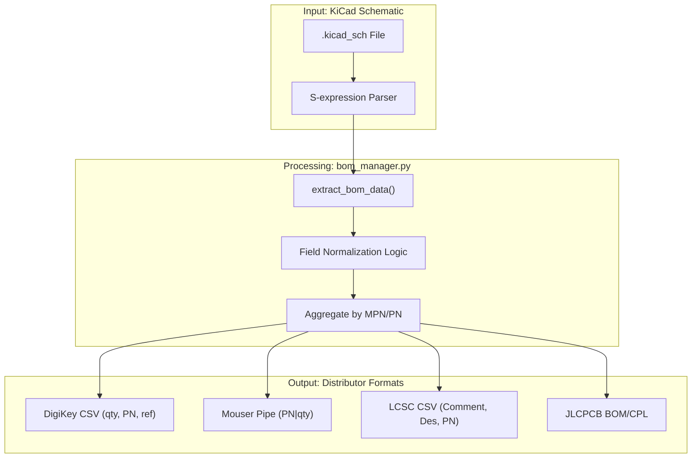
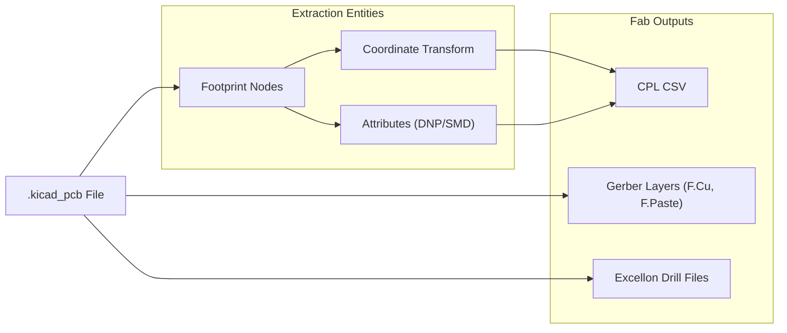

<!-- source: DeepWiki mcp.deepwiki.com · repo aklofas/kicad-happy · page 4.2 KiCad Fields, Part Numbers, and Ordering · fetched 2026-10-26 -->

# KiCad Fields, Part Numbers, and Ordering

Relevant source files

The following files were used as context for generating this wiki page:

- [skills/bom/references/kicad-fields.md](skills/bom/references/kicad-fields.md)
- [skills/bom/references/ordering-and-fabrication.md](skills/bom/references/ordering-and-fabrication.md)
- [skills/bom/references/part-number-conventions.md](skills/bom/references/part-number-conventions.md)

This page documents the conventions and automated workflows for managing component metadata within KiCad schematics. It covers how the `bom_manager.py` and `edit_properties.py` scripts interact with symbol fields to facilitate part sourcing, datasheet synchronization, and automated order generation across multiple distributors.

## KiCad Symbol Field Conventions

The `bom_manager.py` script treats the KiCad schematic as the single source of truth for component metadata. It extracts both standard KiCad fields and custom BOM-specific fields to build a unified part list.

### Standard and Custom Fields
While KiCad provides default fields like `Reference` and `Value`, the `kicad-happy` workflow relies on a set of canonical custom fields to drive the procurement pipeline.

| Field | Purpose | Requirement | Example |
| :--- | :--- | :--- | :--- |
| `MPN` | Manufacturer Part Number | **Universal Key** | `GRM155R71C104KA88D` |
| `Manufacturer` | Part manufacturer | Required | `Murata` |
| `DigiKey` | DigiKey Part Number | Prototype | `490-10698-1-ND` |
| `Mouser` | Mouser Part Number | Prototype | `81-GRM155R71C104KA8D` |
| `LCSC` | LCSC Part Number | Production | `C14663` |
| `BOM Comments` | Assembly/Ordering notes | Optional | `DNP in production` |
| `DNP` | Do Not Populate flag | Optional | `1` or `Yes` |

**Sources:** [skills/bom/references/kicad-fields.md:3-23]()

### Field Name Aliasing and Normalization
Real-world projects often use inconsistent naming conventions. The extraction logic in `bom_manager.py` utilizes an internal mapping to normalize these variants into canonical keys.

*   **MPN Aliases:** `Manufacturer Part Number`, `PartNumber`, `Mfr_No`, `MFPN`.
*   **LCSC Aliases:** `LCSC Part #`, `JLCPCB Part`, `JLC`, `LCSCStockCode`.
*   **DigiKey Aliases:** `Digi-Key_PN`, `DK`, `DigiKey Part Number`.
*   **Comments Aliases:** `Notes`, `Remarks`, `Ordering Notes`, `Assembly Notes`.

**Sources:** [skills/bom/references/kicad-fields.md:25-39]()

## Part Number Naming Patterns

Across a corpus of 56+ projects, several distinct metadata patterns have been identified. The system is designed to detect these patterns to determine how to "ground" a symbol to a real-world component.

### Pattern Classification
1.  **Level 1 (MPN Only):** Symbols contain an MPN but no distributor-specific info. The system uses the MPN to query APIs (DigiKey/Mouser) to find distributor PNs.
2.  **Pattern B (Supplier Slots):** Some projects use generic slots like `Supplier 1` and `Supplier 1 Part #`. The script maps these by reading the value of the `Supplier X` field.
3.  **Pattern E (LCSC/EasyEDA):** Common in JLCPCB-targeted designs. Contains fields like `Class` (Basic/Extended) and `LCSC` (e.g., `C14663`).
4.  **Pattern G (Description-as-MPN):** For commodity passives, the `Value` field often contains the actual MPN (e.g., `RC0805FR-071ML`) rather than a generic value (e.g., `100n`).

**Sources:** [skills/bom/references/part-number-conventions.md:18-155]()

### Identifier Recognition
The system uses regex and suffix patterns to identify distributor-specific PNs even when field names are ambiguous:
*   **DigiKey:** Typically ends in `-ND` (e.g., `311-10.0KCRCT-ND`).
*   **Mouser:** Often starts with a numeric manufacturer prefix (e.g., `81-`).
*   **LCSC:** Follows the `C[0-9]+` pattern (e.g., `C14663`).

**Sources:** [skills/bom/references/kicad-fields.md:58-66]()

## Ordering and Export Formats

The `bom_manager.py order` subcommand transforms the extracted schematic data into distributor-specific formats.

### Automated Order Generation Flow

#### Data Transformation Logic
The following diagram illustrates how schematic S-expressions are transformed into distributor-ready order files.

**Diagram: Schematic to Order File Pipeline**

**Sources:** [skills/bom/references/ordering-and-fabrication.md:3-78](), [skills/bom/references/kicad-fields.md:41-50]()

### Distributor-Specific Formats

| Distributor | Format String / Structure | Delimiter |
| :--- | :--- | :--- |
| **DigiKey** | `quantity, DigiKey_PN, customer_reference` | Comma/Tab |
| **Mouser** | `Mouser_PN\|quantity` | Pipe (`\|`) |
| **LCSC** | `Comment,Designator,Footprint,LCSC Part #` | Comma |
| **element14**| `Newark_OrderCode, quantity` | Comma/Tab |

**Sources:** [skills/bom/references/ordering-and-fabrication.md:7-78]()

## Fabrication and Assembly (JLCPCB/PCBWay)

For PCBA (PCB Assembly), the system generates two critical files: the **BOM** (Bill of Materials) and the **CPL** (Component Placement List).

### CPL Generation
The CPL is derived from the `.kicad_pcb` file, mapping designators to physical coordinates and rotations.

| Column | Description |
| :--- | :--- |
| `Designator` | Reference designator (e.g., `C1`) |
| `Mid X` / `Mid Y` | Component center in mm |
| `Rotation` | Angle in degrees |
| `Layer` | `Top` or `Bottom` |

**Sources:** [skills/bom/references/ordering-and-fabrication.md:97-108]()

### Manufacturing Data Flow
The relationship between the layout file and the fabrication output is managed by `analyze_pcb.py` and the `jlcpcb` skill.

**Diagram: Fabrication Output Mapping**

**Sources:** [skills/bom/references/ordering-and-fabrication.md:81-112]()

### Required Gerber Layers
To ensure successful fabrication and stencil creation, the following layers are typically exported:
*   **Copper:** `F.Cu`, `B.Cu`
*   **Solder Paste:** `F.Paste`, `B.Paste` (Used for stencil ordering)
*   **Silkscreen:** `F.SilkS`, `B.SilkS`
*   **Mask:** `F.Mask`, `B.Mask`
*   **Edge:** `Edge.Cuts` (Board outline)

**Sources:** [skills/bom/references/ordering-and-fabrication.md:83-95]()

---

