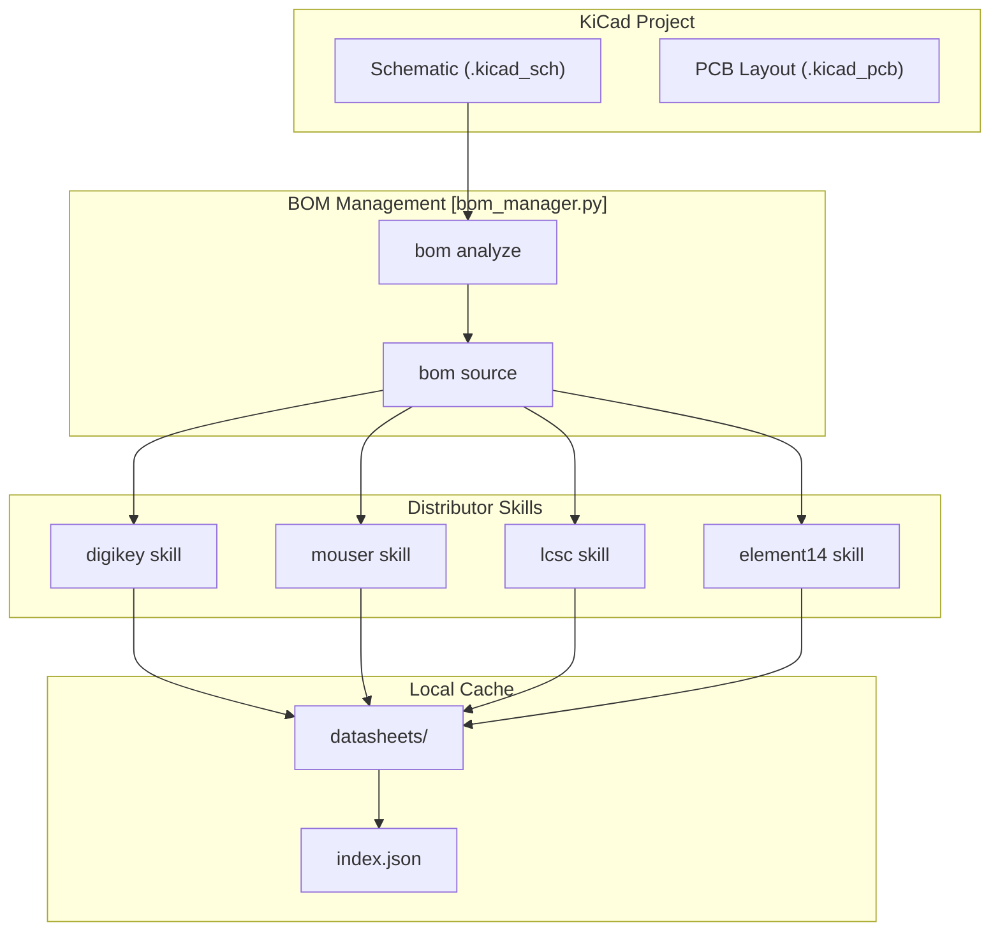
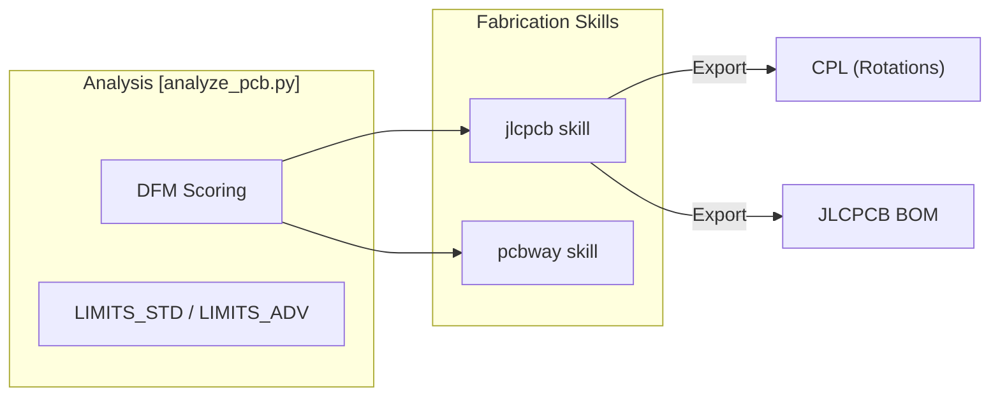

<!-- source: DeepWiki mcp.deepwiki.com · repo aklofas/kicad-happy · page 5 Component Sourcing and Datasheet Skills · fetched 2026-10-26 -->

# Component Sourcing and Datasheet Skills

Relevant source files

The following files were used as context for generating this wiki page:

- [README.md](README.md)

This section provides an overview of the skills used to bridge the gap between a KiCad design and the physical supply chain. These skills enable the AI agent to interact with component distributor APIs for real-time pricing and availability, manage a local datasheet repository, and validate designs against specific fabrication house capabilities.

## Overview of Sourcing Integration

The sourcing workflow integrates directly with the Bill of Materials (BOM) management system. While the `kicad` skill extracts design intent, the distributor skills (`digikey`, `mouser`, `lcsc`, `element14`) provide the external market data required to ground those designs in reality. The fabrication skills (`jlcpcb`, `pcbway`) then ensure the design can be manufactured within the constraints of specific vendors.

### Sourcing Architecture: From Schematic to API

**Sources:** [README.md:11-20](), [README.md:93-117]()

## Distributor API Skills

The distributor skills provide standardized interfaces for searching component databases and retrieving technical documentation. These skills handle the complexities of different authentication methods, from OAuth 2.0 flows to simple API keys.

### Key Capabilities
*   **Search and Identify:** Resolves generic part values (e.g., "10k 0603 1%") to specific Manufacturer Part Numbers (MPNs) based on stock availability.
*   **Datasheet Management:** Automated scripts (e.g., `sync_datasheets_*.py`) fetch PDFs and maintain a centralized `datasheets/` directory with a searchable `index.json` manifest.
*   **Pricing and Availability:** Provides real-time cost estimation and stock alerts to prevent "designing-in" obsolete or out-of-stock components.

| Skill | Primary Use Case | Auth Method |
| :--- | :--- | :--- |
| **DigiKey** | Prototyping & US Sourcing | OAuth 2.0 (`DIGIKEY_CLIENT_ID`) |
| **Mouser** | Prototyping & Global Sourcing | API Key (`MOUSER_SEARCH_API_KEY`) |
| **LCSC** | Production & JLCPCB Assembly | Community API (No Key Required) |
| **element14** | International (Newark/Farnell) | API Key (`ELEMENT14_API_KEY`) |

For implementation details and credential setup, see **[Distributor API Skills (DigiKey, Mouser, LCSC, element14)](#5.1)**.

**Sources:** [README.md:15-18](), [README.md:84-89]()

## Fabrication Skills

Fabrication skills focus on the "back-end" of the design process: converting the KiCad layout into a manufacturable product. They provide vendor-specific knowledge that the generic KiCad DRC (Design Rule Check) might miss.

### Key Capabilities
*   **Format Conversion:** Generates Component Placement Lists (CPL) and BOM files in the specific CSV/Excel formats required by JLCPCB and PCBWay.
*   **DFM Validation:** Compares the design against specific fabrication tiers (Standard vs. Advanced). This includes checking minimum trace widths, annular rings, and drill sizes against the vendor's actual capabilities.
*   **Assembly Constraints:** Identifies "Basic" vs. "Extended" parts for JLCPCB to minimize loading fees and checks for component rotation issues in the CPL.

**Sources:** [README.md:19-20](), [README.md:95-117]()

For details on export formats and manufacturing limits, see **[Fabrication Skills (JLCPCB and PCBWay)](#5.2)**.

## Integration with BOM Workflow

The sourcing and fabrication skills are orchestrated by the `bom` skill. The workflow typically follows an 11-step lifecycle where the AI agent:
1.  Analyzes the schematic to identify required parts.
2.  Uses distributor skills to find MPNs and download datasheets.
3.  Updates the KiCad schematic fields with the found sourcing data.
4.  Uses fabrication skills to generate the final files for the factory.

**Sources:** [README.md:14](), [README.md:68-69]()

---

