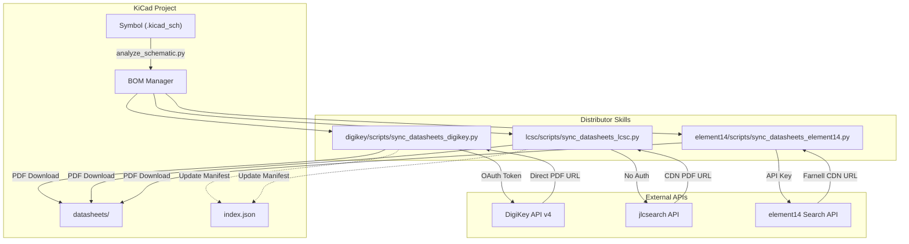
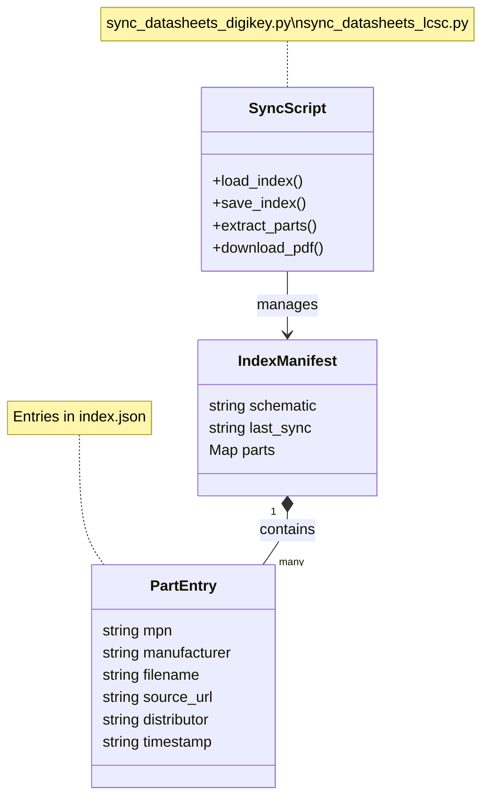

<!-- source: DeepWiki mcp.deepwiki.com · repo aklofas/kicad-happy · page 5.1 Distributor API Skills (DigiKey, Mouser, LCSC, element14) · fetched 2026-10-26 -->

# Distributor API Skills (DigiKey, Mouser, LCSC, element14)

Relevant source files

The following files were used as context for generating this wiki page:

- [skills/digikey/SKILL.md](skills/digikey/SKILL.md)
- [skills/digikey/scripts/fetch_datasheet_digikey.py](skills/digikey/scripts/fetch_datasheet_digikey.py)
- [skills/digikey/scripts/sync_datasheets_digikey.py](skills/digikey/scripts/sync_datasheets_digikey.py)
- [skills/element14/SKILL.md](skills/element14/SKILL.md)
- [skills/element14/scripts/fetch_datasheet_element14.py](skills/element14/scripts/fetch_datasheet_element14.py)
- [skills/lcsc/SKILL.md](skills/lcsc/SKILL.md)
- [skills/lcsc/scripts/sync_datasheets_lcsc.py](skills/lcsc/scripts/sync_datasheets_lcsc.py)
- [skills/mouser/SKILL.md](skills/mouser/SKILL.md)

This page documents the distributor API integrations used for component sourcing, pricing analysis, and automated datasheet management. These skills allow the system to ground generic schematic components in real-world part data, maintaining a local repository of datasheets synchronized with the KiCad project.

## Distributor Selection Logic

The system categorizes distributors based on their role in the hardware development lifecycle.

| Distributor | Role | Primary Strength | API Auth |
| :--- | :--- | :--- | :--- |
| **DigiKey** | Primary Prototyping | Direct PDF links, best US stock | OAuth 2.0 (Client Credentials) |
| **Mouser** | Secondary Prototyping | High-end/Specialized ICs | API Key (UUID) |
| **LCSC** | Production | Low cost, JLCPCB integration | None (Community API) |
| **element14** | Global / EU / APAC | Newark/Farnell/element14 unified | API Key (Simple) |

DigiKey is the preferred source for datasheets because its API returns direct PDF links, avoiding the bot protection and scraping challenges common with other distributors [skills/digikey/SKILL.md:3-8](). LCSC is the primary source for production-ready BOMs intended for JLCPCB assembly [skills/lcsc/SKILL.md:8-15]().

### Distributor Data Flow
The following diagram illustrates how component data moves from a KiCad schematic through distributor APIs to the local project environment.

**Component Sourcing Data Flow**

Sources: [skills/digikey/SKILL.md:3-8](), [skills/lcsc/SKILL.md:140-150](), [skills/element14/SKILL.md:174-180]().

---

## API Credential Setup

### DigiKey (OAuth 2.0)
DigiKey requires a 2-legged OAuth flow. Users must register an app at `developer.digikey.com` with the "Product Information v4" API and "Client Credentials" type [skills/digikey/SKILL.md:12-22]().
*   **Environment Variables**: `DIGIKEY_CLIENT_ID`, `DIGIKEY_CLIENT_SECRET` [skills/digikey/scripts/sync_datasheets_digikey.py:18-23]().
*   **Implementation**: `get_oauth_token()` fetches a token valid for 10 minutes, which is then cached locally to avoid redundant auth calls [skills/digikey/scripts/fetch_datasheet_digikey.py:69-130]().

### Mouser (Simple API Key)
Mouser uses a UUID-based API key passed as a query parameter.
*   **Environment Variable**: `MOUSER_SEARCH_API_KEY` [skills/mouser/SKILL.md:23-26]().
*   **Constraint**: Mouser frequently blocks automated PDF downloads via its `DataSheetUrl` field, requiring fallback strategies like scraping the product page or using alternative manufacturer sources [skills/mouser/SKILL.md:166-173]().

### LCSC (Community API)
LCSC integration uses the `jlcsearch` community API, which requires no authentication [skills/lcsc/SKILL.md:27-32]().
*   **Base URL**: `https://jlcsearch.tscircuit.com` [skills/lcsc/SKILL.md:31]().
*   **Data Source**: Returns `Cxxxxx` part numbers and direct PDF links to LCSC's CDN (`wmsc.lcsc.com`) [skills/lcsc/SKILL.md:97-105]().

### element14 (Simple API Key)
Covers Newark (US), Farnell (EU), and element14 (APAC) through a single interface.
*   **Environment Variable**: `ELEMENT14_API_KEY` [skills/element14/SKILL.md:40-43]().
*   **Auth**: API key is passed in the `callInfo.apiKey` query parameter [skills/element14/SKILL.md:53]().

---

## Datasheet Sync Workflow

Each distributor skill provides a `sync_datasheets_*.py` script that manages a project's local datasheet library.

### The Sync Process
1.  **Extraction**: The script runs `analyze_schematic.py` (or loads a pre-computed JSON) to extract Manufacturer Part Numbers (MPNs) and distributor-specific codes (e.g., LCSC `Cxxxxx`) [skills/lcsc/scripts/sync_datasheets_lcsc.py:147-181]().
2.  **Filtering**: Generic values (e.g., "10k", "0.1uF") and non-component items (test points, mounting holes) are filtered out using `is_real_mpn()` [skills/digikey/scripts/sync_datasheets_digikey.py:48-77]().
3.  **Search**: The script queries the distributor API. For LCSC, it prefers the `Cxxxxx` code for an exact match before falling back to MPN [skills/lcsc/SKILL.md:140-148]().
4.  **Download**: PDFs are downloaded using a multi-strategy approach: `requests` -> `urllib` -> `playwright` (for JS-heavy sites) [skills/digikey/scripts/fetch_datasheet_digikey.py:197-205]().
5.  **Verification**: The script verifies the downloaded file is a valid PDF by checking the `%PDF` header [skills/element14/scripts/fetch_datasheet_element14.py:210-215]().

### Manifest and Directory Structure
All scripts maintain a shared `index.json` manifest within the `datasheets/` directory. This allows different distributor skills to contribute to the same library without duplication.

**Datasheet Sync Entity Mapping**

Sources: [skills/lcsc/scripts/sync_datasheets_lcsc.py:123-141](), [skills/digikey/scripts/sync_datasheets_digikey.py:200-220]().

### File Naming Convention
To ensure human-readability, files are named using the `friendly_filename()` function, which combines the MPN with a sanitized version of the component description (e.g., `TPS61023DRLR_Boost_Converter.pdf`) [skills/digikey/scripts/sync_datasheets_digikey.py:174-183]().

---

## Search Interfaces

### Keyword Search (DigiKey v4)
The `KeywordSearch` endpoint is the primary method for finding parts.
*   **Endpoint**: `POST /products/v4/search/keyword` [skills/digikey/SKILL.md:69]().
*   **Key Filters**: `InStock`, `HasDatasheet`, `RoHSCompliant` [skills/digikey/SKILL.md:82]().

### LCSC jlcsearch API
LCSC search is highly optimized for the `Cxxxxx` part numbers shared with JLCPCB.
*   **Query**: `GET /api/search?q=<query>&full=true` [skills/lcsc/SKILL.md:36]().
*   **Special Fields**: Returns `basic` (1 or 0) to indicate if the part is a JLCPCB "Basic" part, which incurs no feeder loading fee [skills/lcsc/SKILL.md:106]().

### element14 Multi-Store Search
The element14 API automatically routes searches based on the `storeInfo.id` parameter (e.g., `www.newark.com` for US vs `uk.farnell.com` for UK) [skills/element14/SKILL.md:149-157]().

---

## Summary of Key Scripts

| Script | Purpose |
| :--- | :--- |
| `sync_datasheets_digikey.py` | Full project sync using DigiKey API [skills/digikey/scripts/sync_datasheets_digikey.py:2-10]() |
| `fetch_datasheet_digikey.py` | Single-part download with manufacturer-specific redirect handling (e.g., TI, Microchip) [skills/digikey/scripts/fetch_datasheet_digikey.py:170-194]() |
| `sync_datasheets_lcsc.py` | Full project sync using free jlcsearch API [skills/lcsc/scripts/sync_datasheets_lcsc.py:2-10]() |
| `fetch_datasheet_lcsc.py` | Single-part download from LCSC CDN with `playwright` fallback [skills/lcsc/SKILL.md:153-170]() |

Sources: [skills/digikey/scripts/sync_datasheets_digikey.py](), [skills/digikey/scripts/fetch_datasheet_digikey.py](), [skills/lcsc/scripts/sync_datasheets_lcsc.py](), [skills/element14/scripts/fetch_datasheet_element14.py]().

---

