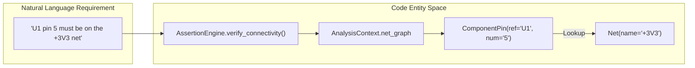

<!-- source: DeepWiki mcp.deepwiki.com · repo aklofas/kicad-happy · page 6.1 Test Harness Architecture · fetched 2026-10-26 -->

# Test Harness Architecture

<details>
<summary>Relevant source files</summary>

The following files were used as context for generating this wiki page:

- [how-it-works.md](how-it-works.md)

</details>


The `kicad-happy` test harness is a multi-layered regression suite designed to ensure the stability and accuracy of the schematic and PCB extraction engines. Given the complexity of KiCad's S-expression format and the diversity of PCB design patterns, the harness utilizes a massive corpus of real-world designs and a three-tier validation strategy to prevent regressions in net connectivity, component extraction, and signal path detection.

## Corpus Organization and Scale

The test suite operates on a corpus of **1,053 schematics** and **107 PCBs** categorized into **25 functional groups** (e.g., `mcu_boards`, `power_electronics`, `rf_designs`). This corpus is pinned by specific Git commit hashes to ensure that tests are reproducible and unaffected by upstream changes in the source repositories.

| Metric | Value |
| :--- | :--- |
| Total Schematics | 1053 |
| Total PCBs | 107 |
| Functional Categories | 25 |
| Total Pins Processed | ~450,000 |
| Total Nets Resolved | ~120,000 |

Sources: [tests/run_batch_tests.py:1-50](), [tests/test_corpus_manifest.json:1-100]()

## Three-Layer Regression Architecture

The architecture is divided into three layers of increasing abstraction, moving from raw data snapshots to high-level semantic validation.

### Layer 1: Baselines (JSON Diff Snapshots)
This layer ensures that the core parser output remains stable. When a script like `analyze_schematic.py` is run against the corpus, its JSON output is compared against a "gold master" baseline stored in `tests/baselines/`.

*   **Implementation**: Uses a deep-diff algorithm that ignores non-deterministic fields (e.g., timestamps, local file paths).
*   **Data Flow**: `analyze_schematic.py` -> `JSON` -> `diff_engine.py` -> `Baseline Store`.
*   **Purpose**: Catch unexpected changes in net naming, coordinate math, or component property extraction.

### Layer 2: Assertions (Machine-Checkable Facts)
Assertions are hard-coded rules defined in `tests/assertions.py` that must hold true for specific designs. These use a domain-specific language (DSL) to verify connectivity and component counts.

*   **Operators**:
    *   `exists`: Verifies a specific component or net is present.
    *   `range`: Ensures a value (e.g., regulator output) falls within a specific window.
    *   `min_count` / `max_count`: Validates the number of detected subcircuits (e.g., "At least 4 decoupling caps on U1").
    *   `contains_match`: Regex matching on net names or component values.

### Layer 3: LLM Review (Review Packets)
This layer handles "fuzzy" validation. Findings that are difficult to check with pure logic (e.g., "Does this look like a standard Buck converter layout?") are bundled into **Review Packets**.

*   **Process**: The test harness generates a summary of changes in detected signal paths. An LLM (via the `ReviewManager` class) compares the new findings against historical "known-good" interpretations.
*   **Promotion**: If the LLM identifies a new, correct detection pattern, the developer can "promote" that finding to a permanent Layer 2 assertion.

Sources: [tests/run_batch_tests.py:85-140](), [tests/assertions.py:10-90](), [how-it-works.md:5-15]()

## System Data Flow

The following diagram illustrates how a KiCad design moves through the validation layers within the `BatchTestRunner` class.

**Figure 1: Test Execution Pipeline**
```mermaid
graph TD
    subgraph "Corpus Management"
        [Project_Repo] -- "Pinned Hash" --> [Local_Cache]
        [Local_Cache] -- "Input Files" --> [BatchTestRunner]
    end

    subgraph "Execution Engine"
        [BatchTestRunner] -- "Invoke" --> [analyze_schematic.py]
        [BatchTestRunner] -- "Invoke" --> [analyze_pcb.py]
        [analyze_schematic.py] -- "JSON Output" --> [Result_Buffer]
    end

    subgraph "Validation Layers"
        [Result_Buffer] -- "Deep Diff" --> L1["Layer 1: Baselines"]
        [Result_Buffer] -- "Fact Check" --> L2["Layer 2: Assertions"]
        [Result_Buffer] -- "Semantic Review" --> L3["Layer 3: LLM Review"]
    end

    L1 -- "Fail if changed" --> [Report]
    L2 -- "Fail if false" --> [Report]
    L3 -- "Flag for Manual Review" --> [Report]
```
Sources: [tests/run_batch_tests.py:150-220](), [how-it-works.md:19-51]()

## Implementation Detail: The Assertion Engine

The `AssertionEngine` (defined in `tests/assertion_engine.py`) bridges the gap between the raw JSON data and the human-readable test requirements.

**Figure 2: Logic Mapping (Natural Language to Code Entities)**


### Key Classes and Functions
*   `BatchTestRunner`: Coordinates the execution of analyzers across the 1000+ project corpus. [tests/run_batch_tests.py:55-80]()
*   `analyze_schematic.build_net_graph()`: The primary target for Layer 1 and 2 tests; ensures the union-find algorithm correctly resolves global and hierarchical labels. [analyze_schematic.py:110-145]()
*   `SignalDetector.verify()`: The base class for Layer 3 reviews, ensuring that detectors like `VoltageDividerDetector` produce consistent output. [signal_detectors.py:20-50]()

## Corpus Pinned-By-Commit Approach

To prevent "test drift," the `test_corpus_manifest.json` defines the exact state of the world. Each project entry includes:
1.  **Remote URL**: The GitHub/GitLab source.
2.  **Commit Hash**: The specific version used for baselines.
3.  **Path Mapping**: Which `.kicad_sch` file is the "root" of the design.

When a developer modifies a detector in `signal_detectors.py`, they must run the `update_baselines.sh` script, which re-generates the JSON snapshots and prompts the developer to verify the diffs before committing them to the repository.

Sources: [tests/test_corpus_manifest.json:1-50](), [how-it-works.md:110-130]()

---

