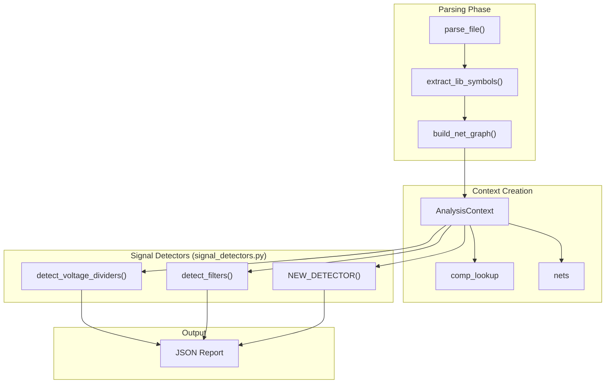
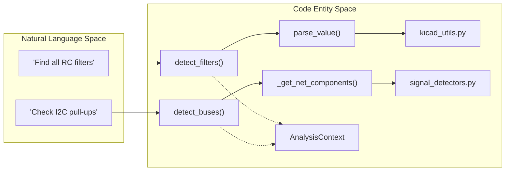

<!-- source: DeepWiki mcp.deepwiki.com · repo aklofas/kicad-happy · page 6.2 Adding New Detection Features · fetched 2026-10-26 -->

# Adding New Detection Features

<details>
<summary>Relevant source files</summary>

The following files were used as context for generating this wiki page:

- [skills/kicad/scripts/README.md](skills/kicad/scripts/README.md)
- [skills/kicad/scripts/analyze_schematic.py](skills/kicad/scripts/analyze_schematic.py)
- [skills/kicad/scripts/sexp_parser.py](skills/kicad/scripts/sexp_parser.py)
- [skills/kicad/scripts/signal_detectors.py](skills/kicad/scripts/signal_detectors.py)

</details>


This guide provides a developer-oriented walkthrough for extending the detection capabilities of the KiCad Schematic Analyzer. Detection features in `kicad-happy` are designed to be deterministic, leveraging the net graph and component properties to identify subcircuits (like voltage dividers, filters, or communication buses) before passing structured facts to the AI layer.

## Detection Philosophy: Net-Graph-First

The primary mechanism for detection is the traversal of the net graph constructed during the parsing phase. Unlike simple keyword matching, the net-graph-first approach identifies circuits based on their topology.

1.  **Topology Extraction**: The analyzer builds a global map of connectivity using a union-find algorithm during the `build_net_graph` phase [skills/kicad/scripts/analyze_schematic.py:214-230]().
2.  **Context Injection**: A shared `AnalysisContext` object is populated with component lookups, parsed values, and net definitions [skills/kicad/scripts/kicad_types.py:1-60]().
3.  **Detector Execution**: Specific functions in `signal_detectors.py` iterate through components or nets to find patterns [skills/kicad/scripts/signal_detectors.py:108-110]().

### Key Utility: `get_two_pin_nets()`
Most analog subcircuits (resistors, capacitors, diodes) are two-pin devices. The `get_two_pin_nets` helper is the workhorse for finding series or parallel connections [skills/kicad/scripts/analyze_schematic.py:36-51]().

## Implementing a New Detector

To add a new detector, follow this pattern in `skills/kicad/scripts/signal_detectors.py`:

### 1. Filtering High-Fanout Nets
To avoid $O(n^2)$ complexity and false positives, detectors must filter out "Global" or "Power" nets when looking for signal paths. A common pitfall is treating a $VCC$ rail as a signal node in a voltage divider.

```python
# Example: Identifying a signal mid-point
# Reject if mid-point is a power rail with many connections
if ctx.is_power_net(mid_net) or ctx.is_ground(mid_net):
    mid_pin_count = len(ctx.nets.get(mid_net, {}).get("pins", []))
    if mid_pin_count > 4: # Typical signal mid-points have low fanout
        continue
```
[skills/kicad/scripts/signal_detectors.py:162-168]()

### 2. Keyword Matching Pitfalls
While topology is preferred, keywords are used for "hints" (e.g., net names like `USB_D+`). Always use the normalized helpers to avoid case-sensitivity issues or distributor-specific naming variations [skills/kicad/scripts/analyze_schematic.py:58-87]().

### 3. Data Flow Diagram
The following diagram illustrates how a new detector integrates into the `analyze_schematic.py` pipeline.

**Detection Integration Flow**

**Sources:** [skills/kicad/scripts/analyze_schematic.py:101-110](), [skills/kicad/scripts/signal_detectors.py:1-6](), [skills/kicad/scripts/kicad_types.py:1-12]()

## Calibrating Sensitivity

Detection logic must be calibrated against the `kicad-happy` batch suite to ensure it handles the variety of styles found in the 1,000+ project corpus.

*   **False Positive Prevention**: Use `_classify_load()` to determine if a net is driving an inductive load, LED, or IC input [skills/kicad/scripts/signal_detectors.py:48-80]().
*   **Value Parsing**: Use `parse_value()` to handle strings like "10k", "0.1uF", or "4M7" before performing math for RC time constants or divider ratios [skills/kicad/scripts/analyze_schematic.py:36-51]().

## Development Cycle: Change to Baseline

When a new detection feature is added, it must be validated using the three-layer regression system.

| Step | Action | Tool/Function |
| :--- | :--- | :--- |
| **1. Implementation** | Add detector logic | `signal_detectors.py` |
| **2. Integration** | Call detector in main loop | `analyze_schematic.py` |
| **3. Layer 1 Test** | Run analyzer on corpus | `pytest` / Batch Suite |
| **4. Diff Review** | Compare new JSON vs Baselines | `git diff` |
| **5. Promotion** | Update baselines if correct | `scripts/update_baselines.sh` |

### System Mapping: Code to Logic
This diagram bridges the natural language concepts of "Detection" to the specific classes and functions in the codebase.

**Logic Mapping Diagram**

**Sources:** [skills/kicad/scripts/signal_detectors.py:28-45](), [skills/kicad/scripts/kicad_utils.py:1-20](), [skills/kicad/scripts/analyze_schematic.py:1-25]()

## Common Patterns for New Features

### Detecting Multi-Component Chains
If you are detecting a chain (e.g., an RF Pi-network), do not just look at one component. Use the `ctx.nets` dictionary to find the "other side" of a component and recursively follow the path until you hit a termination (Ground, Power, or an IC Pin).

### Handling Multi-Unit Symbols
When detecting power pins on large ICs (like FPGAs or MCUs), remember that KiCad often splits these into multiple "units" (e.g., `U1A`, `U1B`). The `extract_lib_symbols` function correctly groups these so your detector sees the component as a single entity with all pins available [skills/kicad/scripts/analyze_schematic.py:101-140]().

**Sources:**
- [skills/kicad/scripts/analyze_schematic.py:1-160]()
- [skills/kicad/scripts/signal_detectors.py:1-120]()
- [skills/kicad/scripts/kicad_types.py:1-60]()
- [skills/kicad/scripts/kicad_utils.py:1-51]()

---

