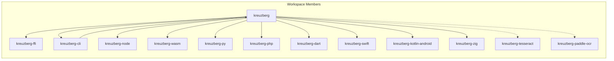

<!-- source: DeepWiki mcp.deepwiki.com · repo kreuzberg-dev/kreuzberg · page 1.1 System Architecture · fetched 2026-10-26 -->

# System Architecture

<details>
<summary>Relevant source files</summary>

The following files were used as context for generating this wiki page:

- [alef.toml](alef.toml)
- [crates/kreuzberg-ffi/Cargo.toml](crates/kreuzberg-ffi/Cargo.toml)
- [crates/kreuzberg-ffi/include/kreuzberg.h](crates/kreuzberg-ffi/include/kreuzberg.h)
- [crates/kreuzberg-ffi/src/lib.rs](crates/kreuzberg-ffi/src/lib.rs)
- [crates/kreuzberg-node/Cargo.toml](crates/kreuzberg-node/Cargo.toml)
- [crates/kreuzberg-node/index.d.ts](crates/kreuzberg-node/index.d.ts)
- [crates/kreuzberg-node/src/lib.rs](crates/kreuzberg-node/src/lib.rs)
- [crates/kreuzberg-php/src/lib.rs](crates/kreuzberg-php/src/lib.rs)
- [crates/kreuzberg-py/Cargo.toml](crates/kreuzberg-py/Cargo.toml)
- [crates/kreuzberg-py/src/lib.rs](crates/kreuzberg-py/src/lib.rs)
- [crates/kreuzberg-wasm/src/lib.rs](crates/kreuzberg-wasm/src/lib.rs)
- [docs/concepts/architecture.md](docs/concepts/architecture.md)
- [docs/concepts/extraction-pipeline.md](docs/concepts/extraction-pipeline.md)
- [docs/concepts/plugin-system.md](docs/concepts/plugin-system.md)
- [docs/ecosystem.md](docs/ecosystem.md)
- [docs/guides/image-captions.md](docs/guides/image-captions.md)
- [docs/guides/ner.md](docs/guides/ner.md)
- [docs/guides/page-classification.md](docs/guides/page-classification.md)
- [docs/guides/qr-codes.md](docs/guides/qr-codes.md)
- [docs/guides/redaction.md](docs/guides/redaction.md)
- [docs/guides/summarization.md](docs/guides/summarization.md)
- [docs/guides/translation.md](docs/guides/translation.md)
- [docs/llms.txt](docs/llms.txt)
- [e2e/rust/Cargo.toml](e2e/rust/Cargo.toml)
- [packages/elixir/native/kreuzberg_nif/src/lib.rs](packages/elixir/native/kreuzberg_nif/src/lib.rs)
- [packages/php/src/Kreuzberg.php](packages/php/src/Kreuzberg.php)
- [packages/php/stubs/kreuzberg_extension.php](packages/php/stubs/kreuzberg_extension.php)
- [packages/python/kreuzberg/__init__.py](packages/python/kreuzberg/__init__.py)
- [packages/python/kreuzberg/_kreuzberg.pyi](packages/python/kreuzberg/_kreuzberg.pyi)
- [packages/python/kreuzberg/api.py](packages/python/kreuzberg/api.py)
- [packages/python/kreuzberg/options.py](packages/python/kreuzberg/options.py)
- [packages/r/src/rust/src/lib.rs](packages/r/src/rust/src/lib.rs)
- [packages/ruby/ext/kreuzberg_rb/src/lib.rs](packages/ruby/ext/kreuzberg_rb/src/lib.rs)
- [packages/ruby/kreuzberg.gemspec](packages/ruby/kreuzberg.gemspec)
- [packages/swift/rust/src/lib.rs](packages/swift/rust/src/lib.rs)
- [packages/typescript/src/index.ts](packages/typescript/src/index.ts)
- [zensical.toml](zensical.toml)

</details>


## Purpose and Scope

This document describes the overall system architecture of Kreuzberg, focusing on how the Rust core library integrates with 12+ language bindings and deployment targets. It covers the workspace structure, binding strategies (direct Rust integration vs. FFI), feature flag system, and how native dependencies are managed across platforms.

For specific information about:
- Document processing pipeline internals, see [Document Processing Pipeline](#3.1)
- Individual language binding implementations, see [Language Bindings](#4)
- Build and CI/CD orchestration, see [CI/CD and Release Process](#8)
- Deployment modes and execution environments, see [Deployment](#7)

---

## High-Level Architecture

```mermaid
graph TB
    subgraph "Rust Workspace"
        Core["kreuzberg<br/>(main library)"]
        FFI["kreuzberg-ffi<br/>(C bindings)"]
        Tesseract["kreuzberg-tesseract<br/>(OCR engine)"]
        PaddleOCR["kreuzberg-paddle-ocr<br/>(ONNX-based OCR)"]
        CLI["kreuzberg-cli<br/>(binary)"]
        Node["kreuzberg-node<br/>(NAPI-RS)"]
        WASM["kreuzberg-wasm<br/>(wasm-bindgen)"]
        PyBindings["kreuzberg-py<br/>(PyO3)"]
        PHPBindings["kreuzberg-php<br/>(ext-ffi)"]
        DartBindings["kreuzberg-dart<br/>(flutter_rust_bridge)"]
        SwiftBindings["kreuzberg-swift<br/>(swift-bridge)"]
        KotlinAndroidBindings["kreuzberg-kotlin-android<br/>(JNI)"]
        ZigBindings["kreuzberg-zig<br/>(C-interop)"]
    end
    
    subgraph "Direct Rust Bindings"
        Python["Python<br/>via PyO3"]
        NodeJS["Node.js<br/>via NAPI-RS"]
        Ruby["Ruby<br/>Magnus/rb_sys"]
        Elixir["Elixir<br/>Rustler NIFs"]
        R["R<br/>extendr"]
        Dart["Dart/Flutter<br/>flutter_rust_bridge"]
        Swift["Swift<br/>swift-bridge"]
        KotlinAndroid["Kotlin (Android)<br/>JNI"]
    end
    
    subgraph "FFI-Based Bindings"
        Go["Go<br/>cgo"]
        Java["Java<br/>Panama FFM"]
        CSharp["C#<br/>P/Invoke"]
        PHP["PHP<br/>ext-ffi"]
        C["C<br/>Direct"]
        Zig["Zig<br/>C-interop"]
    end
    
    subgraph "Browser/Edge"
        Browser["Browser/Deno<br/>Cloudflare Workers"]
    end
    
    Core --> FFI
    Core --> CLI
    Core --> PyBindings
    Core --> Node
    Core --> WASM
    Core --> Tesseract
    Core --> PaddleOCR
    
    PyBindings --> Python
    Node --> NodeJS
    Ruby --> FFI
    Elixir --> FFI
    R --> FFI
    DartBindings --> Dart
    SwiftBindings --> Swift
    KotlinAndroidBindings --> KotlinAndroid
    
    FFI --> Go
    FFI --> Java
    FFI --> CSharp
    PHPBindings --> PHP
    FFI --> C
    ZigBindings --> Zig
    
    WASM --> Browser
```



**Sources:** [alef.toml:3-18]()

The architecture uses a **hub-and-spoke model** with the `kreuzberg` crate at the center. Two primary integration strategies enable polyglot support:

1. **Direct Rust Integration:** Python (PyO3), Node.js (NAPI-RS), Ruby (Magnus), Elixir (Rustler), R (extendr), Swift (swift-bridge), Dart (flutter_rust_bridge), and Kotlin (JNI) compile Rust code directly into native extensions or link via specific bridge generators.
2. **C FFI Layer:** Go, Java, C#, PHP, and Zig consume the `kreuzberg-ffi` C-compatible library via platform-specific FFI mechanisms.

---

## Cargo Workspace Structure



**Sources:** [alef.toml:1-19]()

The workspace is defined in the root `alef.toml` [alef.toml:1-19]() and contains:

| Crate | Type | Purpose |
|-------|------|---------|
| `kreuzberg` | Library | Core extraction engine with feature flags |
| `kreuzberg-ffi` | cdylib/staticlib | C-compatible bindings for FFI languages |
| `kreuzberg-tesseract` | Library | OCR engine with C++ build system |
| `kreuzberg-paddle-ocr` | Library | ONNX-based OCR |
| `kreuzberg-cli` | Binary | Command-line interface |
| `kreuzberg-node` | cdylib | NAPI-RS native module |
| `kreuzberg-wasm` | cdylib | WebAssembly bindings |
| `kreuzberg-py` | cdylib | PyO3 Python bindings |
| `kreuzberg-php` | cdylib | PHP FFI wrapper |
| `kreuzberg-dart` | cdylib | Dart FFI / flutter_rust_bridge support |
| `kreuzberg-swift` | cdylib | Swift bridge support |
| `kreuzberg-kotlin-android` | cdylib | Kotlin (Android) JNI support |
| `kreuzberg-zig` | cdylib | Zig C-interop support |

Workspace-level configurations are managed by `alef.toml`, including language-specific DTO styles [alef.toml:34-45]() and binding generation control [alef.toml:50-59]().

**Sources:** [alef.toml:1-19](), [alef.toml:34-45](), [alef.toml:50-59]()

---

## Feature Flag Architecture

The `kreuzberg` crate uses extensive feature flags for modular compilation:

```mermaid
graph TD
    subgraph "kreuzberg Crate Features"
        direction LR
        F_full["full"]
        F_pdf["pdf"]
        F_ocr["ocr"]
        F_paddle_ocr["paddle-ocr"]
        F_embeddings["embeddings"]
        F_chunking["chunking"]
        F_keywords_yake["keywords-yake"]
        F_keywords_rake["keywords-rake"]
        F_language_detection["language-detection"]
        F_html["html"]
        F_tree_sitter["tree-sitter"]
        F_office["office"]
        F_email["email"]
        F_archives["archives"]
        F_stopwords["stopwords"]
        F_auto_rotate["auto-rotate"]
        F_tokio_runtime["tokio-runtime"]
        F_api["api"]
        F_mcp["mcp"]
        F_liter_llm["liter-llm"]
        F_quality["quality"]
        F_layout_detection["layout-detection"]
        F_paddle_ocr_types["paddle-ocr-types"]
        F_layout_types["layout-types"]
        F_embedding_presets["embedding-presets"]
        F_auto_rotate_types["auto-rotate-types"]
        F_android_target["android-target"]
    end

    subgraph "Binding Crate Dependencies"
        Py_kreuzberg["kreuzberg-py<br/>(Cargo.toml)"]
        Node_kreuzberg["kreuzberg-node<br/>(Cargo.toml)"]
        FFI_kreuzberg["kreuzberg-ffi<br/>(Cargo.toml)"]
        Rust_e2e_kreuzberg["kreuzberg-e2e-rust<br/>(Cargo.toml)"]
    end

    Py_kreuzberg --> F_full
    Py_kreuzberg --> F_pdf
    Py_kreuzberg --> F_ocr
    Py_kreuzberg --> F_paddle_ocr
    Py_kreuzberg --> F_paddle_ocr_types
    Py_kreuzberg --> F_layout_detection
    Py_kreuzberg --> F_layout_types
    Py_kreuzberg --> F_embeddings
    Py_kreuzberg --> F_embedding_presets
    Py_kreuzberg --> F_chunking
    Py_kreuzberg --> F_keywords_yake
    Py_kreuzberg --> F_keywords_rake
    Py_kreuzberg --> F_language_detection
    Py_kreuzberg --> F_html
    Py_kreuzberg --> F_tree_sitter
    Py_kreuzberg --> F_office
    Py_kreuzberg --> F_email
    Py_kreuzberg --> F_archives
    Py_kreuzberg --> F_stopwords
    Py_kreuzberg --> F_auto_rotate
    Py_kreuzberg --> F_auto_rotate_types
    Py_kreuzberg --> F_tokio_runtime
    Py_kreuzberg --> F_api
    Py_kreuzberg --> F_mcp
    Py_kreuzberg --> F_liter_llm
    Py_kreuzberg --> F_quality

    Node_kreuzberg --> F_full
    Node_kreuzberg --> F_pdf
    Node_kreuzberg --> F_ocr
    Node_kreuzberg --> F_paddle_ocr
    Node_kreuzberg --> F_paddle_ocr_types
    Node_kreuzberg --> F_layout_detection
    Node_kreuzberg --> F_layout_types
    Node_kreuzberg --> F_embeddings
    Node_kreuzberg --> F_embedding_presets
    Node_kreuzberg --> F_chunking
    Node_kreuzberg --> F_keywords_yake
    Node_kreuzberg --> F_keywords_rake
    Node_kreuzberg --> F_language_detection
    Node_kreuzberg --> F_html
    Node_kreuzberg --> F_tree_sitter
    Node_kreuzberg --> F_office
    Node_kreuzberg --> F_email
    Node_kreuzberg --> F_archives
    Node_kreuzberg --> F_stopwords
    Node_kreuzberg --> F_auto_rotate
    Node_kreuzberg --> F_auto_rotate_types
    Node_kreuzberg --> F_tokio_runtime
    Node_kreuzberg --> F_api
    Node_kreuzberg --> F_mcp
    Node_kreuzberg --> F_liter_llm
    Node_kreuzberg --> F_quality

    FFI_kreuzberg --> F_full
    FFI_kreuzberg --> F_pdf
    FFI_kreuzberg --> F_ocr
    FFI_kreuzberg --> F_paddle_ocr
    FFI_kreuzberg --> F_paddle_ocr_types
    FFI_kreuzberg --> F_layout_detection
    FFI_kreuzberg --> F_layout_types
    FFI_kreuzberg --> F_embeddings
    FFI_kreuzberg --> F_embedding_presets
    FFI_kreuzberg --> F_chunking
    FFI_kreuzberg --> F_keywords_yake
    FFI_kreuzberg --> F_keywords_rake
    FFI_kreuzberg --> F_language_detection
    FFI_kreuzberg --> F_html
    FFI_kreuzberg --> F_tree_sitter
    FFI_kreuzberg --> F_office
    FFI_kreuzberg --> F_email
    FFI_kreuzberg --> F_archives
    FFI_kreuzberg --> F_stopwords
    FFI_kreuzberg --> F_auto_rotate
    FFI_kreuzberg --> F_auto_rotate_types
    FFI_kreuzberg --> F_tokio_runtime
    FFI_kreuzberg --> F_api
    FFI_kreuzberg --> F_mcp
    FFI_kreuzberg --> F_liter_llm
    FFI_kreuzberg --> F_quality
    FFI_kreuzberg -- "target.'cfg(all(target_os = \"android\", target_arch = \"x86_64\"))'.dependencies" --> F_android_target
    FFI_kreuzberg -- "target.'cfg(target_os = \"windows\")'.dependencies" --> F_pdf
    FFI_kreuzberg -- "target.'cfg(target_os = \"windows\")'.dependencies" --> F_ocr
    FFI_kreuzberg -- "target.'cfg(target_os = \"windows\")'.dependencies" --> F_chunking
    FFI_kreuzberg -- "target.'cfg(target_os = \"windows\")'.dependencies" --> F_keywords_yake
    FFI_kreuzberg -- "target.'cfg(target_os = \"windows\")'.dependencies" --> F_keywords_rake
    FFI_kreuzberg -- "target.'cfg(target_os = \"windows\")'.dependencies" --> F_language_detection
    FFI_kreuzberg -- "target.'cfg(target_os = \"windows\")'.dependencies" --> F_html
    FFI_kreuzberg -- "target.'cfg(target_os = \"windows\")'.dependencies" --> F_tree_sitter
    FFI_kreuzberg -- "target.'cfg(target_os = \"windows\")'.dependencies" --> F_office
    FFI_kreuzberg -- "target.'cfg(target_os = \"windows\")'.dependencies" --> F_email
    FFI_kreuzberg -- "target.'cfg(target_os = \"windows\")'.dependencies" --> F_archives
    FFI_kreuzberg -- "target.'cfg(target_os = \"windows\")'.dependencies" --> F_stopwords
    FFI_kreuzberg -- "target.'cfg(target_os = \"windows\")'.dependencies" --> F_auto_rotate
    FFI_kreuzberg -- "target.'cfg(target_os = \"windows\")'.dependencies" --> F_auto_rotate_types
    FFI_kreuzberg -- "target.'cfg(target_os = \"windows\")'.dependencies" --> F_tokio_runtime
    FFI_kreuzberg -- "target.'cfg(target_os = \"windows\")'.dependencies" --> F_api
    FFI_kreuzberg -- "target.'cfg(target_os = \"windows\")'.dependencies" --> F_mcp
    FFI_kreuzberg -- "target.'cfg(target_os = \"windows\")'.dependencies" --> F_quality

    Rust_e2e_kreuzberg --> F_full
    Rust_e2e_kreuzberg --> F_pdf
    Rust_e2e_kreuzberg --> F_ocr
    Rust_e2e_kreuzberg --> F_paddle_ocr
    Rust_e2e_kreuzberg --> F_paddle_ocr_types
    Rust_e2e_kreuzberg --> F_layout_detection
    Rust_e2e_kreuzberg --> F_layout_types
    Rust_e2e_kreuzberg --> F_embeddings
    Rust_e2e_kreuzberg --> F_embedding_presets
    Rust_e2e_kreuzberg --> F_chunking
    Rust_e2e_kreuzberg --> F_keywords_yake
    Rust_e2e_kreuzberg --> F_keywords_rake
    Rust_e2e_kreuzberg --> F_language_detection
    Rust_e2e_kreuzberg --> F_html
    Rust_e2e_kreuzberg --> F_tree_sitter
    Rust_e2e_kreuzberg --> F_office
    Rust_e2e_kreuzberg --> F_email
    Rust_e2e_kreuzberg --> F_archives
    Rust_e2e_kreuzberg --> F_stopwords
    Rust_e2e_kreuzberg --> F_auto_rotate
    Rust_e2e_kreuzberg --> F_auto_rotate_types
    Rust_e2e_kreuzberg --> F_tokio_runtime
    Rust_e2e_kreuzberg --> F_api
    Rust_e2e_kreuzberg --> F_mcp
    Rust_e2e_kreuzberg --> F_liter_llm
    Rust_e2e_kreuzberg --> F_quality
```

**Sources:** [alef.toml:168-195](), [crates/kreuzberg-py/Cargo.toml:29-30](), [crates/kreuzberg-node/Cargo.toml:24](), [crates/kreuzberg-ffi/Cargo.toml:37-43](), [e2e/rust/Cargo.toml:16]()

### Key Feature Categories

**Format Extractors**:
- `pdf`: Enables `pdf_oxide` and `lopdf` based extraction.
- `office`: Word/PowerPoint/Excel via `roxmltree`, `zip`, `quick-xml`, `calamine`.
- `email`: Email parsing.
- `html`: HTML parsing.
- `archives`: ZIP/TAR/7z support.
- `tree-sitter`: Code intelligence for 300+ languages.

**OCR & AI**:
- `ocr`: Full Tesseract with image preprocessing.
- `paddle-ocr`: ONNX Runtime-based OCR.
- `layout-detection`: YOLO/RT-DETR based layout analysis via ONNX Runtime.
- `auto-rotate`: PP-LCNet based orientation detection.
- `embeddings`: Full embedding generation via ONNX Runtime.
- `liter-llm`: LLM integration for various tasks.

**Text Processing**:
- `chunking`: Document chunking strategies.
- `keywords-yake`, `keywords-rake`: Keyword extraction algorithms.
- `language-detection`: Language identification.
- `quality`: Quality scoring for extracted content.

**Deployment Targets**:
- `wasm-target`: Preset for WebAssembly (excludes ORT/native C++ deps).
- `android-target`: Preset for Android (excludes ORT-dependent features).

**Sources:** [alef.toml:168-195]()

---

## Language Binding Strategies

### Direct Rust Integration

#### PyO3 (Python)

```mermaid
graph TD
    PythonApp["Python Application"]
    PyPackage["kreuzberg<br/>(Python package)"]
    PyCrate["kreuzberg-py<br/>(Rust crate)"]
    CoreLib["kreuzberg<br/>(core library)"]
    
    PythonApp -->|imports| PyPackage
    PyPackage -->|calls Python API<br/>(e.g., `extract_file`)| PyCrate
    PyCrate -->|Rust FFI calls| CoreLib
    
    subgraph "Python Binding Details"
        PyCrate_lib_rs["crates/kreuzberg-py/src/lib.rs"]
        PyPackage_init_py["packages/python/kreuzberg/__init__.py"]
        PyPackage_api_py["packages/python/kreuzberg/api.py"]
        PyPackage_options_py["packages/python/kreuzberg/options.py"]
        PyPackage_pyi["packages/python/kreuzberg/_kreuzberg.pyi"]
    end

    PyCrate_lib_rs -- "defines PyO3 modules" --> PyPackage
    PyPackage_init_py -- "re-exports symbols" --> PythonApp
    PyPackage_api_py -- "Python wrappers" --> PyPackage
    PyPackage_options_py -- "Python DTOs" --> PyPackage
    PyPackage_pyi -- "type hints" --> PyPackage

    PyCrate -- "uses `pyo3`" --> PyCrate_lib_rs
    PyCrate_lib_rs -- "calls `kreuzberg` functions" --> CoreLib
```

**Implementation:** The Python bindings are built using `PyO3` [crates/kreuzberg-py/Cargo.toml:30](). The `alef` tool generates the Rust code for the Python module [crates/kreuzberg-py/src/lib.rs:1-3]() and Python stubs [packages/python/kreuzberg/__init__.py:1-8](), [packages/python/kreuzberg/_kreuzberg.pyi](). `maturin` is used for the build system [pyproject.toml:1-3](). Asynchronous operations are handled via `pyo3-async-runtimes` [crates/kreuzberg-py/Cargo.toml:31]().

**Sources:** [crates/kreuzberg-py/src/lib.rs:1-3](), [packages/python/kreuzberg/__init__.py:1-8](), [packages/python/kreuzberg/_kreuzberg.pyi](), [pyproject.toml:1-3](), [crates/kreuzberg-py/Cargo.toml:30-31]()

#### NAPI-RS (Node.js)

```mermaid
graph TD
    NodeJSApp["Node.js Application"]
    NPM["@kreuzberg/node<br/>(npm package)"]
    NodeCrate["kreuzberg-node<br/>(Rust crate)"]
    CoreLib["kreuzberg<br/>(core library)"]
    
    NodeJSApp -->|imports| NPM
    NPM -->|calls Node.js API<br/>(e.g., `extractFile`)| NodeCrate
    NodeCrate -->|Rust FFI calls| CoreLib
    
    subgraph "Node.js Binding Details"
        NodeCrate_lib_rs["crates/kreuzberg-node/src/lib.rs"]
        NPM_index_ts["packages/typescript/src/index.ts"]
        NPM_d_ts["crates/kreuzberg-node/index.d.ts"]
    end

    NodeCrate_lib_rs -- "defines NAPI modules" --> NPM
    NPM_index_ts -- "TypeScript wrappers" --> NodeJSApp
    NPM_d_ts -- "TypeScript definitions" --> NodeJSApp

    NodeCrate -- "uses `napi-rs`" --> NodeCrate_lib_rs
    NodeCrate_lib_rs -- "calls `kreuzberg` functions" --> CoreLib
```

**Implementation:** The Node.js bindings are built using `napi-rs` [crates/kreuzberg-node/Cargo.toml:25](). The `alef` tool generates the Rust code for the NAPI module [crates/kreuzberg-node/src/lib.rs:1-3]() and TypeScript definitions [crates/kreuzberg-node/index.d.ts](). A multi-threaded Tokio runtime is used for asynchronous operations [crates/kreuzberg-node/src/lib.rs:57-62]().

**Sources:** [crates/kreuzberg-node/src/lib.rs:1-3](), [crates/kreuzberg-node/Cargo.toml:25](), [crates/kreuzberg-node/src/lib.rs:57-62](), [crates/kreuzberg-node/index.d.ts]()

#### Magnus (Ruby)

**Implementation:** Ruby integration uses `Magnus` and `rb-sys`. The extension is located in [packages/ruby/ext/kreuzberg_rb/native/Cargo.toml](). It manages native dependencies via `rb_sys` to ensure compatibility with the Ruby runtime. The `alef` tool generates the Rust code for the Ruby extension [packages/ruby/ext/kreuzberg_rb/src/lib.rs:1-3]().

**Sources:** [packages/ruby/kreuzberg.gemspec:21](), [packages/ruby/ext/kreuzberg_rb/src/lib.rs:1-3]()

#### Rustler (Elixir)

**Implementation:** Elixir bindings are implemented using `Rustler` NIFs. The `alef` tool generates the Rust code for the NIF module [packages/elixir/native/kreuzberg_nif/src/lib.rs:1-3]().

**Sources:** [packages/elixir/native/kreuzberg_nif/src/lib.rs:1-3]()

#### extendr (R)

**Implementation:** R bindings are built using the `extendr` framework. The `alef` tool generates the Rust code for the R extension [packages/r/src/rust/src/lib.rs:1-3]().

**Sources:** [packages/r/src/rust/src/lib.rs:1-3]()

#### swift-bridge (Swift)

**Implementation:** Swift bindings are generated using `swift-bridge`. The `alef` tool generates the Rust code for the Swift bridge [packages/swift/rust/src/lib.rs:1-3]().

**Sources:** [packages/swift/rust/src/lib.rs:1-3]()

#### flutter_rust_bridge (Dart/Flutter)

**Implementation:** Dart/Flutter bindings leverage `flutter_rust_bridge`. The `alef` tool generates the Rust code for the Dart FFI [packages/dart/rust/src/lib.rs:1-3]().

**Sources:** [packages/dart/rust/src/lib.rs:1-3]()

#### JNI (Kotlin/Android)

**Implementation:** Kotlin (Android) bindings use JNI. The `alef` tool generates the Rust code for the JNI interface [packages/kotlin-android/rust/src/lib.rs:1-3]().

**Sources:** [packages/kotlin-android/rust/src/lib.rs:1-3]()

### FFI-Based Bindings

```mermaid
graph TD
    App["Application (Go, Java, C#, PHP, Zig)"]
    FFI_Layer["kreuzberg-ffi<br/>(C-compatible library)"]
    CoreLib["kreuzberg<br/>(core library)"]
    
    App -->|FFI calls (e.g., `kreuzberg_extract_file`)| FFI_Layer
    FFI_Layer -->|Rust FFI calls| CoreLib
    
    subgraph "FFI Layer Details"
        FFI_lib_rs["crates/kreuzberg-ffi/src/lib.rs"]
        FFI_header["crates/kreuzberg-ffi/include/kreuzberg.h"]
        FFI_Cargo_toml["crates/kreuzberg-ffi/Cargo.toml"]
    end

    FFI_lib_rs -- "defines C functions" --> FFI_Layer
    FFI_lib_rs -- "error handling, memory management" --> FFI_Layer
    FFI_header -- "generated by `cbindgen`" --> FFI_Layer
    FFI_Cargo_toml -- "builds `cdylib`, `staticlib`" --> FFI_Layer

    FFI_Layer -- "uses `kreuzberg`" --> CoreLib
```

**C Header Generation:** `cbindgen` generates C-compatible headers for `kreuzberg-ffi`. The `alef` tool manages the synchronization of these bindings across languages [alef.toml:51-58](). The `kreuzberg-ffi` crate is configured to build as a `cdylib` and `staticlib` [crates/kreuzberg-ffi/Cargo.toml:25](). It includes functions for error handling (`kreuzberg_last_error_code`, `kreuzberg_last_error_context`) and memory management (`kreuzberg_free_string`, `kreuzberg_free_bytes`) [crates/kreuzberg-ffi/src/lib.rs:60-106]().

**Sources:** [alef.toml:51-58](), [crates/kreuzberg-ffi/Cargo.toml:25](), [crates/kreuzberg-ffi/src/lib.rs:60-106]()

#### CGo (Go)

**Implementation:** Go bindings use `cgo` to interact with the `kreuzberg-ffi` library. The `alef` tool generates the Go code [packages/go/v5/go.mod]().

**Sources:** [packages/go/v5/go.mod]()

#### Panama FFM API (Java)

**Implementation:** Java bindings utilize the Panama Foreign Function & Memory (FFM) API. The `alef` tool generates the Java code [packages/java/src/main/java/dev/kreuzberg/Kreuzberg.java]().

**Sources:** [packages/java/src/main/java/dev/kreuzberg/Kreuzberg.java]()

#### P/Invoke (C#)

**Implementation:** C# bindings use P/Invoke to call functions from the `kreuzberg-ffi` library. The `alef` tool generates the C# code [packages/csharp/Kreuzberg.cs]().

**Sources:** [packages/csharp/Kreuzberg.cs]()

#### ext-ffi (PHP)

```mermaid
graph TD
    PHPApp["PHP Application"]
    PHPPackage["Kreuzberg<br/>(Composer package)"]
    PHPBindings["kreuzberg-php<br/>(Rust crate)"]
    CoreLib["kreuzberg<br/>(core library)"]
    
    PHPApp -->|uses| PHPPackage
    PHPPackage -->|calls PHP API<br/>(e.g., `extractFile`)| PHPBindings
    PHPBindings -->|Rust FFI calls| CoreLib
    
    subgraph "PHP Binding Details"
        PHPBindings_lib_rs["crates/kreuzberg-php/src/lib.rs"]
        PHPPackage_php["packages/php/src/Kreuzberg.php"]
        PHPPackage_stubs["packages/php/stubs/kreuzberg_extension.php"]
    end

    PHPBindings_lib_rs -- "defines PHP classes/functions" --> PHPPackage
    PHPPackage_php -- "PHP wrappers" --> PHPApp
    PHPPackage_stubs -- "PHP stubs" --> PHPApp

    PHPBindings -- "uses `ext-php-rs`" --> PHPBindings_lib_rs
    PHPBindings_lib_rs -- "calls `kreuzberg` functions" --> CoreLib
```

**Implementation:** PHP bindings are built using `ext-php-rs` [crates/kreuzberg-php/src/lib.rs:27](). The `alef` tool generates the Rust code for the PHP extension [crates/kreuzberg-php/src/lib.rs:1-3]() and PHP stubs [packages/php/stubs/kreuzberg_extension.php](). A Tokio runtime is used for asynchronous operations [crates/kreuzberg-php/src/lib.rs:57-62]().

**Sources:** [crates/kreuzberg-php/src/lib.rs:1-3](), [crates/kreuzberg-php/src/lib.rs:27](), [crates/kreuzberg-php/src/lib.rs:57-62](), [packages/php/stubs/kreuzberg_extension.php]()

#### C-interop (Zig)

**Implementation:** Zig bindings use C-interop with the `kreuzberg-ffi` library. The `alef` tool generates the Zig code [packages/zig/src/kreuzberg.zig]().

**Sources:** [packages/zig/src/kreuzberg.zig]()

---

## Native Dependencies

### ONNX Runtime (ORT)

Kreuzberg relies heavily on ONNX Runtime for OCR, layout detection, and embeddings. 

- **Version:** Pinned to `2.0.0-rc.12` in the workspace `Cargo.toml`.
- **Bundling:** The `ort-bundled` feature enables downloading pre-built binaries (CoreML on macOS, CUDA on Linux).
- **Dynamic Loading:** The `ort-dynamic` feature allows loading the library at runtime.

**Sources:** [Cargo.toml:76-79]()

### Tesseract OCR

The `kreuzberg-tesseract` crate provides the bridge to the Tesseract engine. It is a core dependency for the `ocr` feature.

**Sources:** [alef.toml:170]()

---

## Build and Versioning Orchestration

### Version Synchronization

The `alef` tool synchronizes versions across the entire polyglot workspace.

**Versioned Files:**
- `Cargo.toml` (Workspace root) [alef.toml:82]()
- `packages/python/kreuzberg/__init__.py` [alef.toml:75]()
- `packages/ruby/lib/kreuzberg/version.rb` [alef.toml:76]()
- `crates/kreuzberg-node/package.json` [alef.toml:78]()
- `packages/go/v5/go.mod` [alef.toml:81]()
- `packages/ruby/ext/kreuzberg_rb/native/Cargo.toml` [alef.toml:77]()

**Sources:** [alef.toml:73-83]()

### Pre-Commit Hooks

The repository uses `pre-commit` to maintain code quality across all languages.

- **Rust:** `cargo-fmt`, `cargo-clippy`, `cargo-machete`, `cargo-deny`.
- **Python:** `mypy`, `ruff`.
- **Node.js:** `oxlint`, `oxfmt`.
- **Java:** `checkstyle`, `java-verify`.
- **Ruby:** `rubocop`, `steep`.

**Sources:** [alef.toml:63-71]()

---

