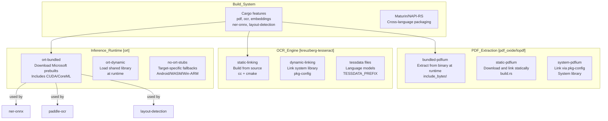
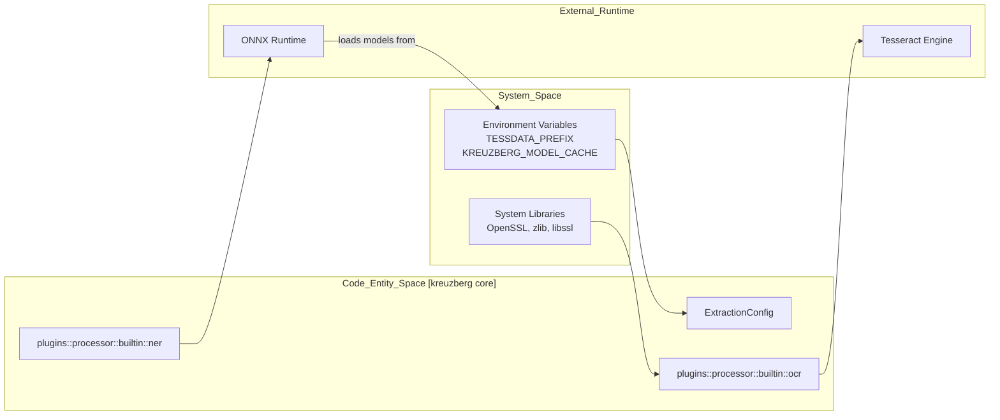

<!-- source: DeepWiki mcp.deepwiki.com · repo kreuzberg-dev/kreuzberg · page 10.1 External Dependencies · fetched 2026-10-26 -->

# External Dependencies

Relevant source files

The following files were used as context for generating this wiki page:

- [.github/actions/install-system-deps/action.yml](.github/actions/install-system-deps/action.yml)
- [.github/actions/setup-onnx-runtime/action.yml](.github/actions/setup-onnx-runtime/action.yml)
- [.gitignore](.gitignore)
- [.pre-commit-config.yaml](.pre-commit-config.yaml)
- [CHANGELOG.md](CHANGELOG.md)
- [Cargo.lock](Cargo.lock)
- [Cargo.toml](Cargo.toml)
- [crates/kreuzberg-node/package.json](crates/kreuzberg-node/package.json)
- [crates/kreuzberg-wasm/package.json](crates/kreuzberg-wasm/package.json)
- [crates/kreuzberg/Cargo.toml](crates/kreuzberg/Cargo.toml)
- [package.json](package.json)
- [packages/ruby/Gemfile.lock](packages/ruby/Gemfile.lock)
- [packages/ruby/ext/kreuzberg_rb/native/Cargo.lock](packages/ruby/ext/kreuzberg_rb/native/Cargo.lock)
- [packages/ruby/ext/kreuzberg_rb/native/Cargo.toml](packages/ruby/ext/kreuzberg_rb/native/Cargo.toml)
- [pnpm-lock.yaml](pnpm-lock.yaml)
- [pyproject.toml](pyproject.toml)
- [scripts/ci/install-system-deps/install-linux.sh](scripts/ci/install-system-deps/install-linux.sh)
- [scripts/ci/install-system-deps/install-macos.sh](scripts/ci/install-system-deps/install-macos.sh)
- [scripts/ci/install-system-deps/install-windows.ps1](scripts/ci/install-system-deps/install-windows.ps1)
- [uv.lock](uv.lock)

Kreuzberg relies on several core external dependencies for document processing: **PDFium** (PDF rendering), **Tesseract** (OCR), and **ONNX Runtime** (embeddings, NER, and layout analysis). This document describes how these dependencies are managed across platforms, including build-time linking strategies, runtime resolution, and system-level requirements.

## Overview of External Dependencies

Kreuzberg's architecture distinguishes between libraries linked at build time and those loaded dynamically at runtime. The system uses Cargo features to toggle between bundled binaries, static linking, and system-provided libraries.

### External Dependency Architecture

**Sources:** [crates/kreuzberg/Cargo.toml:48-50](), [crates/kreuzberg/Cargo.toml:91-101](), [crates/kreuzberg/Cargo.toml:130-135](), [Cargo.toml:75-75]()

## PDFium Integration

PDFium is the primary engine for high-fidelity PDF rendering. In the v5 architecture, PDF extraction is backed by `pdf_oxide` and `lopdf`.

### PDFium Linking Strategies
1.  **Bundled**: The PDFium binary is embedded into the Kreuzberg library using `include_bytes!`. At runtime, it is extracted to a temporary directory.
2.  **Static**: The build script downloads the appropriate PDFium binary for the target triple and links it statically.
3.  **System**: Uses `pkg-config` to find a system-installed PDFium library.

**Sources:** [crates/kreuzberg/Cargo.toml:48-50](), [Cargo.toml:77-80]()

## Tesseract OCR Integration

The `kreuzberg-tesseract` crate provides the interface to the Tesseract C++ engine.

### Tesseract Linking Modes
*   **Static (Default)**: The `static-linking` feature triggers a source build of Tesseract and Leptonica using the `cc` and `cmake` crates. This is used for portable binaries and WASM targets.
*   **Dynamic**: Links against `libtesseract` using system paths.

### Tesseract Language Data (tessdata)
Tesseract requires `.traineddata` files. Kreuzberg looks for these in paths defined by the `TESSDATA_PREFIX` environment variable. In CI environments, these are installed via system package managers.

**Sources:** [crates/kreuzberg/Cargo.toml:91-93](), [Cargo.toml:118-118](), [.github/actions/install-system-deps/action.yml:24-129]()

## ONNX Runtime (ORT) Integration

ONNX Runtime is used for performance-critical inference tasks: text embeddings, Named Entity Recognition (NER), PaddleOCR, and layout detection.

### ORT Feature Matrix

| Feature | Mode | Target Support |
| :--- | :--- | :--- |
| `ort-bundled` | Downloads Microsoft prebuilts | Linux, macOS, Windows (x64) |
| `ort-dynamic` | Loads system `onnxruntime.so/dll` | Custom deployments |
| **None** | Stubs/Fallbacks | Android x86_64, WASM, Windows ARM64 |

### Dependency Resolution Strategy
For targets where ORT is unavailable (e.g., Android x86_64 emulators), Kreuzberg provides stub implementations of `LlmBackend` and `GlineBackend` to allow language bindings (like Dart/Java) to compile unconditionally.

**Sources:** [crates/kreuzberg/Cargo.toml:130-135](), [CHANGELOG.md:20-21](), [CHANGELOG.md:29-30]()

## System Library Dependencies

Beyond the primary engines, Kreuzberg requires several standard system libraries:

| Library | Purpose | Managed By |
| :--- | :--- | :--- |
| **OpenSSL / libssl** | HTTPS requests for model downloading | `native-tls` / `ureq` |
| **pkg-config** | Locating system dependencies | Build-time tool |
| **libc** | Standard C library interface | `libc` crate |
| **zlib / liblzma** | Archive extraction (ZIP, 7z) | `flate2`, `lzma-rust2` |

**Sources:** [Cargo.toml:66-66](), [Cargo.toml:69-69](), [crates/kreuzberg/Cargo.toml:53-63]()

## Language-Specific Dependency Resolution

### Python (uv & Maturin)
Python dependencies are resolved via `uv.lock`. Native extensions are built using `maturin`. The environment universe is restricted to Python 3.11+ to avoid version conflicts with `onnxruntime` wheels.

**Sources:** [uv.lock:1-26](), [pyproject.toml:36-46]()

### Node.js (pnpm & NAPI-RS)
Node.js uses `pnpm` for workspace management. Native binaries are distributed as optional platform-specific dependencies (e.g., `@kreuzberg/node-linux-x64-gnu`).

**Sources:** [pnpm-lock.yaml:1-32](), [crates/kreuzberg-node/package.json:20-29]()

### Ruby (Magnus & rb-sys)
Ruby bindings use `rb_sys` (>= 0.9) to manage the Rust-to-Ruby interface. The build process uses `rake-compiler-dock` for cross-compilation of native gems.

**Sources:** [packages/ruby/Gemfile.lock:1-6](), [packages/ruby/Gemfile.lock:72-73]()

## External Dependency Data Flow

**Sources:** [crates/kreuzberg/Cargo.toml:116-129](), [crates/kreuzberg/Cargo.toml:203-214](), [CHANGELOG.md:29-30]()

## Platform-Specific Considerations

*   **Windows**: Uses `native-tls` specifically to avoid CMake configuration issues often encountered with `openssl-sys` on Windows.
*   **macOS ARM64**: Optimization levels for archive crates (like `sevenz-rust2`) are capped at `opt-level = 1` to prevent SIGBUS crashes during unsafe memory operations on Apple Silicon.
*   **Linux (manylinux)**: Dependencies are linked against older GLIBC versions or statically to ensure compatibility across distributions.

**Sources:** [Cargo.toml:130-135](), [scripts/ci/install-system-deps/install-windows.ps1:1-10](), [scripts/ci/install-system-deps/install-macos.sh:1-10]()

---

