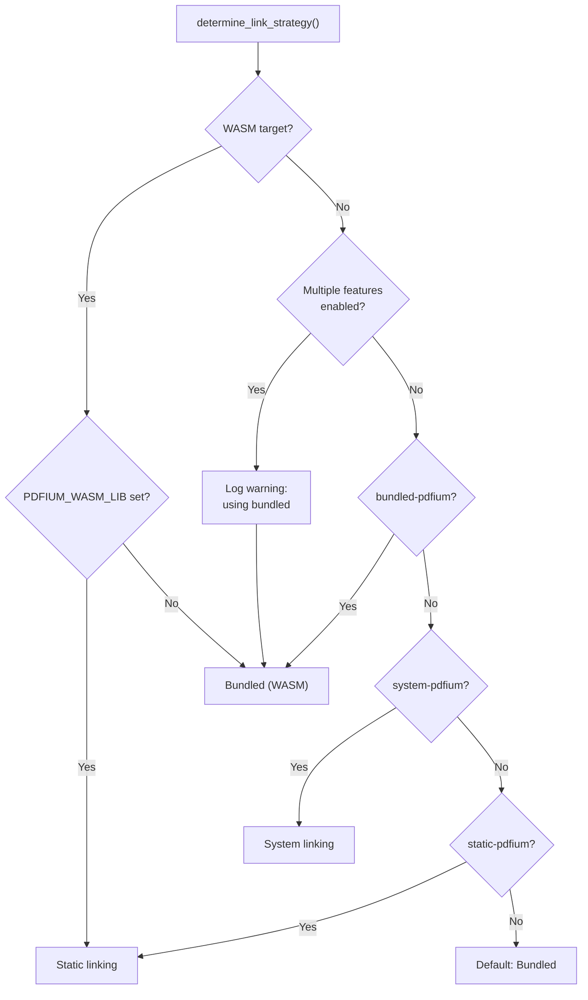
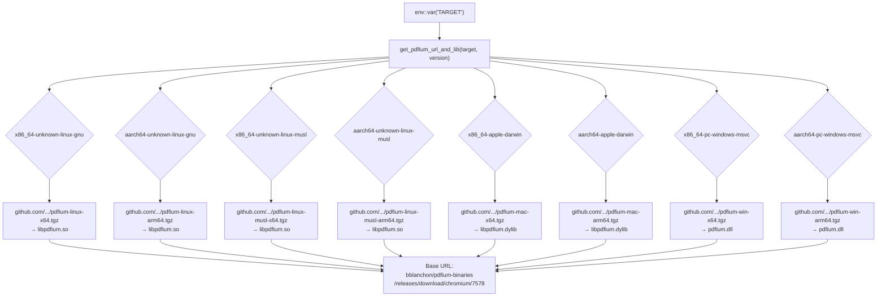
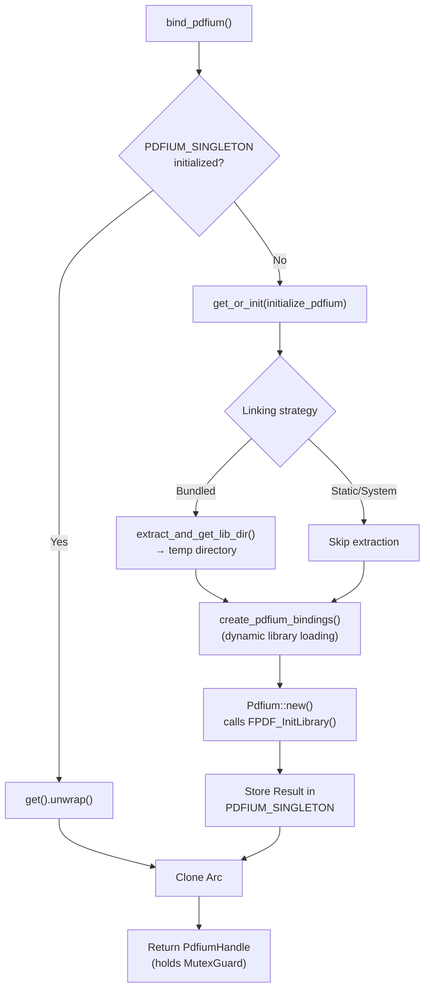
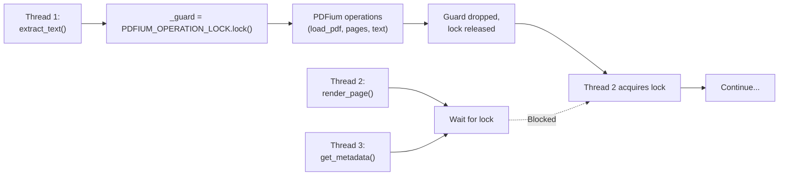
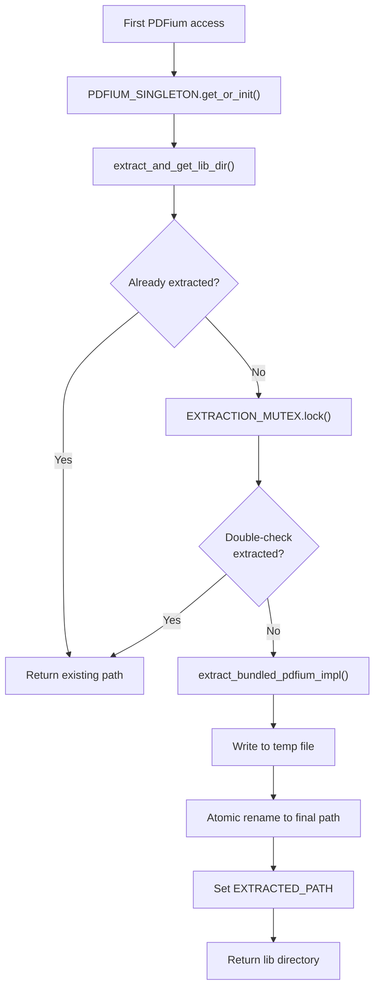

<!-- source: DeepWiki mcp.deepwiki.com · repo kreuzberg-dev/kreuzberg · page 10.2 PDFium Integration · fetched 2026-10-26 -->

# PDFium Integration

Relevant source files

The following files were used as context for generating this wiki page:

- [crates/kreuzberg/src/extraction/image.rs](crates/kreuzberg/src/extraction/image.rs)
- [crates/kreuzberg/src/extraction/pptx/content_builder.rs](crates/kreuzberg/src/extraction/pptx/content_builder.rs)
- [crates/kreuzberg/src/extractors/image.rs](crates/kreuzberg/src/extractors/image.rs)
- [crates/kreuzberg/src/extractors/pdf/extraction.rs](crates/kreuzberg/src/extractors/pdf/extraction.rs)
- [crates/kreuzberg/src/extractors/pdf/layout_runner.rs](crates/kreuzberg/src/extractors/pdf/layout_runner.rs)
- [crates/kreuzberg/src/extractors/pdf/mod.rs](crates/kreuzberg/src/extractors/pdf/mod.rs)
- [crates/kreuzberg/src/extractors/pdf/ocr.rs](crates/kreuzberg/src/extractors/pdf/ocr.rs)
- [crates/kreuzberg/src/pdf/error.rs](crates/kreuzberg/src/pdf/error.rs)
- [crates/kreuzberg/src/pdf/metadata.rs](crates/kreuzberg/src/pdf/metadata.rs)
- [crates/kreuzberg/src/pdf/mod.rs](crates/kreuzberg/src/pdf/mod.rs)
- [crates/kreuzberg/src/pdf/oxide/hierarchy.rs](crates/kreuzberg/src/pdf/oxide/hierarchy.rs)
- [crates/kreuzberg/src/pdf/oxide/images.rs](crates/kreuzberg/src/pdf/oxide/images.rs)
- [crates/kreuzberg/src/pdf/oxide/mod.rs](crates/kreuzberg/src/pdf/oxide/mod.rs)
- [crates/kreuzberg/src/pdf/oxide/table.rs](crates/kreuzberg/src/pdf/oxide/table.rs)
- [crates/kreuzberg/src/pdf/oxide/text.rs](crates/kreuzberg/src/pdf/oxide/text.rs)
- [crates/kreuzberg/src/pdf/oxide_text.rs](crates/kreuzberg/src/pdf/oxide_text.rs)
- [crates/kreuzberg/src/pdf/structure/mod.rs](crates/kreuzberg/src/pdf/structure/mod.rs)
- [crates/kreuzberg/src/pdf/structure/pipeline.rs](crates/kreuzberg/src/pdf/structure/pipeline.rs)
- [crates/kreuzberg/src/pdf/structure/regions/table_recognition.rs](crates/kreuzberg/src/pdf/structure/regions/table_recognition.rs)
- [crates/kreuzberg/src/pdf/text.rs](crates/kreuzberg/src/pdf/text.rs)
- [crates/kreuzberg/tests/pdf_glyph_spacing_issue_962.rs](crates/kreuzberg/tests/pdf_glyph_spacing_issue_962.rs)
- [crates/kreuzberg/tests/pdf_heuristic_tables.rs](crates/kreuzberg/tests/pdf_heuristic_tables.rs)
- [crates/kreuzberg/tests/pdf_image_extraction_tests.rs](crates/kreuzberg/tests/pdf_image_extraction_tests.rs)

## Purpose and Scope

This document describes how Kreuzberg integrates with the PDFium library for PDF rendering and text extraction. While Kreuzberg's primary PDF engine is `pdf_oxide` (a pure-Rust implementation), PDFium remains a critical component for high-fidelity rendering, image extraction, and OCR pre-processing. Kreuzberg uses a forked version of [`pdfium-render`](https://crates.io/crates/pdfium-render) (`kreuzberg-pdfium-render` v0.9.0) as a Rust wrapper to interact with PDFium's C API.

PDFium provides the following capabilities used by Kreuzberg:
- **Text Extraction**: `FPDF_Text_*` APIs for extracting searchable text from PDF pages.
- **Page Rendering**: `FPDF_RenderPageBitmap()` for converting pages to images for OCR and layout detection.
- **Metadata Access**: `FPDF_GetMetaText()` for document properties.
- **Image Extraction**: `FPDF_GetPageObj()` and related APIs for embedded images.
- **Structure Analysis**: Font information and bounding boxes for hierarchy detection.

This page covers linking strategies, thread-safety mechanisms, build-time configuration, and runtime extraction logic. For PDF text extraction implementation details using the oxide backend, see [3.2](). For general external dependency management, see [10.1]().

**Key Integration Points:**
- **Build Time**: Feature flag selection, library downloading/linking via `crates/kreuzberg/build.rs`.
- **Runtime**: Singleton initialization, thread-safe access via `crates/kreuzberg/src/pdf/bindings.rs`.
- **Extraction**: Bundled library extraction via `crates/kreuzberg/src/pdf/bundled.rs`.

**PDFium Version**: Kreuzberg uses PDFium build **7578** (from chromium/7578 branch).

**Sources:** [crates/kreuzberg/src/pdf/mod.rs:1-41](), [crates/kreuzberg/src/pdf/bindings.rs:1-20]()

---

## Linking Strategies

Kreuzberg supports three mutually exclusive strategies for linking PDFium, controlled by feature flags:

| Strategy | Feature Flag | Description | Use Case |
|----------|--------------|-------------|----------|
| **Static** | `static-pdfium` | Download and link statically | Minimal runtime dependencies |
| **Bundled** | `bundled-pdfium` | Embed library, extract at runtime | Single-binary distribution |
| **System** | `system-pdfium` | Use system-installed PDFium via pkg-config | System integration, shared libraries |

### Strategy Selection Logic

The build script implements selection logic to determine the appropriate linking mode based on feature flags and target platform:

**Sources:** [crates/kreuzberg/src/pdf/mod.rs:12-33]()

### Platform-Specific Library URLs

PDFium binaries are downloaded from [bblanchon/pdfium-binaries](https://github.com/bblanchon/pdfium-binaries) releases. The build script constructs platform-specific download URLs:

**PDFium Binary Selection**

**Supported Platforms:**

| Target Triple | Platform | Library Name | URL Suffix |
|--------------|----------|--------------|------------|
| `x86_64-unknown-linux-gnu` | Linux x64 | `libpdfium.so` | `pdfium-linux-x64.tgz` |
| `aarch64-unknown-linux-gnu` | Linux ARM64 | `libpdfium.so` | `pdfium-linux-arm64.tgz` |
| `x86_64-unknown-linux-musl` | Linux musl x64 | `libpdfium.so` | `pdfium-linux-musl-x64.tgz` |
| `aarch64-unknown-linux-musl` | Linux musl ARM64 | `libpdfium.so` | `pdfium-linux-musl-arm64.tgz` |
| `x86_64-apple-darwin` | macOS Intel | `libpdfium.dylib` | `pdfium-mac-x64.tgz` |
| `aarch64-apple-darwin` | macOS Apple Silicon | `libpdfium.dylib` | `pdfium-mac-arm64.tgz` |
| `x86_64-pc-windows-msvc` | Windows x64 | `pdfium.dll` | `pdfium-win-x64.tgz` |
| `aarch64-pc-windows-msvc` | Windows ARM64 | `pdfium.dll` | `pdfium-win-arm64.tgz` |

**Sources:** [crates/kreuzberg/src/pdf/mod.rs:1-41]()

---

## Thread-Safety Architecture

PDFium is **not thread-safe**. Kreuzberg implements a two-level protection mechanism to ensure safe concurrent access.

### Singleton Pattern

The `PDFIUM_SINGLETON` (`OnceLock<Result<Pdfium, String>>`) ensures PDFium is initialized exactly once per process.

**Singleton Initialization Flow**

**Key Invariants:**
1. `FPDF_InitLibrary()` called exactly once during `Pdfium::new()`.
2. `FPDF_DestroyLibrary()` never called (singleton lives for process lifetime).
3. Library binding succeeds or fails permanently (stored in `Result<Pdfium, String>`).
4. `OnceLock::get_or_init()` guarantees thread-safe initialization.

**Sources:** [crates/kreuzberg/src/pdf/bindings.rs:1-120]()

### Operation Lock

The `PDFIUM_OPERATION_LOCK` serializes all PDFium operations to prevent concurrent access:

**Implementation:** The `PdfiumHandle<'a>` wrapper holds:
- `_guard: MutexGuard<'a, ()>` - Acquired on construction, released on drop.
- `pdfium: Arc<Pdfium>` - Cloned reference to singleton instance.

This ensures exclusive access to all PDFium APIs for the lifetime of the handle.

**Sources:** [crates/kreuzberg/src/pdf/bindings.rs:1-120]()

---

## Runtime Extraction (Bundled Mode)

When using `bundled-pdfium`, the library is embedded using `include_bytes!` and extracted at runtime to a temporary directory.

### Extraction Flow

**Thread-Safety:** The extraction uses a double-checked locking pattern to prevent race conditions.

**Atomic File Operations:**
To prevent "file too short" errors when multiple threads access PDFium during extraction, the bundled extraction uses atomic file operations:
1. **Write to temporary file** with `.tmp` suffix.
2. **Atomic rename** via `std::fs::rename()`: OS-level guarantee of atomicity.
3. **Update global state** `EXTRACTED_PATH`: `Mutex<Option<PathBuf>>` signals completion.

**Sources:** [crates/kreuzberg/src/pdf/bindings.rs:1-120]()

---

## Code Architecture

### Module Organization

The PDFium integration is organized across several modules in `crates/kreuzberg/src/pdf/`. Note that while `pdf_oxide` is the default backend, these PDFium-based utilities are still leveraged for specific tasks like rendering.

**PDFium Module Structure**

```mermaid
graph TB
    ModFile["mod.rs<br/>Public API exports"] --> Bindings["bindings.rs"]
    ModFile --> Bundled["bundled.rs"]
    ModFile --> Text["text.rs"]
    ModFile --> Metadata["metadata.rs"]
    ModFile --> Rendering["rendering.rs"]
    ModFile --> Images["images.rs"]
    
    Bindings -->|"Exports"| PdfiumHandle["PdfiumHandle<'a><br/>Deref to Pdfium"]
    Bindings -->|"Exports"| BindFn["bind_pdfium()<br/>→ Result<PdfiumHandle>"]
    Bindings -->|"Private"| Singleton["PDFIUM_SINGLETON<br/>OnceLock<Result<Pdfium>>"]
    Bindings -->|"Private"| OpLock["PDFIUM_OPERATION_LOCK<br/>Mutex<()>"]
    
    Bundled -->|"Exports"| ExtractFn["extract_bundled_pdfium()<br/>→ Result<PathBuf>"]
    Bundled -->|"Private"| ExtMutex["EXTRACTION_MUTEX<br/>Mutex<()>"]
    Bundled -->|"Private"| ExtPath["EXTRACTED_PATH<br/>Mutex<Option<PathBuf>>"]
    Bundled -->|"Private"| Bytes["PDFIUM_BYTES<br/>&[u8]"]
    
    Text -->|"Uses"| BindFn
    Metadata -->|"Uses"| BindFn
    Rendering -->|"Uses"| BindFn
    
    Text -->|"Exports"| ExtractText["extract_text_from_pdf()<br/>→ Result<String>"]
    Metadata -->|"Exports"| ExtractMeta["extract_pdf_metadata()<br/>→ Result<PdfMetadata>"]
    Rendering -->|"Exports"| RenderPage["render_pdf_page()<br/>→ Result<DynamicImage>"]
```

**Key Public APIs:**
- `bind_pdfium()` → `Result<PdfiumHandle<'static>, ExtractionError>` - Obtain thread-safe PDFium handle.
- `extract_bundled_pdfium()` → `Result<PathBuf, ExtractionError>` - Extract bundled library.
- `PdfMetadata` - PDF-specific metadata fields like version and producer [crates/kreuzberg/src/pdf/metadata.rs:17-41]().

**Sources:** [crates/kreuzberg/src/pdf/mod.rs:1-41](), [crates/kreuzberg/src/pdf/bindings.rs:1-120](), [crates/kreuzberg/src/pdf/metadata.rs:1-98]()

---

## Rotation and Post-Processing

PDFium extraction often requires handling orientation and encoding artifacts.

### Rotation Workarounds
During extraction, rotation metadata is checked. If a page is rotated, coordinates are adjusted to ensure bounding boxes for text and images align with the rendered output. This is particularly critical for OCR fallback and layout detection where spatial accuracy is paramount.

### Text Post-Processing
Extracted text from PDF documents is cleaned using utilities in `crates/kreuzberg/src/pdf/text.rs`:
- `fix_pdf_control_chars(text: &str)`: Replaces control characters (U+0001–U+001F) resulting from broken `ToUnicode` mappings with hyphens or removes them [crates/kreuzberg/src/pdf/text.rs:17-43]().
- `contains_html_markup(text: &str)`: Detects if the PDF text layer contains raw HTML (common in web-to-PDF converters) [crates/kreuzberg/src/pdf/text.rs:50-62]().
- `convert_html_page_text(text: &str)`: Converts detected HTML to Markdown [crates/kreuzberg/src/pdf/text.rs:69-74]().

**Sources:** [crates/kreuzberg/src/pdf/text.rs:1-75]()

---

