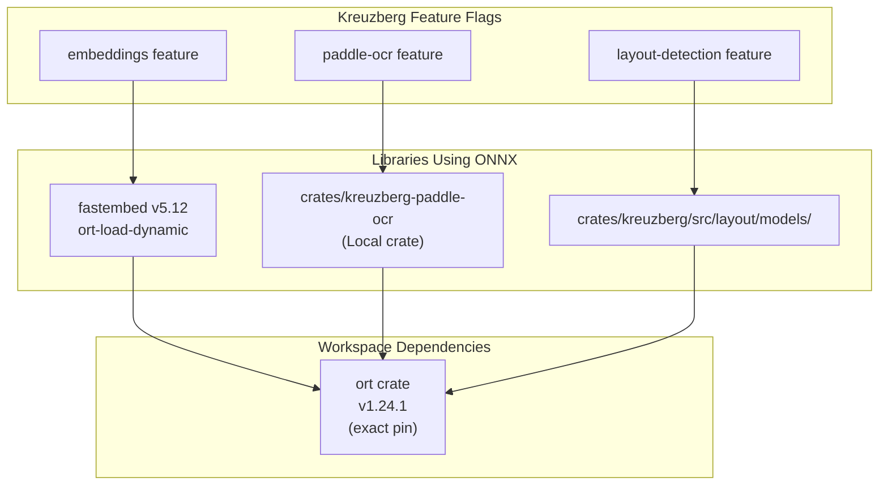
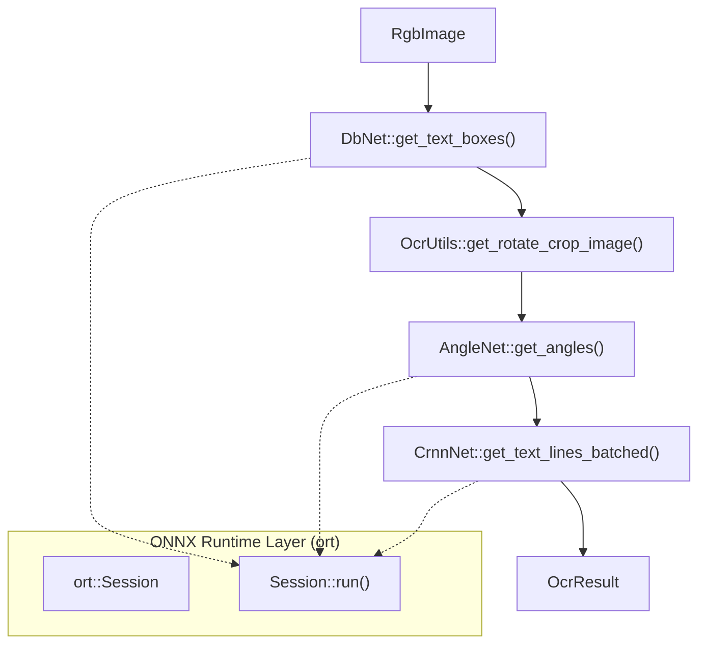

<!-- source: DeepWiki mcp.deepwiki.com · repo kreuzberg-dev/kreuzberg · page 10.3 ONNX Runtime Integration · fetched 2026-10-26 -->

# ONNX Runtime Integration

Relevant source files

The following files were used as context for generating this wiki page:

- [crates/kreuzberg-paddle-ocr/src/angle_net.rs](crates/kreuzberg-paddle-ocr/src/angle_net.rs)
- [crates/kreuzberg-paddle-ocr/src/base_net.rs](crates/kreuzberg-paddle-ocr/src/base_net.rs)
- [crates/kreuzberg-paddle-ocr/src/crnn_net.rs](crates/kreuzberg-paddle-ocr/src/crnn_net.rs)
- [crates/kreuzberg-paddle-ocr/src/db_net.rs](crates/kreuzberg-paddle-ocr/src/db_net.rs)
- [crates/kreuzberg-paddle-ocr/src/ocr_lite.rs](crates/kreuzberg-paddle-ocr/src/ocr_lite.rs)
- [crates/kreuzberg-paddle-ocr/src/ocr_result.rs](crates/kreuzberg-paddle-ocr/src/ocr_result.rs)
- [crates/kreuzberg-paddle-ocr/src/ocr_utils.rs](crates/kreuzberg-paddle-ocr/src/ocr_utils.rs)
- [crates/kreuzberg/src/core/config/layout.rs](crates/kreuzberg/src/core/config/layout.rs)
- [crates/kreuzberg/src/extractors/pdf/pages.rs](crates/kreuzberg/src/extractors/pdf/pages.rs)
- [crates/kreuzberg/src/layout/engine.rs](crates/kreuzberg/src/layout/engine.rs)
- [crates/kreuzberg/src/layout/mod.rs](crates/kreuzberg/src/layout/mod.rs)
- [crates/kreuzberg/src/layout/model_manager.rs](crates/kreuzberg/src/layout/model_manager.rs)
- [crates/kreuzberg/src/layout/models/mod.rs](crates/kreuzberg/src/layout/models/mod.rs)
- [crates/kreuzberg/src/layout/models/rtdetr.rs](crates/kreuzberg/src/layout/models/rtdetr.rs)
- [crates/kreuzberg/src/layout/models/slanet.rs](crates/kreuzberg/src/layout/models/slanet.rs)
- [crates/kreuzberg/src/layout/models/table_classifier.rs](crates/kreuzberg/src/layout/models/table_classifier.rs)
- [crates/kreuzberg/src/layout/models/tatr.rs](crates/kreuzberg/src/layout/models/tatr.rs)
- [crates/kreuzberg/src/layout/models/yolo.rs](crates/kreuzberg/src/layout/models/yolo.rs)
- [crates/kreuzberg/src/layout/session.rs](crates/kreuzberg/src/layout/session.rs)
- [crates/kreuzberg/src/paddle_ocr/config.rs](crates/kreuzberg/src/paddle_ocr/config.rs)
- [crates/kreuzberg/src/paddle_ocr/mod.rs](crates/kreuzberg/src/paddle_ocr/mod.rs)
- [crates/kreuzberg/src/paddle_ocr/model_manager.rs](crates/kreuzberg/src/paddle_ocr/model_manager.rs)
- [crates/kreuzberg/src/pdf/hierarchy/bounding_box.rs](crates/kreuzberg/src/pdf/hierarchy/bounding_box.rs)
- [crates/kreuzberg/src/pdf/hierarchy/types.rs](crates/kreuzberg/src/pdf/hierarchy/types.rs)
- [crates/kreuzberg/src/pdf/structure/text_repair.rs](crates/kreuzberg/src/pdf/structure/text_repair.rs)
- [crates/kreuzberg/src/pdf/structure/types.rs](crates/kreuzberg/src/pdf/structure/types.rs)
- [scripts/ci/docker/test_docker.py](scripts/ci/docker/test_docker.py)
- [tools/benchmark-harness/fixtures/pdf/iso_21111_10.json](tools/benchmark-harness/fixtures/pdf/iso_21111_10.json)
- [tools/benchmark-harness/src/comparison.rs](tools/benchmark-harness/src/comparison.rs)
- [tools/benchmark-harness/src/pipeline_benchmark.rs](tools/benchmark-harness/src/pipeline_benchmark.rs)

## Purpose and Scope

This document describes Kreuzberg's integration with ONNX Runtime for machine learning inference. ONNX Runtime powers three distinct capabilities within the ecosystem:

1.  **Document embeddings** via the FastEmbed library (feature: `embeddings`).
2.  **PaddleOCR backend** for high-quality OCR processing (feature: `paddle-ocr`).
3.  **Layout Analysis** for document structure detection, including table recognition (feature: `layout-detection`).

ONNX Runtime is **not available on WASM targets** due to platform limitations. For OCR functionality on WASM, see [Tesseract OCR Build System](10.4).

**Sources:** [crates/kreuzberg/Cargo.toml:79-80](), [crates/kreuzberg/Cargo.toml:66-76](), [crates/kreuzberg/src/layout/mod.rs:1-9]()

---

## Dependency Architecture

### Core ONNX Runtime Bindings

Kreuzberg uses the `ort` crate (Rust bindings for ONNX Runtime) with an **exact version pin** (v1.24.1) to ensure compatibility with FastEmbed and consistent behavior across the PaddleOCR and Layout modules.

**Dependency Map: Code Entity Space**

**Sources:** [crates/kreuzberg/Cargo.toml:261-264](), [crates/kreuzberg/Cargo.toml:280-283](), [crates/kreuzberg/src/layout/mod.rs:1-9]()

---

## PaddleOCR Integration

### Three-Stage Pipeline

The PaddleOCR implementation in `kreuzberg-paddle-ocr` utilizes three distinct ONNX models managed via the `BaseNet` trait and `OcrLite` coordinator.

| Model Component | Code Entity | Purpose |
| :--- | :--- | :--- |
| **Detection** | `DbNet` | Detects text regions (bounding boxes) using a Differentiable Binarization network. |
| **Classification** | `AngleNet` | Detects text orientation (0° vs 180°) for rotation correction. |
| **Recognition** | `CrnnNet` | Transcribes text from cropped regions using CRNN + CTC decoding. |

**Sources:** [crates/kreuzberg-paddle-ocr/src/db_net.rs:16-19](), [crates/kreuzberg-paddle-ocr/src/angle_net.rs:25-28](), [crates/kreuzberg-paddle-ocr/src/crnn_net.rs:18-22](), [crates/kreuzberg-paddle-ocr/src/base_net.rs:8-9]()

### Inference Data Flow

**Sources:** [crates/kreuzberg-paddle-ocr/src/angle_net.rs:48-78](), [crates/kreuzberg-paddle-ocr/src/crnn_net.rs:144-148](), [crates/kreuzberg-paddle-ocr/src/db_net.rs:48-55]()

### Performance Optimizations

1.  **Batch Recognition**: `CrnnNet` implements `get_text_lines_batched`, which sorts image crops by width, groups them into batches, and pads them into a single `[N, 3, 48, max_width]` tensor to maximize throughput. [crates/kreuzberg-paddle-ocr/src/crnn_net.rs:144-181]()
2.  **Thread-Safe Inference**: Inference methods use `unsafe` pointer casts to call `ort`'s `Session::run` because the underlying C API is thread-safe, allowing concurrent inference without mutex contention. [crates/kreuzberg-paddle-ocr/src/angle_net.rs:97-102]()
3.  **Panic Handling**: Model initialization is wrapped in `std::panic::catch_unwind` to prevent mutex poisoning if ORT initialization fails on platforms like Windows. [crates/kreuzberg-paddle-ocr/src/base_net.rs:47-54]()

---

## Layout Model Integration

Kreuzberg uses specialized ONNX models for document structure analysis, managed by the `LayoutModelManager` and `LayoutEngine`.

### Model Definitions and Caching

Models are downloaded from HuggingFace Hub and cached locally. The `LayoutModelManager` ensures integrity via SHA-256 verification and organized cache directories.

| Model Type | Code Entity | Purpose | Remote Path |
| :--- | :--- | :--- | :--- |
| **RT-DETR** | `RtDetrModel` | Layout detection (17 classes) | `rtdetr/model.onnx` |
| **TATR** | `TatrModel` | Table structure recognition | `tatr/model.onnx` |
| **SLANeXT** | `SlanetModel` | Table grid reconstruction | `v2/table/SLANeXt_wired.onnx` |
| **Classifier**| `TableClassifier` | Routes table to Wired/Wireless model | `v2/classifiers/PP-LCNet_x1_0_table_cls.onnx` |

**Sources:** [crates/kreuzberg/src/layout/model_manager.rs:35-85](), [crates/kreuzberg/src/layout/engine.rs:21-28](), [crates/kreuzberg/src/layout/models/tatr.rs:154-162]()

### Model Caching Strategy

The `layout` module implements a global singleton caching pattern using `ModelCache<T>` to avoid redundant model loading costs.

*   **Global Engines**: `CACHED_ENGINE` stores the primary layout detector. [crates/kreuzberg/src/layout/mod.rs:59]()
*   **Table Models**: Separate caches exist for `CACHED_TATR`, `CACHED_SLANET_WIRED`, and `CACHED_TABLE_CLASSIFIER`. [crates/kreuzberg/src/layout/mod.rs:63-174]()
*   **Sticky Failures**: `OnceLock<bool>` flags (e.g., `TATR_TRIED`) prevent repeated download attempts if a model fails to load once. [crates/kreuzberg/src/layout/mod.rs:71-72]()

---

## Configuration and Model Tiers

### PaddleOCR Tiers

PaddleOCR supports two model tiers via `PaddleOcrConfig`:
*   **Mobile (Default)**: Lightweight models (~4.5MB detection, ~16.5MB recognition). [crates/kreuzberg/src/paddle_ocr/config.rs:78-80]()
*   **Server**: High-accuracy models (~88MB detection, ~84MB recognition) for complex documents. [crates/kreuzberg/src/paddle_ocr/config.rs:79-80]()

### Table Model Selection

The `LayoutEngine` can be configured to use specific SLANeXT variants for table extraction, supporting wired, wireless, or auto-detection via the `TableClassifier`.

**Sources:** [tools/benchmark-harness/src/comparison.rs:70-77](), [crates/kreuzberg/src/layout/model_manager.rs:54-84]()

---

## Session Configuration

The `build_session` function in `crates/kreuzberg/src/layout/session.rs` (and similarly in `BaseNet` for OCR) configures the ONNX Runtime sessions:

*   **Optimization**: `GraphOptimizationLevel::All` is enabled for maximum performance. [crates/kreuzberg-paddle-ocr/src/base_net.rs:20]()
*   **Concurrency**: Intra-op threads are set based on the `num_thread` budget, while inter-op threads are typically pinned to 1. [crates/kreuzberg-paddle-ocr/src/base_net.rs:22-24]()
*   **Execution Providers**: The system automatically attempts to apply hardware acceleration (e.g., CUDA, CoreML) if available via `ort_discovery`. [crates/kreuzberg/src/layout/mod.rs:90-93]()

**Sources:** [crates/kreuzberg-paddle-ocr/src/base_net.rs:11-29](), [crates/kreuzberg/src/layout/mod.rs:88-93]()

---

