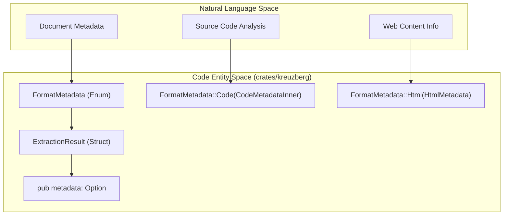
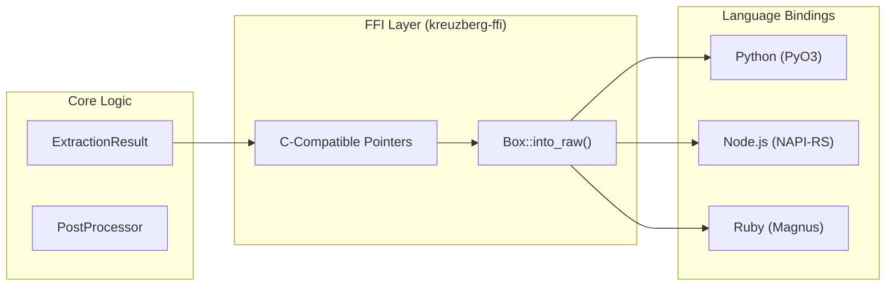

<!-- source: DeepWiki mcp.deepwiki.com · repo kreuzberg-dev/kreuzberg · page 10.8 Migration Guides · fetched 2026-10-26 -->

# Migration Guides

Relevant source files

The following files were used as context for generating this wiki page:

- [.gitignore](.gitignore)
- [.pre-commit-config.yaml](.pre-commit-config.yaml)
- [CHANGELOG.md](CHANGELOG.md)
- [Cargo.lock](Cargo.lock)
- [Cargo.toml](Cargo.toml)
- [crates/kreuzberg-node/package.json](crates/kreuzberg-node/package.json)
- [crates/kreuzberg-wasm/package.json](crates/kreuzberg-wasm/package.json)
- [crates/kreuzberg/Cargo.toml](crates/kreuzberg/Cargo.toml)
- [docs/migration/v4.0-html-metadata.md](docs/migration/v4.0-html-metadata.md)
- [docs/snippets/csharp/metadata.md](docs/snippets/csharp/metadata.md)
- [docs/snippets/csharp/metadata/parse_all.cs](docs/snippets/csharp/metadata/parse_all.cs)
- [docs/snippets/elixir/advanced/metadata_extraction.exs](docs/snippets/elixir/advanced/metadata_extraction.exs)
- [docs/snippets/go/metadata/metadata.md](docs/snippets/go/metadata/metadata.md)
- [docs/snippets/java/metadata/metadata.md](docs/snippets/java/metadata/metadata.md)
- [docs/snippets/python/metadata/metadata.md](docs/snippets/python/metadata/metadata.md)
- [docs/snippets/r/metadata/metadata.md](docs/snippets/r/metadata/metadata.md)
- [docs/snippets/ruby/metadata/metadata.md](docs/snippets/ruby/metadata/metadata.md)
- [docs/snippets/rust/metadata/metadata.md](docs/snippets/rust/metadata/metadata.md)
- [docs/snippets/typescript/metadata/metadata.md](docs/snippets/typescript/metadata/metadata.md)
- [docs/snippets/wasm/metadata/metadata.md](docs/snippets/wasm/metadata/metadata.md)
- [package.json](package.json)
- [packages/ruby/Gemfile.lock](packages/ruby/Gemfile.lock)
- [packages/ruby/ext/kreuzberg_rb/native/Cargo.lock](packages/ruby/ext/kreuzberg_rb/native/Cargo.lock)
- [packages/ruby/ext/kreuzberg_rb/native/Cargo.toml](packages/ruby/ext/kreuzberg_rb/native/Cargo.toml)
- [pnpm-lock.yaml](pnpm-lock.yaml)
- [pyproject.toml](pyproject.toml)
- [uv.lock](uv.lock)

This page provides technical details and implementation guidance for migrating between major versions of the Kreuzberg document intelligence platform. It focuses on breaking changes in the core Rust library and their propagation through the multi-language binding layers.

## v4.x to v5.0 Migration

The v5.0 release introduces significant changes to how document structural elements, font information, and HTML metadata are represented. These changes aim to provide a more unified data model across all 75+ supported formats.

### Image Index References

In v5.0, the `ExtractedImage` structure and its association with the document content have been refactored to support precise spatial referencing.

*   **Implementation**: Images are now stored in a flat vector within the `ExtractionResult`.
*   **Data Flow**: The extraction pipeline assigns a stable index to each image during the format-specific extraction phase (e.g., PDF object stream parsing).
*   **Breaking Change**: Previously, images were often embedded or loosely associated. Now, the `content` (Markdown) includes specific placeholders that correlate to the index in the `images` list.

### Font Metadata and Hierarchy

The `FontMetadata` and `HierarchyConfig` systems were updated to better capture semantic structure from fixed-layout formats like PDF.

*   **Key Entities**:
    *   `FontMetadata`: Captures family, size, weight, and style.
    *   `HierarchyConfig`: Defines how visual cues (font size, bolding) map to semantic headers (H1-H6).
*   **Change**: v5.0 moves from a global font heuristic to a per-page/per-region metadata model [crates/kreuzberg/Cargo.toml:148-157]().

### HTML Metadata

The representation of HTML-specific metadata has been standardized. The previous `v4.0-html-metadata.md` migration path is now fully integrated into the core `Metadata` variant [CHANGELOG.md:33-33]().

#### Structural Changes Table

| Feature | v4.x Implementation | v5.0 Implementation |
| :--- | :--- | :--- |
| **HTML Metadata** | Separate `HtmlMetadata` struct | Integrated into `FormatMetadata::Html` |
| **Code Metadata** | Simple string | `CodeMetadataInner` wrapper [CHANGELOG.md:27-27]() |
| **Redaction** | Case-insensitive BIC matching | Case-sensitive uppercase BIC matching [CHANGELOG.md:18-19]() |
| **NER Backend** | Platform-agnostic | Feature-gated by platform (excluded on Windows/Android x86_64) [CHANGELOG.md:29-31]() |

### Code Entity Space: Metadata and Extraction

The following diagram illustrates how the natural language concept of "Document Metadata" maps to specific Rust structs and enums within the `kreuzberg` crate.

**Metadata Mapping: Concept to Code**

**Sources**: [CHANGELOG.md:27-27](), [crates/kreuzberg/Cargo.toml:75-76](), [crates/kreuzberg/Cargo.toml:201-203]()

---

## FFI and Binding Updates

The migration to v5.0 requires updating native dependencies and binding logic due to changes in the FFI layer (`kreuzberg-ffi`).

### JNI Env Refactor
For Java and Kotlin (Android) consumers, the JNI layer has moved to `jni 0.22`, which introduces a split between `EnvUnowned` and `Env`.

*   **Implementation**: Call sites in `crates/kreuzberg-jni/src/lib.rs` must now use `env.with_env(|env| { ... })` to access `Env` methods [CHANGELOG.md:28-28]().
*   **Affected Functions**: `throw_exception`, `jstring_to_string`, `string_to_jstring`, and `byte_array_from_slice`.

### Ruby Magnus Integration
The Ruby bindings now strictly enforce `rb_sys` versions and frozen Gemfile states.

*   **Change**: `kreuzberg.gemspec` constraint for `rb_sys` updated to `>= 0.9` [CHANGELOG.md:24-24]().
*   **CI Impact**: Bundler 2.6+ requires explicit frozen configuration via `bundle config set frozen true` [CHANGELOG.md:31-31]().

### Binding Data Flow

This diagram shows how data flows from the core Rust logic through the generated FFI layer to the language-specific bindings (e.g., Python/Node.js).

**FFI Data Pipeline**

**Sources**: [CHANGELOG.md:34-34](), [Cargo.toml:1-16](), [crates/kreuzberg-node/package.json:30-43]()

---

## Platform-Specific Migration Notes

### Windows and Android x86_64
The `ner-llm` and `ner-onnx` features are now explicitly disabled for Windows and Android x86_64 targets due to the absence of ONNX Runtime (ORT) prebuilts for these specific triples [CHANGELOG.md:20-20](), [CHANGELOG.md:29-30]().

*   **Action**: If your application targets these platforms, ensure you are not unconditionally calling `LlmBackend` or `GlineBackend` methods. Stub implementations are provided in the core library to prevent compilation failures in downstream bindings like Dart [CHANGELOG.md:20-20]().

### WASM Size Optimization
For WebAssembly deployments, the `kreuzberg-wasm` package now uses `opt-level = "z"` to minimize memory spikes during the compilation of complex parsers [Cargo.toml:137-138]().

**Sources**: [CHANGELOG.md:20-20](), [CHANGELOG.md:29-31](), [Cargo.toml:137-138]()

---

