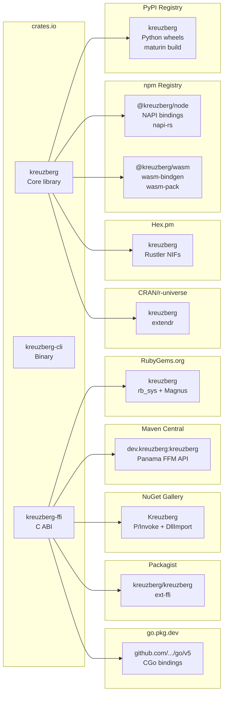
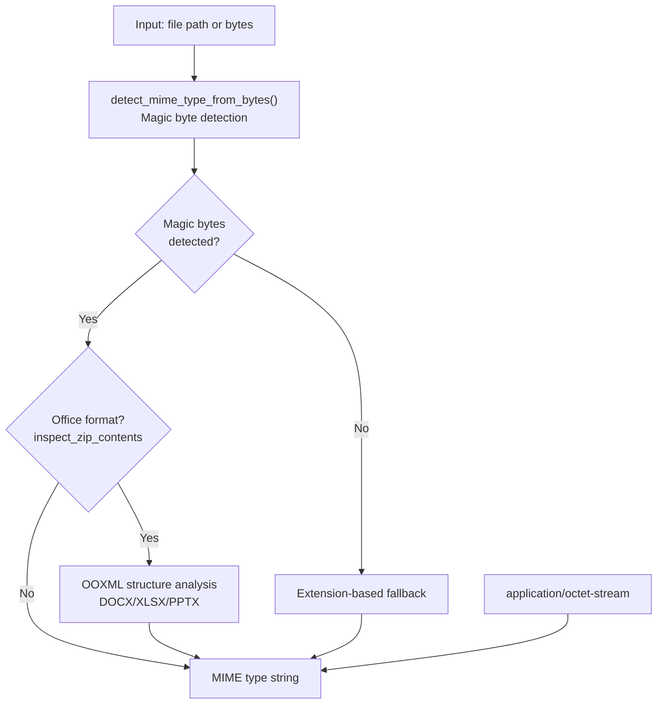
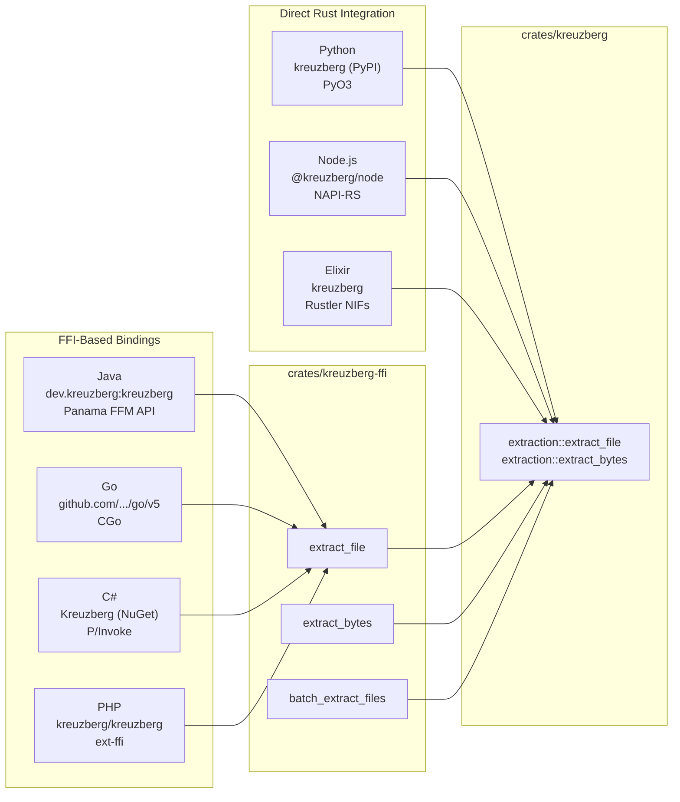

<!-- source: DeepWiki mcp.deepwiki.com · repo kreuzberg-dev/kreuzberg · page 11 Reference · fetched 2026-10-26 -->

# Reference

Relevant source files

The following files were used as context for generating this wiki page:

- [docs/reference/api-c.md](docs/reference/api-c.md)
- [docs/reference/api-csharp.md](docs/reference/api-csharp.md)
- [docs/reference/api-elixir.md](docs/reference/api-elixir.md)
- [docs/reference/api-go.md](docs/reference/api-go.md)
- [docs/reference/api-java.md](docs/reference/api-java.md)
- [docs/reference/api-php.md](docs/reference/api-php.md)
- [docs/reference/api-python.md](docs/reference/api-python.md)
- [docs/reference/api-r.md](docs/reference/api-r.md)
- [docs/reference/api-ruby.md](docs/reference/api-ruby.md)
- [docs/reference/api-rust.md](docs/reference/api-rust.md)
- [docs/reference/api-typescript.md](docs/reference/api-typescript.md)
- [docs/reference/api-wasm.md](docs/reference/api-wasm.md)
- [docs/reference/configuration.md](docs/reference/configuration.md)
- [docs/reference/errors.md](docs/reference/errors.md)
- [docs/reference/types.md](docs/reference/types.md)

Quick-lookup reference documentation for Kreuzberg constants, error codes, environment variables, CLI commands, and cross-language FFI bindings. This page provides tables and diagrams for rapid reference during development.

**Child Pages:**

- **[Configuration Reference](#11.1)**: Complete `ExtractionConfig`, `OcrConfig`, `PdfConfig`, `ChunkingConfig`, and `HierarchyConfig` field documentation.
- **[Supported Document Formats](#11.2)**: Full list of 75+ formats with extraction methods and capabilities.
- **[Feature Flags Reference](#11.3)**: Complete Cargo feature documentation including `pdf`, `ocr`, `embeddings`, `full`, `server`, `cli`, and platform-specific features.
- **[Error Codes and Types](#11.4)**: Comprehensive error classification, error code enumeration, and language-specific exception mapping.
- **[Environment Variables Reference](#11.5)**: Complete list of `KREUZBERG_*` environment variables for configuration, API server tuning, file size limits, and OCR model paths.

**Related Documentation:**

- [API Reference (Python, TypeScript, Java, Go, etc.)](4) - Language-specific API documentation.
- [Concepts](3) - System architecture and pipeline design.
- [Guides](6) - Configuration tutorials and advanced usage patterns.

**Current Version:** 5.0.0-rc.3

**Sources:** [docs/reference/api-csharp.md:5](), [docs/reference/api-go.md:5](), [docs/reference/api-java.md:5](), [docs/reference/api-python.md:5]()

## Quick Reference Tables

This section provides fast lookups for common development tasks. For detailed configuration documentation, see [Configuration Reference](#11.1).

### Package Distribution Matrix

**Package Distribution by Language Ecosystem**

**Installation Commands by Ecosystem**

| Language | Package Manager | Installation Command | Package Identifier |
|----------|----------------|---------------------|-------------------|
| **Python** | pip / uv | `pip install kreuzberg` | `kreuzberg` |
| **Node.js** | pnpm / npm | `pnpm add @kreuzberg/node` | `@kreuzberg/node` |
| **WASM** | pnpm / npm | `pnpm add @kreuzberg/wasm` | `@kreuzberg/wasm` |
| **Ruby** | gem / bundler | `gem install kreuzberg` | `kreuzberg` |
| **Go** | go get | `go get github.com/kreuzberg-dev/kreuzberg/v5` | `github.com/kreuzberg-dev/kreuzberg/v5` |
| **Java** | maven | See [packages/java/README.md:83-87]() | `dev.kreuzberg:kreuzberg` |
| **C#** | dotnet | `dotnet add package Kreuzberg` | `Kreuzberg` |
| **PHP** | composer | `composer require kreuzberg/kreuzberg` | `kreuzberg/kreuzberg` |

**Sources:** [docs/reference/api-python.md:5](), [docs/reference/api-typescript.md:5](), [docs/reference/api-go.md:5](), [docs/reference/api-java.md:5](), [docs/reference/api-csharp.md:5](), [docs/reference/api-php.md:5]()

### MIME Type Detection and API Entry Points

**MIME Detection Flow**

**Core Extraction API Functions:**

| Language | Async Function | Sync Wrapper | Return Type |
|----------|----------------|--------------|-------------|
| **Rust** | `extract_file()` | `extract_file_sync()` | `Result<ExtractionResult, Error>` |
| **Python** | `extract_file()` | `extract_file_sync()` | `ExtractionResult` |
| **TypeScript** | `extractFile()` | `extractFileSync()` | `Promise<ExtractionResult>` |
| **Java** | `extractFile()` | `extractFileSync()` | `ExtractionResult` |
| **Go** | `ExtractFile()` | `ExtractFileSync()` | `(ExtractionResult, error)` |
| **C#** | `ExtractFileAsync()` | `ExtractFileSync()` | `Task<ExtractionResult>` |

**Sources:** [docs/reference/api-rust.md:49-107](), [docs/reference/api-python.md:49-107](), [docs/reference/api-typescript.md:49-107](), [docs/reference/api-java.md:49-107](), [docs/reference/api-go.md:49-107](), [docs/reference/api-csharp.md:49-107](), [docs/reference/api-elixir.md:155-188]()

## Environment Variables

**Configuration and Runtime Control**

| Variable | Type | Purpose | Default |
|----------|------|---------|---------|
| `KREUZBERG_CONFIG_PATH` | Path | Override config file discovery | Auto-discover |
| `KREUZBERG_CACHE_DIR` | Path | Set extraction cache directory | System temp |
| `TESSDATA_PREFIX` | Path | Path to Tesseract traineddata | System path |

**Sources:** [docs/reference/configuration.md:79-99](), [docs/reference/api-rust.md:53-61]()

### FFI Layer Architecture

**kreuzberg-ffi: C ABI Bridge for Multi-Language Bindings**

**FFI Entry Point Reference**

| Language | Main File Entry Point | Main Bytes Entry Point | Source |
|----------|-----------------------|------------------------|--------|
| **C#** | `ExtractFileAsync` | `ExtractBytesAsync` | [docs/reference/api-csharp.md:33-74]() |
| **Go** | `ExtractFile` | `ExtractBytes` | [docs/reference/api-go.md:33-74]() |
| **Java** | `extractFile` | `extractBytes` | [docs/reference/api-java.md:33-74]() |
| **PHP** | `extractFile` | `extractBytes` | [docs/reference/api-php.md:33-74]() |
| **Ruby** | `extract_file` | `extract_bytes` | [docs/reference/api-ruby.md:33-74]() |

**Sources:** [docs/reference/api-csharp.md:33-74](), [docs/reference/api-go.md:33-74](), [docs/reference/api-java.md:33-74](), [docs/reference/api-php.md:33-74](), [docs/reference/api-ruby.md:33-74]()

## Next Steps

- **[Configuration Reference](#11.1)**: Complete list of all configuration options with types and defaults.
- **[Supported Document Formats](#11.2)**: Comprehensive format capabilities table.
- **[Feature Flags Reference](#11.3)**: Cargo features and build-time configuration.
- **[Error Codes and Types](#11.4)**: Error classification and cross-language exception mapping.
- **[Environment Variables Reference](#11.5)**: Complete list of `KREUZBERG_*` variables.

**Sources:** [docs/reference/configuration.md:5-80](), [docs/reference/types.md:22-53]()

---

