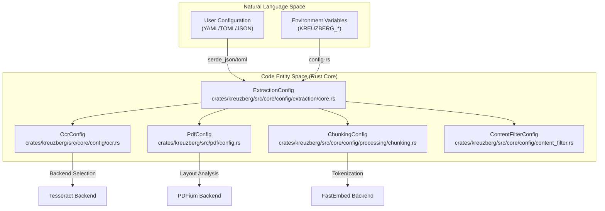
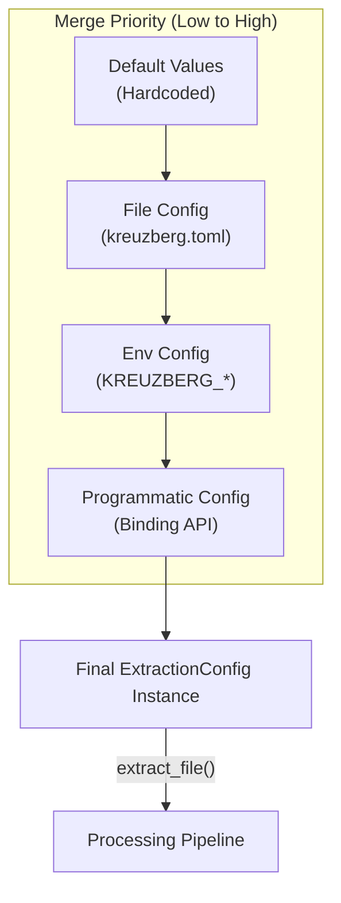

<!-- source: DeepWiki mcp.deepwiki.com · repo kreuzberg-dev/kreuzberg · page 11.1 Configuration Reference · fetched 2026-10-26 -->

# Configuration Reference

Relevant source files

The following files were used as context for generating this wiki page:

- [crates/kreuzberg/src/core/config/captioning.rs](crates/kreuzberg/src/core/config/captioning.rs)
- [crates/kreuzberg/src/core/config/classification.rs](crates/kreuzberg/src/core/config/classification.rs)
- [crates/kreuzberg/src/core/config/extraction/core.rs](crates/kreuzberg/src/core/config/extraction/core.rs)
- [crates/kreuzberg/src/core/config/llm.rs](crates/kreuzberg/src/core/config/llm.rs)
- [crates/kreuzberg/src/core/config/mod.rs](crates/kreuzberg/src/core/config/mod.rs)
- [crates/kreuzberg/src/core/config/ocr.rs](crates/kreuzberg/src/core/config/ocr.rs)
- [crates/kreuzberg/src/core/config/translation.rs](crates/kreuzberg/src/core/config/translation.rs)
- [crates/kreuzberg/src/diff/mod.rs](crates/kreuzberg/src/diff/mod.rs)
- [crates/kreuzberg/src/diff/types.rs](crates/kreuzberg/src/diff/types.rs)
- [crates/kreuzberg/src/lib.rs](crates/kreuzberg/src/lib.rs)
- [crates/kreuzberg/src/plugins/processor/builtin/ner.rs](crates/kreuzberg/src/plugins/processor/builtin/ner.rs)
- [crates/kreuzberg/src/text/ner/mod.rs](crates/kreuzberg/src/text/ner/mod.rs)
- [crates/kreuzberg/src/text/redaction/engine.rs](crates/kreuzberg/src/text/redaction/engine.rs)
- [crates/kreuzberg/src/types/revisions.rs](crates/kreuzberg/src/types/revisions.rs)
- [crates/kreuzberg/tests/image_classification.rs](crates/kreuzberg/tests/image_classification.rs)
- [docs/reference/api-c.md](docs/reference/api-c.md)
- [docs/reference/api-csharp.md](docs/reference/api-csharp.md)
- [docs/reference/api-elixir.md](docs/reference/api-elixir.md)
- [docs/reference/api-go.md](docs/reference/api-go.md)
- [docs/reference/api-java.md](docs/reference/api-java.md)
- [docs/reference/api-php.md](docs/reference/api-php.md)
- [docs/reference/api-python.md](docs/reference/api-python.md)
- [docs/reference/api-r.md](docs/reference/api-r.md)
- [docs/reference/api-ruby.md](docs/reference/api-ruby.md)
- [docs/reference/api-rust.md](docs/reference/api-rust.md)
- [docs/reference/api-typescript.md](docs/reference/api-typescript.md)
- [docs/reference/api-wasm.md](docs/reference/api-wasm.md)
- [docs/reference/configuration.md](docs/reference/configuration.md)
- [docs/reference/errors.md](docs/reference/errors.md)
- [docs/reference/types.md](docs/reference/types.md)

## Purpose and Scope

This document provides a complete technical reference for `ExtractionConfig` and its nested configuration types: `OcrConfig`, `PdfConfig`, `ChunkingConfig`, and `ContentFilterConfig`. These structures govern the entire document intelligence pipeline, from MIME detection and hardware acceleration to semantic chunking and layout-aware extraction.

For architectural details, see [System Architecture](#1.1). For format-specific details, see [Document Processing Pipeline](#3.1).

## Configuration System Overview

The Kreuzberg configuration system is built on a hierarchical Rust-core structure that is mirrored across all language bindings via FFI. `ExtractionConfig` is the root object, aggregating specialized configurations for OCR, PDF processing, and post-processing.

### Data Flow and Code Entity Mapping

The following diagram bridges the natural language configuration concepts to the specific Rust entities and data flow paths.

**Sources:** [crates/kreuzberg/src/core/config/extraction/core.rs:17-35](), [docs/reference/configuration.md:79-105]()

## ExtractionConfig

The `ExtractionConfig` struct is the main entry point for configuring the extraction process. It is serializable and can be loaded from various file formats or created programmatically in any binding.

### Core Fields

| Field | Type | Default | Description |
|-------|------|---------|-------------|
| `use_cache` | `bool` | `true` | Enable disk-based caching of extraction results. [crates/kreuzberg/src/core/config/extraction/core.rs:38]() |
| `enable_quality_processing` | `bool` | `true` | Enable quality post-processing (normalization, cleanup). [crates/kreuzberg/src/core/config/extraction/core.rs:42]() |
| `force_ocr` | `bool` | `false` | Force OCR even for searchable PDFs. [crates/kreuzberg/src/core/config/extraction/core.rs:50]() |
| `disable_ocr` | `bool` | `false` | Skip OCR for all types; images return metadata only. [crates/kreuzberg/src/core/config/extraction/core.rs:72]() |
| `force_ocr_pages` | `list[int]?` | `None` | 1-indexed page numbers to force OCR on. [crates/kreuzberg/src/core/config/extraction/core.rs:60]() |
| `max_concurrent_extractions` | `int?` | `None` | Limit batch parallelism (defaults to CPUs x 1.5). [crates/kreuzberg/src/core/config/extraction/core.rs:149]() |
| `extraction_timeout_secs` | `int?` | `60` | Per-file timeout for batch operations. [crates/kreuzberg/src/core/config/extraction/core.rs:147]() |
| `result_format` | `ResultFormat` | `Unified` | Controls output structure (Unified vs ElementBased). [crates/kreuzberg/src/core/config/extraction/core.rs:162]() |

### Sub-Configuration Objects

| Field | Type | Description |
|-------|------|-------------|
| `ocr` | `OcrConfig?` | OCR engine and language settings. [crates/kreuzberg/src/core/config/extraction/core.rs:46]() |
| `pdf_options` | `PdfConfig?` | PDF-specific extraction logic. [crates/kreuzberg/src/core/config/extraction/core.rs:93]() |
| `chunking` | `ChunkingConfig?` | Semantic or fixed-size text splitting. [crates/kreuzberg/src/core/config/extraction/core.rs:76]() |
| `content_filter` | `ContentFilterConfig?` | Controls stripping of headers/footers. [crates/kreuzberg/src/core/config/extraction/core.rs:84]() |
| `images` | `ImageExtractionConfig?` | Controls embedded image extraction. [crates/kreuzberg/src/core/config/extraction/core.rs:88]() |

**Sources:** [crates/kreuzberg/src/core/config/extraction/core.rs:35-173](), [docs/reference/configuration.md:79-115]()

## OcrConfig

Controls the Optical Character Recognition behavior. Kreuzberg supports multiple backends depending on the platform and language binding.

| Field | Type | Default | Description |
|-------|------|---------|-------------|
| `backend` | `OcrBackend` | `TESSERACT` | Engine selection (Tesseract, EasyOCR, PaddleOCR). |
| `language` | `string` | `"eng"` | Language codes (e.g., `"eng+fra"`). |
| `deskew` | `bool` | `true` | Automatically correct image rotation. |
| `denoise` | `bool` | `true` | Apply noise reduction filters before OCR. |

**Sources:** [docs/reference/configuration.md:90-93](), [crates/kreuzberg/src/core/config/ocr.rs:11-15]()

## PdfConfig

Specific settings for PDF documents, leveraging PDFium for text and structure extraction.

| Field | Type | Default | Description |
|-------|------|---------|-------------|
| `extract_images` | `bool` | `false` | Extract embedded images as raw bytes. |
| `detect_tables` | `bool` | `true` | Identify and extract grid structures as Markdown tables. |
| `extract_annotations` | `bool` | `false` | Include sticky notes and highlights. [docs/reference/types.md:46]() |
| `dpi` | `int` | `150` | Resolution for OCR rendering. |
| `include_document_structure` | `bool` | `false` | Enable hierarchical heading/section detection. [docs/reference/types.md:42]() |

**Sources:** [docs/reference/configuration.md:97](), [docs/reference/types.md:42-46]()

## ContentFilterConfig

Controls the heuristic and model-based removal of document "furniture" (repetitive content).

| Field | Type | Default | Description |
|-------|------|---------|-------------|
| `include_headers` | `bool` | `false` | Keep running headers in the output. [docs/reference/configuration.md:62]() |
| `include_footers` | `bool` | `false` | Keep running footers/page numbers. [docs/reference/configuration.md:63]() |
| `strip_repeating_text` | `bool` | `true` | Remove text that repeats across the majority of pages. [docs/reference/configuration.md:64]() |
| `include_watermarks` | `bool` | `false` | Keep watermark text and arXiv IDs. [docs/reference/configuration.md:65]() |

**Sources:** [docs/reference/configuration.md:48-66]()

## ChunkingConfig

Used to split documents into manageable pieces for RAG (Retrieval-Augmented Generation) systems.

| Field | Type | Default | Description |
|-------|------|---------|-------------|
| `chunk_size` | `int` | `512` | Target token count per chunk. |
| `chunk_overlap` | `int` | `50` | Overlapping tokens between adjacent chunks. |
| `strategy` | `ChunkingStrategy` | `SEMANTIC` | Splitting logic (Semantic, Fixed, Recursive). |
| `embedding_model` | `string?` | `None` | Optional ONNX model for vector generation. |

**Sources:** [docs/reference/configuration.md:94](), [crates/kreuzberg/src/core/config/processing/mod.rs:13]()

## HierarchyConfig

Hierarchy detection is controlled via the `include_document_structure` flag in `ExtractionConfig` (and nested in `PdfConfig`). When enabled, the system populates the `document` field in `ExtractionResult`.

| Field | Type | Description |
|-------|------|-------------|
| `include_document_structure` | `bool` | When `true`, produces a full hierarchical representation including heading-driven section nesting and content layer classification. [docs/reference/types.md:42]() |

**Sources:** [docs/reference/types.md:42-45]()

## Implementation: Configuration Merging

The configuration system employs a "Priority Merge" strategy where runtime programmatic configs override environment variables, which in turn override file-based configs.

**Sources:** [docs/reference/api-rust.md:73-83](), [docs/reference/api-python.md:73-83](), [docs/reference/api-typescript.md:73-83]()

---

