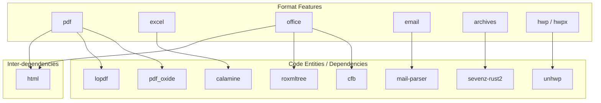
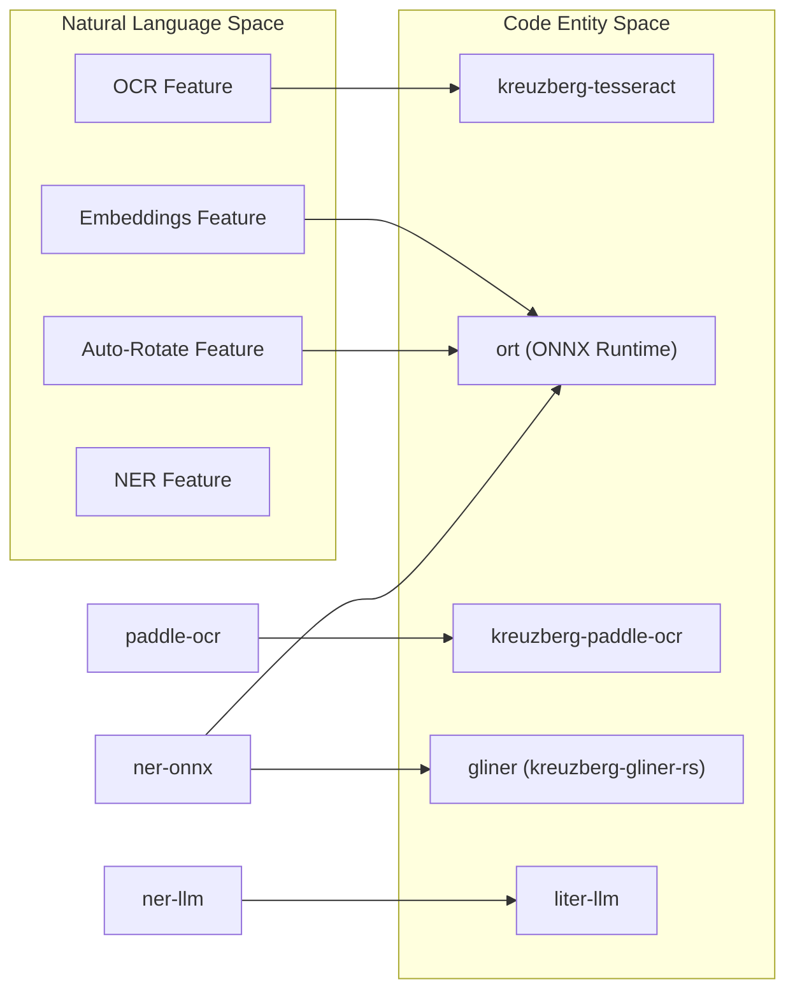

<!-- source: DeepWiki mcp.deepwiki.com · repo kreuzberg-dev/kreuzberg · page 11.3 Feature Flags Reference · fetched 2026-10-26 -->

# Feature Flags Reference

<details>
<summary>Relevant source files</summary>

The following files were used as context for generating this wiki page:

- [.gitignore](.gitignore)
- [.pre-commit-config.yaml](.pre-commit-config.yaml)
- [CHANGELOG.md](CHANGELOG.md)
- [Cargo.lock](Cargo.lock)
- [Cargo.toml](Cargo.toml)
- [crates/kreuzberg-ffi/Cargo.toml](crates/kreuzberg-ffi/Cargo.toml)
- [crates/kreuzberg-node/Cargo.toml](crates/kreuzberg-node/Cargo.toml)
- [crates/kreuzberg-node/package.json](crates/kreuzberg-node/package.json)
- [crates/kreuzberg-py/Cargo.toml](crates/kreuzberg-py/Cargo.toml)
- [crates/kreuzberg-wasm/package.json](crates/kreuzberg-wasm/package.json)
- [crates/kreuzberg/Cargo.toml](crates/kreuzberg/Cargo.toml)
- [package.json](package.json)
- [packages/ruby/Gemfile.lock](packages/ruby/Gemfile.lock)
- [packages/ruby/ext/kreuzberg_rb/native/Cargo.lock](packages/ruby/ext/kreuzberg_rb/native/Cargo.lock)
- [packages/ruby/ext/kreuzberg_rb/native/Cargo.toml](packages/ruby/ext/kreuzberg_rb/native/Cargo.toml)
- [pnpm-lock.yaml](pnpm-lock.yaml)
- [pyproject.toml](pyproject.toml)
- [uv.lock](uv.lock)

</details>


This page documents Cargo feature flags used to control conditional compilation of Kreuzberg functionality. Feature flags allow users to customize which capabilities are included in their build, reducing binary size and compile time for minimal configurations. For information about runtime configuration of extraction behavior, see [11.1 Configuration Reference]().

## Overview

Kreuzberg uses Cargo's feature flag system to provide fine-grained control over document formats, processing capabilities, and runtime dependencies. Features are defined in [crates/kreuzberg/Cargo.toml:35-231]() and propagate to language bindings through their respective build configurations.

The feature system is organized into:
- **Default features**: Minimal runtime dependencies enabled by default.
- **Format features**: Support for specific document types (PDF, Office, etc.).
- **Processing features**: OCR, chunking, embeddings, quality processing, and text analysis.
- **Deployment features**: API server, MCP server, profiling, metrics.
- **Platform targets**: Pre-configured bundles for WASM, Android, and mobile.

## Feature Categories

### Default Features

[crates/kreuzberg/Cargo.toml:36]()
```toml
default = ["tokio-runtime", "simd-utf8"]
```

*   **`tokio-runtime`**: Enables the `tokio` dependency. Required for async extraction APIs, HTTP servers, and embedding generation. [crates/kreuzberg/Cargo.toml:46]()
*   **`simd-utf8`**: Enables SIMD-accelerated UTF-8 validation via the `simdutf8` crate. [crates/kreuzberg/Cargo.toml:44]()

### Core Runtime & Profiling

| Feature | Description | Code Entities / Dependencies |
| :--- | :--- | :--- |
| **`profiling`** | Enables `pprof` flamegraph profiling (non-Windows/WASM). | `dep:pprof` [crates/kreuzberg/Cargo.toml:40]() |
| **`pool-metrics`** | Enables collection of thread pool utilization metrics. | N/A [crates/kreuzberg/Cargo.toml:42]() |

Sources: [crates/kreuzberg/Cargo.toml:38-46]()

### Document Format Features

Kreuzberg supports 75+ formats, gated by specific feature flags to manage the dependency tree.

#### Format Dependency Mapping

Title: Format Feature to Code Entity Mapping

Sources: [crates/kreuzberg/Cargo.toml:50-77]()

*   **`pdf`**: Core PDF support via `pdf_oxide` and `lopdf`. Includes `image` for rendering and `html` for structural output. [crates/kreuzberg/Cargo.toml:50]()
*   **`excel`**: Microsoft Excel support (.xlsx, .xls, .ods) via `calamine`. [crates/kreuzberg/Cargo.toml:51]()
*   **`office`**: Word processing and presentations (DOCX, PPTX, ODT). Uses `cfb` for OLE containers and `roxmltree` for XML parsing. [crates/kreuzberg/Cargo.toml:53-63]()
*   **`email`**: Support for EML and Outlook PST/MSG via `mail-parser` and `outlook-pst`. [crates/kreuzberg/Cargo.toml:67-74]()
*   **`archives`**: Recursive extraction for ZIP, TAR, and 7Z files. [crates/kreuzberg/Cargo.toml:77]()

### Processing & AI Features

These features control the "Intelligence" part of the platform, often involving heavy ONNX Runtime (ORT) dependencies.

#### AI Pipeline Entity Association

Title: AI Feature to Code Entity Association

Sources: [crates/kreuzberg/Cargo.toml:80-214]()

*   **`ocr`**: Enables Tesseract OCR via `kreuzberg-tesseract`. Includes image processing utilities. [crates/kreuzberg/Cargo.toml:91-101]()
*   **`paddle-ocr`**: Enables PaddleOCR via ONNX Runtime. Implies `ocr` and `auto-rotate`. [crates/kreuzberg/Cargo.toml:116-129]()
*   **`embeddings`**: Full vector embedding generation using ONNX Runtime. Includes `chunking` and `hf-hub` for model management. [crates/kreuzberg/Cargo.toml:178-187]()
*   **`ort-bundled`**: Configures the `ort` crate to download and bundle pre-compiled ONNX Runtime binaries. [crates/kreuzberg/Cargo.toml:132]()
*   **`auto-rotate`**: Uses PP-LCNet via ORT to detect and correct document orientation. [crates/kreuzberg/Cargo.toml:138-147]()
*   **`liter-llm`**: Enables LLM-driven features like VLM OCR and zero-shot extraction. [crates/kreuzberg/Cargo.toml:80]()
*   **`ner-onnx`**: Enables Named Entity Recognition using GLiNER models via ONNX Runtime. [crates/kreuzberg/Cargo.toml:203-214]()
*   **`redaction`**: Pattern-based PII engine. [crates/kreuzberg/Cargo.toml:216]()

### Deployment & Service Features

| Feature | Role | Dependencies |
| :--- | :--- | :--- |
| **`api`** | REST API Server | `axum`, `tower-http`, `utoipa` [crates/kreuzberg/Cargo.toml:239-249]() |
| **`mcp`** | Model Context Protocol | `rmcp` [crates/kreuzberg/Cargo.toml:250]() |
| **`otel`** | Observability | `opentelemetry`, `tracing-opentelemetry` [crates/kreuzberg/Cargo.toml:253]() |

## Platform Target Bundles

Kreuzberg provides pre-defined bundles for specific deployment environments where certain dependencies (like ONNX Runtime) may be incompatible.

### `no-ort-target`
A foundation for environments that cannot run ONNX Runtime (e.g., WASM, Android x86_64 emulators). It includes almost all format parsers and pure-Rust processing but excludes `embeddings`, `paddle-ocr`, and `ner-onnx`. [crates/kreuzberg/Cargo.toml:258-283]()

### `wasm-target`
Extends `no-ort-target` with WASM-specific implementations like `excel-wasm`, `tree-sitter-wasm`, and `ocr-wasm`. [crates/kreuzberg/Cargo.toml:285]()

### `android-target`
Extends `no-ort-target` with native Linux variants that work on Android ABI, including Tesseract OCR and API/MCP transports. [crates/kreuzberg/Cargo.toml:289]()

## Composite Feature Bundles

| Bundle | Purpose | Key Features Included |
| :--- | :--- | :--- |
| **`full`** | Maximum functionality | All formats, OCR, Embeddings, NER, API, MCP, OTEL. [crates/kreuzberg/Cargo.toml:292-313]() |
| **`server`** | API Server optimized | `api`, `mcp`, `pdf`, `excel`, `ocr`, `static-pdfium`. [crates/kreuzberg/Cargo.toml:315-324]() |
| **`cli`** | CLI tool optimized | `pdf`, `excel`, `office`, `ocr`, `static-pdfium`. [crates/kreuzberg/Cargo.toml:326-335]() |

Sources: [crates/kreuzberg/Cargo.toml:292-335]()

## PDFium Linking Strategies

The `pdf` feature requires a PDFium backend. Only one of these should be active:

1.  **`static-pdfium`**: Links PDFium statically. Best for portable CLI/Server binaries. [crates/kreuzberg/Cargo.toml:337]()
2.  **`bundled-pdfium`**: Bundles PDFium as a shared library. Used for Python/Node.js wheels/packages. [crates/kreuzberg/Cargo.toml:339]()
3.  **`system-pdfium`**: Uses the system-installed PDFium. [crates/kreuzberg/Cargo.toml:341]()

Sources: [crates/kreuzberg/Cargo.toml:337-341]()

## Feature Propagation in Bindings

Language bindings enable specific features by default in their respective `Cargo.toml` files:

*   **Python**: Enables `bundled-pdfium`, `ocr`, `excel`, `office`, and `keywords`. [crates/kreuzberg-py/Cargo.toml]()
*   **Node.js**: Enables `full` and `bundled-pdfium`. [crates/kreuzberg-node/Cargo.toml]()
*   **WASM**: Enables `wasm-target` and `bundled-pdfium`. [crates/kreuzberg-wasm/Cargo.toml]()

Sources: [crates/kreuzberg-py/Cargo.toml](), [crates/kreuzberg-node/Cargo.toml](), [crates/kreuzberg-wasm/Cargo.toml]()

---

