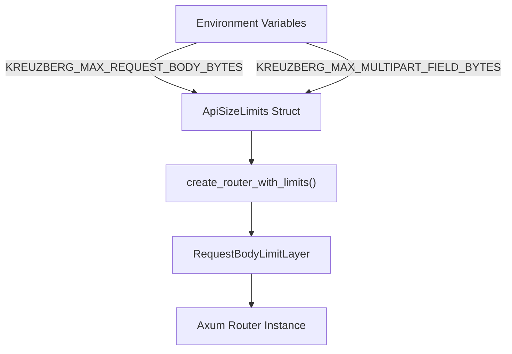
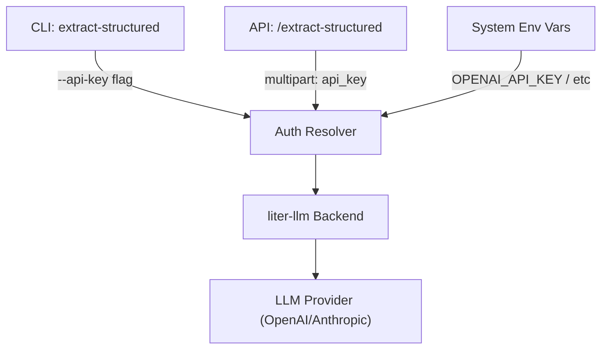

<!-- source: DeepWiki mcp.deepwiki.com · repo kreuzberg-dev/kreuzberg · page 11.5 Environment Variables Reference · fetched 2026-10-26 -->

# Environment Variables Reference

<details>
<summary>Relevant source files</summary>

The following files were used as context for generating this wiki page:

- [crates/kreuzberg-cli/README.md](crates/kreuzberg-cli/README.md)
- [crates/kreuzberg/src/api/error.rs](crates/kreuzberg/src/api/error.rs)
- [crates/kreuzberg/src/api/handlers.rs](crates/kreuzberg/src/api/handlers.rs)
- [crates/kreuzberg/src/api/mod.rs](crates/kreuzberg/src/api/mod.rs)
- [crates/kreuzberg/src/api/openapi.rs](crates/kreuzberg/src/api/openapi.rs)
- [crates/kreuzberg/src/api/openweb.rs](crates/kreuzberg/src/api/openweb.rs)
- [crates/kreuzberg/src/api/router.rs](crates/kreuzberg/src/api/router.rs)
- [crates/kreuzberg/src/api/types.rs](crates/kreuzberg/src/api/types.rs)
- [crates/kreuzberg/src/chunking/validation.rs](crates/kreuzberg/src/chunking/validation.rs)
- [crates/kreuzberg/src/core/config_validation/dependencies.rs](crates/kreuzberg/src/core/config_validation/dependencies.rs)
- [crates/kreuzberg/src/core/server_config/mod.rs](crates/kreuzberg/src/core/server_config/mod.rs)
- [crates/kreuzberg/tests/api_chunk.rs](crates/kreuzberg/tests/api_chunk.rs)
- [crates/kreuzberg/tests/api_embed.rs](crates/kreuzberg/tests/api_embed.rs)
- [crates/kreuzberg/tests/api_large_pdf_extraction.rs](crates/kreuzberg/tests/api_large_pdf_extraction.rs)
- [crates/kreuzberg/tests/api_large_pdf_extraction_diagnostics.rs](crates/kreuzberg/tests/api_large_pdf_extraction_diagnostics.rs)
- [crates/kreuzberg/tests/api_tests.rs](crates/kreuzberg/tests/api_tests.rs)
- [docs/cli/usage.md](docs/cli/usage.md)
- [docs/getting-started/quickstart.md](docs/getting-started/quickstart.md)
- [docs/guides/advanced.md](docs/guides/advanced.md)
- [docs/guides/api-server.md](docs/guides/api-server.md)
- [docs/guides/configuration.md](docs/guides/configuration.md)
- [docs/guides/extraction.md](docs/guides/extraction.md)
- [docs/guides/layout-detection.md](docs/guides/layout-detection.md)
- [docs/guides/ocr.md](docs/guides/ocr.md)
- [docs/guides/plugins.md](docs/guides/plugins.md)
- [docs/reference/environment-variables.md](docs/reference/environment-variables.md)
- [docs/reference/file-size-limits.md](docs/reference/file-size-limits.md)
- [docs/reference/formats.md](docs/reference/formats.md)
- [docs/snippets/cli/batch_basic.md](docs/snippets/cli/batch_basic.md)
- [docs/snippets/cli/extract_basic.md](docs/snippets/cli/extract_basic.md)
- [docs/snippets/cli/ocr_basic.md](docs/snippets/cli/ocr_basic.md)

</details>


This page provides a comprehensive reference for the `KREUZBERG_*` environment variables used to configure the extraction engine, API server limits, logging behavior, and model paths. These variables allow for fine-grained control over the system without modifying configuration files or code.

## Global Configuration

These variables affect the core behavior of the Kreuzberg engine across all interfaces (CLI, API, and language bindings).

| Variable | Description | Default |
| :--- | :--- | :--- |
| `KREUZBERG_CONFIG` | Path to a TOML, YAML, or JSON configuration file. | Auto-discovered `kreuzberg.toml` |
| `RUST_LOG` | Controls logging verbosity (e.g., `info`, `debug`, `trace`). | `info` |
| `NO_COLOR` | Disables colored output in the CLI when set to any value. | Unset |

### Log Levels
The `RUST_LOG` variable (or the `--log-level` CLI flag) supports the following levels: `trace`, `debug`, `info`, `warn`, and `error` [docs/cli/usage.md:43-58]().

### Configuration Discovery
If `KREUZBERG_CONFIG` is not set, the system performs "Automatic Discovery" by walking up from the current working directory to find a `kreuzberg.toml` file [docs/guides/configuration.md:86-88]().

Sources: [docs/cli/usage.md:43-67](), [docs/guides/configuration.md:86-88]()

---

## API Server & Resource Limits

When running the HTTP REST API server via `kreuzberg serve`, these variables tune the networking and resource constraints of the `axum` server.

| Variable | Description | Default |
| :--- | :--- | :--- |
| `KREUZBERG_MAX_REQUEST_BODY_BYTES` | Maximum total size of the entire multipart request body. | 100 MB |
| `KREUZBERG_MAX_MULTIPART_FIELD_BYTES` | Maximum size allowed for an individual file within a request. | 100 MB |
| `KREUZBERG_PORT` | The port the API server listens on. | `8000` |
| `KREUZBERG_HOST` | The network interface the API server binds to. | `127.0.0.1` |

### Implementation Details
The size limits are enforced in the API router layer using `DefaultBodyLimit` and `RequestBodyLimitLayer` [crates/kreuzberg/src/api/handlers.rs:102-110](). These values are encapsulated in the `ApiSizeLimits` struct [crates/kreuzberg/src/api/types.rs:52-64]().

### Data Flow: API Size Enforcement
The following diagram illustrates how environment variables propagate into the Axum server configuration.

**Diagram: API Limit Propagation**


Sources: [crates/kreuzberg/src/api/types.rs:10-28](), [crates/kreuzberg/src/api/handlers.rs:102-110](), [crates/kreuzberg/src/api/types.rs:52-73]()

---

## OCR and Model Paths

These variables control how the system locates OCR engines and deep learning models for layout detection and embeddings.

| Variable | Description | Default |
| :--- | :--- | :--- |
| `TESSDATA_PREFIX` | Path to the directory containing Tesseract `.traineddata` files. | System default |
| `KREUZBERG_CACHE_DIR` | Directory where ONNX models and PaddleOCR weights are stored. | Platform-specific cache |

### OCR Backend Selection
While backends are typically configured via `OcrConfig` [docs/guides/ocr.md:93-128](), the environment must provide the necessary binaries or model paths:
- **Tesseract**: Requires `tesseract` in the system `PATH` and `TESSDATA_PREFIX` for language packs [docs/guides/ocr.md:29-65]().
- **PaddleOCR**: Models are automatically downloaded to the cache directory on first use [docs/guides/ocr.md:69-76]().

Sources: [docs/guides/ocr.md:29-76](), [docs/guides/layout-detection.md:112-113]()

---

## LLM Integration (Structured Extraction)

When using `extract-structured` or the `/extract-structured` endpoint, Kreuzberg relies on the `liter-llm` backend which consumes standard provider environment variables [docs/cli/usage.md:111-114]().

| Variable | Provider | Description |
| :--- | :--- | :--- |
| `OPENAI_API_KEY` | OpenAI | Required for GPT models |
| `ANTHROPIC_API_KEY` | Anthropic | Required for Claude models |
| `COHERE_API_KEY` | Cohere | Required for Command models |

### Integration Diagram: LLM Service Flow
This diagram shows how the `extract_structured` CLI command and API handler resolve keys to communicate with LLM providers.

**Diagram: LLM Credential Resolution**


Sources: [docs/cli/usage.md:94-118](), [docs/guides/api-server.md:143-165]()

---

## Summary of Default Values

The `ApiSizeLimits` implementation defines the default thresholds used when no environment variables are provided:

```rust
impl Default for ApiSizeLimits {
    fn default() -> Self {
        Self {
            max_request_body_bytes: 100 * 1024 * 1024, // 100 MB
            max_multipart_field_bytes: 100 * 1024 * 1024, // 100 MB
        }
    }
}
```
[crates/kreuzberg/src/api/types.rs:66-73]()

Sources: [crates/kreuzberg/src/api/types.rs:66-73]()

---

