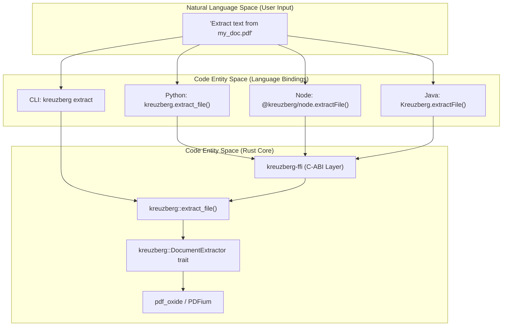
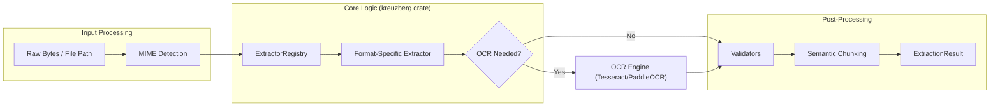

<!-- source: DeepWiki mcp.deepwiki.com · repo kreuzberg-dev/kreuzberg · page 2 Getting Started · fetched 2026-10-26 -->

# Getting Started

<details>
<summary>Relevant source files</summary>

The following files were used as context for generating this wiki page:

- [CONTRIBUTING.md](CONTRIBUTING.md)
- [crates/kreuzberg-cli/README.md](crates/kreuzberg-cli/README.md)
- [crates/kreuzberg/tests/api_openweb.rs](crates/kreuzberg/tests/api_openweb.rs)
- [docs/cli/usage.md](docs/cli/usage.md)
- [docs/contributing.md](docs/contributing.md)
- [docs/css/extra.css](docs/css/extra.css)
- [docs/features.md](docs/features.md)
- [docs/getting-started/installation.md](docs/getting-started/installation.md)
- [docs/getting-started/quickstart.md](docs/getting-started/quickstart.md)
- [docs/guides/advanced.md](docs/guides/advanced.md)
- [docs/guides/agent-skills.md](docs/guides/agent-skills.md)
- [docs/guides/api-server.md](docs/guides/api-server.md)
- [docs/guides/configuration.md](docs/guides/configuration.md)
- [docs/guides/docker.md](docs/guides/docker.md)
- [docs/guides/extraction.md](docs/guides/extraction.md)
- [docs/guides/kubernetes.md](docs/guides/kubernetes.md)
- [docs/guides/layout-detection.md](docs/guides/layout-detection.md)
- [docs/guides/ocr.md](docs/guides/ocr.md)
- [docs/guides/plugins.md](docs/guides/plugins.md)
- [docs/index.md](docs/index.md)
- [docs/integrations/index.md](docs/integrations/index.md)
- [docs/integrations/openwebui.md](docs/integrations/openwebui.md)
- [docs/integrations/surrealdb.md](docs/integrations/surrealdb.md)
- [docs/reference/environment-variables.md](docs/reference/environment-variables.md)
- [docs/reference/formats.md](docs/reference/formats.md)
- [docs/snippets/cli/batch_basic.md](docs/snippets/cli/batch_basic.md)
- [docs/snippets/cli/extract_basic.md](docs/snippets/cli/extract_basic.md)
- [docs/snippets/cli/ocr_basic.md](docs/snippets/cli/ocr_basic.md)

</details>


This document serves as a high-level guide for installing and using the Kreuzberg document intelligence library across various programming languages. Kreuzberg provides a unified interface for extracting text, metadata, and code intelligence from 91+ file formats [docs/index.md:29-30]().

## Installation

Kreuzberg is designed with a Rust core and native bindings for 17 languages [docs/getting-started/installation.md:7](). Most packages ship with **prebuilt binaries** for Linux (x86_64/aarch64), macOS (Apple Silicon/Intel), and Windows, eliminating the need for a local compilation step [docs/getting-started/installation.md:7-8]().

### Package Overview

| Runtime/Environment | Package | Performance | Best For |
|:--------------------|:--------|:------------|:---------|
| **Node.js** | `@kreuzberg/node` | Native | Server-side applications [docs/index.md:91]() |
| **Browser / Edge** | `@kreuzberg/wasm` | WASM | Client-side, Workers, Deno [docs/index.md:93]() |
| **Python** | `kreuzberg` | Native | AI/ML pipelines, general purpose [docs/index.md:70]() |
| **Rust** | `kreuzberg` | Native | Systems programming [docs/index.md:73]() |
| **Go** | `github.com/kreuzberg-dev/kreuzberg/v5` | Native | High-concurrency services [docs/index.md:74]() |
| **Java / Kotlin** | `dev.kreuzberg:kreuzberg` | Native | Enterprise JVM apps [docs/index.md:75-76]() |
| **Ruby** | `kreuzberg` | Native | Idiomatic Ruby apps [docs/index.md:78]() |
| **PHP** | `kreuzberg/kreuzberg` | Native | Modern PHP apps [docs/index.md:79]() |
| **C# / .NET** | `Kreuzberg` | Native | .NET applications [docs/index.md:77]() |

For detailed installation instructions, including native dependencies and runtime requirements, see [Installation](#2.1).

### System Requirements & Constraints

While binaries are prebuilt, certain features have hardware requirements:
- **AVX/AVX2 Instructions**: Required for x86_64 CPUs to use **PaddleOCR**, **layout detection**, and **embeddings** via ONNX Runtime [docs/getting-started/installation.md:51-53]().
- **Dynamic Linking**: Go, Elixir, and C/C++ on Windows require `onnxruntime.dll` to be present on the system `PATH` [docs/getting-started/installation.md:55-57]().

Sources: [docs/getting-started/installation.md:7-57](), [docs/index.md:67-95]()

## Quick Start Examples

Kreuzberg provides both synchronous and asynchronous APIs depending on the language's idiomatic patterns. Below are high-level examples of basic document extraction.

### Python
```python
import asyncio
from kreuzberg import extract_file, ExtractionConfig

async def main():
    # Basic extraction with caching enabled
    config = ExtractionConfig(use_cache=True)
    result = await extract_file("document.pdf", config=config)
    print(result.content)

asyncio.run(main())
```
Sources: [docs/snippets/python/api/extract_file_sync.md]()

### TypeScript (Node.js)
```typescript
import { extractFile } from "@kreuzberg/node";

const result = await extractFile("document.pdf");
console.log(result.content);
```
Sources: [docs/snippets/typescript/getting-started/extract_file_sync.md]()

### Java
```java
import dev.kreuzberg.Kreuzberg;
import dev.kreuzberg.ExtractionResult;

public class Main {
    public static void main(String[] args) throws Exception {
        ExtractionResult result = Kreuzberg.extractFile("document.pdf");
        System.out.println(result.getContent());
    }
}
```
Sources: [docs/snippets/java/api/extract_file_sync.md]()

For more language-specific code snippets and advanced usage patterns, see [Quick Start Examples](#2.2).

## Architecture Overview

The following diagrams illustrate how Kreuzberg bridges the gap between high-level language requests and the underlying Rust engine.

### Data Flow: Language Binding to Rust Core

This diagram shows how a call in a host language (e.g., Python or Node.js) traverses the system.


Sources: [docs/features.md:112-121](), [docs/guides/extraction.md:1-8](), [docs/cli/usage.md:71-79]()

### The Extraction Pipeline

The internal processing logic used by all bindings to transform raw bytes into structured intelligence.


Sources: [docs/features.md:112-121](), [docs/guides/ocr.md:1-5]()

## Next Steps

To dive deeper into specific areas of Kreuzberg, explore these sections:

- **[Core Concepts](#3)**: Understand the extraction pipeline, MIME detection, and PDF handling.
- **[Language Bindings](#4)**: Detailed guides for all 17 supported languages.
- **[Plugin System](#5)**: Learn how to extend Kreuzberg with custom OCR backends or post-processors.
- **[Deployment](#7)**: Running Kreuzberg as a CLI tool, REST API, or MCP server.

Sources: [docs/index.md:95-133]()

---

