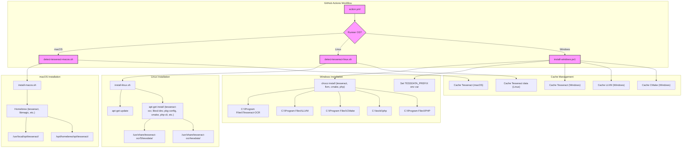

<!-- source: DeepWiki mcp.deepwiki.com · repo kreuzberg-dev/kreuzberg · page 2.1 Installation · fetched 2026-10-26 -->

# Installation

<details>
<summary>Relevant source files</summary>

The following files were used as context for generating this wiki page:

- [.github/actions/install-system-deps/action.yml](.github/actions/install-system-deps/action.yml)
- [.github/actions/setup-onnx-runtime/action.yml](.github/actions/setup-onnx-runtime/action.yml)
- [CONTRIBUTING.md](CONTRIBUTING.md)
- [crates/kreuzberg/tests/api_openweb.rs](crates/kreuzberg/tests/api_openweb.rs)
- [docs/contributing.md](docs/contributing.md)
- [docs/css/extra.css](docs/css/extra.css)
- [docs/features.md](docs/features.md)
- [docs/getting-started/installation.md](docs/getting-started/installation.md)
- [docs/guides/agent-skills.md](docs/guides/agent-skills.md)
- [docs/guides/docker.md](docs/guides/docker.md)
- [docs/guides/kubernetes.md](docs/guides/kubernetes.md)
- [docs/index.md](docs/index.md)
- [docs/integrations/index.md](docs/integrations/index.md)
- [docs/integrations/openwebui.md](docs/integrations/openwebui.md)
- [docs/integrations/surrealdb.md](docs/integrations/surrealdb.md)
- [scripts/ci/install-system-deps/install-linux.sh](scripts/ci/install-system-deps/install-linux.sh)
- [scripts/ci/install-system-deps/install-macos.sh](scripts/ci/install-system-deps/install-macos.sh)
- [scripts/ci/install-system-deps/install-windows.ps1](scripts/ci/install-system-deps/install-windows.ps1)

</details>


This document covers installation of Kreuzberg across all supported language bindings and runtime environments. For runtime configuration options, see the [Configuration Reference](../reference/configuration.md). For deployment scenarios including Docker and API servers, see [Docker Deployment](../guides/docker.md) and [HTTP REST API Server](../guides/api-server.md).

## Overview

Kreuzberg is distributed through language-specific package managers, with pre-built binaries available for most platforms. Installation methods vary by binding strategy:

-   **Native bindings** (Python, Node.js, Ruby, Elixir, R): Direct integration via language-specific build systems (PyO3, NAPI-RS, Magnus, Rustler, extendr).
-   **FFI bindings** (Java, Go, C#, PHP, C, Zig): Use the C FFI layer with platform-specific runtime loading.
-   **WebAssembly**: Pure WASM modules for browser, Deno, and Cloudflare Workers.
-   **CLI/Docker**: Standalone binaries and container images.

Sources: [docs/index.md:62-84](), [docs/getting-started/installation.md:5-58]()

---

## Package Manager Installation

### Python

Kreuzberg for Python is distributed via PyPI with pre-built wheels. The package uses `maturin` for building PyO3 bindings.

```bash
# Using pip
pip install kreuzberg

# Install with optional dependencies
pip install kreuzberg[easyocr]  # EasyOCR backend
```

**Platform support:**
- Linux: `manylinux2014` (glibc), `musllinux` (Alpine)
- macOS: x86_64, arm64 (Apple Silicon)
- Windows: x86_64

**Python version:** `>=3.10` (specified in [docs/contributing.md:45]())

Sources: [docs/getting-started/installation.md:63-72](), [docs/index.md:70]()

---

### Node.js / TypeScript

Two packages are available for JavaScript/TypeScript environments:

#### @kreuzberg/node (Native)
Native Node.js bindings via NAPI-RS for maximum performance. Use for Node.js servers and CLI tools.

```bash
# Using npm
npm install @kreuzberg/node
```

#### @kreuzberg/wasm (WebAssembly)
WASM bindings for browser, Deno, and edge runtimes.

```bash
npm install @kreuzberg/wasm
```

Sources: [docs/getting-started/installation.md:74-94](), [docs/index.md:71-72]()

---

### Ruby

Kreuzberg for Ruby uses Magnus (rb-sys) for native bindings:

```bash
gem install kreuzberg
```

**Requirements:**
- Ruby `3.2+` (specified in [docs/contributing.md:47]())

Sources: [docs/getting-started/installation.md:140-150](), [docs/index.md:78]()

---

### Java & Kotlin

Java bindings use the Panama FFM API (Foreign Function & Memory API), distributed via Maven Central:

```gradle
// Java
implementation 'dev.kreuzberg:kreuzberg:5.0.0-rc.1'

// Kotlin
implementation 'dev.kreuzberg:kreuzberg-kotlin:5.0.0-rc.1'
```

**Requirements:**
- Java `25+` (specified in [docs/contributing.md:49]())

Sources: [docs/getting-started/installation.md:118-138](), [docs/index.md:75-76]()

---

### Go

Go bindings use cgo to interface with the C FFI layer:

```bash
go get github.com/kreuzberg-dev/kreuzberg/v5@latest
```

**Requirements:**
- Go `1.26+` (specified in [docs/contributing.md:48]())

Sources: [docs/getting-started/installation.md:107-116](), [docs/index.md:74]()

---

### C# / .NET

C# bindings use P/Invoke for interop, distributed via NuGet:

```bash
dotnet add package Kreuzberg
```

**Requirements:**
- .NET `10+` (specified in [docs/contributing.md:50]())

Sources: [docs/getting-started/installation.md:162-171](), [docs/index.md:77]()

---

### PHP

PHP bindings leverage `ext-ffi` for integration:

```bash
composer require kreuzberg/kreuzberg
```

**Requirements:**
- PHP `8.1+` (specified in [docs/contributing.md:51]())

Sources: [docs/getting-started/installation.md:173-183](), [docs/index.md:79]()

---

### Elixir

Elixir bindings use Rustler NIFs:

```elixir
{:kreuzberg, "~> 5.0.0-rc.1"}
```

**Requirements:**
- Elixir `1.14+` (specified in [docs/contributing.md:52]())
- OTP `25+`

Sources: [docs/getting-started/installation.md:185-195](), [docs/index.md:80]()

---

### R

R bindings are built using the `extendr` framework and distributed via r-universe:

```r
install.packages("kreuzberg",
  repos = "https://kreuzberg-dev.r-universe.dev")
```

**Requirements:**
- R `4.1+` (specified in [docs/contributing.md:53]())

Sources: [docs/getting-started/installation.md:197-206](), [docs/index.md:81]()

---

### Swift

Swift bindings use `swift-bridge` for integration:

```swift
.package(url: "https://github.com/kreuzberg-dev/kreuzberg.git", from: "5.0.0-rc.1")
```

Sources: [docs/getting-started/installation.md:152-161](), [docs/index.md:83]()

---

### Dart / Flutter

Dart/Flutter bindings use `flutter_rust_bridge` (FRB) and Dart FFI:

```bash
dart pub add kreuzberg
```

Sources: [docs/getting-started/installation.md:218-227](), [docs/index.md:82]()

---

### Zig

Zig bindings utilize Zig's C-interop with `kreuzberg-ffi`:

```bash
zig fetch --save https://github.com/kreuzberg-...
```

Sources: [docs/getting-started/installation.md:229-238](), [docs/index.md:84]()

---

### C / C++

The C/C++ bindings are provided through the `kreuzberg-ffi` crate, which generates a C header and shared library.

```bash
cargo build -p kreuzberg-ffi
```

Sources: [docs/getting-started/installation.md:208-217](), [docs/index.md:85]()

---

## Language Support Matrix

### Binding Strategy and Package Names

The following diagram maps the relationship between language-specific code entities and the core Rust implementation.

**Language Binding to Code Entity Mapping**

```mermaid
graph TD
    subgraph "Language Space"
        PY["Python: kreuzberg"]
        TS_NODE["Node.js: @kreuzberg/node"]
        TS_WASM["WASM: @kreuzberg/wasm"]
        RB["Ruby: kreuzberg"]
        JV["Java: dev.kreuzberg:kreuzberg"]
        GO["Go: github.com/kreuzberg-dev/kreuzberg"]
        CS["C#: Kreuzberg"]
        PHP["PHP: kreuzberg/kreuzberg"]
        ELIXIR["Elixir: {:kreuzberg, ~> 5.0.0-rc.1}"]
        R["R: kreuzberg"]
        SWIFT["Swift: kreuzberg.git"]
        DART["Dart: kreuzberg"]
        ZIG["Zig: kreuzberg"]
        C_CPP["C/C++: kreuzberg-ffi"]
    end

    subgraph "Bridge Layer"
        PYO3["PyO3"]
        NAPI["NAPI-RS"]
        WASM_BIND["wasm-bindgen"]
        MAGNUS["Magnus (rb-sys)"]
        PANAMA["Java Panama FFM API"]
        CGO["CGo"]
        PINVOKE["P/Invoke"]
        EXT_FFI["ext-ffi"]
        RUSTLER["Rustler NIFs"]
        EXTENDR["extendr"]
        SWIFT_BRIDGE["swift-bridge"]
        FRB["flutter_rust_bridge"]
        ZIG_C_INTEROP["Zig C-interop"]
        CBINDGEN["cbindgen"]
    end

    subgraph "Core Entity Space"
        CORE["kreuzberg core crate"]
        FFI["kreuzberg-ffi (C-Headers)"]
    end

    PY --> PYO3 --> CORE
    TS_NODE --> NAPI --> CORE
    TS_WASM --> WASM_BIND --> CORE
    RB --> MAGNUS --> CORE
    JV --> PANAMA --> FFI
    GO --> CGO --> FFI
    CS --> PINVOKE --> FFI
    PHP --> EXT_FFI --> FFI
    ELIXIR --> RUSTLER --> FFI
    R --> EXTENDR --> FFI
    SWIFT --> SWIFT_BRIDGE --> FFI
    DART --> FRB --> FFI
    ZIG --> ZIG_C_INTEROP --> FFI
    C_CPP --> CBINDGEN --> FFI
    FFI --> CORE
```

Sources: [docs/index.md:62-84](), [docs/getting-started/installation.md:59-228](), [scripts/ci/ruby/vendor-kreuzberg-core.py:1-11]()

---

## Native Dependencies & Runtime Requirements

### Hardware Requirements
**x86_64 CPUs:** Support for **AVX/AVX2** instruction sets is required for ONNX-dependent features:
- PaddleOCR
- Layout detection
- Embeddings

CPUs without AVX (e.g., older Intel Atoms or pre-2011 processors) will crash when these features are invoked. Text extraction and Tesseract OCR are unaffected. ARM platforms (aarch64) have no such restriction [docs/getting-started/installation.md:51-53]().

### OCR Backends
Kreuzberg supports three OCR engines with varying installation requirements:

| Backend | Requirements | Best For |
| :--- | :--- | :--- |
| **Tesseract** | System package `tesseract-ocr` | Broad language coverage (100+) |
| **PaddleOCR** | ONNX Runtime (Bundled in Python) | CJK, high accuracy |
| **EasyOCR** | `pip install kreuzberg[easyocr]` | GPU-accelerated (Python only) |

Sources: [docs/features.md:143-150](), [docs/getting-started/installation.md:51-53]()

### Windows Specifics
For Go, Elixir, and C/C++ on Windows, `onnxruntime.dll` must be present in the system `PATH` at runtime. This DLL can be downloaded from the [ONNX Runtime releases](https://github.com/microsoft/onnxruntime/releases) (e.g., `onnxruntime-win-x64-1.24.1.zip`) [docs/getting-started/installation.md:55-57]().

### WASM Builds
For WASM builds, the [WASI SDK](https://github.com/WebAssembly/wasi-sdk/releases) is required. It provides a wasm-capable C/C++ compiler necessary for `tree-sitter` and `tesseract` compilation. It should be installed to `$HOME/wasi-sdk` or its path specified via the `WASI_SDK_PATH` environment variable [docs/contributing.md:38-41]().

Sources: [docs/getting-started/installation.md:55-57](), [docs/features.md:143-150](), [docs/contributing.md:38-41]()

---

## System Installation Pipeline

The following diagram illustrates the data flow and system dependencies involved during the installation of system-level tools via CI scripts.

**System Dependency Installation Flow**

Sources: [.github/actions/install-system-deps/action.yml:16-105](), [scripts/ci/install-system-deps/install-linux.sh:1-137](), [scripts/ci/install-system-deps/install-windows.ps1:1-220]()

---

## CLI & Docker

### Standalone CLI
The CLI can be installed via an install script, Homebrew, or Cargo.

```bash
# Install script
curl -fsSL https://raw.githubusercontent.com/kreuzberg-dev/kreuzberg/main/scripts/install.sh | bash

# Homebrew
brew install kreuzberg-dev/tap/kreuzberg

# Cargo
cargo install kreuzberg-cli
```

Sources: [docs/getting-started/installation.md:15-31]()

### Docker
Two Docker image variants are provided:
1.  **CLI Image**: `ghcr.io/kreuzberg-dev/kreuzberg-cli:latest` - Optimized for terminal usage.
2.  **Full Image**: `ghcr.io/kreuzberg-dev/kreuzberg:latest` - Includes all dependencies for API/MCP server usage.

```bash
docker pull ghcr.io/kreuzberg-dev/kreuzberg:latest
```

Sources: [docs/getting-started/installation.md:33-44](), [docs/guides/docker.md:35-36]()

---

