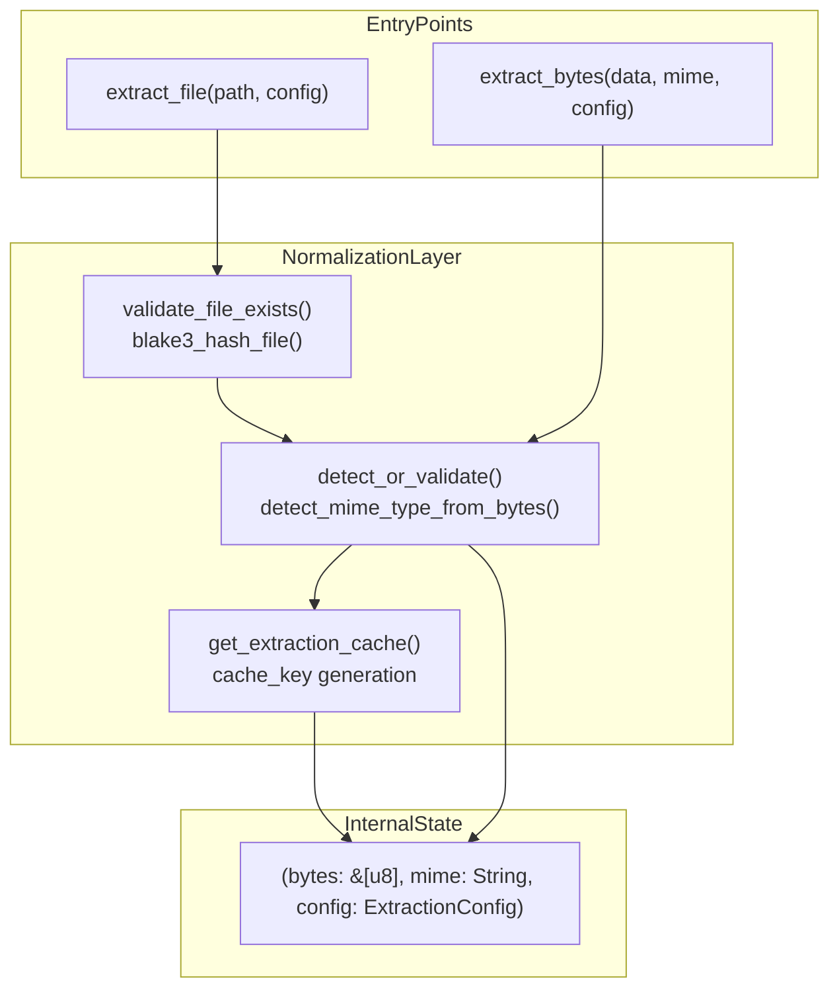
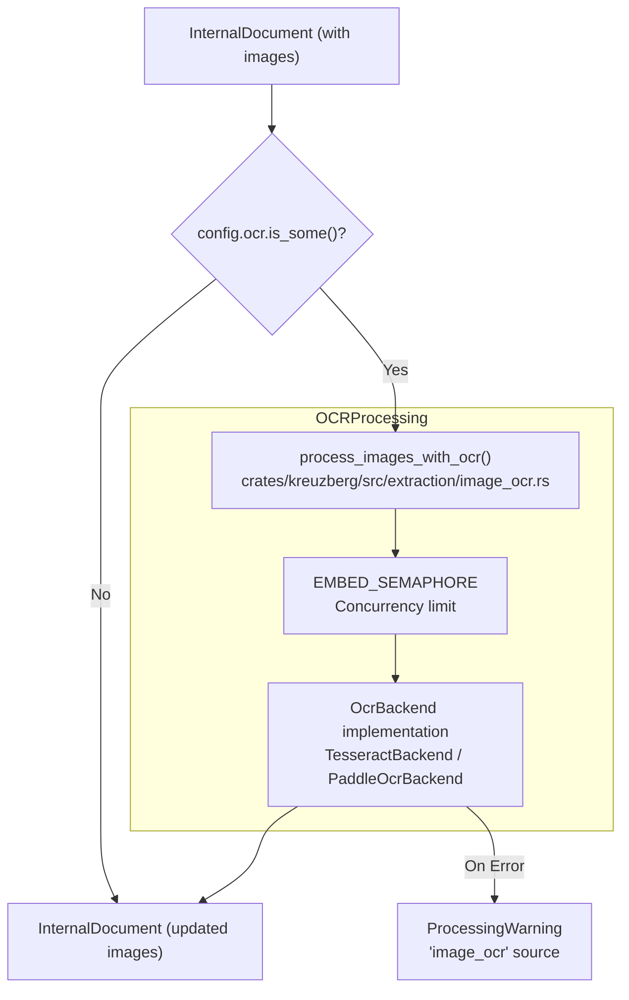
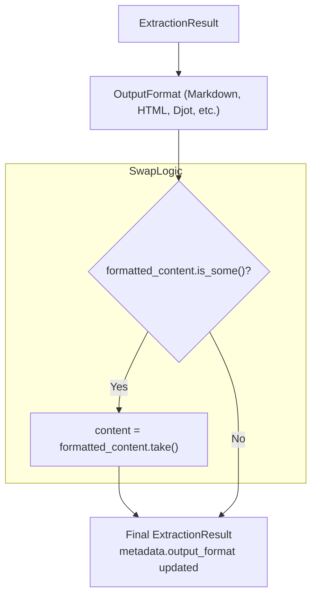

<!-- source: DeepWiki mcp.deepwiki.com · repo kreuzberg-dev/kreuzberg · page 3.1 Document Processing Pipeline · fetched 2026-10-26 -->

# Document Processing Pipeline

Relevant source files

The following files were used as context for generating this wiki page:

- [crates/kreuzberg-cli/src/style.rs](crates/kreuzberg-cli/src/style.rs)
- [crates/kreuzberg-ffi/tests/vtable_bytes_len.rs](crates/kreuzberg-ffi/tests/vtable_bytes_len.rs)
- [crates/kreuzberg/src/cache/mod.rs](crates/kreuzberg/src/cache/mod.rs)
- [crates/kreuzberg/src/cache/utilities.rs](crates/kreuzberg/src/cache/utilities.rs)
- [crates/kreuzberg/src/chunking/builder.rs](crates/kreuzberg/src/chunking/builder.rs)
- [crates/kreuzberg/src/chunking/core.rs](crates/kreuzberg/src/chunking/core.rs)
- [crates/kreuzberg/src/chunking/mod.rs](crates/kreuzberg/src/chunking/mod.rs)
- [crates/kreuzberg/src/chunking/yaml_section.rs](crates/kreuzberg/src/chunking/yaml_section.rs)
- [crates/kreuzberg/src/core/mime.rs](crates/kreuzberg/src/core/mime.rs)
- [crates/kreuzberg/src/core/pipeline/cache.rs](crates/kreuzberg/src/core/pipeline/cache.rs)
- [crates/kreuzberg/src/core/pipeline/features.rs](crates/kreuzberg/src/core/pipeline/features.rs)
- [crates/kreuzberg/src/core/pipeline/format.rs](crates/kreuzberg/src/core/pipeline/format.rs)
- [crates/kreuzberg/src/core/pipeline/mod.rs](crates/kreuzberg/src/core/pipeline/mod.rs)
- [crates/kreuzberg/src/embeddings/mod.rs](crates/kreuzberg/src/embeddings/mod.rs)
- [crates/kreuzberg/src/extraction/mod.rs](crates/kreuzberg/src/extraction/mod.rs)
- [crates/kreuzberg/src/extractors/mod.rs](crates/kreuzberg/src/extractors/mod.rs)
- [crates/kreuzberg/src/extractors/security.rs](crates/kreuzberg/src/extractors/security.rs)
- [crates/kreuzberg/src/ocr/mod.rs](crates/kreuzberg/src/ocr/mod.rs)
- [crates/kreuzberg/src/ocr/tesseract_backend.rs](crates/kreuzberg/src/ocr/tesseract_backend.rs)
- [crates/kreuzberg/src/ocr/tesseract_wasm_backend.rs](crates/kreuzberg/src/ocr/tesseract_wasm_backend.rs)
- [crates/kreuzberg/src/ocr/types.rs](crates/kreuzberg/src/ocr/types.rs)
- [crates/kreuzberg/src/rendering/common.rs](crates/kreuzberg/src/rendering/common.rs)
- [crates/kreuzberg/src/table_core.rs](crates/kreuzberg/src/table_core.rs)
- [crates/kreuzberg/src/text/token_reduction/semantic.rs](crates/kreuzberg/src/text/token_reduction/semantic.rs)
- [crates/kreuzberg/src/utils/json_utils.rs](crates/kreuzberg/src/utils/json_utils.rs)
- [crates/kreuzberg/src/utils/mod.rs](crates/kreuzberg/src/utils/mod.rs)
- [crates/kreuzberg/src/utils/pool_sizing.rs](crates/kreuzberg/src/utils/pool_sizing.rs)
- [crates/kreuzberg/tests/docx_mime_detection_test.rs](crates/kreuzberg/tests/docx_mime_detection_test.rs)
- [crates/kreuzberg/tests/issue_350_regression_test.rs](crates/kreuzberg/tests/issue_350_regression_test.rs)
- [crates/kreuzberg/tests/pdf_chunk_page_metadata.rs](crates/kreuzberg/tests/pdf_chunk_page_metadata.rs)

This document describes Kreuzberg's multi-stage document processing pipeline, from input normalization through format-specific extraction, OCR integration, post-processing, and advanced feature generation. The pipeline is designed for extensibility through a plugin system while maintaining consistent behavior across 75+ file formats and 12+ language bindings.

For information about the plugin architecture that enables custom extractors and processors, see [Plugin System](#5). For configuration options and discovery mechanisms, see [Configuration System](#3.4).

## Pipeline Overview

The document processing pipeline consists of six distinct stages executed in sequence:

```mermaid
graph LR
    Input["Input Normalization<br/>extract_file()<br/>extract_bytes()"]
    MIME["MIME Detection<br/>detect_or_validate()"]
    Route["Format Routing<br/>get_extractor()"]
    Extract["Format Extraction<br/>SyncExtractor<br/>InternalDocument"]
    OCR["OCR Integration<br/>process_images_with_ocr()"]
    Derive["Derivation<br/>derive_extraction_result()"]
    PostProc["Post-Processing<br/>run_pipeline() stages"]
    Output["ExtractionResult<br/>content, metadata<br/>chunks, embeddings"]
    
    Input --> MIME
    MIME --> Route
    Route --> Extract
    Extract --> OCR
    OCR --> Derive
    Derive --> PostProc
    PostProc --> Output
```

**Sources:** [crates/kreuzberg/src/core/pipeline/mod.rs:58-58](), [crates/kreuzberg/src/core/pipeline/mod.rs:137-140]()

## Input Normalization

The pipeline accepts three primary input modes, all normalized to an `ExtractionConfig` and raw data before processing. The `extract_file` function handles filesystem paths, while `extract_bytes` handles in-memory data.

| Input Mode | Function | Use Case | Implementation |
|------------|----------|----------|----------------|
| File Path | `extract_file()` | Local file extraction | Validates existence, detects MIME, handles caching [crates/kreuzberg/src/core/extractor/file.rs:67-122]() |
| Byte Array | `extract_bytes()` | In-memory documents | Direct processing, validates provided MIME [crates/kreuzberg/src/core/extractor/bytes.rs:66-108]() |
| Synchronous | `extract_sync()` | Blocking contexts | Uses `SyncExtractor` trait without async runtime [crates/kreuzberg/src/extractors/mod.rs:47-63]() |

**Sources:** [crates/kreuzberg/src/core/extractor/file.rs:67-160](), [crates/kreuzberg/src/core/extractor/bytes.rs:66-146](), [crates/kreuzberg/src/extractors/mod.rs:14-23]()

## Format-Specific Extraction

Once the MIME type is determined, the `get_extractor` helper retrieves the appropriate implementation from the registry. All extractors return an `InternalDocument`, which is a flat, append-only structure optimized for performance. The `SyncExtractor` trait defines the synchronous extraction interface for WASM targets and other environments where async runtimes are not available or desirable [crates/kreuzberg/src/extractors/mod.rs:47-63]().

```mermaid
graph TB
    Registry["get_document_extractor_registry().get_extractor(mime_type)"]
    
    subgraph "Extractors"
        PDF["PdfExtractor<br/>crates/kreuzberg/src/extractors/pdf.rs"]
        Office["DocxExtractor / ExcelExtractor<br/>crates/kreuzberg/src/extractors/docx.rs"]
        Text["PlainTextExtractor<br/>crates/kreuzberg/src/extractors/text.rs"]
        Image["ImageExtractor<br/>crates/kreuzberg/src/extractors/image.rs"]
        Code["CodeExtractor<br/>crates/kreuzberg/src/extractors/code.rs"]
        Csv["CsvExtractor<br/>crates/kreuzberg/src/extractors/csv.rs"]
        Html["HtmlExtractor<br/>crates/kreuzberg/src/extractors/html.rs"]
        Markdown["MarkdownExtractor<br/>crates/kreuzberg/src/extractors/markdown.rs"]
        Structured["StructuredExtractor<br/>crates/kreuzberg/src/extractors/structured.rs"]
        Archive["ZipExtractor / TarExtractor<br/>crates/kreuzberg/src/extractors/archive.rs"]
        Email["EmailExtractor / PstExtractor<br/>crates/kreuzberg/src/extractors/email.rs"]
        IWork["KeynoteExtractor / NumbersExtractor / PagesExtractor<br/>crates/kreuzberg/src/extractors/iwork.rs"]
        Hwp["HwpExtractor / HwpxExtractor<br/>crates/kreuzberg/src/extractors/hwp.rs"]
        Djot["DjotExtractor<br/>crates/kreuzberg/src/extractors/djot_format.rs"]
        Mdx["MdxExtractor<br/>crates/kreuzberg/src/extractors/mdx.rs"]
        Rst["RstExtractor<br/>crates/kreuzberg/src/extractors/rst.rs"]
        Latex["LatexExtractor<br/>crates/kreuzberg/src/extractors/latex.rs"]
        Jupyter["JupyterExtractor<br/>crates/kreuzberg/src/extractors/jupyter.rs"]
        OrgMode["OrgModeExtractor<br/>crates/kreuzberg/src/extractors/orgmode.rs"]
        Odt["OdtExtractor<br/>crates/kreuzberg/src/extractors/odt.rs"]
        Opml["OpmlExtractor<br/>crates/kreuzberg/src/extractors/opml.rs"]
        Typst["TypstExtractor<br/>crates/kreuzberg/src/extractors/typst.rs"]
        Xml["XmlExtractor / JatsExtractor / DocbookExtractor<br/>crates/kreuzberg/src/extractors/xml.rs"]
        Ppt["PptExtractor / PptxExtractor<br/>crates/kreuzberg/src/extractors/ppt.rs"]
        Rtf["RtfExtractor<br/>crates/kreuzberg/src/extractors/rtf.rs"]
        Bibtex["BibtexExtractor<br/>crates/kreuzberg/src/extractors/bibtex.rs"]
        Citation["CitationExtractor<br/>crates/kreuzberg/src/extractors/citation.rs"]
        Dbf["DbfExtractor<br/>crates/kreuzberg/src/extractors/dbf.rs"]
        Epub["EpubExtractor<br/>crates/kreuzberg/src/extractors/epub.rs"]
        FictionBook["FictionBookExtractor<br/>crates/kreuzberg/src/extractors/fictionbook.rs"]
    end
    
    subgraph "Output"
        InternalDoc["InternalDocument<br/>elements: Vec&lt;InternalElement&gt;<br/>metadata: Metadata<br/>images: Vec&lt;ExtractedImage&gt;"]
    end
    
    Registry --> PDF
    Registry --> Office
    Registry --> Text
    Registry --> Image
    Registry --> Code
    Registry --> Csv
    Registry --> Html
    Registry --> Markdown
    Registry --> Structured
    Registry --> Archive
    Registry --> Email
    Registry --> IWork
    Registry --> Hwp
    Registry --> Djot
    Registry --> Mdx
    Registry --> Rst
    Registry --> Latex
    Registry --> Jupyter
    Registry --> OrgMode
    Registry --> Odt
    Registry --> Opml
    Registry --> Typst
    Registry --> Xml
    Registry --> Ppt
    Registry --> Rtf
    Registry --> Bibtex
    Registry --> Citation
    Registry --> Dbf
    Registry --> Epub
    Registry --> FictionBook

    PDF --> InternalDoc
    Office --> InternalDoc
    Text --> InternalDoc
    Image --> InternalDoc
    Code --> InternalDoc
    Csv --> InternalDoc
    Html --> InternalDoc
    Markdown --> InternalDoc
    Structured --> InternalDoc
    Archive --> InternalDoc
    Email --> InternalDoc
    IWork --> InternalDoc
    Hwp --> InternalDoc
    Djot --> InternalDoc
    Mdx --> InternalDoc
    Rst --> InternalDoc
    Latex --> InternalDoc
    Jupyter --> InternalDoc
    OrgMode --> InternalDoc
    Odt --> InternalDoc
    Opml --> InternalDoc
    Typst --> InternalDoc
    Xml --> InternalDoc
    Ppt --> InternalDoc
    Rtf --> InternalDoc
    Bibtex --> InternalDoc
    Citation --> InternalDoc
    Dbf --> InternalDoc
    Epub --> InternalDoc
    FictionBook --> InternalDoc
```

The `InternalDocument` uses deterministic `InternalElementId` (Blake3) to enable caching and diffing. It stores relationships separately from elements to keep iteration compact.

**Sources:** [crates/kreuzberg/src/extractors/mod.rs:66-282](), [crates/kreuzberg/src/extractors/mod.rs:284-289](), [crates/kreuzberg/src/plugins/registry.rs:1-10]()

## OCR Integration Layer

OCR can be triggered either by specific extractors (like `ImageExtractor`) or as a pipeline step for documents containing images (like PDFs).

1.  **Format-Level OCR**: `ImageExtractor` uses the configured `OcrBackend` directly during the extraction phase.
2.  **Pipeline-Level OCR**: The `run_pipeline` function checks if `InternalDocument` contains images and if OCR is configured. It calls `process_images_with_ocr` to update the document [crates/kreuzberg/src/core/pipeline/mod.rs:66-73]().

**Sources:** [crates/kreuzberg/src/core/pipeline/mod.rs:59-81](), [crates/kreuzberg/src/embeddings/mod.rs:89-93](), [crates/kreuzberg/src/ocr/tesseract_backend.rs:28-31]()

## Derivation and Hierarchy

The bridge between the internal flat representation and the public-facing `ExtractionResult` is the **Derivation Pipeline**. This stage reconstructs the document tree and resolves relationships.

-   **Relationship Resolution**: Converts `RelationshipTarget::Key` (anchors) to `RelationshipTarget::Index` (vector offsets) [crates/kreuzberg/src/extraction/derive.rs:35-60]().
-   **Tree Reconstruction**: Flat elements are nested into a hierarchical `DocumentStructure` based on container markers (e.g., `ListStart`, `Heading`) [crates/kreuzberg/src/extraction/derive.rs:71-150]().
-   **PDF Hierarchy**: Uses font size clustering (K-Means) to detect H1-H6 levels in PDFs [crates/kreuzberg/tests/pdf_hierarchy_detection.rs:46-51]().

**Sources:** [crates/kreuzberg/src/extraction/derive.rs:1-10](), [crates/kreuzberg/src/extraction/derive.rs:128-131](), [crates/kreuzberg/tests/pdf_hierarchy_detection.rs:22-61]()

## Post-Processing and Features

The `run_pipeline` function orchestrates the final processing steps after derivation:

1.  **Post-Processors**: Executes registered plugins in `Early`, `Middle`, and `Late` stages [crates/kreuzberg/src/core/pipeline/mod.rs:159-167]().
2.  **Chunking**: Splits text into segments for RAG. If `Markdown` chunking is used, the pipeline pre-renders markdown to provide heading context [crates/kreuzberg/src/core/pipeline/mod.rs:88-99](). The `chunk_text` function in `crates/kreuzberg/src/chunking/core.rs` is the primary API for this [crates/kreuzberg/src/chunking/core.rs:53-59]().
3.  **Language Detection**: Uses `execute_language_detection` to populate `detected_languages` [crates/kreuzberg/src/core/pipeline/mod.rs:179]().
4.  **Token Reduction**: Applies summarization or filtering [crates/kreuzberg/src/core/pipeline/mod.rs:180]().
5.  **Validators**: Final check to ensure extraction quality [crates/kreuzberg/src/core/pipeline/mod.rs:181]().

### Advanced Feature: Embeddings
Embeddings are generated using ONNX models (via `fastembed-rs`). The system supports multiple presets (`fast`, `balanced`, `quality`, `multilingual`) [crates/kreuzberg/src/embeddings/mod.rs:118-161]() and limits concurrent inference via `EMBED_SEMAPHORE` to prevent resource exhaustion [crates/kreuzberg/src/embeddings/mod.rs:89-93]().

**Sources:** [crates/kreuzberg/src/core/pipeline/mod.rs:149-181](), [crates/kreuzberg/src/embeddings/mod.rs:89-115](), [crates/kreuzberg/src/embeddings/mod.rs:118-161](), [crates/kreuzberg/src/chunking/core.rs:53-59]()

## Output Format Application

The final step in the pipeline is `apply_output_format`. This function swaps the pre-rendered content (produced during derivation) into the main `content` field [crates/kreuzberg/src/core/pipeline/format.rs:29-47]().

**Sources:** [crates/kreuzberg/src/core/pipeline/format.rs:29-47](), [crates/kreuzberg/src/core/pipeline/mod.rs:186]()

---

