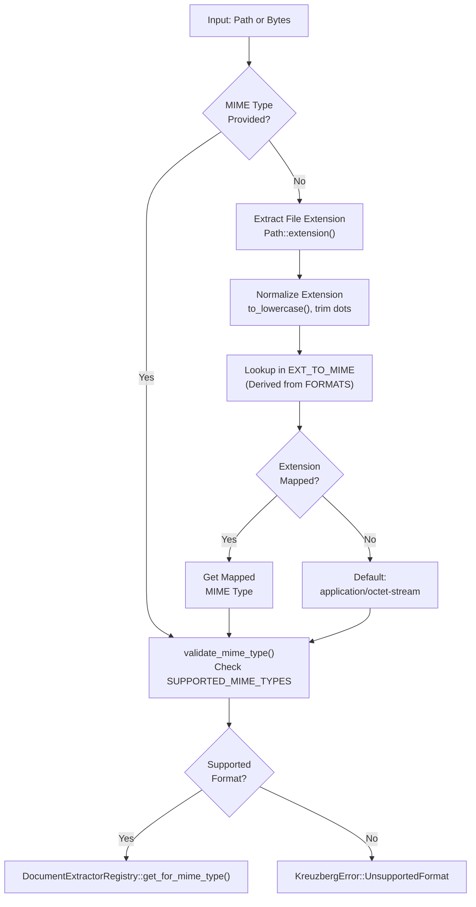
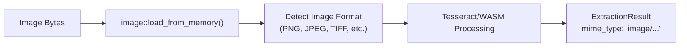

<!-- source: DeepWiki mcp.deepwiki.com · repo kreuzberg-dev/kreuzberg · page 3.3 MIME Type Detection · fetched 2026-10-26 -->

# MIME Type Detection

<details>
<summary>Relevant source files</summary>

The following files were used as context for generating this wiki page:

- [crates/kreuzberg/src/cache/mod.rs](crates/kreuzberg/src/cache/mod.rs)
- [crates/kreuzberg/src/cache/utilities.rs](crates/kreuzberg/src/cache/utilities.rs)
- [crates/kreuzberg/src/chunking/builder.rs](crates/kreuzberg/src/chunking/builder.rs)
- [crates/kreuzberg/src/chunking/core.rs](crates/kreuzberg/src/chunking/core.rs)
- [crates/kreuzberg/src/chunking/mod.rs](crates/kreuzberg/src/chunking/mod.rs)
- [crates/kreuzberg/src/chunking/yaml_section.rs](crates/kreuzberg/src/chunking/yaml_section.rs)
- [crates/kreuzberg/src/core/mime.rs](crates/kreuzberg/src/core/mime.rs)
- [crates/kreuzberg/src/ocr/mod.rs](crates/kreuzberg/src/ocr/mod.rs)
- [crates/kreuzberg/src/ocr/tesseract_backend.rs](crates/kreuzberg/src/ocr/tesseract_backend.rs)
- [crates/kreuzberg/src/ocr/tesseract_wasm_backend.rs](crates/kreuzberg/src/ocr/tesseract_wasm_backend.rs)
- [crates/kreuzberg/src/ocr/types.rs](crates/kreuzberg/src/ocr/types.rs)
- [crates/kreuzberg/src/utils/json_utils.rs](crates/kreuzberg/src/utils/json_utils.rs)
- [crates/kreuzberg/src/utils/mod.rs](crates/kreuzberg/src/utils/mod.rs)
- [crates/kreuzberg/src/utils/pool_sizing.rs](crates/kreuzberg/src/utils/pool_sizing.rs)
- [crates/kreuzberg/tests/docx_mime_detection_test.rs](crates/kreuzberg/tests/docx_mime_detection_test.rs)
- [crates/kreuzberg/tests/issue_350_regression_test.rs](crates/kreuzberg/tests/issue_350_regression_test.rs)

</details>


## Purpose and Overview

MIME type detection is a foundational component of Kreuzberg's extraction pipeline. It identifies the file format of input documents and routes them to the appropriate `DocumentExtractor` implementation. This page details the detection algorithm, the centralized `FORMATS` registry, and the content-based differentiation for complex formats.

The system relies on a single source of truth for all format mappings, which drives extension-to-MIME resolution, validation, and extractor selection.

Sources:
- [crates/kreuzberg/src/core/mime.rs:1-6]()

## Centralized Format Registry

Kreuzberg uses a centralized registry defined in `crates/kreuzberg/src/core/mime.rs` to manage all supported formats. This registry, the `FORMATS` static array, contains `FormatEntry` structures that define canonical extensions, primary MIME types, and aliases.

### Format Entry Structure
```rust
struct FormatEntry {
    extensions: &'static [&'static str],
    mime_type: &'static str,
    aliases: &'static [&'static str],
}
```
[crates/kreuzberg/src/core/mime.rs:55-62]()

### Registry Implementation Details
The registry enables automatic derivation of:
1. `EXT_TO_MIME`: A `HashMap` mapping file extensions to canonical MIME types.
2. `SUPPORTED_MIME_TYPES`: A `HashSet` of all primary MIME types and aliases for validation.

Sources:
- [crates/kreuzberg/src/core/mime.rs:64-172]()

## Detection Mechanism

The detection process follows a multi-stage workflow, starting from the file path and moving toward a validated MIME type.

### Detection Workflow Diagram


Sources:
- [crates/kreuzberg/src/core/mime.rs:1-12]()
- [crates/kreuzberg/src/core/mime.rs:27-50]()

## Complex Format Differentiation

While extension-based detection handles most cases, Kreuzberg performs content analysis for ambiguous formats, particularly within the Microsoft Office ecosystem and XML-based standards.

### Office and XML Differentiation

Many modern document formats are technically ZIP archives containing XML files. Kreuzberg's extractors perform secondary validation of the internal structure to confirm the specific sub-type. This is crucial for correctly identifying formats like DOCX, XLSX, and PPTX, which are all ZIP files but contain specific internal XML markers.

| Canonical MIME Type | Differentiation Method |
|---------------------|------------------------|
| `application/vnd.openxmlformats-officedocument.wordprocessingml.document` | Detects `word/document.xml` in ZIP [crates/kreuzberg/src/core/mime.rs:34-34]() |
| `application/vnd.openxmlformats-officedocument.presentationml.presentation` | Detects `ppt/presentation.xml` in ZIP [crates/kreuzberg/src/core/mime.rs:32-33]() |
| `application/vnd.openxmlformats-officedocument.spreadsheetml.sheet` | Detects `xl/workbook.xml` in ZIP [crates/kreuzberg/src/core/mime.rs:44-44]() |
| `application/xml` | Analyzes root tag using `xml_tag_name` [crates/kreuzberg/src/utils/mod.rs:23-24]() |

### Specialized XML Detection
For XML documents, the utility function `xml_tag_name` is used to peek at the root element, allowing the system to distinguish between generic XML, JATS, or DocBook.

Sources:
- [crates/kreuzberg/src/utils/mod.rs:19-24]()
- [crates/kreuzberg/src/core/mime.rs:38-46]()
- [crates/kreuzberg/tests/docx_mime_detection_test.rs:1-141]()
- [crates/kreuzberg/tests/issue_350_regression_test.rs:1-10]()

## Magic Byte Detection (OCR and Images)

For image formats and binary files where extensions might be missing or incorrect, Kreuzberg relies on the `ImageExtractor` and OCR subsystem.

### OCR MIME Logic
When processing images for OCR, the system retains the original image MIME type in the `OcrExtractionResult` to maintain traceability.



Sources:
- [crates/kreuzberg/src/ocr/tesseract_wasm_backend.rs:104-128]()
- [crates/kreuzberg/src/ocr/types.rs:168-174]()

## Extractor Registry and Selection

The `DocumentExtractorRegistry` uses the validated MIME type to select the appropriate logic. Selection is based on:
1. **MIME Match**: The extractor must include the type in its `supported_mime_types()` list.
2. **Priority**: If multiple extractors support a type, the one with the highest `priority()` value is chosen.

### System Entity Mapping

| Code Entity | Role in MIME Detection |
|-------------|-------------------------|
| `FormatEntry` | Definition of a format's extensions and MIME [crates/kreuzberg/src/core/mime.rs:55-62]() |
| `FORMATS` | Static registry of all supported formats [crates/kreuzberg/src/core/mime.rs:69-70]() |
| `SupportedFormat` | Public struct for API format listing [crates/kreuzberg/src/core/mime.rs:20-25]() |
| `DocumentExtractor` | Trait that defines `supported_mime_types()` and `priority()` |
| `detect_mime_type_from_bytes` | Function to detect MIME type from raw bytes [crates/kreuzberg/tests/docx_mime_detection_test.rs:36-36]() |
| `detect_mime_type` | Function to detect MIME type from a file path [crates/kreuzberg/tests/docx_mime_detection_test.rs:114-114]() |
| `validate_mime_type` | Function to check if a MIME type is supported [crates/kreuzberg/tests/docx_mime_detection_test.rs:101-101]() |

### Error Handling
If a MIME type is detected but no extractor is registered (often due to missing feature flags like `pdf` or `ocr`), the system returns `KreuzbergError::UnsupportedFormat`.

Sources:
- [crates/kreuzberg/src/core/mime.rs:9-25]()
- [crates/kreuzberg/src/ocr/tesseract_wasm_backend.rs:179-186]()

## Utility Functions for MIME Analysis

| Function | File Path | Purpose |
|----------|-----------|---------|
| `xml_tag_name` | `crates/kreuzberg/src/utils/mod.rs` | Extracts the root tag name for XML differentiation [crates/kreuzberg/src/utils/mod.rs:23-24]() |
| `normalize_whitespace` | `crates/kreuzberg/src/utils/mod.rs` | Cleans text content after format-specific extraction [crates/kreuzberg/src/utils/mod.rs:64-77]() |
| `blake3_hash_file` | `crates/kreuzberg/src/cache/utilities.rs` | Generates unique keys for MIME-based caching [crates/kreuzberg/src/cache/utilities.rs:67-86]() |
| `blake3_hash_bytes` | `crates/kreuzberg/src/cache/utilities.rs` | Hashes arbitrary bytes for cache keys [crates/kreuzberg/src/cache/utilities.rs:59-61]() |
| `generate_cache_key` | `crates/kreuzberg/src/cache/utilities.rs` | Generates a deterministic cache key from key-value pairs [crates/kreuzberg/src/cache/utilities.rs:36-56]() |

Sources:
- [crates/kreuzberg/src/utils/mod.rs:1-78]()
- [crates/kreuzberg/src/cache/utilities.rs:59-86]()

---

