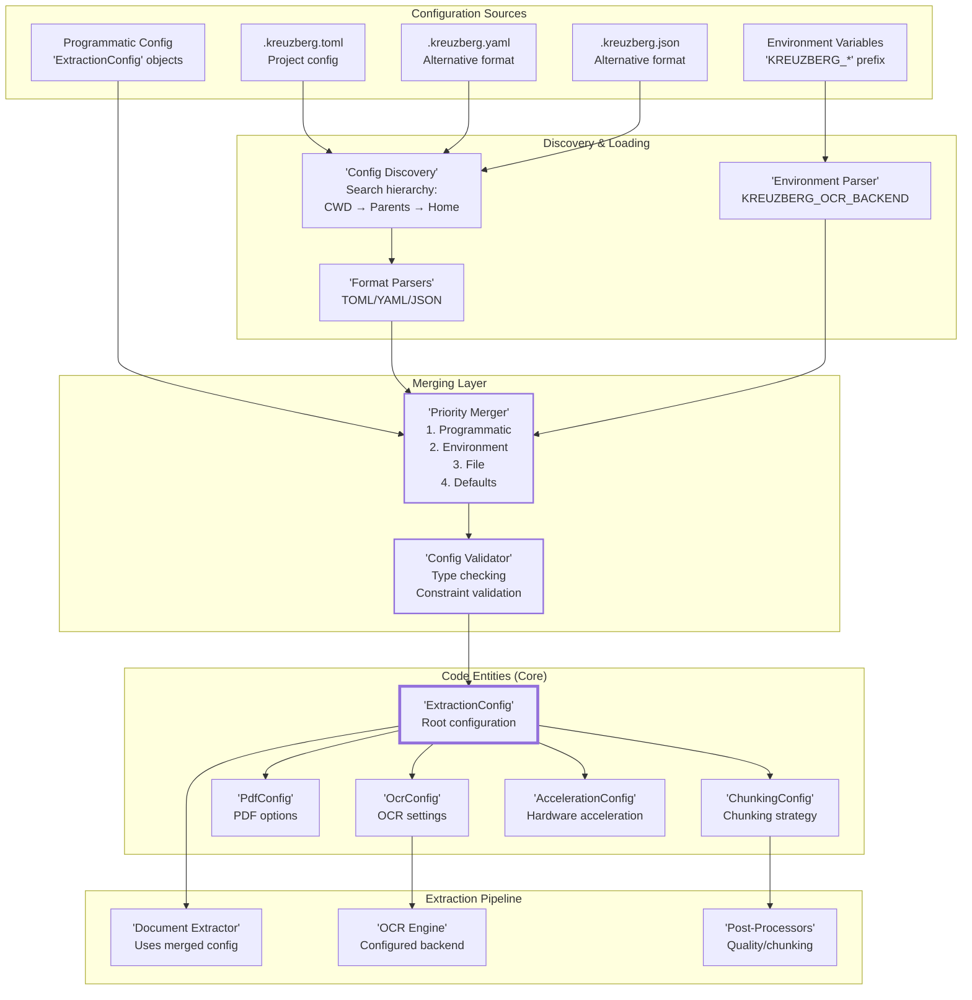
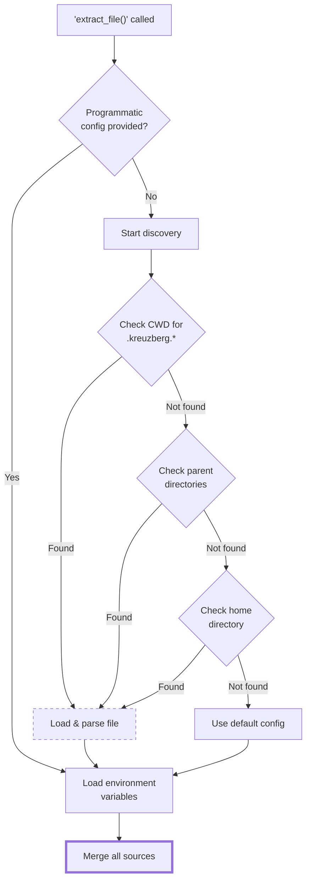
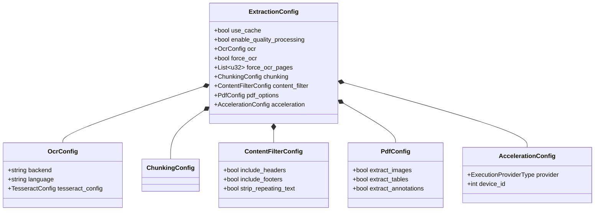

<!-- source: DeepWiki mcp.deepwiki.com · repo kreuzberg-dev/kreuzberg · page 3.4 Configuration System · fetched 2026-10-26 -->

# Configuration System

<details>
<summary>Relevant source files</summary>

The following files were used as context for generating this wiki page:

- [crates/kreuzberg-cli/README.md](crates/kreuzberg-cli/README.md)
- [crates/kreuzberg/src/chunking/semantic/mod.rs](crates/kreuzberg/src/chunking/semantic/mod.rs)
- [crates/kreuzberg/src/core/config/captioning.rs](crates/kreuzberg/src/core/config/captioning.rs)
- [crates/kreuzberg/src/core/config/classification.rs](crates/kreuzberg/src/core/config/classification.rs)
- [crates/kreuzberg/src/core/config/extraction/core.rs](crates/kreuzberg/src/core/config/extraction/core.rs)
- [crates/kreuzberg/src/core/config/llm.rs](crates/kreuzberg/src/core/config/llm.rs)
- [crates/kreuzberg/src/core/config/mod.rs](crates/kreuzberg/src/core/config/mod.rs)
- [crates/kreuzberg/src/core/config/ocr.rs](crates/kreuzberg/src/core/config/ocr.rs)
- [crates/kreuzberg/src/core/config/processing.rs](crates/kreuzberg/src/core/config/processing.rs)
- [crates/kreuzberg/src/core/config/translation.rs](crates/kreuzberg/src/core/config/translation.rs)
- [crates/kreuzberg/src/diff/mod.rs](crates/kreuzberg/src/diff/mod.rs)
- [crates/kreuzberg/src/diff/types.rs](crates/kreuzberg/src/diff/types.rs)
- [crates/kreuzberg/src/lib.rs](crates/kreuzberg/src/lib.rs)
- [crates/kreuzberg/src/plugins/processor/builtin/ner.rs](crates/kreuzberg/src/plugins/processor/builtin/ner.rs)
- [crates/kreuzberg/src/text/ner/mod.rs](crates/kreuzberg/src/text/ner/mod.rs)
- [crates/kreuzberg/src/text/redaction/engine.rs](crates/kreuzberg/src/text/redaction/engine.rs)
- [crates/kreuzberg/src/types/revisions.rs](crates/kreuzberg/src/types/revisions.rs)
- [crates/kreuzberg/tests/image_classification.rs](crates/kreuzberg/tests/image_classification.rs)
- [crates/kreuzberg/tests/issue_797_preset_embedding_regression.rs](crates/kreuzberg/tests/issue_797_preset_embedding_regression.rs)
- [docs/cli/usage.md](docs/cli/usage.md)
- [docs/getting-started/quickstart.md](docs/getting-started/quickstart.md)
- [docs/guides/advanced.md](docs/guides/advanced.md)
- [docs/guides/api-server.md](docs/guides/api-server.md)
- [docs/guides/configuration.md](docs/guides/configuration.md)
- [docs/guides/extraction.md](docs/guides/extraction.md)
- [docs/guides/layout-detection.md](docs/guides/layout-detection.md)
- [docs/guides/ocr.md](docs/guides/ocr.md)
- [docs/guides/plugins.md](docs/guides/plugins.md)
- [docs/reference/environment-variables.md](docs/reference/environment-variables.md)
- [docs/reference/formats.md](docs/reference/formats.md)
- [docs/snippets/cli/batch_basic.md](docs/snippets/cli/batch_basic.md)
- [docs/snippets/cli/extract_basic.md](docs/snippets/cli/extract_basic.md)
- [docs/snippets/cli/ocr_basic.md](docs/snippets/cli/ocr_basic.md)

</details>


The configuration system provides flexible, multi-source control over document extraction behavior. It supports programmatic configuration objects, file-based discovery (`.kreuzberg.toml`, `.kreuzberg.yaml`, `.kreuzberg.json`), and environment variable overrides with automatic priority merging.

For detailed field documentation of all configuration classes, see [Configuration Reference](reference/configuration.md) [docs/guides/configuration.md:201-208]().

## Overview

Kreuzberg's configuration system operates on three core principles:

1.  **Multi-source**: Configuration can originate from code, files, or environment variables.
2.  **Automatic discovery**: The system searches for configuration files in standard locations.
3.  **Priority merging**: Multiple sources combine with defined precedence rules.

Configuration controls all aspects of extraction: OCR backends, PDF processing, chunking strategies, quality processing, caching, and output formatting [crates/kreuzberg/src/core/config/extraction/core.rs:33-35]().

## Configuration Architecture

The diagram below bridges the natural language configuration concepts to the underlying code entities.



**Sources:** [crates/kreuzberg/src/core/config/extraction/core.rs:33-35](), [crates/kreuzberg/src/core/config/mod.rs:31-62](), [docs/cli/usage.md:161-205]()

## Configuration Sources

### Programmatic Configuration

Configuration objects are constructed directly in code and passed to extraction functions like `extract_file()` or `extract_bytes()`. This is the highest-priority source and overrides all others [docs/getting-started/quickstart.md:9-77]() [docs/guides/extraction.md:13-18]().

Programmatic configuration is type-checked at construction time in statically-typed bindings (TypeScript, Rust, C#, Java) and at runtime in dynamically-typed bindings (Python, Ruby, PHP) [docs/guides/configuration.md:7-38]().

**Sources:** [docs/getting-started/quickstart.md:9-77](), [docs/guides/configuration.md:7-38](), [docs/guides/extraction.md:13-18]()

### File-Based Configuration

The system searches for configuration files in the following order [docs/guides/configuration.md:86-89]():

1.  Current working directory.
2.  Parent directories (recursive up to filesystem root).
3.  User home directory (`~/.kreuzberg.toml`).

**Supported formats:**

| Format | Filename | Description |
| :--- | :--- | :--- |
| TOML | `.kreuzberg.toml` | Native TOML parser |
| YAML | `.kreuzberg.yaml`, `.kreuzberg.yml` | Native YAML parser |
| JSON | `.kreuzberg.json` | Native JSON parser |

**Example `.kreuzberg.toml`:**

```toml
use_cache = true
enable_quality_processing = true

[ocr]
backend = "tesseract"
language = "eng"

[ocr.tesseract_config]
psm = 3
```

**Sources:** [docs/guides/configuration.md:45-83](), [crates/kreuzberg/src/core/config/extraction/core.rs:33-35]()

### Environment Variables

Environment variables provide runtime overrides. All variables use the `KREUZBERG_` prefix [docs/reference/environment-variables.md:1-2]().

**Examples:**

| Environment Variable | Configuration Path | Type |
| :--- | :--- | :--- |
| `KREUZBERG_USE_CACHE=true` | `ExtractionConfig.use_cache` | Boolean |
| `KREUZBERG_OCR_BACKEND=paddle-ocr` | `ExtractionConfig.ocr.backend` | String |
| `KREUZBERG_OCR_LANGUAGE=fra` | `ExtractionConfig.ocr.language` | String |
| `KREUZBERG_FORCE_OCR=true` | `ExtractionConfig.force_ocr` | Boolean |

**Sources:** [docs/reference/environment-variables.md:1-2](), [docs/cli/usage.md:161-205](), [crates/kreuzberg/src/core/config/extraction/core.rs:37-72]()

## Configuration Discovery

Discovery is triggered automatically when calling extraction functions. In the CLI, the `--config` flag can be used to explicitly point to a configuration file [docs/cli/usage.md:115]() [docs/guides/configuration.md:86-89]().



**Sources:** [docs/cli/usage.md:115](), [docs/guides/configuration.md:86-89](), [docs/getting-started/quickstart.md:9-77]()

## Priority and Merging

Configuration sources merge with the following priority (highest to lowest):

1.  **Programmatic**: Directly provided `ExtractionConfig` objects.
2.  **CLI Flags**: (CLI only) e.g., `--ocr true` overrides config files [docs/cli/usage.md:161-169]().
3.  **Environment**: `KREUZBERG_*` variables.
4.  **File-based**: Discovered `.kreuzberg.*` files.
5.  **Defaults**: Built-in fallback values (e.g., `use_cache = True`) [crates/kreuzberg/src/core/config/extraction/core.rs:37]().

**Merging rules:**
*   **Scalar fields**: Higher priority replaces lower priority.
*   **Nested objects**: Merged recursively (e.g., `OcrConfig` within `ExtractionConfig`).
*   **Arrays/lists**: Higher priority replaces the entire list (e.g., `force_ocr_pages`) [crates/kreuzberg/src/core/config/extraction/core.rs:59-60]().

**Sources:** [docs/cli/usage.md:161-213](), [crates/kreuzberg/src/core/config/extraction/core.rs:37-72]()

## Configuration Class Hierarchy

The system is anchored by the `ExtractionConfig` class, which aggregates specialized configuration objects.



**Sources:** [crates/kreuzberg/src/core/config/extraction/core.rs:33-174](), [crates/kreuzberg/src/core/config/ocr.rs:20-21](), [crates/kreuzberg/src/core/config/processing.rs:113-189]()

### Key Configuration Entities

| Entity | Role | Key Fields |
| :--- | :--- | :--- |
| `ExtractionConfig` | Root configuration object [crates/kreuzberg/src/core/config/extraction/core.rs:33-35]() | `use_cache`, `force_ocr`, `ocr`, `pdf_options` |
| `OcrConfig` | OCR backend and language settings [crates/kreuzberg/src/core/config/ocr.rs:20-21]() | `backend`, `language`, `tesseract_config` |
| `PdfConfig` | PDF-specific extraction behavior [crates/kreuzberg/src/core/config/pdf.rs:19-21]() | `extract_images`, `extract_tables`, `extract_annotations` |
| `ContentFilterConfig` | Controls document "furniture" stripping [crates/kreuzberg/src/core/config/content_filter.rs:19-21]() | `include_headers`, `include_footers`, `strip_repeating_text` |
| `AccelerationConfig` | Hardware acceleration for ONNX models [crates/kreuzberg/src/core/config/acceleration.rs:19-21]() | `provider`, `device_id` |

**Sources:** [crates/kreuzberg/src/core/config/acceleration.rs:19-21](), [crates/kreuzberg/src/core/config/content_filter.rs:19-21](), [crates/kreuzberg/src/core/config/extraction/core.rs:33-35](), [crates/kreuzberg/src/core/config/ocr.rs:20-21](), [crates/kreuzberg/src/core/config/pdf.rs:19-21]()

## Configuration Lifecycle

1.  **Discovery**: System searches for `.kreuzberg.*` files starting from CWD [docs/guides/configuration.md:86-89]().
2.  **Loading**: Files are parsed into intermediate structures.
3.  **Merging**: Programmatic, CLI, Environment, and File sources are merged into a final `ExtractionConfig` [docs/cli/usage.md:180-205]().
4.  **Validation**: The pipeline validates constraints (e.g., `disable_ocr` and `force_ocr` cannot both be `True`) [crates/kreuzberg/src/core/config/extraction/core.rs:68-69]().
5.  **Execution**: The validated config is passed to the native Rust core to drive the extraction pipeline [crates/kreuzberg/src/lib.rs:9-15]().

**Sources:** [crates/kreuzberg/src/core/config/extraction/core.rs:68-69](), [crates/kreuzberg/src/lib.rs:9-15](), [docs/cli/usage.md:180-205](), [docs/guides/configuration.md:86-89]()

---

