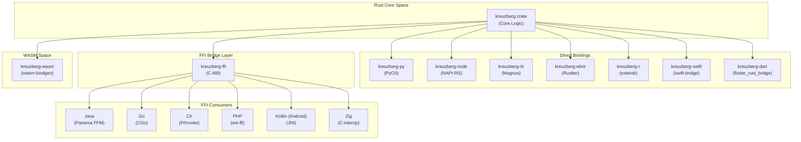
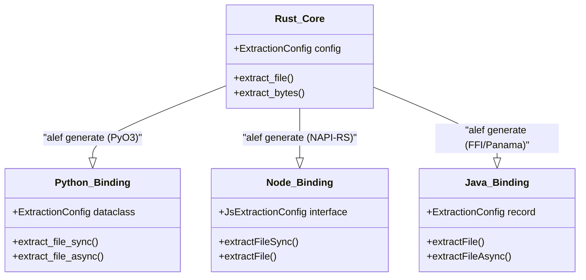

<!-- source: DeepWiki mcp.deepwiki.com · repo kreuzberg-dev/kreuzberg · page 4 Language Bindings · fetched 2026-10-26 -->

# Language Bindings

Relevant source files

The following files were used as context for generating this wiki page:

- [README.md](README.md)
- [alef.toml](alef.toml)
- [crates/kreuzberg-ffi/include/kreuzberg.h](crates/kreuzberg-ffi/include/kreuzberg.h)
- [crates/kreuzberg-ffi/src/lib.rs](crates/kreuzberg-ffi/src/lib.rs)
- [crates/kreuzberg-node/README.md](crates/kreuzberg-node/README.md)
- [crates/kreuzberg-node/index.d.ts](crates/kreuzberg-node/index.d.ts)
- [crates/kreuzberg-node/src/lib.rs](crates/kreuzberg-node/src/lib.rs)
- [crates/kreuzberg-php/src/lib.rs](crates/kreuzberg-php/src/lib.rs)
- [crates/kreuzberg-py/src/lib.rs](crates/kreuzberg-py/src/lib.rs)
- [crates/kreuzberg-wasm/README.md](crates/kreuzberg-wasm/README.md)
- [crates/kreuzberg-wasm/src/lib.rs](crates/kreuzberg-wasm/src/lib.rs)
- [crates/kreuzberg/README.md](crates/kreuzberg/README.md)
- [e2e/rust/Cargo.toml](e2e/rust/Cargo.toml)
- [packages/csharp/README.md](packages/csharp/README.md)
- [packages/elixir/README.md](packages/elixir/README.md)
- [packages/elixir/native/kreuzberg_nif/src/lib.rs](packages/elixir/native/kreuzberg_nif/src/lib.rs)
- [packages/go/v4/README.md](packages/go/v4/README.md)
- [packages/java/README.md](packages/java/README.md)
- [packages/php/README.md](packages/php/README.md)
- [packages/php/src/Kreuzberg.php](packages/php/src/Kreuzberg.php)
- [packages/php/stubs/kreuzberg_extension.php](packages/php/stubs/kreuzberg_extension.php)
- [packages/python/README.md](packages/python/README.md)
- [packages/python/kreuzberg/__init__.py](packages/python/kreuzberg/__init__.py)
- [packages/python/kreuzberg/_kreuzberg.pyi](packages/python/kreuzberg/_kreuzberg.pyi)
- [packages/python/kreuzberg/api.py](packages/python/kreuzberg/api.py)
- [packages/python/kreuzberg/options.py](packages/python/kreuzberg/options.py)
- [packages/r/src/rust/src/lib.rs](packages/r/src/rust/src/lib.rs)
- [packages/ruby/README.md](packages/ruby/README.md)
- [packages/ruby/ext/kreuzberg_rb/src/lib.rs](packages/ruby/ext/kreuzberg_rb/src/lib.rs)
- [packages/ruby/kreuzberg.gemspec](packages/ruby/kreuzberg.gemspec)
- [packages/swift/rust/src/lib.rs](packages/swift/rust/src/lib.rs)
- [packages/typescript/src/index.ts](packages/typescript/src/index.ts)

This page provides an overview of how Kreuzberg's Rust core is exposed to 15+ programming languages and environments. It covers the architectural strategies (Direct Bindings, FFI, and WASM), build systems, and distribution channels. Kreuzberg uses a polyglot architecture to ensure native performance across all supported ecosystems. [README.md:97-97]()

## Architecture Overview

Kreuzberg employs three primary integration strategies:

1.  **Direct Rust Bindings**: These use language-specific frameworks (like PyO3, NAPI-RS, or Magnus) to generate native extensions that link directly against the `kreuzberg` core crate.
2.  **C FFI Bridge**: The `kreuzberg-ffi` crate exposes a C-compatible ABI. Languages like Java, Go, and C# use this bridge via their respective FFI mechanisms (Panama, CGo, P/Invoke). [alef.toml:8-11]()
3.  **WebAssembly**: The `kreuzberg-wasm` crate targets the web, Deno, and serverless environments, providing a portable version of the core library. [crates/kreuzberg-wasm/README.md:73-74]()

The `alef` tool orchestrates the generation of these bindings, ensuring type synchronization and API parity across the workspace. [alef.toml:1-19](), [alef.toml:51-58]()

Title: Language Binding Architecture

Sources: [alef.toml:1-19](), [README.md:97-97](), [alef.toml:51-58]()

## Supported Languages

### Scripting & High-Level Languages
*   **Python**: PyO3-based bindings with full async support and EasyOCR integration. For details, see [Python Bindings](#4.1). [crates/kreuzberg-py/src/lib.rs:1-57]()
*   **Ruby**: Magnus and rb-sys integration for an idiomatic Ruby API. For details, see [Ruby Bindings](#4.3). [packages/ruby/README.md:96-97]()
*   **PHP**: Modern PHP 8.2+ support using `ext-ffi`. For details, see [PHP Bindings](#4.7). [packages/php/README.md:90-92]()
*   **Elixir**: Rustler NIFs providing OTP-compatible concurrency. For details, see [Elixir Bindings](#4.8). [alef.toml:12-12]()
*   **R**: Idiomatic R API built with the `extendr` framework. For details, see [R Bindings](#4.9). [README.md:38-40]()

### Managed Runtimes
*   **Node.js/TypeScript**: High-performance NAPI-RS bindings with a dedicated worker pool. For details, see [Node.js/TypeScript Bindings](#4.2). [crates/kreuzberg-node/src/lib.rs:57-62]()
*   **Java**: Modern integration using Java 25+ Foreign Function & Memory (Panama) API. For details, see [Java Bindings](#4.4). [packages/java/README.md:90-91]()
*   **C# (.NET)**: P/Invoke-based bindings supporting .NET 10.0+. For details, see [C# Bindings](#4.6). [packages/csharp/README.md:95-95]()
*   **Kotlin (Android)**: Android JNI integration with Gradle build configuration. For details, see [Kotlin (Android) Bindings](#4.14). [README.md:44-46]()

### Systems & Mobile
*   **Go**: CGo-based integration with standard Go error handling. For details, see [Go Bindings](#4.5). [alef.toml:9-9]()
*   **Swift**: `swift-bridge` integration for macOS and iOS. For details, see [Swift Bindings](#4.12). [alef.toml:17-17]()
*   **Dart/Flutter**: `flutter_rust_bridge` (FRB) for cross-platform mobile support. For details, see [Dart/Flutter Bindings](#4.13). [alef.toml:15-15]()
*   **Zig**: C-interop with the FFI layer via `build.zig`. For details, see [Zig Bindings](#4.15). [alef.toml:18-18]()

### Web & Portable
*   **WebAssembly**: `wasm-bindgen` integration for browsers and edge runtimes. For details, see [WebAssembly Bindings](#4.10). [crates/kreuzberg-wasm/README.md:73-74]()

## Binding Mechanisms and Tooling

Kreuzberg uses the `alef` tool to maintain consistency across these diverse environments. It manages:
*   **DTO Generation**: Maps Rust structs to language-specific types (e.g., `dataclass` in Python, `record` in Java, `interface` in TypeScript). [alef.toml:34-45]()
*   **Async Wrappers**: Generates `async/await` patterns or `CompletableFuture`/`Task` equivalents. [alef.toml:55-55]()
*   **Error Mapping**: Propagates structured Rust errors into native exception hierarchies. [alef.toml:53-53]()

Title: Code Entity Mapping (Rust to Bindings)

Sources: [alef.toml:34-58](), [crates/kreuzberg-node/src/lib.rs:199-220](), [crates/kreuzberg-py/src/lib.rs:135-162]()

## Common Features Across Bindings

Regardless of the language, all bindings provide access to the core Kreuzberg features:
*   **90+ File Formats**: Consistent extraction across PDF, Office, and images. [README.md:97-97]()
*   **OCR Support**: Tesseract and PaddleOCR backends available in all native bindings. [README.md:99-99]()
*   **Code Intelligence**: Tree-sitter based semantic analysis for 300+ languages. [README.md:94-95]()
*   **Configuration Discovery**: Automatic loading of `kreuzberg.toml` or environment variables. [crates/kreuzberg-node/README.md:189-204]()

Sources: [README.md:1-106](), [alef.toml:1-188](), [crates/kreuzberg-node/src/lib.rs:1-220](), [crates/kreuzberg-py/src/lib.rs:1-162]()

---

