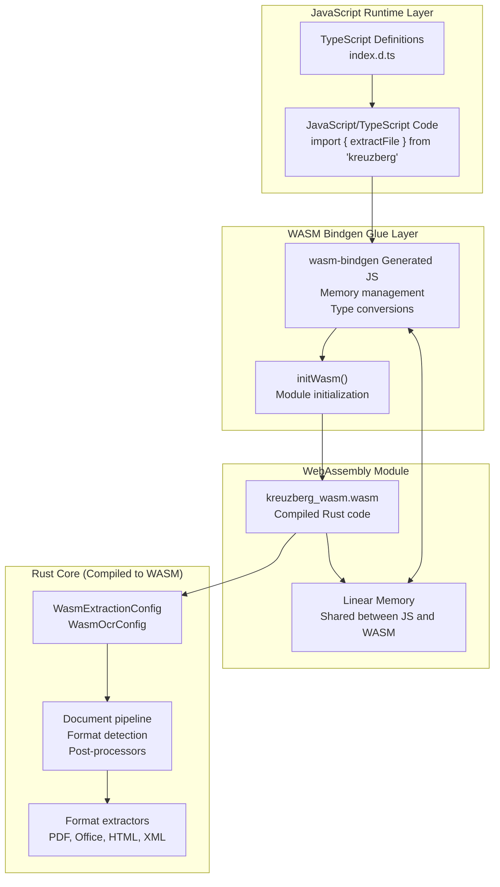
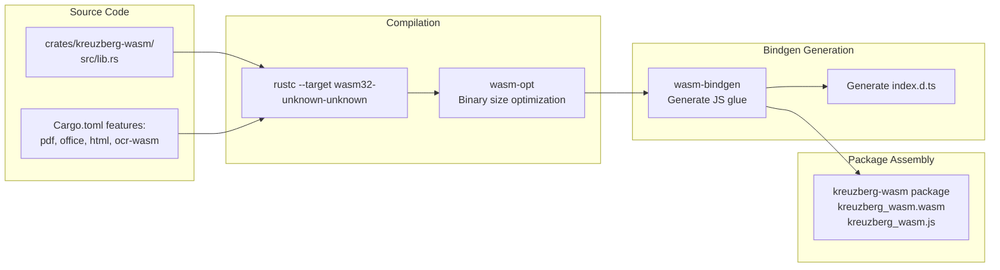
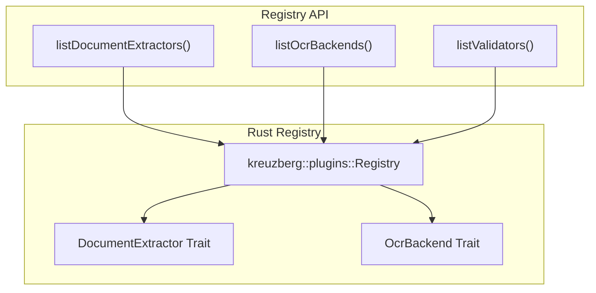

<!-- source: DeepWiki mcp.deepwiki.com · repo kreuzberg-dev/kreuzberg · page 4.10 WebAssembly Bindings · fetched 2026-10-26 -->

# WebAssembly Bindings

<details>
<summary>Relevant source files</summary>

The following files were used as context for generating this wiki page:

- [crates/kreuzberg-php/Cargo.toml](crates/kreuzberg-php/Cargo.toml)
- [crates/kreuzberg-wasm/Cargo.toml](crates/kreuzberg-wasm/Cargo.toml)
- [e2e/java/src/test/java/dev/kreuzberg/e2e/OcrBackendManagementTest.java](e2e/java/src/test/java/dev/kreuzberg/e2e/OcrBackendManagementTest.java)
- [e2e/node/tests/ocr_backend_management.test.ts](e2e/node/tests/ocr_backend_management.test.ts)
- [e2e/node/tests/plugin_api.test.ts](e2e/node/tests/plugin_api.test.ts)
- [e2e/php/tests/OcrBackendManagementTest.php](e2e/php/tests/OcrBackendManagementTest.php)
- [e2e/python/tests/test_plugin_api.py](e2e/python/tests/test_plugin_api.py)
- [e2e/r/tests/test_plugin_api.R](e2e/r/tests/test_plugin_api.R)
- [e2e/wasm/setup.ts](e2e/wasm/setup.ts)
- [e2e/wasm/tests/async.test.ts](e2e/wasm/tests/async.test.ts)
- [e2e/wasm/tests/detection.test.ts](e2e/wasm/tests/detection.test.ts)
- [e2e/wasm/tests/ocr_backend_management.test.ts](e2e/wasm/tests/ocr_backend_management.test.ts)
- [e2e/wasm/tests/plugin_api.test.ts](e2e/wasm/tests/plugin_api.test.ts)
- [e2e/wasm/tests/registry.test.ts](e2e/wasm/tests/registry.test.ts)
- [e2e/wasm/tests/registry_operations.test.ts](e2e/wasm/tests/registry_operations.test.ts)
- [e2e/wasm/tests/smoke.test.ts](e2e/wasm/tests/smoke.test.ts)
- [packages/dart/rust/Cargo.toml](packages/dart/rust/Cargo.toml)
- [packages/elixir/native/kreuzberg_nif/Cargo.toml](packages/elixir/native/kreuzberg_nif/Cargo.toml)
- [packages/swift/rust/Cargo.toml](packages/swift/rust/Cargo.toml)

</details>


The WebAssembly bindings provide a pure JavaScript implementation of Kreuzberg that runs in browsers, Deno, Cloudflare Workers, and other JavaScript runtimes without native dependencies. This binding is published as `@kreuzberg/wasm` and uses `wasm-bindgen` to generate JavaScript/TypeScript interfaces from the Rust core.

**Scope**: This page covers the WASM binding architecture, compilation process, deployment scenarios, feature set, and performance characteristics. For server-side Node.js with native performance, see [Node.js/TypeScript Bindings](#4.2). For other language bindings, see [Language Bindings](#4).

## Architecture Overview

The WASM bindings compile the Rust core to WebAssembly and wrap it with JavaScript glue code. Unlike native bindings that use FFI or direct native extensions, WASM provides a sandboxed execution environment with predictable cross-platform behavior.

### WASM Binding Layers



**Key Characteristics**:

- **Single-threaded by default**: WASM runs on the JavaScript event loop unless threads are enabled.
- **Memory isolation**: WASM linear memory is separate from the JavaScript heap.
- **No FFI overhead**: Direct compilation to WASM bytecode via `wasm-bindgen`.
- **Cross-platform**: The same binary runs on all platforms supporting WASM.

Sources: [crates/kreuzberg-wasm/Cargo.toml:7-15](), [e2e/wasm/tests/smoke.test.ts:8-41]()

## Compilation Pipeline

The WASM package is built using the `wasm-pack` profile, which orchestrates Rust compilation, `wasm-bindgen` processing, and npm package generation.

### Build Process Flow



**Build Configuration**:

| Setting | Value | Purpose |
|---------|-------|---------|
| Target triple | `wasm32-unknown-unknown` | Pure WASM without WASI [crates/kreuzberg-wasm/Cargo.toml:61]() |
| Optimization | `wasm-opt = false` | Profile-specific override [crates/kreuzberg-wasm/Cargo.toml:26]() |
| Crate Type | `cdylib` | Required for WASM targets [crates/kreuzberg-wasm/Cargo.toml:29]() |
| Dependencies | `serde-wasm-bindgen` | Efficient serialization [crates/kreuzberg-wasm/Cargo.toml:63]() |

The `kreuzberg-wasm` crate enables a subset of features optimized for the web, including `ocr-wasm`, `tree-sitter`, and `office` [crates/kreuzberg-wasm/Cargo.toml:31-54]().

Sources: [crates/kreuzberg-wasm/Cargo.toml:25-29](), [crates/kreuzberg-wasm/Cargo.toml:31-54]()

## Runtime Environments

The WASM bindings support three primary deployment environments, each with different initialization and usage patterns.

### Browser and Node.js Integration

The bindings use `wasm-bindgen` to export core functions like `extractFile` and `extractBytes` [e2e/wasm/tests/smoke.test.ts:7]().

**Browser Usage Pattern**:

```typescript
import { extractBytes, WasmExtractionConfig } from "@kreuzberg/wasm";

// Process bytes from a file input or fetch
async function handleFile(buffer: Uint8Array) {
    const config = new WasmExtractionConfig();
    const result = await extractBytes(buffer, "application/pdf", config);
    console.log(result.content);
}
```

Sources: [e2e/wasm/tests/smoke.test.ts:65-73]()

### Cloudflare Workers and Deno

The WASM implementation is compatible with Cloudflare Workers and Deno by avoiding environment-specific syscalls. It uses `getrandom` with the `wasm_js` feature to provide entropy in these environments [crates/kreuzberg-wasm/Cargo.toml:69]().

**Key Considerations**:

- **Memory limits**: Workers typically have 128MB RAM; large PDF processing should be monitored.
- **No filesystem**: Use `extractBytes` with `Uint8Array` instead of `extractFile` when running in restricted environments [e2e/wasm/tests/smoke.test.ts:7]().
- **MIME Detection**: `detectMimeTypeFromBytes` is available for identifying content types in-memory [e2e/wasm/tests/detection.test.ts:7]().

Sources: [crates/kreuzberg-wasm/Cargo.toml:68-72](), [e2e/wasm/tests/detection.test.ts:65-78]()

## Feature Set and Limitations

The WASM bindings implement a subset of Kreuzberg's full feature set due to platform constraints.

### Feature Availability Comparison

| Feature Category | WASM Implementation | Notes |
|-----------------|--------------------------|-------|
| **Document Extraction** | | |
| PDF | `pdf` feature | PDFium-based extraction [crates/kreuzberg-wasm/Cargo.toml:50]() |
| Office (DOCX, XLSX) | `office` | XML-based parsing [crates/kreuzberg-wasm/Cargo.toml:48]() |
| HTML | `html` | Pure Rust parsers [crates/kreuzberg-wasm/Cargo.toml:39]() |
| Email (EML) | `email` | `WasmEmailConfig` available [e2e/wasm/tests/async.test.ts:7]() |
| **OCR** | | |
| Tesseract | `ocr-wasm` | Tesseract via WASM [crates/kreuzberg-wasm/Cargo.toml:47]() |
| **Processing** | | |
| Text chunking | `chunking` | `WasmChunkingConfig` [e2e/wasm/tests/async.test.ts:7]() |
| Language detection | `language-detection` | `WasmLanguageDetectionConfig` [e2e/wasm/tests/async.test.ts:7]() |
| Quality processing | `quality` | `WasmOcrQualityThresholds` [e2e/wasm/tests/async.test.ts:7]() |

Sources: [crates/kreuzberg-wasm/Cargo.toml:31-54](), [e2e/wasm/tests/async.test.ts:7]()

## Memory Management

WASM and JavaScript operate on different memory spaces with explicit ownership rules. The `WasmExtractionConfig` and other configuration structs are managed as `wasm_bindgen` classes.

### Configuration Entities

| Code Entity | Role | Source |
|-------------|------|--------|
| `WasmExtractionConfig` | Primary configuration container | [e2e/wasm/tests/async.test.ts:7]() |
| `WasmOcrConfig` | OCR-specific settings | [e2e/wasm/tests/async.test.ts:7]() |
| `WasmContentFilterConfig` | Controls header/footer stripping | [e2e/wasm/tests/async.test.ts:7]() |
| `WasmAccelerationConfig` | Hardware acceleration (ONNX) | [e2e/wasm/tests/async.test.ts:7]() |

**Memory Operations**:

- **Serialization**: `serde-wasm-bindgen` is used to bridge complex Rust types to JS objects [crates/kreuzberg-wasm/Cargo.toml:63]().
- **Buffers**: Binary data is passed as `Uint8Array`, which maps to `Vec<u8>` in Rust [e2e/wasm/tests/smoke.test.ts:60]().
- **Registry**: Users can query available capabilities using `listDocumentExtractors`, `listOcrBackends`, etc. [e2e/wasm/tests/registry.test.ts:7]()

Sources: [e2e/wasm/tests/async.test.ts:7](), [crates/kreuzberg-wasm/Cargo.toml:63](), [e2e/wasm/tests/smoke.test.ts:60](), [e2e/wasm/tests/registry.test.ts:7]()

## Integration Patterns

### Registry and Capability Discovery

The WASM bindings allow runtimes to inspect available plugins and backends at runtime.



**Implementation Example**:

```typescript
import { listDocumentExtractors, listOcrBackends } from "@kreuzberg/wasm";

// Check if PDF extraction is available in this build
const extractors = listDocumentExtractors();
console.log("Available extractors:", extractors);

const ocrBackends = listOcrBackends();
console.log("Available OCR backends:", ocrBackends);
```

Sources: [e2e/wasm/tests/registry.test.ts:60-81]()

### OCR Worker Architecture

For OCR operations, especially with Tesseract, the WASM binding can leverage a worker-based architecture to offload heavy computation from the main thread. This is crucial for maintaining UI responsiveness in browser environments.

```mermaid
graph TD
    A[Main Thread (JS)] --> B{Call extractBytes with OCR}
    B --> C[WASM Module (kreuzberg-wasm)]
    C --> D{OCR Backend (e.g., Tesseract-WASM)}
    D -- Heavy Computation --> E[Web Worker (Dedicated)]
    E -- Post Message --> C
    C --> F[Promise Resolution]
    F --> A
```

This architecture ensures that the potentially long-running OCR process does not block the main JavaScript thread, providing a smoother user experience. The `ocr-wasm` feature in `kreuzberg-wasm` enables this capability [crates/kreuzberg-wasm/Cargo.toml:47]().

Sources: [crates/kreuzberg-wasm/Cargo.toml:47]()

### WASI Compatibility

While the primary WASM target is `wasm32-unknown-unknown` for maximum portability, the `e2e/wasm/setup.ts` file demonstrates how to provide shims for WASI (WebAssembly System Interface) imports like `env` and `wasi_snapshot_preview1` in Node.js environments [e2e/wasm/setup.ts:44-147](). These shims are necessary because some transitive dependencies (e.g., `getrandom` or `tesseract-wasm`) might expect WASI functions, even if the core `kreuzberg-wasm` crate doesn't directly use them.

**Key WASI Shims**:

- `env.system`, `env.mkstemp`: Provided as no-ops to prevent crashes [e2e/wasm/setup.ts:51-52]().
- `wasi_snapshot_preview1.clock_time_get`, `random_get`: Critical for correct timing and entropy generation, implemented to return realistic values [e2e/wasm/setup.ts:111-126]().
- `wasi_snapshot_preview1.fd_write`, `fd_read`: Crucial for libc-style callers to prevent infinite loops by correctly updating byte counts [e2e/wasm/setup.ts:78-98]().

This setup ensures that the WASM module can be instantiated and run even if it has implicit WASI dependencies, making it more robust across different JavaScript runtimes.

Sources: [e2e/wasm/setup.ts:44-147]()

---

