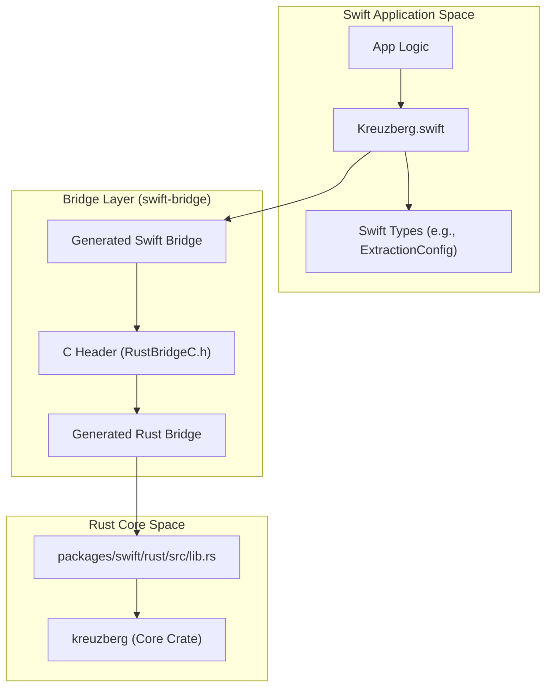

<!-- source: DeepWiki mcp.deepwiki.com · repo kreuzberg-dev/kreuzberg · page 4.12 Swift Bindings · fetched 2026-10-26 -->

# Swift Bindings

<details>
<summary>Relevant source files</summary>

The following files were used as context for generating this wiki page:

- [.cargo/config.toml](.cargo/config.toml)
- [csharp_e2e_output.txt](csharp_e2e_output.txt)
- [e2e/csharp/tests/PluginApiTests.cs](e2e/csharp/tests/PluginApiTests.cs)
- [e2e/swift_e2e/Package.swift](e2e/swift_e2e/Package.swift)
- [e2e/swift_e2e/Tests/KreuzbergE2ETests/OcrBackendManagementTests.swift](e2e/swift_e2e/Tests/KreuzbergE2ETests/OcrBackendManagementTests.swift)
- [e2e/swift_e2e/Tests/KreuzbergE2ETests/PluginApiTests.swift](e2e/swift_e2e/Tests/KreuzbergE2ETests/PluginApiTests.swift)
- [packages/csharp/src/Kreuzberg/ExtractionResult.cs](packages/csharp/src/Kreuzberg/ExtractionResult.cs)
- [packages/csharp/src/Kreuzberg/KreuzbergLib.cs](packages/csharp/src/Kreuzberg/KreuzbergLib.cs)
- [packages/csharp/src/Kreuzberg/Metadata.cs](packages/csharp/src/Kreuzberg/Metadata.cs)
- [packages/csharp/src/Kreuzberg/OcrElement.cs](packages/csharp/src/Kreuzberg/OcrElement.cs)
- [packages/csharp/src/Kreuzberg/TraitBridges.cs](packages/csharp/src/Kreuzberg/TraitBridges.cs)
- [packages/dart/README.md](packages/dart/README.md)
- [packages/ruby/lib/kreuzberg/native.rb](packages/ruby/lib/kreuzberg/native.rb)
- [packages/swift/README.md](packages/swift/README.md)
- [packages/swift/Sources/Kreuzberg/BridgeRegistrationOverloads.swift](packages/swift/Sources/Kreuzberg/BridgeRegistrationOverloads.swift)
- [packages/swift/Sources/Kreuzberg/Kreuzberg.swift](packages/swift/Sources/Kreuzberg/Kreuzberg.swift)
- [packages/swift/Sources/RustBridge/SwiftBridgeCore.swift](packages/swift/Sources/RustBridge/SwiftBridgeCore.swift)
- [packages/swift/Sources/RustBridge/kreuzberg-swift.swift](packages/swift/Sources/RustBridge/kreuzberg-swift.swift)
- [packages/swift/Sources/RustBridgeC/RustBridgeC.h](packages/swift/Sources/RustBridgeC/RustBridgeC.h)
- [packages/zig/README.md](packages/zig/README.md)
- [scripts/setup-swift-bridge.sh](scripts/setup-swift-bridge.sh)

</details>


The Swift bindings for Kreuzberg provide a high-performance document intelligence interface for iOS and macOS applications. Built using `swift-bridge`, these bindings offer a native Swift API that communicates directly with the Rust core via a thin FFI layer, ensuring memory safety and type consistency across the language boundary.

## Architecture and Integration

The Swift integration is structured as a Swift Package that encapsulates both the Swift source code and the cross-compiled Rust binaries. The architecture relies on `swift-bridge` to generate the necessary glue code between Swift types and Rust internal structures.

### System Data Flow

The following diagram illustrates how a Swift application interacts with the Rust core through the generated bridge.

**Diagram: Swift to Rust Core Data Flow**

Sources: [packages/swift/Sources/Kreuzberg/Kreuzberg.swift:1-25](), [packages/swift/Sources/RustBridgeC/RustBridgeC.h:1-10]()

## Implementation Details

The bindings are defined in `packages/swift/rust/src/lib.rs` using the `#[swift_bridge::bridge]` macro. This module declares the shared types and functions that are exposed to Swift.

### Key Bridged Entities

The bridge handles complex configurations and extraction results by mapping Rust structs to Swift types.

| Rust Entity (in `ffi` mod) | Swift Type Alias | Purpose |
| :--- | :--- | :--- |
| `ExtractionConfig` | `AccelerationConfig` | Global settings for OCR, chunking, and metadata. |
| `FileExtractionConfig` | `FileExtractionConfig` | Per-file overrides for batch processing. |
| `OcrConfig` | `OcrConfig` | Specific settings for Tesseract or PaddleOCR engines. |
| `ExtractionResult` | `ExtractionResult` | The final output containing text, metadata, and chunks. |

**Diagram: Entity Mapping (Natural Language to Code)**
```mermaid
classDiagram
    class "Extraction Process" {
        +extract_file()
        +batch_extract_files()
    }
    class "Swift API (Kreuzberg.swift)" {
        +typealias ExtractionConfig
        +typealias ExtractionResult
    }
    class "Rust FFI (lib.rs)" {
        +type ExtractionConfig
        +fn new()
        +fn extract_file_sync()
    }
    class "Rust Core (extraction.rs)" {
        +struct ExtractionConfig
        +struct ExtractionResult
    }

    "Extraction Process" ..> "Swift API (Kreuzberg.swift)" : Uses
    "Swift API (Kreuzberg.swift)" --|> "Rust FFI (lib.rs)" : Maps to
    "Rust FFI (lib.rs)" --|> "Rust Core (extraction.rs)" : Wraps
```
Sources: [packages/swift/Sources/Kreuzberg/Kreuzberg.swift:43-400](), [packages/swift/Sources/RustBridge/kreuzberg-swift.swift:13-36]()

### Function Dispatch

The Swift API provides both synchronous and asynchronous extraction methods. Asynchronous methods in Swift are powered by Rust's internal `tokio` runtime, which is managed within the FFI layer to ensure non-blocking execution on the Swift main thread.

*   **`extractFile`**: Takes a file path, optional MIME type, and `ExtractionConfig`, returning an `ExtractionResult` or throwing an error [packages/swift/Sources/RustBridge/kreuzberg-swift.swift:16-18]().
*   **`extractBytes`**: Takes content bytes, MIME type, and `ExtractionConfig`, returning an `ExtractionResult` or throwing an error [packages/swift/Sources/RustBridge/kreuzberg-swift.swift:13-15]().
*   **`batchExtractFiles`**: Processes a `RustVec<BatchFileItem>` for high-throughput file-based extraction [packages/swift/Sources/RustBridge/kreuzberg-swift.swift:31-32]().
*   **`batchExtractBytes`**: Processes a `RustVec<BatchBytesItem>` for high-throughput memory-based extraction [packages/swift/Sources/RustBridge/kreuzberg-swift.swift:34-35]().

These functions are generated by `swift-bridge` and are available in `RustBridge/kreuzberg-swift.swift`. The `Kreuzberg.swift` file then provides higher-level Swift-idiomatic wrappers. For example, `extractFileSync` and `extractBytesSync` are direct synchronous calls [packages/swift/Sources/RustBridge/kreuzberg-swift.swift:19-24]().

Sources: [packages/swift/Sources/RustBridge/kreuzberg-swift.swift:13-35]()

## Protocol-Based Plugin Bridges

One of the advanced features of the Swift bindings is the support for Protocol-based plugins. This allows Swift developers to implement custom logic (like custom OCR backends or post-processors) in native Swift and register them with the Rust core.

### Plugin Registration Flow

1.  **Define Protocol**: Swift protocols like `SwiftDocumentExtractorBridge`, `SwiftEmbeddingBackendBridge`, `SwiftOcrBackendBridge`, `SwiftPostProcessorBridge`, `SwiftRendererBridge`, and `SwiftValidatorBridge` are defined [e2e/swift_e2e/Tests/KreuzbergE2ETests/PluginApiTests.swift:24-104](). These protocols mirror the Rust trait definitions for plugins.
2.  **Implementation**: The developer implements these protocols in a Swift class, providing the required methods (e.g., `name`, `version`, `initialize`, `shutdown`, and the core processing logic) [e2e/swift_e2e/Tests/KreuzbergE2ETests/PluginApiTests.swift:24-31]().
3.  **Bridge Object**: The Swift implementation is wrapped and registered with the Rust core using functions like `Kreuzberg.registerDocumentExtractor()` [e2e/swift_e2e/Tests/KreuzbergE2ETests/PluginApiTests.swift:33](). This involves passing a reference to the Swift object across the FFI boundary.
4.  **Trait Implementation**: On the Rust side, the `swift-bridge` generated code handles the callback mechanism, allowing the Rust core to invoke the Swift-implemented methods when a plugin is called. This enables seamless integration of Swift-native logic into the Rust processing pipeline.

Sources: [e2e/swift_e2e/Tests/KreuzbergE2ETests/PluginApiTests.swift:24-104]()

## Distribution via SwiftPackage

The bindings are distributed as a standard Swift Package (`SwiftPackage`).

### Package Structure
*   **`Sources/Kreuzberg`**: Contains the public-facing Swift API and type aliases, including Codable structs for configuration and results [packages/swift/Sources/Kreuzberg/Kreuzberg.swift:4-25]().
*   **`Sources/RustBridge`**: Contains the generated Swift code from `swift-bridge`, which handles the low-level FFI calls to the Rust library [packages/swift/Sources/RustBridge/kreuzberg-swift.swift:1-5](). It also includes core utility extensions for `RustString`, `RustStr`, and `RustVec` to make them Swift-idiomatic [packages/swift/Sources/RustBridge/SwiftBridgeCore.swift:6-199]().
*   **`Sources/RustBridgeC`**: Contains the C headers (`RustBridgeC.h`) required for the Clang importer to bridge Rust types to Swift [packages/swift/Sources/RustBridgeC/RustBridgeC.h:1-27]().
*   **`rust/`**: The Rust crate that compiles into the static library used by the package. This crate defines the `#[swift_bridge::bridge]` interfaces [packages/swift/README.md:107]().

### Platform Support
The Swift bindings support:
*   **macOS**: Optimized for both Intel and Apple Silicon (Universal Binaries).
*   **iOS**: Support for physical devices (arm64) and simulators (arm64/x86_64).
*   **Linux**: The `swift-bridge` framework also supports Linux, enabling server-side Swift applications to leverage Kreuzberg.

The minimum Swift version required is 6.0, and the minimum OS versions are macOS 13+ and iOS 16+ [packages/swift/README.md:122]().

Sources: [packages/swift/Sources/Kreuzberg/Kreuzberg.swift:4-25](), [packages/swift/Sources/RustBridge/kreuzberg-swift.swift:1-5](), [packages/swift/Sources/RustBridge/SwiftBridgeCore.swift:6-199](), [packages/swift/Sources/RustBridgeC/RustBridgeC.h:1-27](), [packages/swift/README.md:122]()

---

