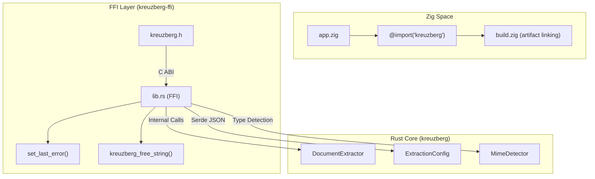
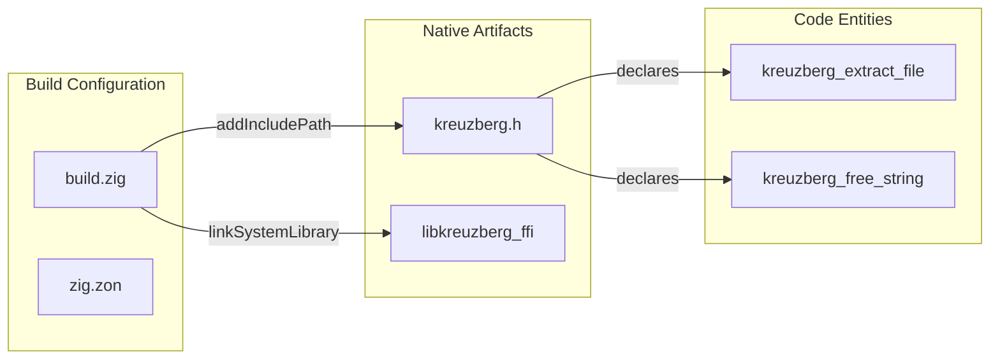

<!-- source: DeepWiki mcp.deepwiki.com · repo kreuzberg-dev/kreuzberg · page 4.15 Zig Bindings · fetched 2026-10-26 -->

# Zig Bindings

<details>
<summary>Relevant source files</summary>

The following files were used as context for generating this wiki page:

- [crates/kreuzberg-ffi/README.md](crates/kreuzberg-ffi/README.md)
- [packages/dart/README.md](packages/dart/README.md)
- [packages/r/README.md](packages/r/README.md)
- [packages/swift/README.md](packages/swift/README.md)
- [packages/zig/README.md](packages/zig/README.md)

</details>


Zig bindings for Kreuzberg provide high-performance, native access to the document intelligence engine via Zig's built-in C interoperability. These bindings utilize the `kreuzberg-ffi` layer to interact with the Rust core, offering a memory-safe and efficient interface for Zig applications.

## System Integration

The Zig integration relies on the `kreuzberg-ffi` crate, which exports a stable C ABI. The primary interaction point is the `kreuzberg.h` header file, which is automatically generated and maintained to ensure parity with the Rust core [crates/kreuzberg-ffi/build.rs:5-7]().

### Data Flow and Interop

Zig interacts with Kreuzberg by importing the C header and linking against the compiled shared library (`libkreuzberg_ffi.so`, `.dylib`, or `.a`). Memory management follows the "Caller Allocates or Library Frees" pattern common in FFI: strings or buffers returned by the library must be explicitly released using dedicated free functions provided by the FFI layer [crates/kreuzberg-ffi/src/lib.rs:66-90]().

### Bridge Architecture: Zig to Rust Core

The following diagram illustrates how Zig code traverses the FFI boundary to reach the Rust document processing logic.

**Zig FFI Bridge Architecture**

Sources: [crates/kreuzberg-ffi/src/lib.rs:22-42](), [crates/kreuzberg-ffi/include/kreuzberg.h:1-125](), [crates/kreuzberg-ffi/build.rs:9-13]()

## Configuration and Build

Integration into a Zig project is managed via `build.zig`. The build script must handle the location of the header files and the linking of the native library.

### build.zig Setup

To use Kreuzberg in a Zig project, you must:
1. Add the include path containing `kreuzberg.h`.
2. Link the `kreuzberg-ffi` native library.
3. Ensure the library is available in the runtime search path (LD_LIBRARY_PATH or similar).

**Build Entity Mapping**

Sources: [crates/kreuzberg-ffi/build.rs:3-13](), [crates/kreuzberg-ffi/include/kreuzberg.h:83-89]()

### Zig Package Manager Integration

The Kreuzberg Zig package can be integrated using the Zig package manager. This involves fetching the package and wiring it into `build.zig`.

First, fetch the package and pin it in `build.zig.zon`:
```bash
zig fetch --save https://github.com/kreuzberg-dev/kreuzberg/archive/refs/tags/v5.0.0-rc.3.tar.gz
```
Then, wire it into `build.zig`:
```zig
const kreuzberg_dep = b.dependency("kreuzberg", .{
    .target = target,
    .optimize = optimize,
});
exe.root_module.addImport("kreuzberg", kreuzberg_dep.module("kreuzberg"));
```
Sources: [packages/zig/README.md:103-117]()

## Memory and Error Handling

Zig developers must interact with the FFI error state and memory management functions to prevent leaks and handle processing failures.

### Error Propagation
The FFI layer uses thread-local storage to maintain the last error code and context message [crates/kreuzberg-ffi/src/lib.rs:29-32](). Zig code should check `kreuzberg_last_error_code()` after any operation that returns a null pointer or an error indicator [crates/kreuzberg-ffi/src/lib.rs:48-51]().

### Memory Lifecycle
| Function | Purpose | Source |
| :--- | :--- | :--- |
| `kreuzberg_free_string` | Frees `*mut c_char` returned by extraction functions. | [crates/kreuzberg-ffi/src/lib.rs:65-73]() |
| `kreuzberg_free_bytes` | Frees byte buffers allocated by the library. | [crates/kreuzberg-ffi/src/lib.rs:81-90]() |
| `kreuzberg_acceleration_config_free` | Frees handles to configuration objects. | [crates/kreuzberg-ffi/src/lib.rs:165-173]() |

## Implementation Detail: JSON Interop

Many complex configurations (like `AccelerationConfig` or `ExtractionConfig`) are passed across the FFI boundary as JSON strings to simplify the interface while maintaining the rich structure required by the Rust core [crates/kreuzberg-ffi/src/lib.rs:107-130]().

1.  **Serialization**: Zig serializes its configuration structures to a JSON string.
2.  **Handle Creation**: The JSON is passed to `kreuzberg_acceleration_config_from_json`, which returns an opaque pointer (handle) to a Rust-managed object [crates/kreuzberg-ffi/src/lib.rs:107-109]().
3.  **Execution**: This handle is passed to extraction functions.
4.  **Cleanup**: The handle is released via the appropriate `_free` function [crates/kreuzberg-ffi/src/lib.rs:166-173]().

Sources: [crates/kreuzberg-ffi/src/lib.rs:107-160](), [crates/kreuzberg-ffi/include/kreuzberg.h:13-108]()

---

