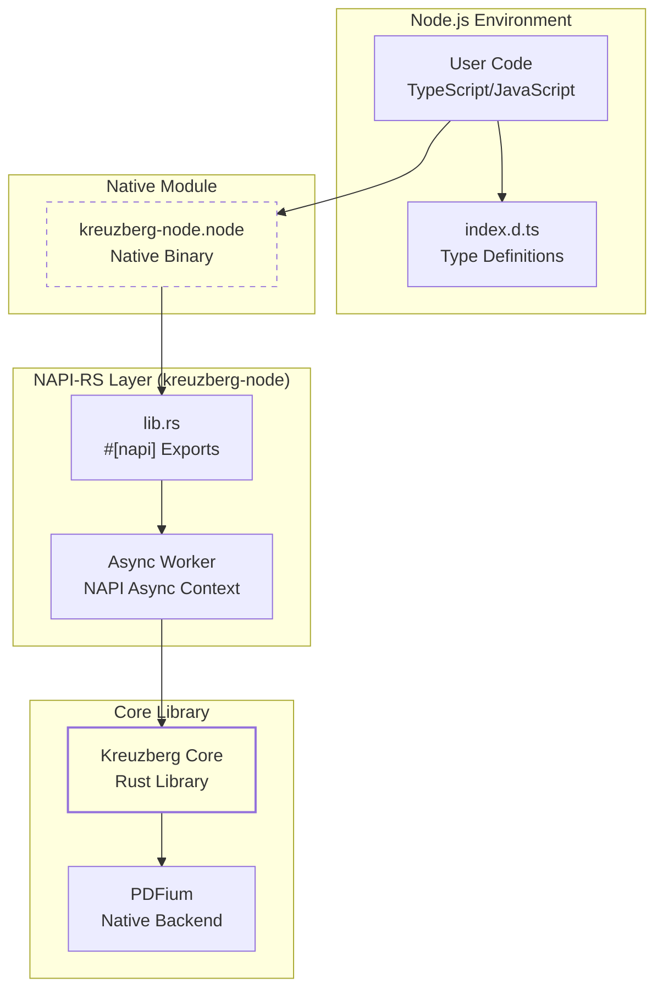
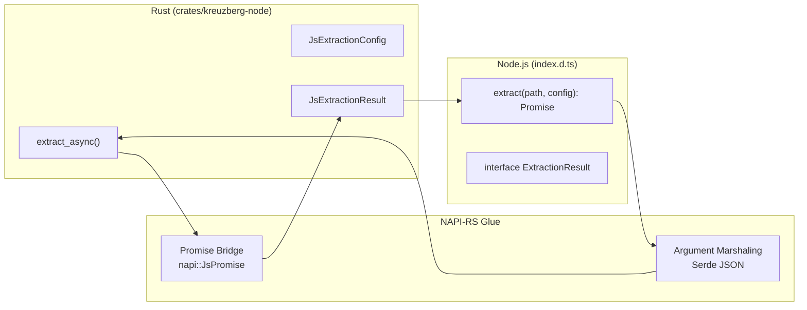

<!-- source: DeepWiki mcp.deepwiki.com · repo kreuzberg-dev/kreuzberg · page 4.2 Node.js/TypeScript Bindings · fetched 2026-10-26 -->

# Node.js/TypeScript Bindings

Relevant source files

The following files were used as context for generating this wiki page:

- [alef.toml](alef.toml)
- [crates/kreuzberg-ffi/Cargo.toml](crates/kreuzberg-ffi/Cargo.toml)
- [crates/kreuzberg-ffi/include/kreuzberg.h](crates/kreuzberg-ffi/include/kreuzberg.h)
- [crates/kreuzberg-ffi/src/lib.rs](crates/kreuzberg-ffi/src/lib.rs)
- [crates/kreuzberg-node/Cargo.toml](crates/kreuzberg-node/Cargo.toml)
- [crates/kreuzberg-node/index.d.ts](crates/kreuzberg-node/index.d.ts)
- [crates/kreuzberg-node/npm/darwin-arm64/package.json](crates/kreuzberg-node/npm/darwin-arm64/package.json)
- [crates/kreuzberg-node/npm/darwin-x64/package.json](crates/kreuzberg-node/npm/darwin-x64/package.json)
- [crates/kreuzberg-node/npm/linux-arm64-gnu/package.json](crates/kreuzberg-node/npm/linux-arm64-gnu/package.json)
- [crates/kreuzberg-node/npm/linux-x64-gnu/package.json](crates/kreuzberg-node/npm/linux-x64-gnu/package.json)
- [crates/kreuzberg-node/npm/win32-arm64-msvc/package.json](crates/kreuzberg-node/npm/win32-arm64-msvc/package.json)
- [crates/kreuzberg-node/npm/win32-x64-msvc/package.json](crates/kreuzberg-node/npm/win32-x64-msvc/package.json)
- [crates/kreuzberg-node/src/lib.rs](crates/kreuzberg-node/src/lib.rs)
- [crates/kreuzberg-php/src/lib.rs](crates/kreuzberg-php/src/lib.rs)
- [crates/kreuzberg-py/Cargo.toml](crates/kreuzberg-py/Cargo.toml)
- [crates/kreuzberg-py/src/lib.rs](crates/kreuzberg-py/src/lib.rs)
- [crates/kreuzberg-wasm/src/lib.rs](crates/kreuzberg-wasm/src/lib.rs)
- [e2e/rust/Cargo.toml](e2e/rust/Cargo.toml)
- [packages/elixir/native/kreuzberg_nif/src/lib.rs](packages/elixir/native/kreuzberg_nif/src/lib.rs)
- [packages/php/src/Kreuzberg.php](packages/php/src/Kreuzberg.php)
- [packages/php/stubs/kreuzberg_extension.php](packages/php/stubs/kreuzberg_extension.php)
- [packages/python/kreuzberg/__init__.py](packages/python/kreuzberg/__init__.py)
- [packages/python/kreuzberg/_kreuzberg.pyi](packages/python/kreuzberg/_kreuzberg.pyi)
- [packages/python/kreuzberg/api.py](packages/python/kreuzberg/api.py)
- [packages/python/kreuzberg/options.py](packages/python/kreuzberg/options.py)
- [packages/r/src/rust/src/lib.rs](packages/r/src/rust/src/lib.rs)
- [packages/ruby/ext/kreuzberg_rb/src/lib.rs](packages/ruby/ext/kreuzberg_rb/src/lib.rs)
- [packages/ruby/kreuzberg.gemspec](packages/ruby/kreuzberg.gemspec)
- [packages/swift/rust/src/lib.rs](packages/swift/rust/src/lib.rs)
- [packages/typescript/src/index.ts](packages/typescript/src/index.ts)

This document describes the Node.js and TypeScript integration for Kreuzberg, implemented using NAPI-RS for native bindings. It covers the package structure, build system, API surface, and worker pool architecture. For WebAssembly-based browser integration, see the WebAssembly Bindings page.

**Sources:** [crates/kreuzberg-node/package.json:1-26](), [crates/kreuzberg-node/Cargo.toml:1-15]()

---

## Architecture Overview

The Node.js bindings use NAPI-RS to create native Node.js modules directly from Rust. This provides high-performance execution by bypassing the generic C FFI layer used by other language bindings.

**Diagram: Node.js Bindings Architecture**

The bindings consist of the native NAPI module compiled from Rust and a TypeScript definition file (`index.d.ts`) that provides type safety for the exported functions.

**Sources:** [crates/kreuzberg-node/src/lib.rs:1-50](), [crates/kreuzberg-node/index.d.ts:1-100](), [crates/kreuzberg-node/package.json:6-10]()

---

## Package Structure

The `kreuzberg` Node.js package is organized as a standard NAPI-RS project, including pre-compiled binaries for multiple platforms.

| File | Purpose |
|------------|---------|
| `index.js` | Main entry point that loads the native binary |
| `index.d.ts` | TypeScript definitions for the API |
| `*.node` | Platform-specific native binaries |
| `package.json` | Package metadata and NAPI configuration |

The package targets the following architectures:
- `x86_64-unknown-linux-gnu`
- `aarch64-unknown-linux-gnu`
- `x86_64-apple-darwin`
- `aarch64-apple-darwin`
- `x86_64-pc-windows-msvc`
- `aarch64-pc-windows-msvc`

**Sources:** [crates/kreuzberg-node/package.json:6-18](), [crates/kreuzberg-node/npm/win32-x64-msvc/package.json:1-10](), [crates/kreuzberg-node/npm/darwin-arm64/package.json:1-10](), [crates/kreuzberg-node/npm/linux-arm64-gnu/package.json:1-10](), [crates/kreuzberg-node/npm/darwin-x64/package.json:1-10](), [crates/kreuzberg-node/npm/win32-arm64-msvc/package.json:1-10](), [crates/kreuzberg-node/npm/linux-x64-gnu/package.json:1-10]()

---

## NAPI-RS Integration

The integration leverages the `napi-rs` framework to bridge Rust's async/await patterns with Node.js Promises.

**Diagram: Data Flow and Entity Mapping**

- **Functions:** Rust functions decorated with `#[napi]` in [crates/kreuzberg-node/src/lib.rs]() are exported directly to JavaScript. For example, `JsCacheStats` is defined with `#[napi(object, js_name = "CacheStats")]` [crates/kreuzberg-node/src/lib.rs:170-187]().
- **Async Pattern:** Native Rust `Future` objects are converted to Node.js `Promise` objects using NAPI-RS's task system.
- **Data Conversion:** Complex types like `JsAccelerationConfig` [crates/kreuzberg-node/src/lib.rs:196-204]() are passed as JSON-compatible objects and converted using `serde`. The `JsBytes` wrapper [crates/kreuzberg-node/src/lib.rs:69-134]() handles conversion of Node.js `Buffer`, `Uint8Array`, or `Array<number>` to `Vec<u8>` and vice-versa.

**Sources:** [crates/kreuzberg-node/src/lib.rs:1-100](), [crates/kreuzberg-node/index.d.ts:1-50](), [crates/kreuzberg-node/src/lib.rs:170-187](), [crates/kreuzberg-node/src/lib.rs:196-204](), [crates/kreuzberg-node/src/lib.rs:69-134]()

---

## Worker Pool and Concurrency

To prevent blocking the Node.js event loop during heavy document processing (like OCR or PDF parsing), the bindings utilize a worker pool architecture.

- **Non-blocking I/O:** All extraction calls are asynchronous and return a `Promise`.
- **Thread Management:** NAPI-RS manages a thread pool where the Rust core executes document processing tasks.
- **Tokio Runtime:** The underlying Rust core uses `tokio` for internal concurrency, which is managed separately from the Node.js event loop. The `WORKER_POOL` static lazy-initialized `tokio::runtime::Runtime` [crates/kreuzberg-node/src/lib.rs:57-62]() is configured as a multi-thread runtime to handle these tasks.

**Sources:** [crates/kreuzberg-node/Cargo.toml:10-15](), [crates/kreuzberg-node/src/lib.rs:57-62]()

---

## Build System

The build process is managed by `@napi-rs/cli`, which handles the compilation of Rust code into a `.node` binary and generates the corresponding TypeScript definitions.

| Step | Tool | Action |
|------|------|--------|
| Compilation | `napi build` | Compiles Rust source into native binary |
| Header Gen | `napi build` | Generates `index.d.ts` from `#[napi]` macros |
| Packaging | `pnpm build` | Prepares artifacts for distribution |

The `package.json` defines the `build` script as `napi build --platform --release`, ensuring optimized binaries are produced for the target environment. The `alef.toml` configuration specifies `node_package_manager = "pnpm"` [alef.toml:28]() and disables default formatting for Node.js, deferring it to a dedicated lint command [alef.toml:69-71]().

**Sources:** [crates/kreuzberg-node/package.json:19-25](), [alef.toml:28](), [alef.toml:69-71]()

---

## TypeScript Definitions

The `index.d.ts` file provides the contract between the native module and TypeScript consumers. It includes definitions for:

- `extract`: The primary function for document text and metadata extraction.
- `ExtractionConfig`: Configuration options for OCR, chunking, and format-specific settings.
- `ExtractionResult`: The structured output containing extracted text, metadata, and optional embeddings.

The `alef.toml` configuration specifies `node = "interface"` for DTO styles [alef.toml:40](), meaning data transfer objects are generated as TypeScript interfaces. The `package_name = "@kreuzberg/node"` [alef.toml:216]() is also defined.

**Sources:** [crates/kreuzberg-node/index.d.ts:1-150](), [packages/typescript/src/index.ts:1-20](), [alef.toml:40](), [alef.toml:216]()

---

## Performance Considerations

- **Native Speed:** By using NAPI instead of FFI, the overhead of crossing the language boundary is minimized.
- **Memory Management:** Memory allocated in Rust is managed via `napi::Env` to ensure proper garbage collection coordination between the V8 engine and the Rust heap.
- **SIMD Support:** The native bindings can leverage SIMD instructions (like `simd-utf8`) if the host CPU supports them, significantly speeding up text processing. The `kreuzberg-node` crate depends on the `kreuzberg` core library [crates/kreuzberg-node/Cargo.toml:23-24](), which includes features like `full`, `pdf`, `ocr`, and `embeddings`, enabling access to optimized Rust implementations.

**Sources:** [crates/kreuzberg-node/Cargo.toml:5-10](), [crates/kreuzberg-node/Cargo.toml:23-24]()

---

