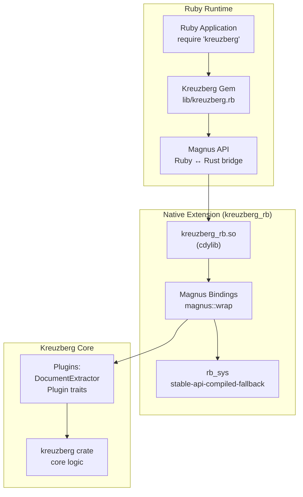
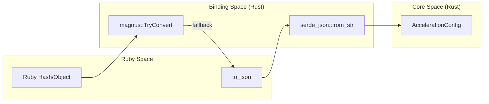

<!-- source: DeepWiki mcp.deepwiki.com · repo kreuzberg-dev/kreuzberg · page 4.3 Ruby Bindings · fetched 2026-10-26 -->

# Ruby Bindings

Relevant source files

The following files were used as context for generating this wiki page:

- [packages/r/NAMESPACE](packages/r/NAMESPACE)
- [packages/r/R/extendr-wrappers.R](packages/r/R/extendr-wrappers.R)
- [packages/ruby/Rakefile](packages/ruby/Rakefile)
- [packages/ruby/ext/kreuzberg_rb/extconf.rb](packages/ruby/ext/kreuzberg_rb/extconf.rb)
- [packages/ruby/lib/kreuzberg.rb](packages/ruby/lib/kreuzberg.rb)
- [packages/ruby/lib/kreuzberg/version.rb](packages/ruby/lib/kreuzberg/version.rb)
- [scripts/ci/README.md](scripts/ci/README.md)
- [scripts/ci/actions/setup-prebuilt-onnx/prepare.sh](scripts/ci/actions/setup-prebuilt-onnx/prepare.sh)

This page documents the Ruby language bindings for Kreuzberg, implemented using **Magnus** and **rb-sys** for native integration with the Rust core. For Python bindings using PyO3, see [Python Bindings](#4.1). For other FFI-based bindings, see [FFI Layer (kreuzberg-ffi)](#4.11).

## Overview

The Ruby bindings provide idiomatic Ruby access to Kreuzberg's document intelligence capabilities through a native extension built with Magnus (a Rust-to-Ruby FFI framework) and rb-sys (Ruby system library bindings). The bindings follow Ruby conventions including snake_case naming, keyword arguments, and Ruby-native error handling.

**Key characteristics:**
- **Native performance** via Magnus direct bindings (not C FFI layer) [packages/ruby/ext/kreuzberg_rb/src/lib.rs:25-28]()
- **Dual dependency management** with workspace Cargo.lock and native extension Cargo.toml [packages/ruby/ext/kreuzberg_rb/native/Cargo.toml:1-116]()
- **Type safety** through RBS signatures and Steep static analysis [packages/ruby/kreuzberg.gemspec:15-15]()
- **Bundled native dependencies** including PDFium, eliminating system requirements
- **Platform support**: Linux x86_64/aarch64, macOS ARM64 (precompiled gems) [packages/ruby/Rakefile:11-16]()

**Sources:** [packages/ruby/kreuzberg.gemspec:1-20](), [packages/ruby/ext/kreuzberg_rb/src/lib.rs:1-30](), [packages/ruby/Rakefile:11-16]()

## Architecture

### Magnus and rb-sys Integration

The Ruby bindings use **Magnus**, a Rust library that provides safe, idiomatic Rust bindings to the Ruby C API. Unlike traditional C FFI approaches, Magnus generates Ruby-callable functions directly from Rust code using procedural macros.

Title: Ruby Bindings Architecture
Sources: [packages/ruby/lib/kreuzberg.rb:1-14](), [packages/ruby/ext/kreuzberg_rb/src/lib.rs:23-28]()

### Key Code Entities

The Ruby bindings map Rust structs to Ruby classes using the `#[magnus::wrap]` attribute.

| Ruby Class | Rust Implementation | Purpose |
| :--- | :--- | :--- |
| `Kreuzberg::AccelerationConfig` | `AccelerationConfig` | Configures ONNX Runtime execution providers [packages/r/NAMESPACE:64-66]() |
| `Kreuzberg::ContentFilterConfig` | `ContentFilterConfig` | Controls stripping of headers/footers/watermarks [packages/r/NAMESPACE:73-75]() |
| `Kreuzberg::ExtractionConfig` | `ExtractionConfig` | Primary configuration for the extraction pipeline [packages/r/NAMESPACE:79-81]() |

**Sources:** [packages/r/NAMESPACE:64-81]()

## Data Flow: Ruby to Rust

The integration utilizes `serde_json` as a bridge for complex configuration objects when standard conversion fails, ensuring robust data transfer.

Title: Ruby to Rust Data Flow for Configuration
Sources: [packages/ruby/ext/kreuzberg_rb/src/lib.rs:74-96](), [packages/ruby/ext/kreuzberg_rb/src/lib.rs:148-169]()

## Implementation Details

### Configuration Mapping

Complex Ruby keyword arguments are scanned and converted to Rust types using `magnus::scan_args`. For example, `AccelerationConfig` handles optional `provider` and `device_id` keys.

- **`AccelerationConfig::new`**: Scans optional keyword arguments and defaults to `0` for `device_id` [packages/ruby/ext/kreuzberg_rb/src/lib.rs:110-125]().
- **`ContentFilterConfig::new`**: Defaults `strip_repeating_text` to `true` while others default to `false` [packages/ruby/ext/kreuzberg_rb/src/lib.rs:181-205]().

### JSON Conversion

The `json_to_ruby` function provides a recursive utility to convert `serde_json::Value` types back into native Ruby types (Hash, Array, Symbol, etc.) [packages/ruby/ext/kreuzberg_rb/src/lib.rs:30-62]().

- **Strings/Numbers**: Converted to native Ruby types [packages/ruby/ext/kreuzberg_rb/src/lib.rs:35-44]().
- **Objects**: Converted to Ruby Hashes with Symbol keys [packages/ruby/ext/kreuzberg_rb/src/lib.rs:52-60]().

**Sources:** [packages/ruby/ext/kreuzberg_rb/src/lib.rs:30-205]()

## Build System

### gemspec and extconf.rb

The gem's distribution is managed via `kreuzberg.gemspec`, which declares a dependency on `rb_sys` [packages/ruby/kreuzberg.gemspec:19-19]().

The native extension build is triggered by `ext/kreuzberg_rb/extconf.rb` [packages/ruby/kreuzberg.gemspec:17-17](). This setup allows the gem to be compiled locally or distributed as a precompiled native gem.

The `Rakefile` [packages/ruby/Rakefile:1-72]() plays a crucial role in managing the build process, especially for cross-compilation. It patches `RbSys::Cargo::Metadata#cargo_metadata` [packages/ruby/Rakefile:29-53]() to explicitly pass `--manifest-path` to `cargo metadata`, ensuring correct resolution of the Rust workspace within the monorepo. This addresses issues where `rb_sys` might otherwise fail to find the `Cargo.toml` for the `kreuzberg_rb` crate.

The `RbSys::ExtensionTask` [packages/ruby/Rakefile:55-62]() is configured to build the `kreuzberg-rb` extension, specifying `lib_dir`, `ext_dir`, and enabling cross-compilation for various platforms [packages/ruby/Rakefile:11-16](). A `compile:ruby` task is aliased to the main `compile` task to ensure builds are triggered correctly [packages/ruby/Rakefile:69-69]().

**Sources:** [packages/ruby/kreuzberg.gemspec:1-21](), [packages/ruby/Rakefile:1-72](), [packages/ruby/ext/kreuzberg_rb/extconf.rb:1-11]()

### Platform Support

The gem requires Ruby version `>= 3.2.0` [packages/ruby/kreuzberg.gemspec:11-11](). It bundles:
- **lib**: Ruby source code [packages/ruby/kreuzberg.gemspec:15-15]()
- **ext**: Native C/Rust extension code [packages/ruby/kreuzberg.gemspec:15-15]()
- **sig**: RBS type signatures for static analysis [packages/ruby/kreuzberg.gemspec:15-15]()

The `CROSS_PLATFORMS` constant in the `Rakefile` [packages/ruby/Rakefile:11-16]() defines the target platforms for which precompiled gems are built:
- `x86_64-linux`
- `aarch64-linux`
- `arm64-darwin`
- `x86_64-darwin`
- `x64-mingw-ucrt` (Windows)

CI scripts like `scripts/ci/ruby/build-gem.sh` [scripts/ci/README.md:101]() and `scripts/ci/ruby/compile-extension.sh` [scripts/ci/README.md:103]() are used to automate the build process for these platforms.

**Sources:** [packages/ruby/kreuzberg.gemspec:1-20](), [packages/ruby/Rakefile:11-16](), [scripts/ci/README.md:101-103]()

## Memory Management

Magnus handles memory management across the Ruby-Rust boundary:

1. **Ruby GC integration**: Wrapped Rust structs participate in Ruby garbage collection via `magnus::wrap` [packages/ruby/ext/kreuzberg_rb/src/lib.rs:66-66]().
2. **Safety**: `IntoValueFromNative` is implemented for wrapped structs to safely pass data to the Ruby VM [packages/ruby/ext/kreuzberg_rb/src/lib.rs:72-72]().
3. **Thread Safety**: The integration uses `Arc` and `Mutex` where necessary to ensure safe concurrent access from Ruby threads [packages/ruby/ext/kreuzberg_rb/src/lib.rs:27-28]().

**Sources:** [packages/ruby/ext/kreuzberg_rb/src/lib.rs:25-72]()

---

