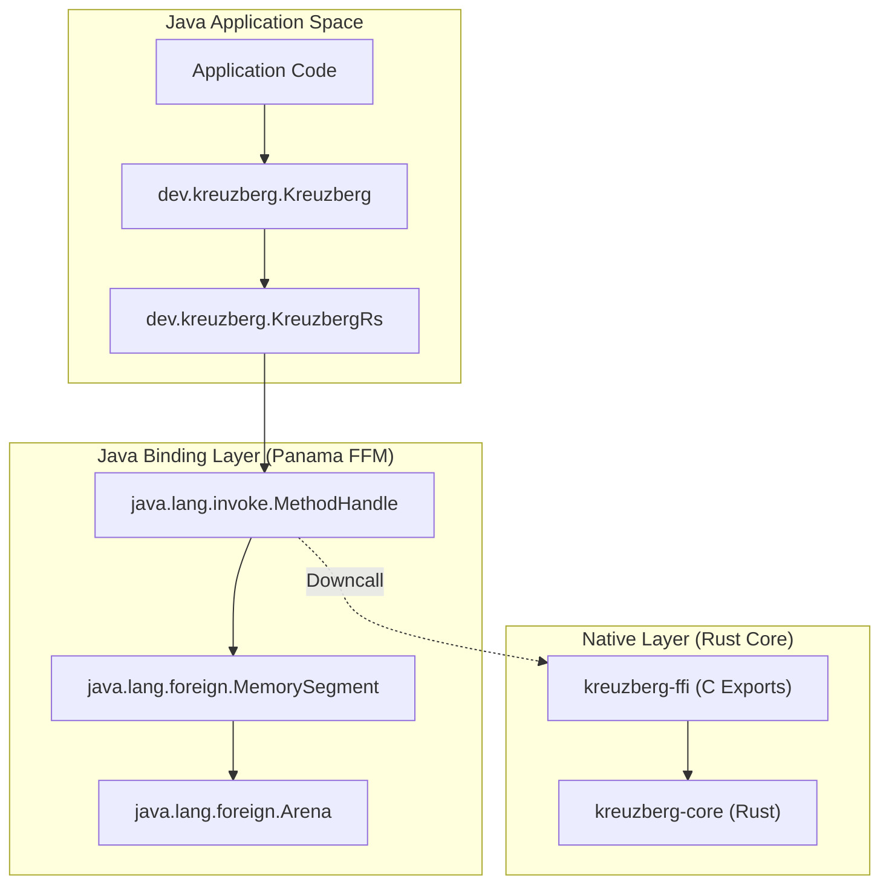
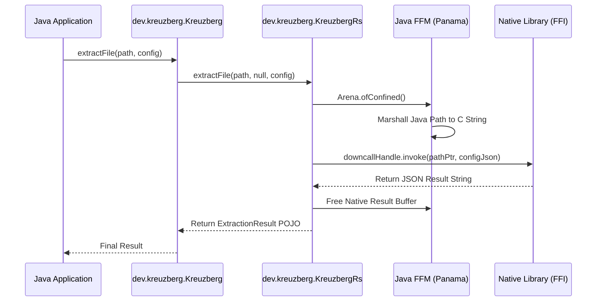
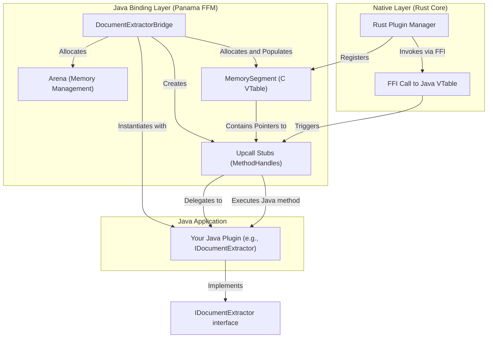

<!-- source: DeepWiki mcp.deepwiki.com · repo kreuzberg-dev/kreuzberg · page 4.4 Java Bindings · fetched 2026-10-26 -->

# Java Bindings

<details>
<summary>Relevant source files</summary>

The following files were used as context for generating this wiki page:

- [packages/java/dev/kreuzberg/DocumentExtractorBridge.java](packages/java/dev/kreuzberg/DocumentExtractorBridge.java)
- [packages/java/dev/kreuzberg/DocxMetadata.java](packages/java/dev/kreuzberg/DocxMetadata.java)
- [packages/java/dev/kreuzberg/EmbeddingBackendBridge.java](packages/java/dev/kreuzberg/EmbeddingBackendBridge.java)
- [packages/java/dev/kreuzberg/ExtractionDiff.java](packages/java/dev/kreuzberg/ExtractionDiff.java)
- [packages/java/dev/kreuzberg/ExtractionResult.java](packages/java/dev/kreuzberg/ExtractionResult.java)
- [packages/java/dev/kreuzberg/Metadata.java](packages/java/dev/kreuzberg/Metadata.java)
- [packages/java/dev/kreuzberg/OcrBackendBridge.java](packages/java/dev/kreuzberg/OcrBackendBridge.java)
- [packages/java/dev/kreuzberg/OcrConfig.java](packages/java/dev/kreuzberg/OcrConfig.java)
- [packages/java/dev/kreuzberg/OcrElement.java](packages/java/dev/kreuzberg/OcrElement.java)
- [packages/java/dev/kreuzberg/OcrExtractionResult.java](packages/java/dev/kreuzberg/OcrExtractionResult.java)
- [packages/java/dev/kreuzberg/OcrPipelineStage.java](packages/java/dev/kreuzberg/OcrPipelineStage.java)
- [packages/java/dev/kreuzberg/PostProcessorBridge.java](packages/java/dev/kreuzberg/PostProcessorBridge.java)
- [packages/java/dev/kreuzberg/RendererBridge.java](packages/java/dev/kreuzberg/RendererBridge.java)
- [packages/java/dev/kreuzberg/StructuredExtractionConfig.java](packages/java/dev/kreuzberg/StructuredExtractionConfig.java)
- [packages/java/dev/kreuzberg/ValidatorBridge.java](packages/java/dev/kreuzberg/ValidatorBridge.java)

</details>


The Java bindings provide access to Kreuzberg's document intelligence capabilities through the Java Foreign Function & Memory API (Panama FFM). These bindings target Java 25+ and use direct memory access for high-performance interop with the native Rust core via the C FFI layer.

**Scope**: This page covers the Java-specific binding architecture, native library loading, API structure, and CompletableFuture async patterns.

---

## Architecture Overview

The Java bindings implement a multi-layer architecture connecting Java application code to the Rust core through a C FFI bridge. The Java layer is responsible for type marshalling, memory safety via `Arena`, and providing a familiar `CompletableFuture`-based async API.

### System Architecture Diagram



**Sources**: [packages/java/src/main/java/dev/kreuzberg/Kreuzberg.java:6-10](), [packages/java/src/main/java/dev/kreuzberg/Kreuzberg.java:41-41]()

---

## Core API Structure

The primary entry point for Java developers is the `dev.kreuzberg.Kreuzberg` class. This class provides static methods for both synchronous and asynchronous extraction.

### Key Classes and Roles

| Class | Package | Responsibility |
|-------|---------|----------------|
| `Kreuzberg` | `dev.kreuzberg` | Public high-level API with `extractFile` and `extractBytes`. |
| `KreuzbergRs` | `dev.kreuzberg` | Internal FFI wrapper managing Panama MethodHandles. |
| `ExtractionConfig` | `dev.kreuzberg` | POJO for configuring OCR, chunking, and metadata extraction. |
| `ExtractionResult` | `dev.kreuzberg` | Container for extracted text, chunks, and metadata. |
| `KreuzbergRsException` | `dev.kreuzberg` | Checked exception for FFI and processing errors. |
| `DocumentExtractorBridge` | `dev.kreuzberg` | Manages Panama FFM upcall stubs for `IDocumentExtractor` implementations. |
| `EmbeddingBackendBridge` | `dev.kreuzberg` | Manages Panama FFM upcall stubs for `IEmbeddingBackend` implementations. |
| `OcrBackendBridge` | `dev.kreuzberg` | Manages Panama FFM upcall stubs for `IOcrBackend` implementations. |
| `PostProcessorBridge` | `dev.kreuzberg` | Manages Panama FFM upcall stubs for `IPostProcessor` implementations. |
| `RendererBridge` | `dev.kreuzberg` | Manages Panama FFM upcall stubs for `IRenderer` implementations. |
| `ValidatorBridge` | `dev.kreuzberg` | Manages Panama FFM upcall stubs for `IValidator` implementations. |

### Data Flow: Extraction Request



**Sources**: [packages/java/src/main/java/dev/kreuzberg/Kreuzberg.java:66-74](), [packages/java/src/main/java/dev/kreuzberg/Kreuzberg.java:118-127]()

---

## Async Patterns and CompletableFuture

Kreuzberg Java bindings leverage `java.util.concurrent.CompletableFuture` for non-blocking operations. These methods internally use a global Tokio runtime managed by the Rust core to ensure high performance without the overhead of thread-per-request models.

### Async Methods

- `extractFileAsync(Path path, String mimeType, ExtractionConfig config)`: Returns `CompletableFuture<ExtractionResult>`. [packages/java/src/main/java/dev/kreuzberg/Kreuzberg.java:181-188]()
- `batchExtractFilesAsync(List<BatchFileItem> items, ExtractionConfig config)`: Concurrently processes multiple files. [packages/java/src/main/java/dev/kreuzberg/Kreuzberg.java:162-171]()

### Example Usage

```java
Kreuzberg.extractFileAsync(Path.of("doc.pdf"), config)
    .thenAccept(result -> {
        System.out.println(result.getContent());
    })
    .exceptionally(ex -> {
        ex.printStackTrace();
        return null;
    });
```

**Sources**: [packages/java/src/main/java/dev/kreuzberg/Kreuzberg.java:181-192]()

---

## Maven and JVM Configuration

Because the bindings use the Panama FFM API (which is a preview feature in many Java versions and requires native access), specific Maven configuration is required.

### Dependency Configuration

The Java package is distributed via Maven Central. For E2E testing and local development, it can be linked as a system dependency or installed to a local repository.

**Sources**: [e2e/java/pom.xml:31-37]()

### Required JVM Arguments

To run applications using Kreuzberg, the following JVM flags are mandatory to enable native memory access and preview features:

```bash
--enable-preview 
--enable-native-access=ALL-UNNAMED 
-Djava.library.path=/path/to/native/libs
```

In Maven, these are typically configured in the `maven-surefire-plugin`:

```xml
<plugin>
    <groupId>org.apache.maven.plugins</groupId>
    <artifactId>maven-surefire-plugin</artifactId>
    <version>3.5.2</version>
    <configuration>
        <argLine>--enable-preview --enable-native-access=ALL-UNNAMED -Djava.library.path=${project.basedir}/../../target/release</argLine>
    </configuration>
</plugin>
```

**Sources**: [e2e/java/pom.xml:88-95]()

---

## Implementation Details

### Synchronous Wrappers

The library provides synchronous wrappers (e.g., `extractFileSync`) for environments where blocking calls are preferred. These wrappers block the current Java thread while the underlying task executes on the global Tokio runtime. This provides a 100x performance improvement over creating a new runtime per call.

**Sources**: [packages/java/src/main/java/dev/kreuzberg/Kreuzberg.java:81-90](), [packages/java/src/main/java/dev/kreuzberg/Kreuzberg.java:110-117]()

### Result Parsing

The FFI layer returns results as serialized JSON strings. The Java binding uses Jackson (specifically `jackson-databind`) to deserialize these strings into the `ExtractionResult` object graph.

**Sources**: [e2e/java/pom.xml:38-42](), [packages/java/src/main/java/dev/kreuzberg/ExtractionResult.java:1-10]()

### Plugin Bridge Mechanism

The Java bindings support the Kreuzberg plugin system, allowing Java implementations of various plugin traits (e.g., `IDocumentExtractor`, `IOcrBackend`, `IPostProcessor`, `IValidator`, `IEmbeddingBackend`, `IRenderer`) to be registered with the native Rust core. This is achieved using Panama FFM's "upcall" mechanism.

Each plugin type has a dedicated `*Bridge` class (e.g., `DocumentExtractorBridge`, `OcrBackendBridge`) responsible for:
1.  Creating a `java.lang.foreign.Arena` for memory management. [packages/java/dev/kreuzberg/DocumentExtractorBridge.java:40]()
2.  Allocating a C-compatible "vtable" (`MemorySegment`) in native memory. [packages/java/dev/kreuzberg/DocumentExtractorBridge.java:41]()
3.  Binding Java methods (e.g., `handleName`, `handleVersion`, `handleExtractBytes`) to native function pointers using `Linker.upcallStub()`. These stubs are then stored in the vtable. [packages/java/dev/kreuzberg/DocumentExtractorBridge.java:46-107]()
4.  Providing static `register*` and `unregister*` methods to manage the lifecycle of these bridges and keep them alive in a `ConcurrentHashMap`. [packages/java/dev/kreuzberg/DocumentExtractorBridge.java:27-28]()

When the Rust core needs to call a plugin method, it invokes the corresponding function pointer in the vtable, which then "upcalls" into the Java `handle*` method. The `handle*` methods perform necessary type conversions (e.g., `MemorySegment` to `String`, `String` to `MemorySegment`) and delegate the call to the actual Java plugin implementation (`impl`). Error handling is also managed within these `handle*` methods, returning an integer status code to Rust.

#### Plugin Bridge Diagram


**Sources**:
[packages/java/dev/kreuzberg/DocumentExtractorBridge.java:15-20](),
[packages/java/dev/kreuzberg/DocumentExtractorBridge.java:38-42](),
[packages/java/dev/kreuzberg/DocumentExtractorBridge.java:46-107](),
[packages/java/dev/kreuzberg/DocumentExtractorBridge.java:117-121](),
[packages/java/dev/kreuzberg/EmbeddingBackendBridge.java:15-20](),
[packages/java/dev/kreuzberg/EmbeddingBackendBridge.java:38-42](),
[packages/java/dev/kreuzberg/EmbeddingBackendBridge.java:45-107](),
[packages/java/dev/kreuzberg/EmbeddingBackendBridge.java:117-121](),
[packages/java/dev/kreuzberg/OcrBackendBridge.java:15-20](),
[packages/java/dev/kreuzberg/OcrBackendBridge.java:38-42](),
[packages/java/dev/kreuzberg/OcrBackendBridge.java:45-150](),
[packages/java/dev/kreuzberg/OcrBackendBridge.java:160-164](),
[packages/java/dev/kreuzberg/PostProcessorBridge.java:15-20](),
[packages/java/dev/kreuzberg/PostProcessorBridge.java:38-42](),
[packages/java/dev/kreuzberg/PostProcessorBridge.java:45-143](),
[packages/java/dev/kreuzberg/PostProcessorBridge.java:153-157](),
[packages/java/dev/kreuzberg/RendererBridge.java:15-20](),
[packages/java/dev/kreuzberg/RendererBridge.java:38-42](),
[packages/java/dev/kreuzberg/RendererBridge.java:45-98](),
[packages/java/dev/kreuzberg/RendererBridge.java:108-112](),
[packages/java/dev/kreuzberg/ValidatorBridge.java:15-20](),
[packages/java/dev/kreuzberg/ValidatorBridge.java:38-42](),
[packages/java/dev/kreuzberg/ValidatorBridge.java:45-125](),
[packages/java/dev/kreuzberg/ValidatorBridge.java:135-139]()

---

