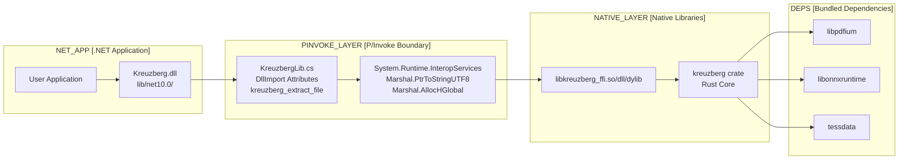
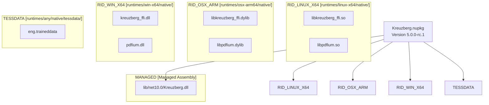
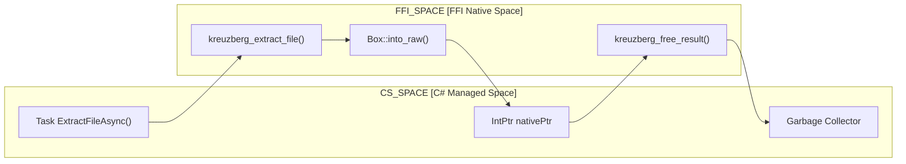
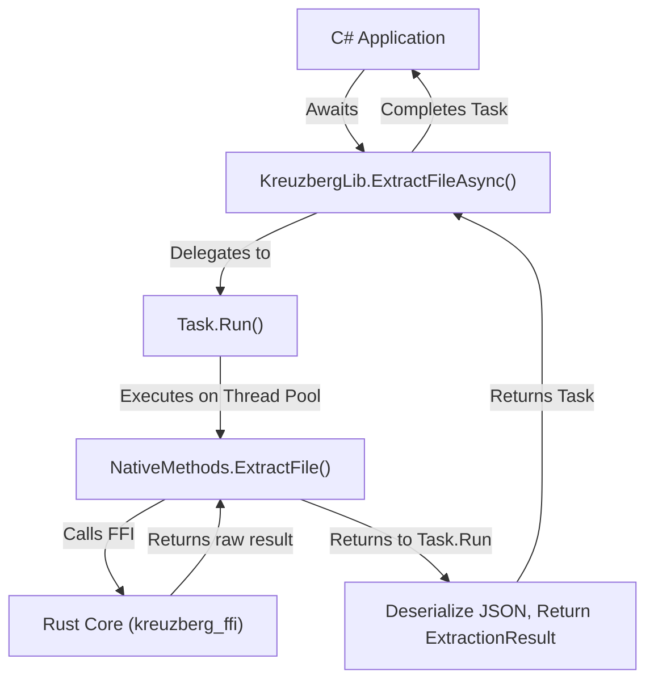
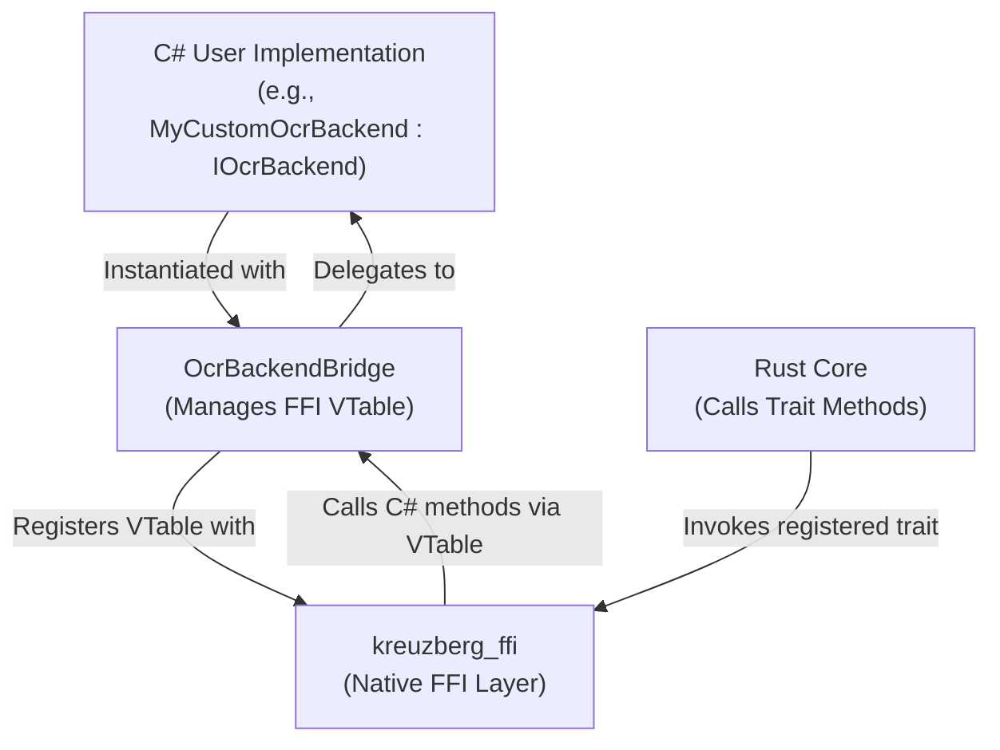

<!-- source: DeepWiki mcp.deepwiki.com · repo kreuzberg-dev/kreuzberg · page 4.6 C# Bindings · fetched 2026-10-26 -->

# C# Bindings

<details>
<summary>Relevant source files</summary>

The following files were used as context for generating this wiki page:

- [.cargo/config.toml](.cargo/config.toml)
- [audit-notes/csharp.md](audit-notes/csharp.md)
- [audit-notes/dart.md](audit-notes/dart.md)
- [audit-notes/elixir.md](audit-notes/elixir.md)
- [audit-notes/go.md](audit-notes/go.md)
- [audit-notes/java.md](audit-notes/java.md)
- [audit-notes/kotlin-android.md](audit-notes/kotlin-android.md)
- [audit-notes/node.md](audit-notes/node.md)
- [audit-notes/other-bindings.md](audit-notes/other-bindings.md)
- [audit-notes/php.md](audit-notes/php.md)
- [audit-notes/python.md](audit-notes/python.md)
- [audit-notes/r.md](audit-notes/r.md)
- [audit-notes/ruby.md](audit-notes/ruby.md)
- [audit-notes/swift.md](audit-notes/swift.md)
- [audit-notes/zig.md](audit-notes/zig.md)
- [crates/kreuzberg-ffi/tests/email_attachment_data_len.rs](crates/kreuzberg-ffi/tests/email_attachment_data_len.rs)
- [csharp_e2e_output.txt](csharp_e2e_output.txt)
- [e2e/csharp/tests/PluginApiTests.cs](e2e/csharp/tests/PluginApiTests.cs)
- [e2e/swift_e2e/Package.swift](e2e/swift_e2e/Package.swift)
- [e2e/swift_e2e/Tests/KreuzbergE2ETests/OcrBackendManagementTests.swift](e2e/swift_e2e/Tests/KreuzbergE2ETests/OcrBackendManagementTests.swift)
- [e2e/swift_e2e/Tests/KreuzbergE2ETests/PluginApiTests.swift](e2e/swift_e2e/Tests/KreuzbergE2ETests/PluginApiTests.swift)
- [packages/csharp/src/Kreuzberg/ExtractionResult.cs](packages/csharp/src/Kreuzberg/ExtractionResult.cs)
- [packages/csharp/src/Kreuzberg/KreuzbergLib.cs](packages/csharp/src/Kreuzberg/KreuzbergLib.cs)
- [packages/csharp/src/Kreuzberg/Metadata.cs](packages/csharp/src/Kreuzberg/Metadata.cs)
- [packages/csharp/src/Kreuzberg/OcrElement.cs](packages/csharp/src/Kreuzberg/OcrElement.cs)
- [packages/csharp/src/Kreuzberg/TraitBridges.cs](packages/csharp/src/Kreuzberg/TraitBridges.cs)
- [packages/ruby/lib/kreuzberg/native.rb](packages/ruby/lib/kreuzberg/native.rb)
- [packages/swift/Sources/Kreuzberg/BridgeRegistrationOverloads.swift](packages/swift/Sources/Kreuzberg/BridgeRegistrationOverloads.swift)
- [packages/swift/Sources/Kreuzberg/Kreuzberg.swift](packages/swift/Sources/Kreuzberg/Kreuzberg.swift)
- [packages/swift/Sources/RustBridge/SwiftBridgeCore.swift](packages/swift/Sources/RustBridge/SwiftBridgeCore.swift)
- [packages/swift/Sources/RustBridge/kreuzberg-swift.swift](packages/swift/Sources/RustBridge/kreuzberg-swift.swift)
- [packages/swift/Sources/RustBridgeC/RustBridgeC.h](packages/swift/Sources/RustBridgeC/RustBridgeC.h)
- [scripts/setup-swift-bridge.sh](scripts/setup-swift-bridge.sh)

</details>


The C# bindings provide .NET integration via P/Invoke and the C FFI layer, enabling .NET applications to access Kreuzberg's document intelligence capabilities through idiomatic .NET APIs. These bindings are distributed as a NuGet package and target modern .NET environments.

**Sources:** [packages/csharp/Kreuzberg/Kreuzberg.csproj:1-13](), [crates/kreuzberg-node/src/lib.rs:57-62]()

---

## Architecture Overview

The C# bindings use a two-layer architecture: a managed .NET wrapper that calls into the C FFI layer via P/Invoke, which then forwards requests to the Rust core.

### Integration Strategy

**Diagram: C# P/Invoke Architecture**


**Sources:** [packages/csharp/Kreuzberg/Kreuzberg.csproj:1-13](), [packages/csharp/src/Kreuzberg/KreuzbergLib.cs:1-50]()

### P/Invoke Integration

The C# bindings use .NET's Platform Invoke (P/Invoke) mechanism to call native functions. This approach provides:
- Automatic marshaling of basic types (int, bool, double).
- Manual memory management for complex types and strings via `IntPtr`.
- Cross-platform library loading via Runtime Identifiers (RIDs).

**Sources:** [packages/csharp/Kreuzberg/Kreuzberg.csproj:11-12](), [packages/csharp/src/Kreuzberg/KreuzbergLib.cs:1-50]()

---

## Installation

### NuGet Package

The C# bindings are distributed as the `Kreuzberg` NuGet package.

```xml
<PackageReference Include="Kreuzberg" Version="5.0.0-rc.1" />
```

### Prerequisites

| Requirement | Version | Notes |
|------------|---------|-------|
| **.NET SDK** | 10.0.x (`net10.0`) | Target framework |
| **Platform Support** | x64, arm64 | Linux, macOS, Windows |
| **Unsafe Blocks** | Enabled | Required for P/Invoke pointers |

**Sources:** [packages/csharp/Kreuzberg/Kreuzberg.csproj:3-11]()

---

## Data Model and Types

The C# bindings replicate the Rust core's configuration and result models as managed classes and enums.

### Configuration Classes
- `ExtractionConfig`: The primary configuration object [packages/elixir/native/kreuzberg_nif/src/lib.rs:89-124]().
- `OcrConfig`: Configuration for OCR backends (Tesseract/Paddle) [packages/python/kreuzberg/api.py:151-160]().
- `ChunkingConfig`: Settings for text segmentation [packages/csharp/src/Kreuzberg/ChunkingConfig.cs:1-20]().

### Result Types
- `NodeContent`: Represents extracted document content [packages/csharp/src/Kreuzberg/NodeContent.cs:1-15]().
- `OcrBoundingGeometry`: Spatial data for OCR results [packages/csharp/src/Kreuzberg/OcrBoundingGeometry.cs:1-15]().
- `AnnotationKind`: Enumeration of PDF annotation types [packages/csharp/src/Kreuzberg/AnnotationKind.cs:1-10]().

**Sources:** [packages/csharp/src/Kreuzberg/NodeContent.cs:1-15](), [packages/csharp/src/Kreuzberg/ChunkingConfig.cs:1-20]()

---

## NuGet Package Structure

The NuGet package organizes native libraries using .NET's runtime identifier (RID) system.

**Diagram: NuGet Package RID Organization**


**Sources:** [packages/csharp/Kreuzberg/Kreuzberg.csproj:15-18]()

---

## Memory Management

Because the FFI layer allocates memory on the Rust heap, the C# wrapper must ensure deterministic deallocation.

### Memory Ownership Model

**Diagram: Managed to Native Memory Flow**


1. **Allocation**: Native functions like `kreuzberg_extract_file` allocate memory and return an `IntPtr`.
2. **Usage**: C# code marshals data from the pointer using `Marshal.PtrToStructure` or `Marshal.PtrToStringUTF8`.
3. **Cleanup**: The C# wrapper implements `IDisposable`. The `Dispose` method (and finalizer) calls a specific FFI "free" function (e.g., `kreuzberg_free_result`) to release the Rust-allocated memory.

A common issue in P/Invoke is memory leaks if `GCHandle` or `Marshal.AllocHGlobal` are not properly freed, especially in exception paths. The `audit-notes/csharp.md` highlights several such issues, recommending `try-finally` blocks and `SafeHandle` wrappers for robust memory management. For example, `ExtractBytesAsync` and `ExtractFileAsync` use `GCHandle.Alloc` and `NativeMethods.ExtractionConfigFromJson` which require explicit cleanup in a `finally` block to prevent leaks if an exception occurs before deallocation [audit-notes/csharp.md:10-54](), [packages/csharp/src/Kreuzberg/KreuzbergLib.cs:85-89]().

**Sources:** [crates/kreuzberg-node/src/lib.rs:136-168](), [packages/csharp/src/Kreuzberg/KreuzbergLib.cs:1-50](), [audit-notes/csharp.md:10-54]()

---

## Build Process

Building the C# bindings involves compiling the Rust FFI library and then packaging it with the .NET assembly.

### Build Pipeline

| Stage | Tool | Input | Output |
|-------|------|-------|--------|
| **FFI Build** | `cargo build` | `crates/kreuzberg-ffi` | `libkreuzberg_ffi.[so\|dll\|dylib]` |
| **C# Build** | `dotnet build` | `packages/csharp/src/**/*.cs` | `Kreuzberg.dll` |
| **Packaging** | `dotnet pack` | `.csproj` + Native libs | `Kreuzberg.nupkg` |

The `Kreuzberg.csproj` uses `ItemGroup` to include native binaries from the `runtimes/` directory into the final package [packages/csharp/Kreuzberg/Kreuzberg.csproj:15-18]().

**Sources:** [packages/csharp/Kreuzberg/Kreuzberg.csproj:1-23]()

---

## Asynchronous Operations

The C# bindings provide `Task`-based asynchronous methods for long-running operations like `ExtractBytesAsync` and `ExtractFileAsync`. These methods wrap synchronous FFI calls within `Task.Run` to offload work to a thread pool, preventing UI blocking in client applications.

**Diagram: Async Operation Flow**


For example, `ExtractBytesAsync` wraps the `NativeMethods.ExtractBytes` call in `Task.Run` [packages/csharp/src/Kreuzberg/KreuzbergLib.cs:65-83](). This ensures that the native FFI call, which might be blocking, does not block the calling thread in the C# application.

**Sources:** [packages/csharp/src/Kreuzberg/KreuzbergLib.cs:9-10](), [packages/csharp/src/Kreuzberg/KreuzbergLib.cs:49-90]()

---

## Trait Bridge Implementations

The C# bindings support implementing Rust traits (like `OcrBackend`, `DocumentExtractor`, `EmbeddingBackend`, `PostProcessor`, `Renderer`, `Validator`) directly in C#. This allows users to extend Kreuzberg's functionality with custom logic written in C#.

**Diagram: C# Trait Bridge Mechanism**


The `OcrBackendBridge` class [packages/csharp/src/Kreuzberg/TraitBridges.cs:58-136]() is a key component. It takes an `IOcrBackend` implementation, allocates an unmanaged VTable (`_vtable`), and populates it with function pointers to C# delegates (e.g., `NameFnCallback`, `ProcessImageFnCallback`) [packages/csharp/src/Kreuzberg/TraitBridges.cs:138-165](). These delegates then call the methods on the user's `IOcrBackend` instance. The `_delegateRoots` list ensures that these delegates are not garbage collected while Rust holds pointers to them [packages/csharp/src/Kreuzberg/TraitBridges.cs:65-67](), [packages/csharp/src/Kreuzberg/TraitBridges.cs:128-129]().

**Sources:** [packages/csharp/src/Kreuzberg/TraitBridges.cs:1-136](), [packages/csharp/src/Kreuzberg/TraitBridges.cs:138-165]()

---

## Feature Parity

The C# bindings support the full range of Kreuzberg features through its configuration system:

| Feature | Configuration Class | Code Pointer |
|---------|---------------------|--------------|
| **OCR** | `OcrConfig` | [packages/python/kreuzberg/api.py:151-160]() |
| **Chunking** | `ChunkingConfig` | [packages/csharp/src/Kreuzberg/ChunkingConfig.cs:1-10]() |
| **Embeddings** | `EmbeddingModelType` | [packages/csharp/src/Kreuzberg/EmbeddingModelType.cs:1-10]() |
| **Acceleration** | `AccelerationConfig` | [packages/swift/Sources/Kreuzberg/Kreuzberg.swift:63-70]() |
| **Tesseract** | `TessdataManager` | [packages/csharp/src/Kreuzberg/TessdataManager.cs:1-10]() |

**Sources:** [packages/csharp/src/Kreuzberg/ChunkingConfig.cs:1-20](), [packages/csharp/src/Kreuzberg/TessdataManager.cs:1-15](), [packages/swift/Sources/Kreuzberg/Kreuzberg.swift:63-70]()

---

