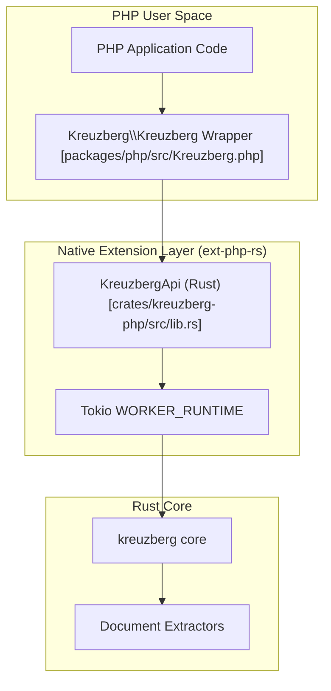
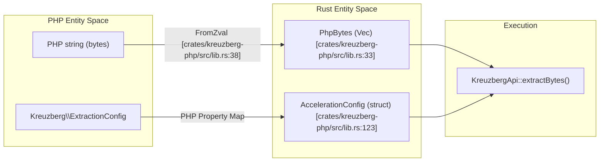
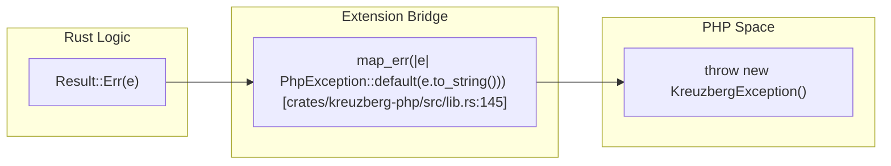

<!-- source: DeepWiki mcp.deepwiki.com · repo kreuzberg-dev/kreuzberg · page 4.7 PHP Bindings · fetched 2026-10-26 -->

# PHP Bindings

<details>
<summary>Relevant source files</summary>

The following files were used as context for generating this wiki page:

- [alef.toml](alef.toml)
- [composer.json](composer.json)
- [crates/kreuzberg-ffi/include/kreuzberg.h](crates/kreuzberg-ffi/include/kreuzberg.h)
- [crates/kreuzberg-ffi/src/lib.rs](crates/kreuzberg-ffi/src/lib.rs)
- [crates/kreuzberg-node/index.d.ts](crates/kreuzberg-node/index.d.ts)
- [crates/kreuzberg-node/src/lib.rs](crates/kreuzberg-node/src/lib.rs)
- [crates/kreuzberg-php/src/lib.rs](crates/kreuzberg-php/src/lib.rs)
- [crates/kreuzberg-py/src/lib.rs](crates/kreuzberg-py/src/lib.rs)
- [crates/kreuzberg-wasm/src/lib.rs](crates/kreuzberg-wasm/src/lib.rs)
- [e2e/rust/Cargo.toml](e2e/rust/Cargo.toml)
- [packages/elixir/native/kreuzberg_nif/src/lib.rs](packages/elixir/native/kreuzberg_nif/src/lib.rs)
- [packages/php/composer.json](packages/php/composer.json)
- [packages/php/src/Kreuzberg.php](packages/php/src/Kreuzberg.php)
- [packages/php/stubs/kreuzberg_extension.php](packages/php/stubs/kreuzberg_extension.php)
- [packages/python/kreuzberg/__init__.py](packages/python/kreuzberg/__init__.py)
- [packages/python/kreuzberg/_kreuzberg.pyi](packages/python/kreuzberg/_kreuzberg.pyi)
- [packages/python/kreuzberg/api.py](packages/python/kreuzberg/api.py)
- [packages/python/kreuzberg/options.py](packages/python/kreuzberg/options.py)
- [packages/r/src/rust/src/lib.rs](packages/r/src/rust/src/lib.rs)
- [packages/ruby/ext/kreuzberg_rb/src/lib.rs](packages/ruby/ext/kreuzberg_rb/src/lib.rs)
- [packages/ruby/kreuzberg.gemspec](packages/ruby/kreuzberg.gemspec)
- [packages/swift/rust/src/lib.rs](packages/swift/rust/src/lib.rs)
- [packages/typescript/src/index.ts](packages/typescript/src/index.ts)

</details>


## Purpose and Scope

This document describes Kreuzberg's PHP integration. Unlike previous versions that relied solely on raw FFI calls, the current implementation utilizes a high-performance native PHP extension built with Rust, alongside a Composer-compatible wrapper. This binding provides full access to Kreuzberg's document intelligence features, including the `DeferredResult` async pattern and comprehensive configuration objects.

The PHP bindings support PHP 8.4+ [packages/php/composer.json:39]() and are distributed as a `php-ext` type package [packages/php/composer.json:5]().

---

## Architecture Overview

The PHP integration consists of three distinct layers: the Rust Core, the Native PHP Extension (generated via `ext-php-rs`), and the User-facing PHP Wrapper.

### PHP-Rust Integration Stack



**Sources:** [packages/php/src/Kreuzberg.php:9-10](), [crates/kreuzberg-php/src/lib.rs:55-60](), [crates/kreuzberg-php/src/lib.rs:62-64]()

### Data Flow: PHP to Rust

Data conversion between PHP types and Rust types is handled by `ext-php-rs` and custom conversion traits. For example, binary data is mapped via `PhpBytes` [crates/kreuzberg-php/src/lib.rs:33-41]().



**Sources:** [crates/kreuzberg-php/src/lib.rs:36-41](), [crates/kreuzberg-php/src/lib.rs:123-133](), [packages/php/src/Kreuzberg.php:54-58]()

---

## Installation and Packaging

### Composer Integration

The package is identified as `kreuzberg-dev/kreuzberg` [packages/php/composer.json:2](). It defines a custom `php-ext` configuration that allows for pre-packaged binary downloads [packages/php/composer.json:27-32]().

```bash
composer require kreuzberg-dev/kreuzberg
```

### Autoloading and Stubs

The package provides PSR-4 autoloading for the `Kreuzberg\` namespace [packages/php/composer.json:49-52](). Since the core logic resides in a compiled extension, IDE support and static analysis (like PHPStan) are provided through auto-generated stubs [packages/php/stubs/kreuzberg_extension.php:1-12]().

**Sources:** [packages/php/composer.json:49-56](), [packages/php/stubs/kreuzberg_extension.php:8-15]()

---

## Implementation Details

### Async Pattern: DeferredResult

While PHP is primarily synchronous, the Kreuzberg extension utilizes a global `WORKER_RUNTIME` (Tokio) [crates/kreuzberg-php/src/lib.rs:55-60]() to handle heavy document processing without blocking the PHP main thread during I/O bound operations.

The `KreuzbergApi` class in Rust exposes both synchronous and deferred methods. The deferred pattern allows the Rust core to manage concurrency limits defined in `ExtractionConfig` [packages/php/stubs/kreuzberg_extension.php:163]().

### Key Classes and Functions

| PHP Class | Rust Source | Purpose |
|-----------|-------------|---------|
| `Kreuzberg\Kreuzberg` | `packages/php/src/Kreuzberg.php` | Main static entry point for users |
| `Kreuzberg\KreuzbergApi` | `crates/kreuzberg-php/src/lib.rs` | Native bridge to Rust core |
| `Kreuzberg\ExtractionConfig` | `packages/php/stubs/kreuzberg_extension.php` | Comprehensive configuration object |
| `Kreuzberg\ExtractionResult` | `packages/php/stubs/kreuzberg_extension.php` | Result container (content, metadata, chunks) |

**Sources:** [packages/php/src/Kreuzberg.php:9-10](), [packages/php/stubs/kreuzberg_extension.php:142-210](), [packages/php/stubs/kreuzberg_extension.php:218-230]()

### Configuration Management

Configuration is passed from PHP as objects that are mapped to Rust structs. The `ExtractionConfig` class supports a wide array of options including OCR settings, PDF-specific behavior, and content filtering [packages/php/stubs/kreuzberg_extension.php:142-180]().

**Example Property Mapping:**
* `force_ocr`: Controls whether OCR is triggered regardless of text availability [packages/php/stubs/kreuzberg_extension.php:147]().
* `content_filter`: Configures stripping of headers/footers [packages/php/stubs/kreuzberg_extension.php:152]().
* `acceleration`: Controls ONNX Runtime execution providers (CPU, CUDA, etc.) [packages/php/stubs/kreuzberg_extension.php:170]().

---

## Error Handling

The PHP bindings map Rust errors to a custom exception hierarchy. The base exception is `Kreuzberg\KreuzbergException` [packages/php/stubs/kreuzberg_extension.php:15](), which extends the standard `\RuntimeException`.

Errors are propagated across the FFI boundary by catching Rust `Result` types and throwing `PhpException` or returning `PhpResult` [crates/kreuzberg-php/src/lib.rs:145]().



**Sources:** [crates/kreuzberg-php/src/lib.rs:145](), [packages/php/stubs/kreuzberg_extension.php:15-21]()

---

## Development and Testing

### Testing Strategy

The PHP bindings are tested using `PHPUnit` [packages/php/composer.json:23](). Tests are split into unit tests and end-to-end (e2e) tests that verify the interaction between the PHP wrapper and the native library [e2e/php/bootstrap.php:10-26]().

### Quality Control

The project uses several tools to ensure code quality:
1. **PHPStan**: Static analysis at level `max` [packages/php/composer.json:64]().
2. **PHP-CS-Fixer**: Enforces coding standards [packages/php/composer.json:66]().
3. **Alef**: A custom tool used to auto-generate the PHP wrapper and stubs from the Rust source [packages/php/src/Kreuzberg.php:2-6]().

**Sources:** [packages/php/composer.json:62-68](), [packages/php/composer.json:19-26](), [packages/php/src/Kreuzberg.php:2-6]()

---

