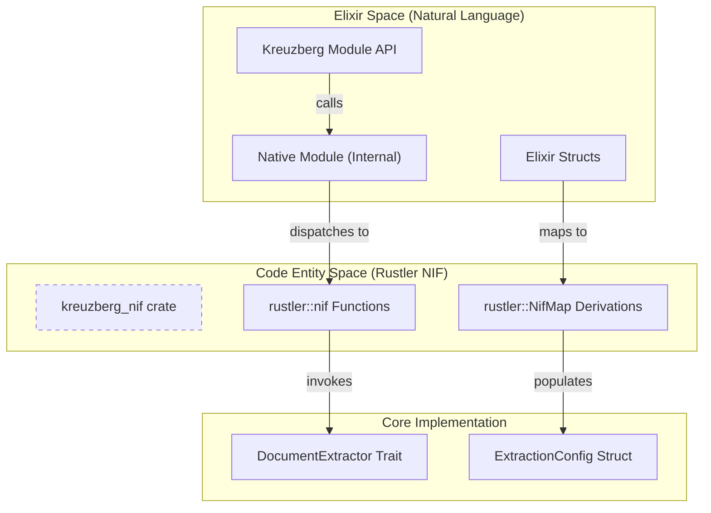
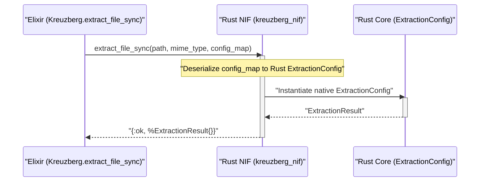

<!-- source: DeepWiki mcp.deepwiki.com · repo kreuzberg-dev/kreuzberg · page 4.8 Elixir Bindings · fetched 2026-10-26 -->

# Elixir Bindings

Relevant source files

The following files were used as context for generating this wiki page:

- [e2e/elixir/test/plugin_api_test.exs](e2e/elixir/test/plugin_api_test.exs)
- [e2e/elixir/test_syntax_check.exs](e2e/elixir/test_syntax_check.exs)
- [e2e/php/tests/PluginApiTest.php](e2e/php/tests/PluginApiTest.php)
- [e2e/ruby/spec/plugin_api_spec.rb](e2e/ruby/spec/plugin_api_spec.rb)
- [e2e/rust/tests/plugin_api_test.rs](e2e/rust/tests/plugin_api_test.rs)
- [packages/elixir/lib/kreuzberg.ex](packages/elixir/lib/kreuzberg.ex)
- [packages/elixir/lib/kreuzberg/html_theme.ex](packages/elixir/lib/kreuzberg/html_theme.ex)
- [packages/elixir/lib/kreuzberg/native.ex](packages/elixir/lib/kreuzberg/native.ex)
- [packages/elixir/lib/kreuzberg/ocr_bounding_geometry.ex](packages/elixir/lib/kreuzberg/ocr_bounding_geometry.ex)
- [packages/elixir/lib/kreuzberg/table_model.ex](packages/elixir/lib/kreuzberg/table_model.ex)
- [packages/elixir/mix.exs](packages/elixir/mix.exs)
- [packages/go/v5/include/kreuzberg.h](packages/go/v5/include/kreuzberg.h)
- [packages/go/v5/trait_bridges.go](packages/go/v5/trait_bridges.go)

The Elixir language bindings for Kreuzberg provide high-performance document intelligence integration with the BEAM VM through Rustler Native Implemented Functions (NIFs). These bindings enable Elixir applications to process over 75 document formats with native speed while maintaining the concurrency and fault-tolerance benefits of the Erlang runtime.

---

## Architecture Overview

The Elixir bindings leverage **Rustler** to bridge the BEAM VM and the Kreuzberg Rust core. Unlike FFI-based bindings used in other languages, NIFs execute within the BEAM process space, allowing for efficient binary passing and direct access to Rust's memory management.

### System to Code Entity Mapping

The following diagram bridges the Elixir application space to the underlying Rust implementation details.

**Sources:** [packages/elixir/lib/kreuzberg/native.ex:5-18](), [packages/elixir/mix.exs:9-12]()

---

## Implementation Details

### Data Flow and Type Mapping

Data transfer between Elixir and Rust is handled by `Rustler`, which automatically converts BEAM terms into Rust types. The `kreuzberg_nif` crate defines mirrors of core Rust structures using the `#[derive(rustler::NifMap)]` attribute to enable seamless mapping to Elixir maps and structs.

| Elixir Concept | Rust NIF Entity | Mapping Type |
| :--- | :--- | :--- |
| `Kreuzberg.ExtractionConfig` | `ExtractionConfig` | `NifMap` |
| `Kreuzberg.OcrConfig` | `OcrConfig` | `NifMap` |
| `Kreuzberg.AccelerationConfig` | `AccelerationConfig` | `NifMap` |
| `Kreuzberg.ResultFormat` | `ResultFormat` | `NifUnitEnum` |

### Process-Based Concurrency

While the BEAM is excellent at handling massive numbers of lightweight processes, document extraction is a CPU-bound task. The Elixir bindings manage this by:
1.  **Dirty Schedulers**: Long-running NIFs are scheduled on Erlang's dirty CPU schedulers to prevent blocking the main emulator loops.
2.  **Async Operations**: Functions like `extract_bytes_async/3` [packages/elixir/lib/kreuzberg/native.ex:59-59]() allow the BEAM to continue processing while the native thread performs the extraction.

### Data Conversion Logic

The NIF layer implements custom constructors to handle optional Elixir terms and provide defaults when keys are missing from the Elixir maps.

**Sources:** [packages/elixir/lib/kreuzberg/native.ex:100-146](), [packages/elixir/lib/kreuzberg.ex:31-38]()

---

## Package Distribution

The Elixir package is distributed via **Hex.pm** and uses `RustlerPrecompiled` to avoid requiring a Rust toolchain on the user's machine for standard architectures.

### Compilation Strategy
-   **Precompiled Binaries**: Distributed for `aarch64-apple-darwin`, `aarch64-unknown-linux-gnu`, `x86_64-unknown-linux-gnu`, and `x86_64-pc-windows-gnu` [packages/elixir/mix.exs:13-18](), [packages/elixir/lib/kreuzberg/native.ex:13-18]().
-   **Fallback Build**: If the environment variable `KREUZBERG_BUILD` is set to `true` or the environment is `:dev`, it attempts a local build [packages/elixir/lib/kreuzberg/native.ex:20-20]().
-   **NIF Versions**: Supports NIF versions `2.16` and `2.17` [packages/elixir/lib/kreuzberg/native.ex:19-19]().

### Mix Configuration
The `mix.exs` file defines the application structure and native crate location:
-   **App Name**: `:kreuzberg` [packages/elixir/mix.exs:6-6]()
-   **Native Crate**: `kreuzberg_nif` [packages/elixir/mix.exs:10-10]()
-   **Dependencies**: Includes `jason` for JSON handling, `rustler` for the NIF bridge, and `rustler_precompiled` for binary distribution [packages/elixir/mix.exs:38-40]().

**Sources:** [packages/elixir/mix.exs:1-45](), [packages/elixir/lib/kreuzberg/native.ex:1-21]()

---

## Key Functions Reference

The `Kreuzberg.Native` module acts as the internal interface to the NIFs, while the `Kreuzberg` module provides a higher-level API.

| Function (Kreuzberg.Native) | Function (Kreuzberg) | Purpose |
| :--- | :--- | :--- |
| `extract_file_sync/3` [packages/elixir/lib/kreuzberg/native.ex:123-123]() | `extract_file_sync/2` [packages/elixir/lib/kreuzberg.ex:31-38]() | Blocks the current process until file extraction is complete. |
| `extract_bytes_async/3` [packages/elixir/lib/kreuzberg/native.ex:59-59]() | `extract_bytes_async/2`, `extract_bytes_async/3` [packages/elixir/lib/kreuzberg.ex:9-19]() | Returns a reference and performs byte array extraction in a background thread. |
| `detect_mime_type_from_bytes/1` [packages/elixir/lib/kreuzberg/native.ex:169-169]() | `detect_mime_type_from_bytes/1` [packages/elixir/lib/kreuzberg.ex:55-57]() | Detects MIME type from raw file bytes. |
| `get_extensions_for_mime/1` [packages/elixir/lib/kreuzberg/native.ex:196-196]() | `get_extensions_for_mime/1` [packages/elixir/lib/kreuzberg.ex:60-62]() | Retrieves file extensions associated with a given MIME type. |
| `detect_qr_codes/2` [packages/elixir/lib/kreuzberg/native.ex:223-223]() | `detect_qr_codes/1`, `detect_qr_codes/2` [packages/elixir/lib/kreuzberg.ex:66-76]() | Detects QR codes within image bytes. |
| `register_document_extractor/2` [packages/elixir/lib/kreuzberg/native.ex:226-226]() | N/A | Registers a custom Elixir-based document extractor via PID. |
| `register_ocr_backend/2` [packages/elixir/lib/kreuzberg/native.ex:229-229]() | N/A | Registers a custom Elixir-based OCR backend via PID. |
| `register_embedding_backend/2` [packages/elixir/lib/kreuzberg/native.ex:232-232]() | N/A | Registers a custom Elixir-based embedding backend via PID. |
| `register_post_processor/2` [packages/elixir/lib/kreuzberg/native.ex:235-235]() | N/A | Registers a custom Elixir-based post-processor via PID. |
| `register_renderer/2` [packages/elixir/lib/kreuzberg/native.ex:238-238]() | N/A | Registers a custom Elixir-based renderer via PID. |
| `register_validator/2` [packages/elixir/lib/kreuzberg/native.ex:241-241]() | N/A | Registers a custom Elixir-based validator via PID. |

**Sources:** [packages/elixir/lib/kreuzberg/native.ex:59-241](), [packages/elixir/lib/kreuzberg.ex:9-154]()

---

