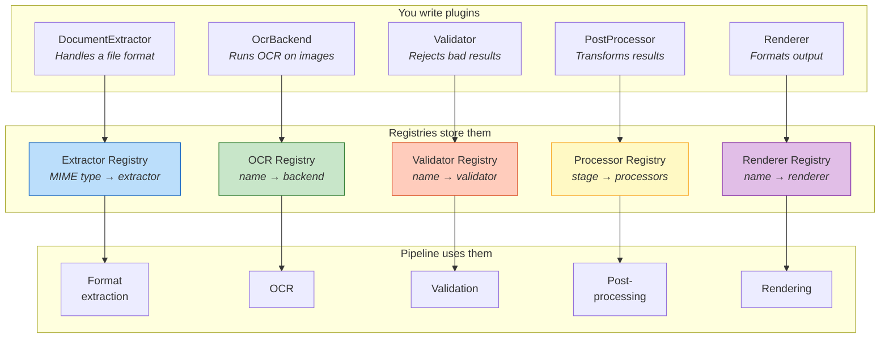
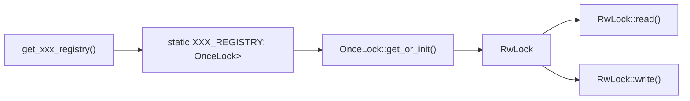
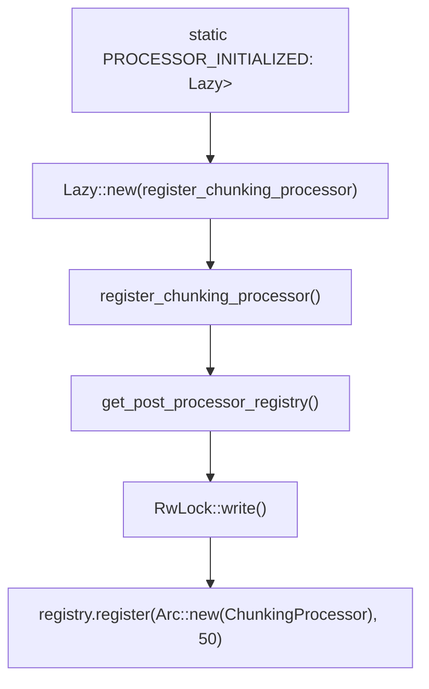

<!-- source: DeepWiki mcp.deepwiki.com · repo kreuzberg-dev/kreuzberg · page 5 Plugin System · fetched 2026-10-26 -->

# Plugin System

<details>
<summary>Relevant source files</summary>

The following files were used as context for generating this wiki page:

- [crates/kreuzberg/src/core/pipeline/tests.rs](crates/kreuzberg/src/core/pipeline/tests.rs)
- [crates/kreuzberg/src/extractors/djot_format/conversion.rs](crates/kreuzberg/src/extractors/djot_format/conversion.rs)
- [crates/kreuzberg/src/plugins/embedding.rs](crates/kreuzberg/src/plugins/embedding.rs)
- [crates/kreuzberg/src/plugins/extractor/mod.rs](crates/kreuzberg/src/plugins/extractor/mod.rs)
- [crates/kreuzberg/src/plugins/extractor/registry.rs](crates/kreuzberg/src/plugins/extractor/registry.rs)
- [crates/kreuzberg/src/plugins/extractor/trait.rs](crates/kreuzberg/src/plugins/extractor/trait.rs)
- [crates/kreuzberg/src/plugins/mod.rs](crates/kreuzberg/src/plugins/mod.rs)
- [crates/kreuzberg/src/plugins/ocr.rs](crates/kreuzberg/src/plugins/ocr.rs)
- [crates/kreuzberg/src/plugins/processor/mod.rs](crates/kreuzberg/src/plugins/processor/mod.rs)
- [crates/kreuzberg/src/plugins/registry/extractor.rs](crates/kreuzberg/src/plugins/registry/extractor.rs)
- [crates/kreuzberg/src/plugins/registry/ocr.rs](crates/kreuzberg/src/plugins/registry/ocr.rs)
- [crates/kreuzberg/src/plugins/registry/renderer.rs](crates/kreuzberg/src/plugins/registry/renderer.rs)
- [crates/kreuzberg/src/plugins/renderer.rs](crates/kreuzberg/src/plugins/renderer.rs)
- [crates/kreuzberg/src/plugins/validator/mod.rs](crates/kreuzberg/src/plugins/validator/mod.rs)
- [docs/concepts/architecture.md](docs/concepts/architecture.md)
- [docs/concepts/extraction-pipeline.md](docs/concepts/extraction-pipeline.md)
- [docs/concepts/plugin-system.md](docs/concepts/plugin-system.md)
- [docs/ecosystem.md](docs/ecosystem.md)
- [docs/guides/image-captions.md](docs/guides/image-captions.md)
- [docs/guides/ner.md](docs/guides/ner.md)
- [docs/guides/page-classification.md](docs/guides/page-classification.md)
- [docs/guides/qr-codes.md](docs/guides/qr-codes.md)
- [docs/guides/redaction.md](docs/guides/redaction.md)
- [docs/guides/summarization.md](docs/guides/summarization.md)
- [docs/guides/translation.md](docs/guides/translation.md)
- [docs/llms.txt](docs/llms.txt)
- [zensical.toml](zensical.toml)

</details>


Kreuzberg's extraction pipeline is entirely plugin-driven. Every format extractor, OCR engine, post-processor, validator, and renderer is a plugin that registers itself into a typed registry. The pipeline queries these registries at each stage to find the right handler. You extend Kreuzberg by writing your own plugin and registering it. The pipeline picks it up automatically.

This page explains the five plugin types, the registry mechanism, the plugin lifecycle, and how plugins work across language boundaries.

## Overview

The plugin system has three layers: plugins, registries, and the pipeline. Plugins implement a trait. Registries store them by key (MIME type, name, or processing stage). The pipeline queries the registries during extraction.


You register a plugin once. From that point on, the pipeline uses it wherever the MIME type, name, or stage matches. No wiring, no config files, no boilerplate.

Sources: [docs/concepts/plugin-system.md:9-59]()

## Plugin Types and Responsibilities

Kreuzberg defines five plugin types, each operating at a specific stage in the extraction pipeline. For details on the underlying architecture, see [Plugin Architecture](#5.1).

### Document Extractors

`DocumentExtractor` plugins handle format-specific extraction logic. The registry maps MIME types to extractors with priority-based selection. For details, see [Document Extractors](#5.2).

| Trait Method | Purpose | Returns |
|--------------|---------|---------|
| `extract_bytes(&self, content: &[u8], mime_type: &str, config: &ExtractionConfig)` | Extract content from raw bytes | `Result<InternalDocument>` |
| `extract_file(&self, path: &Path, mime_type: &str, config: &ExtractionConfig)` | Extract content from a file | `Result<InternalDocument>` |
| `supported_mime_types(&self)` | List supported MIME types | `&[&str]` |
| `priority(&self)` | Selection priority (higher = preferred) | `i32` |
| `can_handle(&self, path: &Path, mime_type: &str)` | Optional: more sophisticated detection | `bool` |

**Built-in Extractors:**
Kreuzberg ships with built-in extractors for PDF, Excel, images (routed to OCR), XML, plain text, email, and Office formats (DOCX, PPTX).

**Sources:** [docs/concepts/plugin-system.md:67-86](), [crates/kreuzberg/src/plugins/extractor/trait.rs:80-202]()

### OCR Backends

`OcrBackend` plugins perform optical character recognition on images and scanned documents. For details, see [OCR Backends](#5.3).

| Trait Method | Purpose | Returns |
|--------------|---------|---------|
| `process_image(&self, image_bytes: &[u8], config: &OcrConfig)` | Extract text from image bytes | `Result<ExtractionResult>` |
| `process_image_file(&self, path: &Path, config: &OcrConfig)` | Extract text from image file | `Result<ExtractionResult>` |
| `supports_language(&self, lang: &str)` | Check language support | `bool` |
| `backend_type(&self)` | Type of OCR backend | `OcrBackendType` |
| `name(&self)` | Backend identifier | `&str` |

**Built-in Backends:**
- **Tesseract**: Native Rust bindings, fast, general-purpose, default backend. Good accuracy for Latin scripts. ([crates/kreuzberg/src/plugins/ocr.rs:20-21]())
- **PaddleOCR**: ONNX Runtime, best accuracy for CJK (Chinese, Japanese, Korean) scripts. No Python dependency. ([crates/kreuzberg/src/plugins/ocr.rs:24-25]())
- **EasyOCR**: Python-based, via FFI. Supports 80+ languages including Arabic, Hindi, and Thai. Only available through Python bindings. ([crates/kreuzberg/src/plugins/ocr.rs:22-23]())

**Sources:** [docs/concepts/plugin-system.md:89-104](), [crates/kreuzberg/src/plugins/ocr.rs:17-28](), [crates/kreuzberg/src/plugins/ocr.rs:87-202]()

### Post-Processors

`PostProcessor` plugins transform extraction results after the main extraction and OCR stages are complete. Each processor declares a processing stage that determines its execution order. For details, see [Post-Processors](#5.4).

| Trait Method | Purpose | Returns |
|--------------|---------|---------|
| `process(&self, result: &mut ExtractionResult, config: &ExtractionConfig)` | Modify extraction result | `Result<()>` |
| `stage(&self)` | Processing stage | `ProcessorStage` |
| `priority(&self)` | Execution order within stage | `i32` |
| `name(&self)` | Processor identifier | `&str` |

**ProcessorStage Enum:**
- `Early`: First stage, for cleaning up raw text (e.g., strip control characters, fix encoding, normalize whitespace).
- `Middle`: Second stage, for analyzing content (e.g., extract named entities, detect language, classify document type).
- `Late`: Third stage, for final output shaping (e.g., format output, generate summaries, redact PII).

**Sources:** [docs/concepts/plugin-system.md:107-120](), [crates/kreuzberg/src/plugins/mod.rs:12]()

### Validators

`Validator` plugins inspect extraction results and can reject them if they don't meet requirements. Unlike post-processors, validator errors stop the pipeline immediately — they're a hard gate. For details, see [Validators](#5.5).

| Trait Method | Purpose | Returns |
|--------------|---------|---------|
| `validate(&self, result: &ExtractionResult, config: &ExtractionConfig)` | Check result quality | `Result<()>` |
| `should_validate(&self, result: &ExtractionResult, config: &ExtractionConfig)` | Conditional validation | `bool` |
| `priority(&self)` | Validation order (higher = earlier) | `i32` |
| `name(&self)` | Validator identifier | `&str` |

**Sources:** [docs/concepts/plugin-system.md:126-146](), [crates/kreuzberg/src/plugins/mod.rs:13]()

### Renderer

`Renderer` plugins convert the internal `InternalDocument` representation into various output string formats (e.g., Markdown, HTML, plain text).

| Trait Method | Purpose | Returns |
|--------------|---------|---------|
| `render(&self, doc: &InternalDocument)` | Convert internal document to string | `Result<String>` |
| `name(&self)` | Renderer format name | `&str` |

**Built-in Renderers:**
- **Markdown**: Renders to GFM Markdown via `comrak` AST bridge. ([crates/kreuzberg/src/plugins/registry/renderer.rs:10-21]())
- **HTML**: Renders to HTML5 via `comrak`. ([crates/kreuzberg/src/plugins/registry/renderer.rs:24-35]())
- **Djot**: Renders to Djot markup. ([crates/kreuzberg/src/plugins/registry/renderer.rs:38-49]())
- **Plain Text**: Renders to plain text. ([crates/kreuzberg/src/plugins/registry/renderer.rs:52-63]())

**Sources:** [docs/concepts/plugin-system.md:151-167](), [crates/kreuzberg/src/plugins/renderer.rs:47-62]()

## Registry Architecture

The plugin system uses specialized registries, each implementing thread-safe registration, lookup, and lifecycle management.

### Registry Implementation Details

```mermaid
graph TB
    subgraph "DocumentExtractorRegistry"
        DER_Storage["RwLock<AHashMap<String, Vec<ExtractorEntry>>>"]
        DER_Key["Key: MIME type (String)"]
        DER_Value["Value: Vec<ExtractorEntry> (priority-sorted)"]
        DER_Entry["ExtractorEntry {<br/>extractor: Arc<dyn DocumentExtractor>,<br/>priority: i32<br/>}"]
    end

    subgraph "OcrBackendRegistry"
        OCR_Storage["RwLock<AHashMap<String, Arc<dyn OcrBackend>>>"]
        OCR_Key["Key: Backend name (String)"]
        OCR_Value["Value: Arc<dyn OcrBackend>"]
    end

    subgraph "PostProcessorRegistry"
        PP_Storage["RwLock<AHashMap<ProcessorStage, Vec<ProcessorEntry>>>"]
        PP_Key["Key: ProcessorStage (Early/Middle/Late)"]
        PP_Value["Value: Vec<ProcessorEntry> (priority-sorted)"]
        PP_Entry["ProcessorEntry {<br/>processor: Arc<dyn PostProcessor>,<br/>priority: i32,<br/>stage: ProcessorStage<br/>}"]
    end

    subgraph "ValidatorRegistry"
        Val_Storage["RwLock<Vec<ValidatorEntry>>"]
        Val_Entry["ValidatorEntry {<br/>validator: Arc<dyn Validator>,<br/>priority: i32<br/>}"]
    end

    subgraph "RendererRegistry"
        R_Storage["RwLock<AHashMap<String, Arc<dyn Renderer>>>"]
        R_Key["Key: Format name (String)"]
        R_Value["Value: Arc<dyn Renderer>"]
    end

    DER_Storage --> DER_Key
    DER_Key --> DER_Value
    DER_Value --> DER_Entry

    OCR_Storage --> OCR_Key
    OCR_Key --> OCR_Value

    PP_Storage --> PP_Key
    PP_Key --> PP_Value
    PP_Value --> PP_Entry

    Val_Storage --> Val_Entry

    R_Storage --> R_Key
    R_Key --> R_Value
```


Each registry uses an `AHashMap` for efficient lookups and is wrapped in a `parking_lot::RwLock` for thread-safe access.

**Sources:** [crates/kreuzberg/src/plugins/registry/extractor.rs:1-4](), [crates/kreuzberg/src/plugins/registry/ocr.rs:1-8](), [crates/kreuzberg/src/plugins/registry/renderer.rs:1-8]()

### Registry Access Pattern

All registries are accessed through global static instances using `OnceLock` for lazy initialization:



**Key Functions:**
- `get_document_extractor_registry() -> &'static RwLock<DocumentExtractorRegistry>`
- `get_ocr_backend_registry() -> &'static RwLock<OcrBackendRegistry>`
- `get_post_processor_registry() -> &'static RwLock<PostProcessorRegistry>`
- `get_validator_registry() -> &'static RwLock<ValidatorRegistry>`
- `get_renderer_registry() -> &'static RwLock<RendererRegistry>`

**Sources:** [crates/kreuzberg/src/plugins/registry/mod.rs:10-14]()

### Priority-Based Selection

When multiple plugins support the same MIME type or stage, priority determines execution order.

| Priority Range | Usage |
|----------------|-------|
| 100+ | Core extractors, critical validators |
| 50-99 | Standard processors, default extractors |
| 0-49 | Custom plugins, alternative implementations |
| <0 | Fallback handlers, low-priority processors |

Higher priority plugins execute first for validators and early-stage processors. For document extractors, the highest priority extractor for a MIME type is selected.

**Sources:** [crates/kreuzberg/src/plugins/extractor/trait.rs:161-175]()

## Registration and Lifecycle

### Auto-Registration Pattern

Built-in plugins use lazy static initialization with `OnceLock` for automatic registration.



**Example Implementation:**

[crates/kreuzberg/src/plugins/mod.rs:26-62]() demonstrates the pattern for a `DocumentExtractor`:

```rust
// 1. Create plugin instance
let plugin = MyExtractor;

// 2. Wrap in Arc for registration
let plugin = Arc::new(plugin);

// 3. Register with registry (calls initialize internally)
let registry = get_document_extractor_registry();
let mut registry = registry.write().unwrap();
registry.register(plugin)?;
```

**Sources:** [crates/kreuzberg/src/plugins/mod.rs:26-62]()

### Manual Registration API

The registry APIs provide explicit registration, unregistration, and clearing:

| Registry | Register Function | Unregister Function | Clear Function | List Function |
|----------|-------------------|---------------------|----------------|---------------|
| **DocumentExtractor** | `register_document_extractor` | `unregister_document_extractor` | `clear_document_extractors` | `list_document_extractors` |
| **OcrBackend** | `register_ocr_backend` | `unregister_ocr_backend` | `clear_ocr_backends` | `list_ocr_backends` |
| **PostProcessor** | `register_post_processor` | `unregister_post_processor` | `clear_post_processors` | `list_post_processors` |
| **Validator** | `register_validator` | `unregister_validator` | `clear_validators` | `list_validators` |
| **Renderer** | `register_renderer` | `unregister_renderer` | `clear_renderers` | `list_renderers` |

**Return Values:**
- `register()` returns `Result<()>`, errors on initialization failure or invalid name.
- `unregister()` returns `Result<()>`, calls `shutdown()` on the plugin.
- `clear()` returns `Result<()>`, removes all plugins from registry.
- `list()` returns `Result<Vec<String>>` (names of registered plugins).

**Sources:** [crates/kreuzberg/src/plugins/extractor/mod.rs:27-75](), [crates/kreuzberg/src/plugins/ocr.rs:203-229](), [crates/kreuzberg/src/plugins/processor/mod.rs:27-75](), [crates/kreuzberg/src/plugins/validator/mod.rs:15-53](), [crates/kreuzberg/src/plugins/renderer.rs:64-125]()

### Thread Safety Guarantees

The plugin system provides concurrent access safety through `RwLock` and `Arc`:

- **`RwLock<Registry>`**: Allows multiple concurrent readers or single writer.
- **`Arc<dyn Trait>`**: Reference-counted trait objects enable shared ownership.
- **Read locks**: Held during extraction pipeline execution.
- **Write locks**: Held only during registration/unregistration operations.

**Interior Mutability Pattern**:
Plugins receive `&self` (not `&mut self`). For mutable state, use interior mutability patterns like `Mutex<T>`, `RwLock<T>`, `AtomicBool`, `AtomicU64`, or `OnceCell<T>`. [crates/kreuzberg/src/plugins/mod.rs:136-175]()

**Sources:** [crates/kreuzberg/src/plugins/mod.rs:136-175]()

## Cross-Language Plugin Bridges

Kreuzberg exposes plugin registration APIs to all language bindings through FFI and native binding layers. For details, see [Plugin Architecture](#5.1).

### Node.js Plugin API

The NAPI-RS bindings provide TypeScript-friendly plugin APIs.

```mermaid
graph TB
    TS["TypeScript/JavaScript Code"]

    subgraph "NAPI Layer (crates/kreuzberg-node/src/plugins.rs)"
        RegisterOCR["#[napi]<br/>register_ocr_backend(name, backend)"]
        UnregisterOCR["#[napi]<br/>unregister_ocr_backend(name)"]
        ClearOCR["#[napi]<br/>clear_ocr_backends()"]
        ListOCR["#[napi]<br/>list_ocr_backends()"]

        RegisterPP["#[napi]<br/>register_post_processor(processor, priority)"]
        UnregisterPP["#[napi]<br/>unregister_post_processor(name)"]
        ClearPP["#[napi]<br/>clear_post_processors()"]
        ListPP["#[napi]<br/>list_post_processors()"]

        RegisterVal["#[napi]<br/>register_validator(validator, priority)"]
        UnregisterVal["#[napi]<br/>unregister_validator(name)"]
        ClearVal["#[napi]<br/>clear_validators()"]
        ListVal["#[napi]<br/>list_validators()"]

        RegisterR["#[napi]<br/>register_renderer(renderer)"]
        UnregisterR["#[napi]<br/>unregister_renderer(name)"]
        ClearR["#[napi]<br/>clear_renderers()"]
        ListR["#[napi]<br/>list_renderers()"]
    end

    subgraph "Rust Core"
        OcrRegistry["OcrBackendRegistry"]
        PPRegistry["PostProcessorRegistry"]
        ValRegistry["ValidatorRegistry"]
        RRegistry["RendererRegistry"]
    end

    TS --> RegisterOCR
    TS --> RegisterPP
    TS --> RegisterVal
    TS --> RegisterR

    RegisterOCR --> OcrRegistry
    UnregisterOCR --> OcrRegistry
    ClearOCR --> OcrRegistry
    ListOCR --> OcrRegistry

    RegisterPP --> PPRegistry
    UnregisterPP --> PPRegistry
    ClearPP --> PPRegistry
    ListPP --> PPRegistry

    RegisterVal --> ValRegistry
    UnregisterVal --> ValRegistry
    ClearVal --> ValRegistry
    ListVal --> ValRegistry

    RegisterR --> RRegistry
    UnregisterR --> RRegistry
    ClearR --> RRegistry
    ListR --> RRegistry
```



**Sources:** [crates/kreuzberg-node/src/plugins.rs]()

### Python Plugin API

PyO3 bindings expose plugin management through Python module functions.

**Module Structure:**
- `kreuzberg.plugins.register_ocr_backend(name, backend)`
- `kreuzberg.plugins.unregister_ocr_backend(name)`
- `kreuzberg.plugins.clear_ocr_backends()`
- `kreuzberg.plugins.list_ocr_backends()`
- Similar functions for document extractors, post-processors, validators, and renderers.

**Sources:** [packages/python/src/plugins.rs]()

### FFI Plugin API

The C FFI layer provides plugin registration for Go, Java, C#, PHP, Elixir, and R.

**FFI Functions:**
- `kreuzberg_register_ocr_backend(name, backend_ptr)`
- `kreuzberg_unregister_ocr_backend(name)`
- `kreuzberg_clear_ocr_backends()`
- `kreuzberg_list_ocr_backends()`
- `kreuzberg_register_post_processor(processor_ptr, priority)`
- `kreuzberg_register_validator(validator_ptr, priority)`
- `kreuzberg_register_document_extractor(extractor_ptr)`
- `kreuzberg_register_renderer(renderer_ptr)`

Memory management for FFI plugins uses arena-based allocation with lifecycle tracking to prevent leaks across language boundaries.

**Sources:** [crates/kreuzberg-ffi/src/plugins.rs]()

### Cross-Language Guarantees

All language bindings provide:

1.  **Type Safety**: Plugin trait methods are validated at registration time.
2.  **Error Propagation**: Registration failures return language-appropriate errors.
3.  **Concurrent Access**: Multiple threads can register plugins simultaneously.
4.  **Memory Safety**: `Arc` reference counting prevents use-after-free.
5.  **ABI Stability**: FFI uses stable C calling convention.

**Sources:** [crates/kreuzberg-node/src/plugins.rs](), [crates/kreuzberg-ffi/src/plugins.rs]()

## Implementation Example: OCR Backend

The `OcrBackend` trait defines the interface for OCR engines.

### `OcrBackend` Trait

[crates/kreuzberg/src/plugins/ocr.rs:87-200]():

```rust
#[cfg_attr(not(target_arch = "wasm32"), async_trait)]
#[cfg_attr(target_arch = "wasm32", async_trait(?Send))]
pub trait OcrBackend: Plugin {
    async fn process_image(&self, image_bytes: &[u8], config: &OcrConfig) -> Result<ExtractionResult>;

    async fn process_image_file(&self, path: &Path, config: &OcrConfig) -> Result<ExtractionResult> {
        // Default implementation reads file and calls process_image
        // ...
    }

    fn supports_language(&self, lang: &str) -> bool;

    fn backend_type(&self) -> OcrBackendType;
}
```

### `OcrBackendRegistry`

The `OcrBackendRegistry` manages available OCR backends. It initializes built-in backends like Tesseract and PaddleOCR based on enabled features. [crates/kreuzberg/src/plugins/registry/ocr.rs:41-128]()

```rust
pub struct OcrBackendRegistry {
    pub(super) backends: AHashMap<String, Arc<dyn OcrBackend>>,
}

impl OcrBackendRegistry {
    pub fn new() -> Self {
        // ... initializes Tesseract, PaddleOCR, VLM OCR based on features ...
    }

    pub fn register(&mut self, backend: Arc<dyn OcrBackend>) -> Result<()> {
        // ... calls backend.initialize() ...
        // ... inserts into self.backends ...
    }

    pub(crate) fn get(&self, name: &str) -> Result<Arc<dyn OcrBackend>> {
        // ... retrieves backend by name ...
    }
    // ... other methods like list, remove, clear_all ...
}
```

**Sources:** [crates/kreuzberg/src/plugins/ocr.rs:87-200](), [crates/kreuzberg/src/plugins/registry/ocr.rs:28-172]()

## Plugin Execution Order

The extraction pipeline executes plugins in deterministic order based on type and priority.

### Execution Sequence

```mermaid
graph TB
    Start["Input: bytes + MIME type"]

    subgraph "1. Document Extraction"
        ExtractorSelect["Select highest priority<br/>DocumentExtractor for MIME type"]
        ExtractorExec["extractor.extract_bytes()/extract_file()<br/>Returns InternalDocument"]
    end

    subgraph "2. OCR (if needed)"
        OCRCheck{"config.ocr.force_ocr == true<br/>OR image/scanned document?"}
        OCRSelect["Select OcrBackend<br/>by config.ocr.backend"]
        OCRExec["backend.process_image()/process_image_file()<br/>Returns ExtractionResult"]
    end

    subgraph "3. Internal Document Transformation"
        TransformInternal["transform_extraction_result_to_elements()<br/>(InternalDocument -> ExtractionResult)"]
    end

    subgraph "4. Validation (priority order: high → low)"
        Val1["Validator priority 100"]
        Val2["Validator priority 50"]
        Val3["Validator priority 0"]
        ValFail{"Any validator<br/>returns error?"}
    end

    subgraph "5. Early Post-Processing (priority order)"
        Early1["PostProcessor priority 100, stage=Early"]
        Early2["PostProcessor priority 50, stage=Early"]
    end

    subgraph "6. Middle Post-Processing (priority order)"
        Mid1["PostProcessor priority 100, stage=Middle"]
        Mid2["PostProcessor priority 50, stage=Middle"]
    end

    subgraph "7. Late Post-Processing (priority order)"
        Late1["PostProcessor priority 100, stage=Late"]
        Late2["PostProcessor priority 50, stage=Late"]
        Late3["PostProcessor priority 40, stage=Late"]
    end

    subgraph "8. Rendering (if requested)"
        RenderSelect["Select Renderer<br/>by config.output_format"]
        RenderExec["renderer.render(InternalDocument)<br/>Returns String"]
    end

    End["Output: ExtractionResult (with rendered content if applicable)"]
    Error["Return error"]

    Start --> ExtractorSelect
    ExtractorSelect --> ExtractorExec
    ExtractorExec --> OCRCheck
    OCRCheck -->|Yes| OCRSelect
    OCRSelect --> OCRExec
    OCRExec --> TransformInternal
    OCRCheck -->|No| TransformInternal
    TransformInternal --> Val1
    Val1 --> Val2
    Val2 --> Val3
    Val3 --> ValFail
    ValFail -->|Yes| Error
    ValFail -->|No| Early1
    Early1 --> Early2
    Early2 --> Mid1
    Mid1 --> Mid2
    Mid2 --> Late1
    Late1 --> Late2
    Late2 --> Late3
    Late3 --> RenderSelect
    RenderSelect --> RenderExec
    RenderExec --> End
```



**Priority Execution Rules:**

1.  **DocumentExtractor**: Highest priority for MIME type wins (single selection).
2.  **Validator**: All validators execute in priority order (high → low), any failure aborts.
3.  **PostProcessor**: All processors execute in stage order, then priority order within stage.

**Stage Processing Order:**
- Early stage: Priority 100 → 50 → 0 (descending)
- Middle stage: Priority 100 → 50 → 0 (descending)
- Late stage: Priority 100 → 50 → 40 → 0 (descending)

**Sources:** [crates/kreuzberg/src/core/pipeline/tests.rs:48-59](), [docs/concepts/extraction-pipeline.md:10-37]()

### Built-in Plugin Priorities

| Plugin Name | Type | Priority | Stage | Purpose |
|-------------|------|----------|-------|---------|
| `PdfExtractor` | DocumentExtractor | 100 | - | PDF extraction |
| `DocxExtractor` | DocumentExtractor | 100 | - | DOCX extraction |
| `HtmlExtractor` | DocumentExtractor | 90 | - | HTML extraction |
| `ImageExtractor` | DocumentExtractor | 80 | - | Image format detection |
| `TextExtractor` | DocumentExtractor | 50 | - | Fallback text handler |
| `MinimumLengthValidator` | Validator | 100 | - | Content length check |
| `EncodingValidator` | Validator | 90 | - | Encoding validation |
| `QualityProcessor` | PostProcessor | 100 | Early | Text normalization |
| `LanguageDetectionProcessor` | PostProcessor | 50 | Middle | Language detection |
| `ChunkingProcessor` | PostProcessor | 50 | Late | Text chunking |
| `KeywordProcessor` | PostProcessor | 45 | Late | Keyword extraction |
| `EmbeddingProcessor` | PostProcessor | 40 | Late | Vector embeddings |
| `MarkdownRenderer` | Renderer | - | - | Markdown output |
| `HtmlRenderer` | Renderer | - | - | HTML output |
| `DjotRenderer` | Renderer | - | - | Djot output |
| `PlainRenderer` | Renderer | - | - | Plain text output |

**Sources:** [crates/kreuzberg/src/plugins/extractor/trait.rs:161-175](), [crates/kreuzberg/src/plugins/registry/renderer.rs:10-67]()

---

