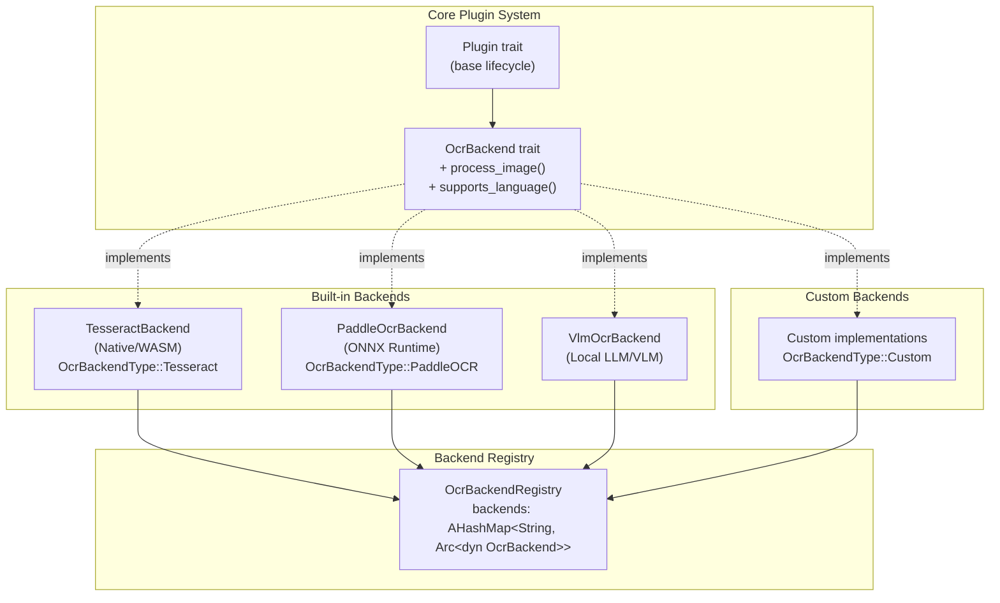
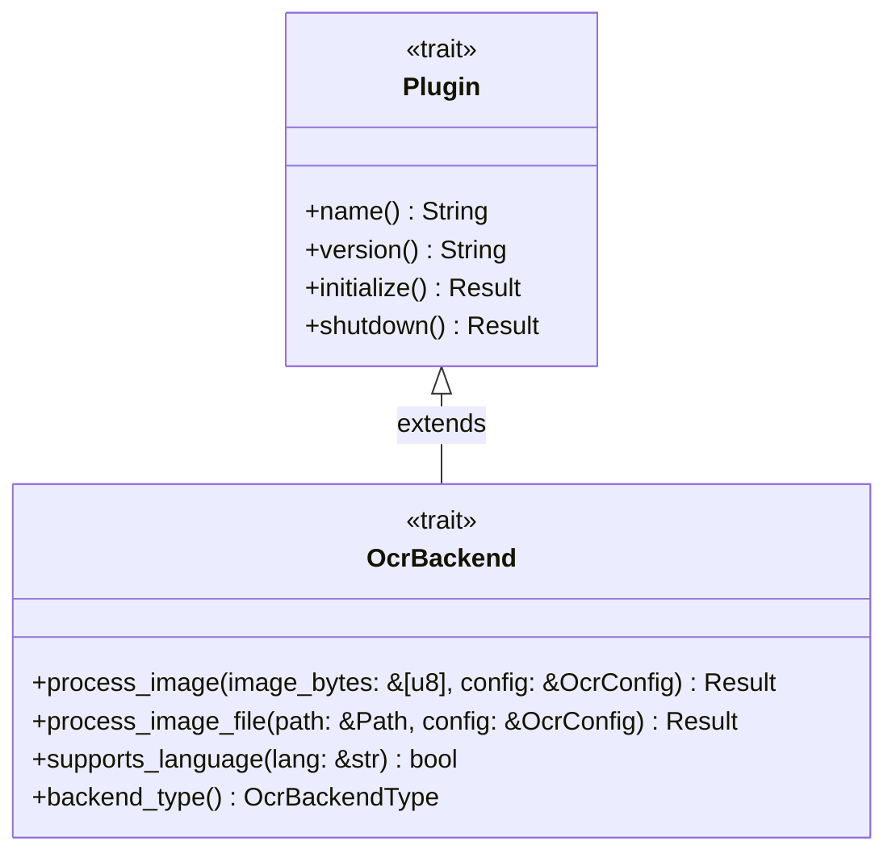
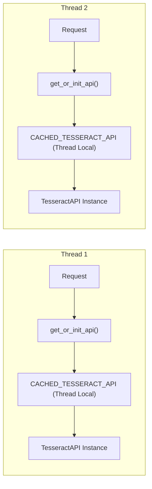
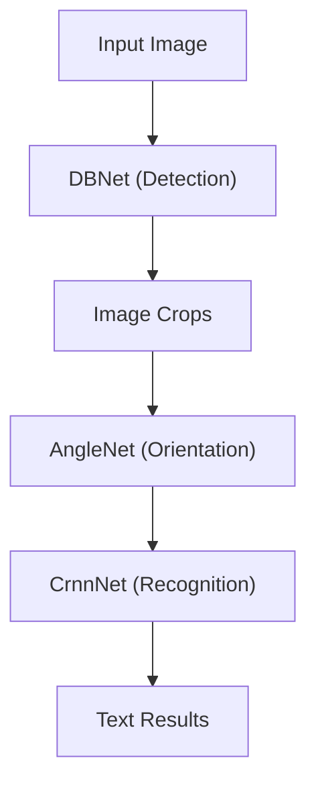

<!-- source: DeepWiki mcp.deepwiki.com · repo kreuzberg-dev/kreuzberg · page 5.3 OCR Backends · fetched 2026-10-26 -->

# OCR Backends

<details>
<summary>Relevant source files</summary>

The following files were used as context for generating this wiki page:

- [.github/actions/setup-tesseract-cache/action.yml](.github/actions/setup-tesseract-cache/action.yml)
- [crates/kreuzberg-tesseract/build.rs](crates/kreuzberg-tesseract/build.rs)
- [crates/kreuzberg-tesseract/src/api.rs](crates/kreuzberg-tesseract/src/api.rs)
- [crates/kreuzberg-tesseract/src/choice_iterator.rs](crates/kreuzberg-tesseract/src/choice_iterator.rs)
- [crates/kreuzberg-tesseract/src/leptonica.rs](crates/kreuzberg-tesseract/src/leptonica.rs)
- [crates/kreuzberg-tesseract/src/lib.rs](crates/kreuzberg-tesseract/src/lib.rs)
- [crates/kreuzberg-tesseract/src/monitor.rs](crates/kreuzberg-tesseract/src/monitor.rs)
- [crates/kreuzberg-tesseract/src/mutable_iterator.rs](crates/kreuzberg-tesseract/src/mutable_iterator.rs)
- [crates/kreuzberg-tesseract/src/page_iterator.rs](crates/kreuzberg-tesseract/src/page_iterator.rs)
- [crates/kreuzberg-tesseract/src/result_iterator.rs](crates/kreuzberg-tesseract/src/result_iterator.rs)
- [crates/kreuzberg-tesseract/src/result_renderer.rs](crates/kreuzberg-tesseract/src/result_renderer.rs)
- [crates/kreuzberg-tesseract/tests/integration_test.rs](crates/kreuzberg-tesseract/tests/integration_test.rs)
- [crates/kreuzberg/src/cache/mod.rs](crates/kreuzberg/src/cache/mod.rs)
- [crates/kreuzberg/src/cache/utilities.rs](crates/kreuzberg/src/cache/utilities.rs)
- [crates/kreuzberg/src/chunking/builder.rs](crates/kreuzberg/src/chunking/builder.rs)
- [crates/kreuzberg/src/chunking/core.rs](crates/kreuzberg/src/chunking/core.rs)
- [crates/kreuzberg/src/chunking/mod.rs](crates/kreuzberg/src/chunking/mod.rs)
- [crates/kreuzberg/src/chunking/yaml_section.rs](crates/kreuzberg/src/chunking/yaml_section.rs)
- [crates/kreuzberg/src/core/mime.rs](crates/kreuzberg/src/core/mime.rs)
- [crates/kreuzberg/src/core/pipeline/tests.rs](crates/kreuzberg/src/core/pipeline/tests.rs)
- [crates/kreuzberg/src/extractors/djot_format/conversion.rs](crates/kreuzberg/src/extractors/djot_format/conversion.rs)
- [crates/kreuzberg/src/ocr/mod.rs](crates/kreuzberg/src/ocr/mod.rs)
- [crates/kreuzberg/src/ocr/processor/execution.rs](crates/kreuzberg/src/ocr/processor/execution.rs)
- [crates/kreuzberg/src/ocr/tesseract_backend.rs](crates/kreuzberg/src/ocr/tesseract_backend.rs)
- [crates/kreuzberg/src/ocr/tesseract_wasm_backend.rs](crates/kreuzberg/src/ocr/tesseract_wasm_backend.rs)
- [crates/kreuzberg/src/ocr/types.rs](crates/kreuzberg/src/ocr/types.rs)
- [crates/kreuzberg/src/plugins/embedding.rs](crates/kreuzberg/src/plugins/embedding.rs)
- [crates/kreuzberg/src/plugins/extractor/mod.rs](crates/kreuzberg/src/plugins/extractor/mod.rs)
- [crates/kreuzberg/src/plugins/extractor/registry.rs](crates/kreuzberg/src/plugins/extractor/registry.rs)
- [crates/kreuzberg/src/plugins/extractor/trait.rs](crates/kreuzberg/src/plugins/extractor/trait.rs)
- [crates/kreuzberg/src/plugins/mod.rs](crates/kreuzberg/src/plugins/mod.rs)
- [crates/kreuzberg/src/plugins/ocr.rs](crates/kreuzberg/src/plugins/ocr.rs)
- [crates/kreuzberg/src/plugins/processor/mod.rs](crates/kreuzberg/src/plugins/processor/mod.rs)
- [crates/kreuzberg/src/plugins/registry/extractor.rs](crates/kreuzberg/src/plugins/registry/extractor.rs)
- [crates/kreuzberg/src/plugins/registry/ocr.rs](crates/kreuzberg/src/plugins/registry/ocr.rs)
- [crates/kreuzberg/src/plugins/registry/renderer.rs](crates/kreuzberg/src/plugins/registry/renderer.rs)
- [crates/kreuzberg/src/plugins/renderer.rs](crates/kreuzberg/src/plugins/renderer.rs)
- [crates/kreuzberg/src/plugins/validator/mod.rs](crates/kreuzberg/src/plugins/validator/mod.rs)
- [crates/kreuzberg/src/utils/json_utils.rs](crates/kreuzberg/src/utils/json_utils.rs)
- [crates/kreuzberg/src/utils/mod.rs](crates/kreuzberg/src/utils/mod.rs)
- [crates/kreuzberg/src/utils/pool_sizing.rs](crates/kreuzberg/src/utils/pool_sizing.rs)
- [crates/kreuzberg/tests/docx_mime_detection_test.rs](crates/kreuzberg/tests/docx_mime_detection_test.rs)
- [crates/kreuzberg/tests/issue_350_regression_test.rs](crates/kreuzberg/tests/issue_350_regression_test.rs)

</details>


This page describes the OCR backend plugin system in Kreuzberg. OCR backends are plugins that implement optical character recognition for images and scanned documents. The system supports multiple OCR engines through a unified trait interface, allowing native Rust implementations, WASM-based engines, and FFI bridges to external libraries.

**Scope**: This page covers the `OcrBackend` trait, backend registration, language support, and implementation details for Tesseract and PaddleOCR. For general plugin architecture concepts, see [Plugin Architecture](#5.1).

## OCR Backend Architecture

Kreuzberg's OCR system is built on a trait-based plugin architecture that allows multiple OCR engines to coexist and be selected at runtime.



**Sources**: [crates/kreuzberg/src/plugins/ocr.rs:17-28](), [crates/kreuzberg/src/plugins/registry/ocr.rs:29-129](), [crates/kreuzberg/src/plugins/mod.rs:9-10]()

## Backend Types

Kreuzberg provides several built-in OCR backends plus support for custom implementations:

| Backend | Type | Implementation | Language Support | Feature Flag |
|---------|------|----------------|------------------|--------------|
| **Tesseract** | `OcrBackendType::Tesseract` | Native C++ via Rust FFI | 100+ via tessdata | `ocr` |
| **Tesseract WASM** | `OcrBackendType::Tesseract` | WASM-compiled Tesseract | Browser/WASI | `ocr-wasm` |
| **PaddleOCR** | `OcrBackendType::PaddleOCR` | Rust + ONNX Runtime | Multi-language | `paddle-ocr` |
| **VLM OCR** | `OcrBackendType::Custom` | Vision Language Models | Contextual OCR | `liter-llm` |
| **EasyOCR** | `OcrBackendType::EasyOCR` | Python FFI | 80+ | N/A |

**Sources**: [crates/kreuzberg/src/plugins/ocr.rs:17-28](), [crates/kreuzberg/src/plugins/registry/ocr.rs:62-127]()

## The OcrBackend Trait

The `OcrBackend` trait extends the base `Plugin` trait with OCR-specific functionality.



### Core Methods

**`async fn process_image(&self, image_bytes: &[u8], config: &OcrConfig) -> Result<ExtractionResult>`**
The primary OCR processing method. Takes raw image bytes (JPEG, PNG, TIFF, etc.) and returns extracted text and metadata.
- **Sources**: [crates/kreuzberg/src/plugins/ocr.rs:161]()

**`async fn process_image_file(&self, path: &Path, config: &OcrConfig) -> Result<ExtractionResult>`**
Reads a file from disk and calls `process_image`. The default implementation uses `io::read_file_async` when the `tokio-runtime` feature is enabled.
- **Sources**: [crates/kreuzberg/src/plugins/ocr.rs:176-190]()

**`fn supports_language(&self, lang: &str) -> bool`**
Returns whether the backend supports a given ISO 639-2/3 language code (e.g., `"eng"`, `"deu"`).
- **Sources**: [crates/kreuzberg/src/plugins/ocr.rs:192-200]()

## Tesseract Integration

The Tesseract backend (`TesseractBackend`) wraps `kreuzberg-tesseract`, which provides safe bindings to the Tesseract C++ API.

### Thread-Safe Execution
Tesseract is not inherently thread-safe. Kreuzberg handles this using a thread-local cache for the `TesseractAPI` instance. This avoids the overhead of reloading `tessdata` (approx. 100MB) for every image while ensuring exclusive access per thread.



- **Execution Flow**: `get_or_init_api` takes the API from the `RefCell`, calls `api.clear()` to reset state, and `return_api_to_cache` puts it back after use.
- **Sources**: [crates/kreuzberg/src/ocr/processor/execution.rs:31-103]()

### Compilation and Build System
`kreuzberg-tesseract` includes a complex `build.rs` that can compile Tesseract and Leptonica from source for multiple targets (Linux, macOS, Windows, Android, WASM).
- **Caching**: It uses a custom caching mechanism (`TESSERACT_RS_CACHE_DIR`) to avoid re-compiling C++ dependencies during Rust development. The preferred cache directory is determined by `get_preferred_out_dir()`.
- **Sources**: [crates/kreuzberg-tesseract/build.rs:3-71](), [.github/actions/setup-tesseract-cache/action.yml:1-61]()

## PaddleOCR Integration

The `PaddleOcrBackend` provides a pure-Rust implementation of the PaddleOCR pipeline using ONNX Runtime.

### Processing Pipeline
The PaddleOCR implementation consists of three distinct neural networks:
1. **DBNet (Detection)**: Locates text regions in the image.
2. **AngleNet (Classification)**: Determines text orientation (0, 90, 180, 270 degrees).
3. **CRNN (Recognition)**: Converts image crops into text.



### Batching Strategy
To optimize performance, `CrnnNet` implements a batched recognition strategy:
- Crops are sorted by aspect ratio.
- Crops are grouped into batches (default `batch_size` from config).
- Images are padded to the maximum width in the batch.
- A single ONNX inference call processes the entire batch.
- **Sources**: [crates/kreuzberg-paddle-ocr/src/crnn_net.rs:144-200]()

## Backend Registration and Selection

Backends are managed by the `OcrBackendRegistry`.

### Registration
The registry is initialized with default backends based on enabled feature flags:
- **Tesseract**: Registered if `feature = "ocr"` is enabled.
- **Tesseract WASM**: Registered if `feature = "ocr-wasm"` is enabled (and `ocr` is not).
- **PaddleOCR**: Registered if `feature = "paddle-ocr"` is enabled.
- **VLM**: Registered if `feature = "liter-llm"` is enabled (and not on Windows or WASM).

**Sources**: [crates/kreuzberg/src/plugins/registry/ocr.rs:41-129]()

### Canonical Names
The registry handles common aliases. For example, a request for `"paddleocr"` is automatically mapped to the canonical `"paddle-ocr"` backend.
- **Sources**: [crates/kreuzberg/src/plugins/registry/ocr.rs:186-191]()

## Implementing a Custom OCR Backend

To implement a custom backend, one must implement the `Plugin` and `OcrBackend` traits.

```rust
use kreuzberg::plugins::{Plugin, OcrBackend, OcrBackendType};
use kreuzberg::{Result, OcrConfig};
use kreuzberg::types::ExtractionResult;
use async_trait::async_trait;

struct MyOcr;

impl Plugin for MyOcr {
    fn name(&self) -> &str { "my-ocr" }
    fn version(&self) -> String { "1.0.0".to_string() }
    fn initialize(&self) -> Result<()> { Ok(()) }
    fn shutdown(&self) -> Result<()> { Ok(()) }
}

#[async_trait]
impl OcrBackend for MyOcr {
    async fn process_image(&self, bytes: &[u8], config: &OcrConfig) -> Result<ExtractionResult> {
        // Implementation logic
        Ok(ExtractionResult::default())
    }
    fn supports_language(&self, lang: &str) -> bool { true }
    fn backend_type(&self) -> OcrBackendType { OcrBackendType::Custom }
}
```

**Sources**: [crates/kreuzberg/src/plugins/ocr.rs:41-83]()

## Thread Safety and Interior Mutability
All plugins must be `Send + Sync` because they are stored in `Arc<dyn Trait>` and accessed concurrently. Since methods take `&self`, any mutable state must use interior mutability patterns (e.g., `Mutex`, `RwLock`, or `Atomic` types).
- **Sources**: [crates/kreuzberg/src/plugins/mod.rs:136-176]()

---

