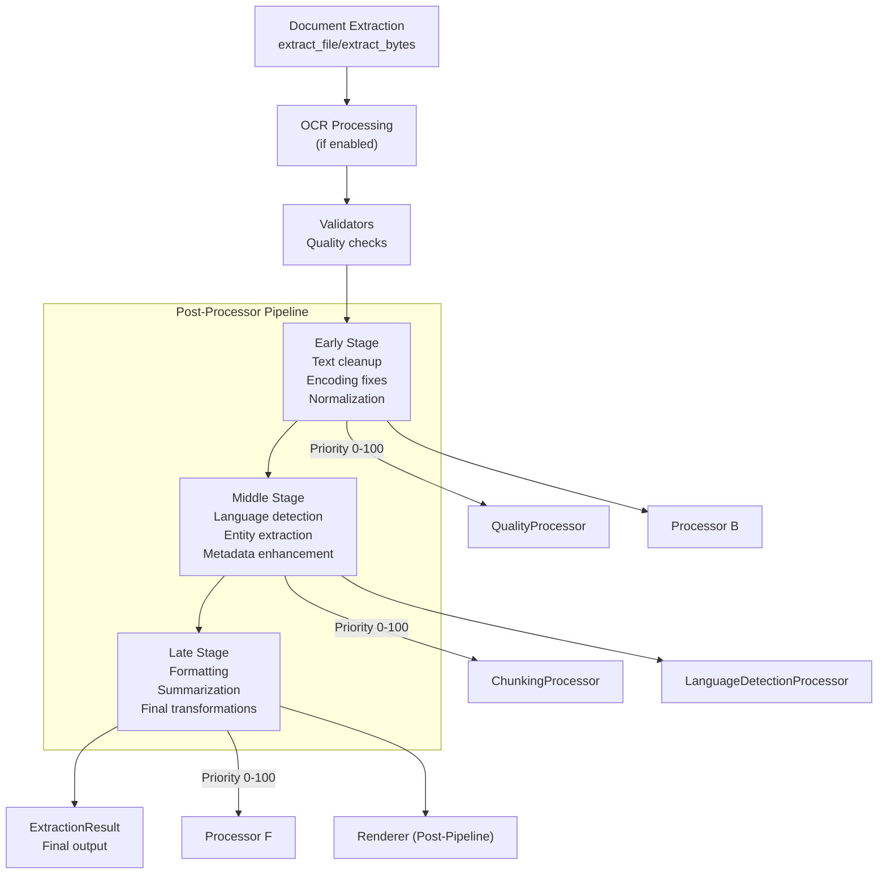
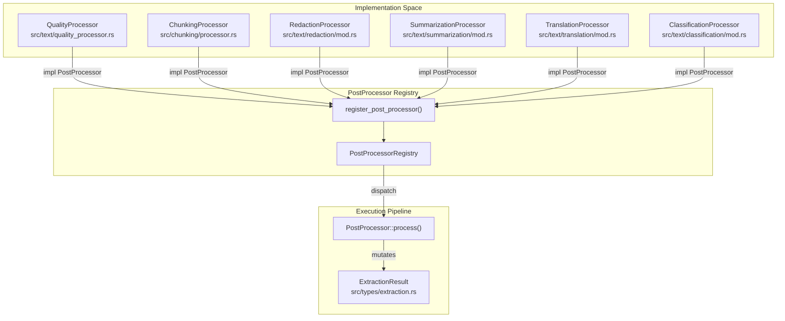
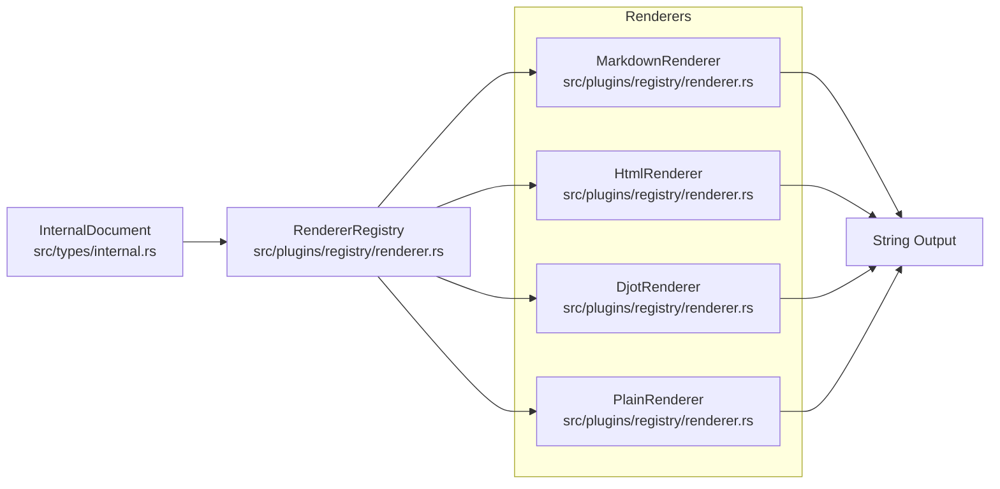

<!-- source: DeepWiki mcp.deepwiki.com · repo kreuzberg-dev/kreuzberg · page 5.4 Post-Processors · fetched 2026-10-26 -->

# Post-Processors

<details>
<summary>Relevant source files</summary>

The following files were used as context for generating this wiki page:

- [crates/kreuzberg/src/core/config/ner.rs](crates/kreuzberg/src/core/config/ner.rs)
- [crates/kreuzberg/src/core/config/redaction.rs](crates/kreuzberg/src/core/config/redaction.rs)
- [crates/kreuzberg/src/core/config/summarization.rs](crates/kreuzberg/src/core/config/summarization.rs)
- [crates/kreuzberg/src/core/pipeline/tests.rs](crates/kreuzberg/src/core/pipeline/tests.rs)
- [crates/kreuzberg/src/extractors/djot_format/conversion.rs](crates/kreuzberg/src/extractors/djot_format/conversion.rs)
- [crates/kreuzberg/src/plugins/embedding.rs](crates/kreuzberg/src/plugins/embedding.rs)
- [crates/kreuzberg/src/plugins/extractor/mod.rs](crates/kreuzberg/src/plugins/extractor/mod.rs)
- [crates/kreuzberg/src/plugins/extractor/registry.rs](crates/kreuzberg/src/plugins/extractor/registry.rs)
- [crates/kreuzberg/src/plugins/extractor/trait.rs](crates/kreuzberg/src/plugins/extractor/trait.rs)
- [crates/kreuzberg/src/plugins/mod.rs](crates/kreuzberg/src/plugins/mod.rs)
- [crates/kreuzberg/src/plugins/ocr.rs](crates/kreuzberg/src/plugins/ocr.rs)
- [crates/kreuzberg/src/plugins/processor/mod.rs](crates/kreuzberg/src/plugins/processor/mod.rs)
- [crates/kreuzberg/src/plugins/registry/extractor.rs](crates/kreuzberg/src/plugins/registry/extractor.rs)
- [crates/kreuzberg/src/plugins/registry/ocr.rs](crates/kreuzberg/src/plugins/registry/ocr.rs)
- [crates/kreuzberg/src/plugins/registry/renderer.rs](crates/kreuzberg/src/plugins/registry/renderer.rs)
- [crates/kreuzberg/src/plugins/renderer.rs](crates/kreuzberg/src/plugins/renderer.rs)
- [crates/kreuzberg/src/plugins/validator/mod.rs](crates/kreuzberg/src/plugins/validator/mod.rs)
- [crates/kreuzberg/src/text/classification/mod.rs](crates/kreuzberg/src/text/classification/mod.rs)
- [crates/kreuzberg/src/text/mod.rs](crates/kreuzberg/src/text/mod.rs)
- [crates/kreuzberg/src/text/ner/backend.rs](crates/kreuzberg/src/text/ner/backend.rs)
- [crates/kreuzberg/src/text/ner/llm.rs](crates/kreuzberg/src/text/ner/llm.rs)
- [crates/kreuzberg/src/text/redaction/mod.rs](crates/kreuzberg/src/text/redaction/mod.rs)
- [crates/kreuzberg/src/text/summarization/mod.rs](crates/kreuzberg/src/text/summarization/mod.rs)
- [crates/kreuzberg/src/text/translation/mod.rs](crates/kreuzberg/src/text/translation/mod.rs)
- [crates/kreuzberg/src/types/redaction.rs](crates/kreuzberg/src/types/redaction.rs)
- [crates/kreuzberg/src/types/summary.rs](crates/kreuzberg/src/types/summary.rs)

</details>


Post-processors are plugins that transform and enhance extraction results after the initial document extraction and OCR phases complete. They operate in a three-stage pipeline (Early, Middle, Late) with priority-based ordering within each stage, enabling sophisticated text transformations, quality improvements, and metadata enrichment across all language bindings.

For information about the overall plugin architecture and trait definitions, see [Plugin Architecture](#5.1). For other plugin types, see [Document Extractors](#5.2), [OCR Backends](#5.3), and [Validators](#5.5).

## Three-Stage Pipeline Architecture

Post-processors execute in three sequential stages, each designed for different transformation types:



**Sources:** [crates/kreuzberg/src/plugins/processor/mod.rs:1-20](), [crates/kreuzberg/src/text/quality_processor.rs:74-76](), [crates/kreuzberg/src/chunking/processor.rs:69-71]()

### Stage Responsibilities

| Stage | Purpose | Example Post-Processors | Typical Priority |
|-------|---------|------------------------|----------------------|
| **Early** | Text cleanup, encoding normalization, structural fixes | `QualityProcessor` | 30 [crates/kreuzberg/src/text/quality_processor.rs:87-89]() |
| **Middle** | Content analysis, metadata enrichment, feature extraction | `ChunkingProcessor`, `LanguageDetectionProcessor` | 50 (Default) |
| **Late** | Final formatting, summarization, output preparation | Custom Formatters | 80 |

Within each stage, post-processors execute in ascending priority order (lower priority values run first). This ensures predictable transformation sequences and allows fine-grained control over processing order.

**Sources:** [crates/kreuzberg/src/text/quality_processor.rs:74-90](), [crates/kreuzberg/src/chunking/processor.rs:69-81]()

## Registry and Execution Model

The `PostProcessorRegistry` (managed via `get_post_processor_registry`) maintains internal storage for each stage. During the extraction lifecycle, the system iterates through these stages, filtering processors based on `should_process()` and sorting them by `priority()`.



**Sources:** [crates/kreuzberg/src/plugins/processor/mod.rs:1-50](), [crates/kreuzberg/src/text/quality_processor.rs:39-61](), [crates/kreuzberg/src/text/redaction/mod.rs](), [crates/kreuzberg/src/text/summarization/mod.rs](), [crates/kreuzberg/src/text/translation/mod.rs](), [crates/kreuzberg/src/text/classification/mod.rs]()

## Built-In Post-Processors

### Quality Processing Post-Processor
The `QualityProcessor` is responsible for calculating document quality scores and performing early-stage cleanup. It avoids unnecessary allocations by checking for metadata fields like "title" or "author" before processing [crates/kreuzberg/src/text/quality_processor.rs:92-103]().

- **Stage:** `ProcessingStage::Early` [crates/kreuzberg/src/text/quality_processor.rs:75]()
- **Priority:** 30 [crates/kreuzberg/src/text/quality_processor.rs:88]()
- **Trigger:** `config.enable_quality_processing` [crates/kreuzberg/src/text/quality_processor.rs:79]()
- **Output:** Populates `result.quality_score` [crates/kreuzberg/src/text/quality_processor.rs:69]()

### Text Chunking Post-Processor
The `ChunkingProcessor` splits large text into manageable segments for LLM context windows or vector databases.

- **Stage:** `ProcessingStage::Middle` [crates/kreuzberg/src/chunking/processor.rs:70]()
- **Trigger:** `config.chunking.is_some()` [crates/kreuzberg/src/chunking/processor.rs:74]()
- **Special Logic:** It can automatically infer a `Yaml` chunker if the document metadata indicates structured data (YAML/JSON) while the user left the chunker type as `Text` [crates/kreuzberg/src/chunking/processor.rs:88-103]().
- **Output:** Populates `result.chunks` [crates/kreuzberg/src/chunking/processor.rs:64]()

### Redaction Post-Processor
The Redaction post-processor (`RedactionProcessor`) handles the identification and replacement of Personally Identifiable Information (PII) or other sensitive data. It operates as a `Late` stage processor to ensure all other content generation (summarization, translation, etc.) has completed.

- **Stage:** `ProcessingStage::Late` [crates/kreuzberg/src/text/redaction/mod.rs:10]()
- **Priority:** 80 (default)
- **Trigger:** `config.redaction.is_some()` [crates/kreuzberg/src/core/config/redaction.rs:3-5]()
- **Output:** Populates `result.redaction_report` and modifies `content`, `formatted_content`, and chunk texts [crates/kreuzberg/src/types/redaction.rs:7-12]().
- **Configuration:** Configured via `RedactionConfig` [crates/kreuzberg/src/core/config/redaction.rs:14-53](), allowing specification of `PiiCategory` [crates/kreuzberg/src/types/redaction.rs:70-96](), `RedactionStrategy` [crates/kreuzberg/src/types/redaction.rs:49-64](), custom terms, and regex patterns. It can optionally use a NER backend for categories like `PERSON`, `ORGANIZATION`, and `LOCATION` [crates/kreuzberg/src/core/config/redaction.rs:26-28]().

### Summarization Post-Processor
The Summarization post-processor (`SummarizationProcessor`) generates a concise summary of the document content.

- **Stage:** `ProcessingStage::Late`
- **Priority:** 70 (default)
- **Trigger:** `config.summarization.is_some()` [crates/kreuzberg/src/core/config/summarization.rs:3-5]()
- **Output:** Populates `result.summary` [crates/kreuzberg/src/types/summary.rs:10-12]().

### Translation Post-Processor
The Translation post-processor (`TranslationProcessor`) translates the document content into a target language.

- **Stage:** `ProcessingStage::Late`
- **Priority:** 60 (default)
- **Trigger:** `config.translation.is_some()` [crates/kreuzberg/src/text/translation/mod.rs:81-89]()
- **Output:** Populates `result.translation` [crates/kreuzberg/src/text/translation/mod.rs:81-89]() and modifies `content` and `formatted_content`.

### Page Classification Post-Processor
The Page Classification post-processor (`ClassificationProcessor`) categorizes the content of individual pages within the document.

- **Stage:** `ProcessingStage::Late`
- **Priority:** 50 (default)
- **Trigger:** `config.page_classification.is_some()` [crates/kreuzberg/src/text/classification/mod.rs:32-36]()
- **Output:** Populates `result.page_classifications` [crates/kreuzberg/src/text/classification/mod.rs:32-36]()

**Sources:** [crates/kreuzberg/src/text/quality_processor.rs:1-90](), [crates/kreuzberg/src/chunking/processor.rs:1-81](), [crates/kreuzberg/src/core/config/redaction.rs:1-171](), [crates/kreuzberg/src/types/redaction.rs:1-96](), [crates/kreuzberg/src/text/redaction/mod.rs:1-13](), [crates/kreuzberg/src/text/summarization/mod.rs](), [crates/kreuzberg/src/core/config/summarization.rs:1-10](), [crates/kreuzberg/src/types/summary.rs:1-12](), [crates/kreuzberg/src/text/translation/mod.rs:75-89](), [crates/kreuzberg/src/text/classification/mod.rs:29-37]()

## Post-Processor Interface

The core trait implemented by processors:

```rust
#[async_trait]
pub trait PostProcessor: Plugin {
    async fn process(&self, result: &mut ExtractionResult, config: &ExtractionConfig) -> Result<()>;
    fn processing_stage(&self) -> ProcessingStage;
    fn should_process(&self, result: &ExtractionResult, config: &ExtractionConfig) -> bool;
    fn priority(&self) -> i32;
    fn estimated_duration_ms(&self, result: &ExtractionResult) -> u64;
}
```

Unlike some other plugin types, `PostProcessor::process` takes a mutable reference to the `ExtractionResult`, allowing in-place modifications to text content, metadata, or the addition of chunks and scores [crates/kreuzberg/src/text/quality_processor.rs:62-72]().

**Sources:** [crates/kreuzberg/src/text/quality_processor.rs:61-90](), [crates/kreuzberg/src/chunking/processor.rs:52-81]()

## Rendering (Post-Pipeline Transformation)

While technically distinct from the `PostProcessor` trait, the `Renderer` system provides the final transformation from an `InternalDocument` to the desired output string (Markdown, HTML, Djot, or Plain Text).



The `RendererRegistry` manages these built-in converters and allows for custom renderer registration [crates/kreuzberg/src/plugins/registry/renderer.rs:87-106]().

**Sources:** [crates/kreuzberg/src/plugins/renderer.rs:47-62](), [crates/kreuzberg/src/plugins/registry/renderer.rs:9-67]()

## Summary of Extraction Result Fields

Post-processors primarily interact with these fields in `ExtractionResult` [crates/kreuzberg/src/types/extraction.rs:54-180]():

| Field | Purpose | Managed By |
|-------|---------|------------|
| `content` | Primary text output | Most Processors |
| `quality_score` | 0.0 to 1.0 quality metric | `QualityProcessor` |
| `chunks` | List of text segments | `ChunkingProcessor` |
| `detected_languages` | ISO codes of detected languages | `LanguageDetectionProcessor` |
| `processing_warnings` | Non-fatal pipeline issues | Pipeline Orchestrator |
| `redaction_report` | Audit trail of PII redactions | `RedactionProcessor` |
| `summary` | Document summary | `SummarizationProcessor` |
| `translation` | Translated content and metadata | `TranslationProcessor` |
| `page_classifications` | Categories for each page | `ClassificationProcessor` |

**Sources:** [crates/kreuzberg/src/types/extraction.rs:54-180](), [crates/kreuzberg/src/text/quality_processor.rs:69](), [crates/kreuzberg/src/chunking/processor.rs:64](), [crates/kreuzberg/src/types/redaction.rs:7-12](), [crates/kreuzberg/src/types/summary.rs:10-12](), [crates/kreuzberg/src/text/translation/mod.rs:81-89](), [crates/kreuzberg/src/text/classification/mod.rs:32-36]()

---

