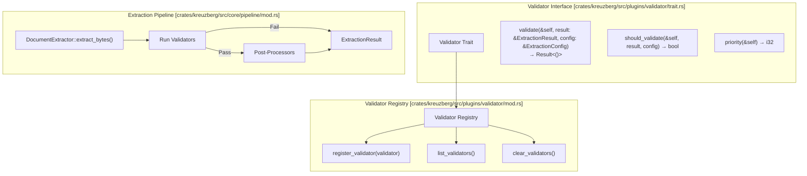
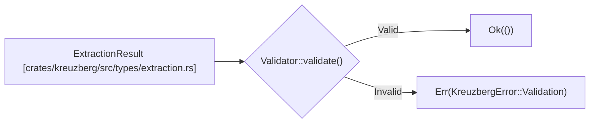
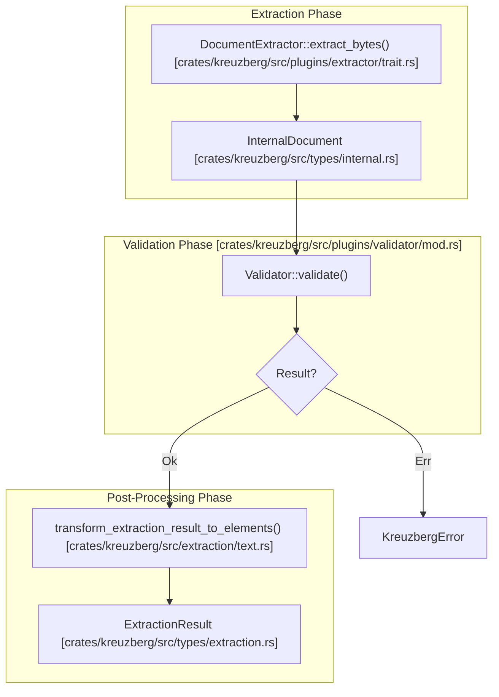

<!-- source: DeepWiki mcp.deepwiki.com · repo kreuzberg-dev/kreuzberg · page 5.5 Validators · fetched 2026-10-26 -->

# Validators

<details>
<summary>Relevant source files</summary>

The following files were used as context for generating this wiki page:

- [crates/kreuzberg/benches/text_quality.rs](crates/kreuzberg/benches/text_quality.rs)
- [crates/kreuzberg/src/core/pipeline/tests.rs](crates/kreuzberg/src/core/pipeline/tests.rs)
- [crates/kreuzberg/src/extraction/text.rs](crates/kreuzberg/src/extraction/text.rs)
- [crates/kreuzberg/src/extractors/djot_format/conversion.rs](crates/kreuzberg/src/extractors/djot_format/conversion.rs)
- [crates/kreuzberg/src/plugins/embedding.rs](crates/kreuzberg/src/plugins/embedding.rs)
- [crates/kreuzberg/src/plugins/extractor/mod.rs](crates/kreuzberg/src/plugins/extractor/mod.rs)
- [crates/kreuzberg/src/plugins/extractor/registry.rs](crates/kreuzberg/src/plugins/extractor/registry.rs)
- [crates/kreuzberg/src/plugins/extractor/trait.rs](crates/kreuzberg/src/plugins/extractor/trait.rs)
- [crates/kreuzberg/src/plugins/mod.rs](crates/kreuzberg/src/plugins/mod.rs)
- [crates/kreuzberg/src/plugins/ocr.rs](crates/kreuzberg/src/plugins/ocr.rs)
- [crates/kreuzberg/src/plugins/processor/mod.rs](crates/kreuzberg/src/plugins/processor/mod.rs)
- [crates/kreuzberg/src/plugins/registry/extractor.rs](crates/kreuzberg/src/plugins/registry/extractor.rs)
- [crates/kreuzberg/src/plugins/registry/ocr.rs](crates/kreuzberg/src/plugins/registry/ocr.rs)
- [crates/kreuzberg/src/plugins/registry/renderer.rs](crates/kreuzberg/src/plugins/registry/renderer.rs)
- [crates/kreuzberg/src/plugins/renderer.rs](crates/kreuzberg/src/plugins/renderer.rs)
- [crates/kreuzberg/src/plugins/validator/mod.rs](crates/kreuzberg/src/plugins/validator/mod.rs)
- [crates/kreuzberg/src/text/quality.rs](crates/kreuzberg/src/text/quality.rs)
- [crates/kreuzberg/src/text/string_utils.rs](crates/kreuzberg/src/text/string_utils.rs)
- [crates/kreuzberg/src/text/token_reduction/cjk_utils.rs](crates/kreuzberg/src/text/token_reduction/cjk_utils.rs)
- [crates/kreuzberg/src/text/token_reduction/config.rs](crates/kreuzberg/src/text/token_reduction/config.rs)
- [crates/kreuzberg/src/text/token_reduction/filters.rs](crates/kreuzberg/src/text/token_reduction/filters.rs)
- [crates/kreuzberg/src/text/token_reduction/mod.rs](crates/kreuzberg/src/text/token_reduction/mod.rs)
- [crates/kreuzberg/src/text/token_reduction/simd_text.rs](crates/kreuzberg/src/text/token_reduction/simd_text.rs)
- [crates/kreuzberg/src/utils/quality/mod.rs](crates/kreuzberg/src/utils/quality/mod.rs)

</details>


## Purpose and Scope

Validators are quality-check plugins that inspect extraction results and reject outputs that fail to meet minimum quality thresholds. They execute before post-processors in the extraction pipeline, ensuring that only valid extraction results proceed through the processing stages.

For information about other plugin types, see [Plugin Architecture](#5.1), [Document Extractors](#5.2), [OCR Backends](#5.3), and [Post-Processors](#5.4).

**Sources:** [crates/kreuzberg/src/plugins/validator/mod.rs:1-6](), [crates/kreuzberg/src/plugins/validator/mod.rs:90-98]()

## Validator Architecture

Validators implement a trait-based design stored as `Arc<dyn Validator>` for thread-safe shared access across the extraction pipeline. The architecture follows a registry pattern where plugins are managed by a central registry.



**Core Components:**

| Component | Type | Purpose |
|-----------|------|---------|
| `Validator` trait | `trait` | Defines the interface for validation logic [crates/kreuzberg/src/plugins/validator/mod.rs:9]() |
| `register_validator` | `fn` | Registers a validator with the global registry [crates/kreuzberg/src/plugins/validator/mod.rs:16]() |
| `ExtractionResult` | `struct` | The data structure being validated [crates/kreuzberg/src/types/extraction.rs:54]() |
| `ExtractionConfig` | `struct` | Configuration parameters used during validation [crates/kreuzberg/src/plugins/validator/mod.rs:91]() |

**Sources:** [crates/kreuzberg/src/plugins/validator/mod.rs:1-53](), [crates/kreuzberg/src/types/extraction.rs:54-180]()

## Built-in Validation Logic

While the core library allows for arbitrary custom validators, the system is designed to handle quality checks such as minimum length validation and extraction failure handling.

### Validation Methods

The `Validator` trait includes methods to control when and how validation occurs:

- **`validate`**: The primary execution point where the `ExtractionResult` is inspected [crates/kreuzberg/src/plugins/validator/mod.rs:91]().
- **`should_validate`**: A conditional check that determines if a specific validator should run against a given result (e.g., based on MIME type) [crates/kreuzberg/src/plugins/validator/mod.rs:199-201]().
- **`priority`**: Determines the execution order relative to other validators [crates/kreuzberg/src/plugins/validator/mod.rs:148]().

### Extraction Failure Handling

Validators can be used to catch "silent" extraction failures, such as when a document is successfully parsed but yields no meaningful text.



**Sources:** [crates/kreuzberg/src/plugins/validator/mod.rs:90-98](), [crates/kreuzberg/src/plugins/validator/mod.rs:125-127]()

## Validator Registry

The validator system uses a global registry to manage active plugins. This registry is thread-safe and allows for dynamic registration and removal of validators.

**Registry Operations:**

| Operation | Function | Description |
|-----------|----------|-------------|
| **Register** | `register_validator` | Adds an `Arc<dyn Validator>` to the global registry [crates/kreuzberg/src/plugins/validator/mod.rs:16]() |
| **Unregister** | `unregister_validator` | Removes a validator by its name [crates/kreuzberg/src/plugins/validator/mod.rs:26]() |
| **List** | `list_validators` | Returns names of all registered validators [crates/kreuzberg/src/plugins/validator/mod.rs:36]() |
| **Clear** | `clear_validators` | Shuts down and removes all validators [crates/kreuzberg/src/plugins/validator/mod.rs:46]() |

**Sources:** [crates/kreuzberg/src/plugins/validator/mod.rs:15-53]()

## Pipeline Integration

Validators operate on the `ExtractionResult` before it is finalized or rendered.



**Sources:** [crates/kreuzberg/src/plugins/extractor/trait.rs:103-107](), [crates/kreuzberg/src/extraction/text.rs:100-104](), [crates/kreuzberg/src/plugins/validator/mod.rs:90-98]()

## Creating Custom Validators

To create a custom validator, implement the `Plugin` and `Validator` traits.

```rust
#[async_trait]
impl Validator for MyCustomValidator {
    async fn validate(&self, result: &ExtractionResult, config: &ExtractionConfig) -> Result<()> {
        if result.content.is_empty() {
            return Err(KreuzbergError::validation("Content is empty".to_string()));
        }
        Ok(())
    }
}
```

**Implementation Details:**
- **Thread Safety**: Must be `Send + Sync` (inherited from `Plugin`).
- **Async Support**: The `validate` method is asynchronous [crates/kreuzberg/src/plugins/validator/mod.rs:91]().
- **Error Handling**: Failures should return `KreuzbergError::Validation` [crates/kreuzberg/src/plugins/validator/mod.rs:127]().

**Sources:** [crates/kreuzberg/src/plugins/validator/mod.rs:67-98](), [crates/kreuzberg/src/plugins/validator/mod.rs:176-202]()

## Cross-Language Support

Validators are a core part of the cross-language plugin architecture. Fixtures exist to verify that validators can be registered and managed across different language bindings using the trait-bridge system.

| Fixture ID | Purpose |
|------------|---------|
| `register_validator_trait_bridge` | Verifies registration via the FFI layer [fixtures/plugin_api/register_validator_trait_bridge.json:2]() |
| `validators_clear` | Verifies the ability to clear the registry from bindings [fixtures/plugin_api/validators_clear.json:2]() |

**Sources:** [fixtures/plugin_api/register_validator_trait_bridge.json:1-42](), [fixtures/plugin_api/validators_clear.json:1-39]()

---

