<!-- source: DeepWiki mcp.deepwiki.com · repo kreuzberg-dev/kreuzberg · page 6 Development Guide · fetched 2026-10-26 -->

# Development Guide

<details>
<summary>Relevant source files</summary>

The following files were used as context for generating this wiki page:

- [.task/languages/csharp.yml](.task/languages/csharp.yml)
- [.task/languages/dart.yml](.task/languages/dart.yml)
- [.task/languages/elixir.yml](.task/languages/elixir.yml)
- [.task/languages/go.yml](.task/languages/go.yml)
- [.task/languages/java.yml](.task/languages/java.yml)
- [.task/languages/kotlin_android.yml](.task/languages/kotlin_android.yml)
- [.task/languages/node.yml](.task/languages/node.yml)
- [.task/languages/php.yml](.task/languages/php.yml)
- [.task/languages/python.yml](.task/languages/python.yml)
- [.task/languages/r.yml](.task/languages/r.yml)
- [.task/languages/ruby.yml](.task/languages/ruby.yml)
- [.task/languages/swift.yml](.task/languages/swift.yml)
- [Taskfile.yml](Taskfile.yml)
- [scripts/ci/cache/compute-hash.sh](scripts/ci/cache/compute-hash.sh)

</details>


This guide covers the development environment setup, build system, testing infrastructure, and code quality standards for contributing to Kreuzberg. It is intended for developers who want to modify the codebase, add features, or fix bugs across any of the language bindings.

For user installation instructions, see [Installation](#2.1).

## Development Environment Setup

Kreuzberg requires multiple language toolchains to support its polyglot architecture. The core library is written in Rust, while bindings leverage language-specific FFI technologies like PyO3 (Python), NAPI-RS (Node.js), Magnus (Ruby), and Panama FFM (Java).

### Prerequisites and Tools

| Tool | Version | Purpose |
|------|---------|---------|
| **Rust** | 1.91+ (edition 2024) | Core library and binding crates [Cargo.toml:28-29]() |
| **Python** | 3.10+ | Python bindings and E2E tests [pyproject.toml:51]() |
| **Node.js** | 18+ | TypeScript bindings and WASM [crates/kreuzberg-node/package.json:24]() |
| **Java** | 25+ | FFM/Panama API bindings [packages/java/pom.xml:38]() |
| **Ruby** | 3.2+ | Ruby bindings via Magnus/rb-sys [packages/ruby/Gemfile.lock:5]() |

### Unified Setup Command

The project uses [Task](https://taskfile.dev/) to orchestrate setup. The `task setup` command installs dependencies across all supported ecosystems.

```mermaid
graph TB
    subgraph ["Setup Orchestration"]
        setup["task setup"]
    end

    subgraph ["Language Toolchains"]
        rust["Rust (cargo)"]
        python["Python (uv)"]
        node["Node.js (pnpm)"]
        java["Java (maven)"]
        ruby["Ruby (bundle)"]
    end

    setup --> rust
    setup --> python
    setup --> node
    setup --> java
    setup --> ruby

    python --- uv_lock["uv.lock"]
    node --- pnpm_lock["pnpm-lock.yaml"]
    java --- pom_xml["pom.xml"]
    ruby --- gem_lock["Gemfile.lock"]
```
**Diagram: Development Environment Setup Flow**
Sources: [Taskfile.yml:92-97](), [uv.lock:1-7](), [pnpm-lock.yaml:1-29](), [packages/java/pom.xml:38-40](), [packages/ruby/Gemfile.lock:1-6]()

For detailed instructions on toolchain installation and IDE configuration, see [Development Environment Setup](#6.1).

## Task Orchestration System

Kreuzberg uses a modular Taskfile architecture. The root `Taskfile.yml` includes language-specific task definitions from the `.task/` directory.

### Common Task Commands

| Command | Purpose |
|---------|---------|
| `task setup` | Idempotent installation of all toolchains and dependencies |
| `task build` | Builds the Rust core and all active language bindings |
| `task test` | Executes unit and integration tests across the workspace |
| `task lint` | Runs all linters and formatters via `prek` |
| `task clean` | Removes build artifacts (target/, node_modules/, .venv/, etc.) |

```mermaid
graph TD
    A[Root Taskfile.yml] --> B{Includes Language-Specific Taskfiles};

    subgraph Language Taskfiles
        B -- "rust:" --> C[./.task/languages/rust.yml];
        B -- "python:" --> D[./.task/languages/python.yml];
        B -- "node:" --> E[./.task/languages/node.yml];
        B -- "ruby:" --> F[./.task/languages/ruby.yml];
        B -- "php:" --> G[./.task/languages/php.yml];
        B -- "go:" --> H[./.task/languages/go.yml];
        B -- "java:" --> I[./.task/languages/java.yml];
        B -- "csharp:" --> J[./.task/languages/csharp.yml];
        B -- "elixir:" --> K[./.task/languages/elixir.yml];
        B -- "dart:" --> L[./.task/languages/dart.yml];
        B -- "swift:" --> M[./.task/languages/swift.yml];
        B -- "kotlin-android:" --> N[./.task/languages/kotlin_android.yml];
        B -- "r:" --> O[./.task/languages/r.yml];
        B -- "zig:" --> P[./.task/languages/zig.yml];
    end

    subgraph Workflow Taskfiles
        B -- "benchmark:" --> Q[./.task/workflows/benchmark.yml];
        B -- "docs:" --> R[./.task/tools/docs.yml];
        B -- "fixtures:" --> S[./.task/tools/fixtures.yml];
    end

    subgraph Core Tasks
        T[task setup] --> C;
        T --> D;
        T --> E;
        T --> F;
        T --> G;
        T --> H;
        T --> I;
        T --> J;
        T --> K;
        T --> L;
        T --> M;
        T --> N;
        T --> O;
        T --> P;
        T --> Q;
        T --> R;
        T --> S;
    end
```


**Diagram: Taskfile Inclusion Structure**
Sources: [Taskfile.yml:41-83](), [Taskfile.yml:92-248]()

For details on the Taskfile structure and adding new tasks, see [Task Orchestration System](#6.2).

## Building from Source

The build process varies by language but generally involves compiling the Rust core (either as an `rlib` or a `cdylib`) and linking it to the target language.

### Cargo Workspace Structure

The repository is organized as a Rust workspace [Cargo.toml:1-16]().

*   `crates/kreuzberg`: The core library [crates/kreuzberg/Cargo.toml:2]()
*   `crates/kreuzberg-ffi`: C-compatible FFI layer for Go, PHP, and Zig [Cargo.toml:5]()
*   `crates/kreuzberg-py`: Python-specific bindings using PyO3 [Cargo.toml:9]()
*   `crates/kreuzberg-node`: Node.js bindings using NAPI-RS [Cargo.toml:6]()
*   `crates/kreuzberg-wasm`: WebAssembly targets [Cargo.toml:11]()

### Feature Flags

Kreuzberg uses extensive feature gating to manage heavy dependencies like ONNX Runtime (`ort`) and Tesseract.

*   `pdf`: PDF extraction via `pdf_oxide` and `lopdf` [crates/kreuzberg/Cargo.toml:44]()
*   `ocr`: Tesseract-based OCR [crates/kreuzberg/Cargo.toml:79]()
*   `paddle-ocr`: ONNX-based OCR [crates/kreuzberg/Cargo.toml:102]()
*   `embeddings`: Vector generation via `ort` [crates/kreuzberg/Cargo.toml:164]()

For platform-specific build instructions and feature flag combinations, see [Building from Source](#6.3).

Sources: [Cargo.toml:1-16](), [crates/kreuzberg/Cargo.toml:31-231]()

## Testing Strategy

Testing is performed at multiple levels to ensure API parity across languages.

1.  **Rust Unit Tests**: Testing core logic within `crates/`.
2.  **Binding Unit Tests**: Language-specific tests (e.g., `pytest` for Python, `vitest` for Node.js).
3.  **E2E Test Generation**: A specialized tool `kreuzberg-e2e-generator` creates test cases from a shared set of document fixtures to ensure consistent behavior [Cargo.toml:1-16]().

For details on running the full test suite and generating E2E tests, see [Testing Strategy](#6.4).

Sources: [pyproject.toml:203-219](), [packages/java/pom.xml:153-159](), [pnpm-lock.yaml:26-28]()

## Code Quality and Pre-Commit Hooks

Kreuzberg uses `prek` to manage pre-commit hooks. These hooks ensure that code meets quality standards before it is committed to the repository.

### Hook Configuration

The configuration in `.pre-commit-config.yaml` includes:
*   **Rust**: `cargo-fmt`, `cargo-clippy`, `cargo-deny`, and `cargo-machete` [.pre-commit-config.yaml:63-105]()
*   **Python**: `ruff`, `ruff-format`, and `mypy` [.pre-commit-config.yaml:45-50](), [.pre-commit-config.yaml:120-122]()
*   **Node.js/TS**: `oxlint` and `oxfmt` [.pre-commit-config.yaml:182-183]()
*   **Cross-Language**: `alef-verify` to ensure bindings stay in sync with the core library [.pre-commit-config.yaml:192]()

For a full list of quality gates, see [Code Quality and Pre-Commit Hooks](#6.5).

Sources: [.pre-commit-config.yaml:1-207](), [pyproject.toml:50-159]()

## Benchmarking and Performance Testing

Performance is tracked using the `benchmark-harness` tool [Cargo.toml:14](). It compares Kreuzberg against other frameworks (e.g., Docling, Unstructured, MarkItDown) across various metrics:
*   Extraction speed (latency and throughput)
*   Memory consumption
*   Output quality (Levenshtein distance against ground truth)

For details on running benchmarks and interpreting results, see [Benchmarking and Performance Testing](#6.6).

Sources: [Cargo.toml:14](), [pyproject.toml:28-41]()

---

