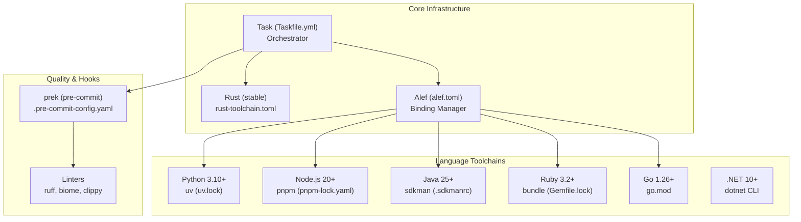
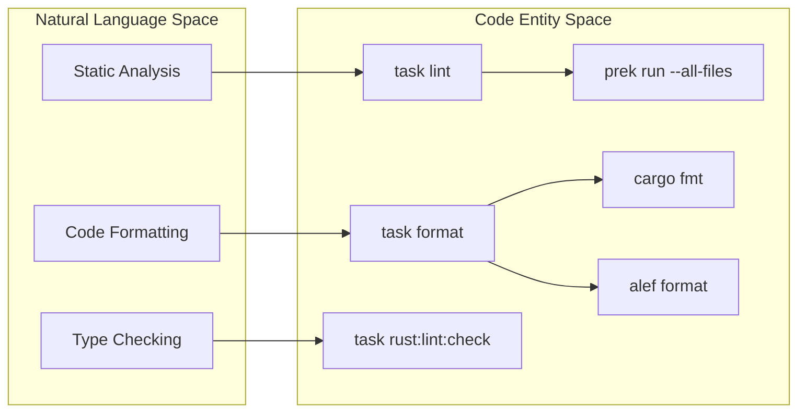

<!-- source: DeepWiki mcp.deepwiki.com · repo kreuzberg-dev/kreuzberg · page 6.1 Development Environment Setup · fetched 2026-10-26 -->

# Development Environment Setup

<details>
<summary>Relevant source files</summary>

The following files were used as context for generating this wiki page:

- [.github/actions/install-system-deps/action.yml](.github/actions/install-system-deps/action.yml)
- [.github/actions/setup-onnx-runtime/action.yml](.github/actions/setup-onnx-runtime/action.yml)
- [Taskfile.yml](Taskfile.yml)
- [scripts/ci/install-system-deps/install-linux.sh](scripts/ci/install-system-deps/install-linux.sh)
- [scripts/ci/install-system-deps/install-macos.sh](scripts/ci/install-system-deps/install-macos.sh)
- [scripts/ci/install-system-deps/install-windows.ps1](scripts/ci/install-system-deps/install-windows.ps1)

</details>


This document covers the installation and configuration of development toolchains, dependency managers, and native dependencies required to build, test, and contribute to Kreuzberg. It focuses on the initial environment setup rather than build processes (see [6.3]()) or task orchestration (see [6.2]()).

---

## Overview

Kreuzberg is a document intelligence platform with a Rust core and native bindings for 17 languages. Development requires:

1.  **Rust toolchain** (stable) as the core implementation language [Taskfile.yml:179]().
2.  **Language-specific toolchains** for each binding (Python, Node.js, Ruby, Java, Go, C#, PHP, Elixir, R, Dart, Swift, Zig, Kotlin).
3.  **Native dependencies** (Tesseract OCR, LLVM, CMake) [docs/getting-started/installation.md:55-57]().
4.  **Development tools** (SDKman, `prek` for pre-commit hooks, `alef` for binding management, `uv` for Python).

The project uses a monorepo structure with per-language dependency isolation via workspace members and language-specific package managers [Taskfile.yml:1-25]().

**Sources:** [Taskfile.yml:1-25](), [docs/getting-started/installation.md:7-57]()

---

## Development Toolchain Architecture

The following diagram maps the high-level toolchain requirements to the specific code entities and configuration files that manage them.

### Toolchain to Code Entity Map


**Sources:** [Taskfile.yml:6-25](), [docs/contributing.md:31-54](), [docs/index.md:63-84]()

---

## Toolchain Setup

### Core Requirements

-   **Git**: Version control.
-   **Task**: Task runner for all build and test workflows [docs/contributing.md:34]().
-   **Rust**: Stable toolchain via `rustup` [docs/contributing.md:35]().

### Language-Specific Versions
Per the contributor guide [docs/contributing.md:43-54](), the following versions are required for development:

| Language | Version | Primary Tool |
| :--- | :--- | :--- |
| **Python** | 3.10+ | `uv` [docs/contributing.md:45]() |
| **Node.js** | 20+ | `pnpm` [docs/contributing.md:46]() |
| **Ruby** | 3.2+ | `bundle` [docs/contributing.md:47]() |
| **Go** | 1.26+ | `go` [docs/contributing.md:48]() |
| **Java** | 25+ | `sdkman` [docs/contributing.md:49]() |
| **.NET** | 10+ | `dotnet` [docs/contributing.md:50]() |
| **PHP** | 8.1+ | `composer` [docs/contributing.md:51]() |
| **Elixir** | 1.14+ | `mix` [docs/contributing.md:52]() |

### Automated Setup
The environment can be initialized using the root `Taskfile.yml`:
```bash
task setup
```
This command executes `rust:install`, `alef setup`, and `pre-commit:install` [Taskfile.yml:95-97]().

**Sources:** [docs/contributing.md:43-54](), [Taskfile.yml:95-97]()

---

## Native Dependencies and SDKman

### SDKman Usage
Java development relies on **SDKman** to manage JDK 25 and Maven. The `task setup` command ensures the environment is ready for `alef` to build Java and Kotlin bindings [docs/contributing.md:49]().

### Platform Dependencies
System-level dependencies vary by operating system and are managed via CI scripts [ .github/actions/install-system-deps/action.yml:1-106]():

-   **Linux**: Tesseract OCR, `libssl-dev`, `pkg-config`, `build-essential`, `cmake`, `libmagic-dev`, `libuv1-dev`, `php-cli`, `php-dev` [scripts/ci/install-system-deps/install-linux.sh:17-32]().
-   **macOS**: Tesseract, CMake, `libmagic`, and PHP via Homebrew [scripts/ci/install-system-deps/install-macos.sh:22-78]().
-   **Windows**: Tesseract OCR, LLVM, and CMake via Chocolatey [scripts/ci/install-system-deps/install-windows.ps1:56-147]().

### WASM Requirements
Building WebAssembly bindings (`@kreuzberg/wasm`) requires the **WASI SDK** [docs/contributing.md:39]().
-   **Location**: Install to `$HOME/wasi-sdk` or set `WASI_SDK_PATH`.
-   **Purpose**: Provides a wasm-capable C/C++ compiler for `tree-sitter` and `tesseract` dependencies [docs/contributing.md:39]().

**Sources:** [docs/contributing.md:37-40](), [.github/actions/install-system-deps/action.yml:1-106](), [scripts/ci/install-system-deps/install-linux.sh:17-32](), [scripts/ci/install-system-deps/install-macos.sh:22-78](), [scripts/ci/install-system-deps/install-windows.ps1:56-147]()

---

## IDE Configuration

### Code Intelligence and Linting
The project uses `prek` (a wrapper for pre-commit) to orchestrate linters and formatters across all languages [Taskfile.yml:166-169]().

### Configuration Mapping
The following diagram bridges the natural language concepts of "Quality Control" to the specific code entities used in the development environment.

### Quality Control Entity Map


**Sources:** [Taskfile.yml:166-191](), [docs/contributing.md:103-116]()

### Recommended Workflow
1.  **Format**: Use `task format` to run `cargo fmt` and `alef format` [Taskfile.yml:177-180]().
2.  **Lint**: Use `task lint` to run the full `prek` chain [Taskfile.yml:166-169]().
3.  **Check**: Use `task check` for a non-modifying verification of formatting and linting [Taskfile.yml:187-191]().

**Sources:** [Taskfile.yml:166-191]()

---

