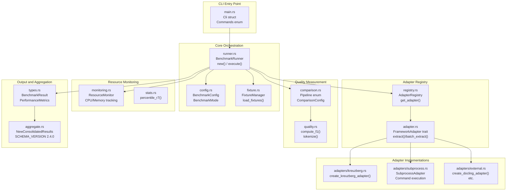
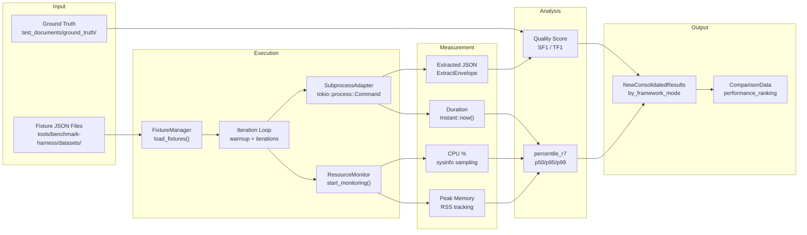

<!-- source: DeepWiki mcp.deepwiki.com · repo kreuzberg-dev/kreuzberg · page 6.6 Benchmarking and Performance Testing · fetched 2026-10-26 -->

# Benchmarking and Performance Testing

Relevant source files

The following files were used as context for generating this wiki page:

- [.task/tools/test-apps.yml](.task/tools/test-apps.yml)
- [.task/workflows/benchmark.yml](.task/workflows/benchmark.yml)
- [crates/kreuzberg/src/core/config/layout.rs](crates/kreuzberg/src/core/config/layout.rs)
- [crates/kreuzberg/src/extractors/pdf/pages.rs](crates/kreuzberg/src/extractors/pdf/pages.rs)
- [crates/kreuzberg/src/layout/engine.rs](crates/kreuzberg/src/layout/engine.rs)
- [crates/kreuzberg/src/layout/mod.rs](crates/kreuzberg/src/layout/mod.rs)
- [crates/kreuzberg/src/layout/models/rtdetr.rs](crates/kreuzberg/src/layout/models/rtdetr.rs)
- [crates/kreuzberg/src/layout/models/yolo.rs](crates/kreuzberg/src/layout/models/yolo.rs)
- [crates/kreuzberg/src/paddle_ocr/config.rs](crates/kreuzberg/src/paddle_ocr/config.rs)
- [crates/kreuzberg/src/paddle_ocr/mod.rs](crates/kreuzberg/src/paddle_ocr/mod.rs)
- [crates/kreuzberg/src/paddle_ocr/model_manager.rs](crates/kreuzberg/src/paddle_ocr/model_manager.rs)
- [crates/kreuzberg/src/pdf/hierarchy/bounding_box.rs](crates/kreuzberg/src/pdf/hierarchy/bounding_box.rs)
- [crates/kreuzberg/src/pdf/hierarchy/types.rs](crates/kreuzberg/src/pdf/hierarchy/types.rs)
- [crates/kreuzberg/src/pdf/structure/text_repair.rs](crates/kreuzberg/src/pdf/structure/text_repair.rs)
- [crates/kreuzberg/src/pdf/structure/types.rs](crates/kreuzberg/src/pdf/structure/types.rs)
- [docs/perf/iterations.md](docs/perf/iterations.md)
- [docs/perf/profiling.md](docs/perf/profiling.md)
- [docs/snippets/c/api/batch_extract_bytes_sync.md](docs/snippets/c/api/batch_extract_bytes_sync.md)
- [docs/snippets/c/api/batch_extract_files_sync.md](docs/snippets/c/api/batch_extract_files_sync.md)
- [docs/snippets/c/api/error_handling.md](docs/snippets/c/api/error_handling.md)
- [docs/snippets/c/api/extract_bytes_async.md](docs/snippets/c/api/extract_bytes_async.md)
- [docs/snippets/c/api/extract_bytes_sync.md](docs/snippets/c/api/extract_bytes_sync.md)
- [docs/snippets/c/api/extract_file_async.md](docs/snippets/c/api/extract_file_async.md)
- [docs/snippets/c/api/extract_file_sync.md](docs/snippets/c/api/extract_file_sync.md)
- [scripts/benchmarks/run-benchmark.sh](scripts/benchmarks/run-benchmark.sh)
- [tools/benchmark-harness/Cargo.toml](tools/benchmark-harness/Cargo.toml)
- [tools/benchmark-harness/bench-out/cord_matrix.json](tools/benchmark-harness/bench-out/cord_matrix.json)
- [tools/benchmark-harness/bench-out/cord_matrix.md](tools/benchmark-harness/bench-out/cord_matrix.md)
- [tools/benchmark-harness/scripts/liteparse_extract.sh](tools/benchmark-harness/scripts/liteparse_extract.sh)
- [tools/benchmark-harness/src/adapters/external.rs](tools/benchmark-harness/src/adapters/external.rs)
- [tools/benchmark-harness/src/adapters/kreuzberg.rs](tools/benchmark-harness/src/adapters/kreuzberg.rs)
- [tools/benchmark-harness/src/adapters/mod.rs](tools/benchmark-harness/src/adapters/mod.rs)
- [tools/benchmark-harness/src/adapters/subprocess.rs](tools/benchmark-harness/src/adapters/subprocess.rs)
- [tools/benchmark-harness/src/aggregate.rs](tools/benchmark-harness/src/aggregate.rs)
- [tools/benchmark-harness/src/comparison.rs](tools/benchmark-harness/src/comparison.rs)
- [tools/benchmark-harness/src/config.rs](tools/benchmark-harness/src/config.rs)
- [tools/benchmark-harness/src/consolidate.rs](tools/benchmark-harness/src/consolidate.rs)
- [tools/benchmark-harness/src/datasets/cord.rs](tools/benchmark-harness/src/datasets/cord.rs)
- [tools/benchmark-harness/src/datasets/docile.rs](tools/benchmark-harness/src/datasets/docile.rs)
- [tools/benchmark-harness/src/datasets/funsd.rs](tools/benchmark-harness/src/datasets/funsd.rs)
- [tools/benchmark-harness/src/datasets/mod.rs](tools/benchmark-harness/src/datasets/mod.rs)
- [tools/benchmark-harness/src/datasets/sroie.rs](tools/benchmark-harness/src/datasets/sroie.rs)
- [tools/benchmark-harness/src/datasets/vrdu.rs](tools/benchmark-harness/src/datasets/vrdu.rs)
- [tools/benchmark-harness/src/fixture.rs](tools/benchmark-harness/src/fixture.rs)
- [tools/benchmark-harness/src/json_quality.rs](tools/benchmark-harness/src/json_quality.rs)
- [tools/benchmark-harness/src/lib.rs](tools/benchmark-harness/src/lib.rs)
- [tools/benchmark-harness/src/main.rs](tools/benchmark-harness/src/main.rs)
- [tools/benchmark-harness/src/output.rs](tools/benchmark-harness/src/output.rs)
- [tools/benchmark-harness/src/pipeline_benchmark.rs](tools/benchmark-harness/src/pipeline_benchmark.rs)
- [tools/benchmark-harness/src/profiling.rs](tools/benchmark-harness/src/profiling.rs)
- [tools/benchmark-harness/src/runner.rs](tools/benchmark-harness/src/runner.rs)
- [tools/benchmark-harness/src/sizes.rs](tools/benchmark-harness/src/sizes.rs)
- [tools/benchmark-harness/src/types.rs](tools/benchmark-harness/src/types.rs)
- [tools/benchmark-harness/tests/structured_matrix.rs](tools/benchmark-harness/tests/structured_matrix.rs)
- [tools/perf/extract_top_symbols.py](tools/perf/extract_top_symbols.py)

## Purpose and Scope

The benchmark harness provides comprehensive performance and quality measurement infrastructure for Kreuzberg's document extraction capabilities. It enables:

- **Performance benchmarking** across language bindings (Rust, Python, Node.js, Ruby, Elixir, PHP, Go, Java, C#, C, WASM) [tools/benchmark-harness/src/adapters/kreuzberg.rs:26-103]()
- **Multi-framework comparison** against external tools (Docling, Apache Tika, Unstructured, Pandoc, PyMuPDF4LLM, MinerU, PDFPlumber) [tools/benchmark-harness/src/main.rs:136-176]()
- **Quality validation** using ground truth datasets with SF1 (Structural F1) and TF1 (Text F1) score computation [tools/benchmark-harness/src/comparison.rs:1-29]()
- **Resource profiling** with CPU/memory monitoring and flamegraph generation [tools/benchmark-harness/src/runner.rs:20-45]()
- **CI/CD integration** for continuous performance tracking and regression testing [tools/benchmark-harness/src/comparison.rs:156-175]()

For general testing infrastructure, see [Testing Strategy](#6.4). For release automation and CI workflows, see [CI Pipeline Overview](#8.1).

## Architecture Overview

### Benchmark Harness Components

**Sources:** [tools/benchmark-harness/src/main.rs:38-44](), [tools/benchmark-harness/src/runner.rs:179-195](), [tools/benchmark-harness/src/adapters/subprocess.rs:65-75](), [tools/benchmark-harness/src/aggregate.rs:41-59](), [tools/benchmark-harness/src/adapters/mod.rs:7-14]()

### Data Flow and Execution Pipeline

**Sources:** [tools/benchmark-harness/src/runner.rs:54-129](), [tools/benchmark-harness/src/adapters/subprocess.rs:24-37](), [tools/benchmark-harness/src/aggregate.rs:97-124](), [tools/benchmark-harness/src/comparison.rs:30-38]()

## Benchmark Modes

The harness supports two execution modes for different measurement objectives:

### Single-File Mode
Sequential execution measuring per-document latency. This is the preferred mode for fair latency comparison between frameworks [tools/benchmark-harness/src/main.rs:15-17]().

### Batch Mode
Concurrent execution measuring throughput. It utilizes native batch APIs where available to measure maximum document processing capacity [tools/benchmark-harness/src/main.rs:18-20]().

**Sources:** [tools/benchmark-harness/src/main.rs:13-36](), [tools/benchmark-harness/src/adapters/subprocess.rs:164-182]()

## Framework Adapter Architecture

### SubprocessAdapter Implementation
The `SubprocessAdapter` is the primary bridge for testing Kreuzberg language bindings and external tools. It manages the lifecycle of a subprocess and monitors its resource usage [tools/benchmark-harness/src/adapters/subprocess.rs:60-75]().

Key features:
- **JSON Envelope Parsing**: Handles `ExtractEnvelope` and `BatchEnvelope` formats emitted by the CLI [tools/benchmark-harness/src/adapters/kreuzberg.rs:1-7]().
- **Output Sanitization**: Strips non-JSON log lines (common in Elixir/BEAM) using `extract_json_from_stdout` [tools/benchmark-harness/src/adapters/subprocess.rs:24-37]().
- **OCR Capability Detection**: Automatically determines if a framework supports OCR (e.g., `kreuzberg-*`, `docling`, `mineru`) [tools/benchmark-harness/src/adapters/subprocess.rs:88-123]().

### Kreuzberg Adapter Factory
The `create_kreuzberg_adapter` function configures the CLI for different pipeline variants:
- **Baseline**: Native PDF text extraction [tools/benchmark-harness/src/adapters/kreuzberg.rs:51-53]().
- **Layout**: Native extraction + layout detection (`--layout true --use-layout-for-markdown`) [tools/benchmark-harness/src/adapters/kreuzberg.rs:54-63]().
- **PaddleOcr**: Full OCR pipeline (`--ocr true --ocr-backend paddle-ocr --force-ocr true`) [tools/benchmark-harness/src/adapters/kreuzberg.rs:64-71]().

**Sources:** [tools/benchmark-harness/src/adapters/kreuzberg.rs:26-103](), [tools/benchmark-harness/src/adapters/subprocess.rs:1-15]()

## Resource Monitoring

### Metrics Collection
The `ResourceMonitor` (using `sysinfo`) tracks:
- **Peak Memory**: Resident Set Size (RSS) high-water mark in MB [tools/benchmark-harness/src/aggregate.rs:78-79]().
- **Average CPU**: Percentage of CPU utilized across all cores [tools/benchmark-harness/src/runner.rs:154]().
- **Throughput**: Bytes processed per second [tools/benchmark-harness/src/runner.rs:156-160]().

### Statistical Methodology
The harness uses **R-7 interpolation** (standard in R and NumPy) for all percentile calculations (p50, p95, p99) to ensure statistical robustness [tools/benchmark-harness/src/aggregate.rs:8-15](). Non-finite floats are sanitized to `0.0` for JSON compatibility [tools/benchmark-harness/src/aggregate.rs:12-15]().

**Sources:** [tools/benchmark-harness/src/aggregate.rs:1-40](), [tools/benchmark-harness/src/runner.rs:54-129](), [tools/benchmark-harness/src/stats.rs:1-10]()

## Quality Metrics and Comparison

### Pipeline Variants
The comparison engine supports multiple extraction pipelines defined in the `Pipeline` enum:
- **Structural Pipelines**: `Layout`, `LayoutSlanetAuto` (SLANeXT table models), `PdfOxideLayout` [tools/benchmark-harness/src/comparison.rs:41-82]().
- **OCR Pipelines**: `Tesseract`, `Paddle` (mobile tier), `PaddleServer` [tools/benchmark-harness/src/comparison.rs:48-59]().
- **External Pipelines**: `Docling`, `RapidOcr`, `PaddleOcrPython` [tools/benchmark-harness/src/comparison.rs:64-69]().

### Quality Scoring (SF1 & TF1)
The system calculates two primary quality metrics:
1. **TF1 (Text F1)**: Token-based F1 score comparing extracted text to ground truth [tools/benchmark-harness/src/comparison.rs:113-118]().
2. **SF1 (Structural F1)**: Measures structural integrity (headings, tables, lists) using structural quality scoring [tools/benchmark-harness/src/comparison.rs:119-121]().

### Guardrails
The `ComparisonConfig` supports `guardrails`, which enforce per-document minimum SF1/TF1 thresholds [tools/benchmark-harness/src/comparison.rs:156-165](). These are typically set to 90% of observed scores to prevent regressions [tools/benchmark-harness/src/comparison.rs:22-28]().

**Sources:** [tools/benchmark-harness/src/comparison.rs:1-152](), [tools/benchmark-harness/src/aggregate.rs:1-25]()

## Result Aggregation

### NewConsolidatedResults (v2.4.0)
The `aggregate.rs` module produces a consolidated JSON report containing:
- **by_framework_mode**: Grouped statistics [tools/benchmark-harness/src/aggregate.rs:49-50]().
- **disk_sizes**: Installation sizes measured via `measure_framework_sizes()` [tools/benchmark-harness/src/runner.rs:198-204]().
- **comparison**: Global rankings for performance, throughput, memory, and quality [tools/benchmark-harness/src/aggregate.rs:97-124]().
- **per_fixture_results**: Raw data for every fixture/framework combination [tools/benchmark-harness/src/aggregate.rs:62-94]().

**Sources:** [tools/benchmark-harness/src/aggregate.rs:41-124](), [tools/benchmark-harness/src/runner.rs:188-210]()

## Profiling and Flamegraphs

### Performance Profiling
When the `profiling` feature is enabled, the harness uses `pprof` to generate flamegraphs [tools/benchmark-harness/Cargo.toml:22]().

### Task Amplification
To ensure enough samples are collected for short-lived extraction tasks, the runner uses `calculate_amplified_iterations`. This repeats the task until a target profiling duration (default 1000ms) is reached [tools/benchmark-harness/src/runner.rs:25-45]().

### Memory Profiling
The harness supports heap profiling via `tikv-jemallocator` and `tikv-jemalloc-ctl` [tools/benchmark-harness/Cargo.toml:23](), [tools/benchmark-harness/src/main.rs:3-5]().

**Sources:** [tools/benchmark-harness/src/runner.rs:20-45](), [tools/benchmark-harness/Cargo.toml:37-40](), [tools/benchmark-harness/src/main.rs:1-6]()

## CLI Usage

| Command | Purpose |
|---------|---------|
| `run` | Execute benchmarks with iterations and warmup [tools/benchmark-harness/src/main.rs:63-111](). |
| `compare` | Run quality comparison against corpus with optional guardrails [tools/benchmark-harness/src/main.rs:136-176](). |
| `consolidate` | Merge multiple result directories into a single v2.4.0 report [tools/benchmark-harness/src/main.rs:114-126](). |
| `generate-guardrails` | Create `guardrails.json` from current benchmark scores [tools/benchmark-harness/src/main.rs:179-195](). |
| `measure-framework-sizes` | Calculate disk footprint of all supported frameworks [tools/benchmark-harness/src/main.rs:129-133](). |
| `pipeline-benchmark` | Run 6-path pipeline benchmark across the document corpus [tools/benchmark-harness/src/main.rs:198-220](). |

**Sources:** [tools/benchmark-harness/src/main.rs:38-220]()

---

