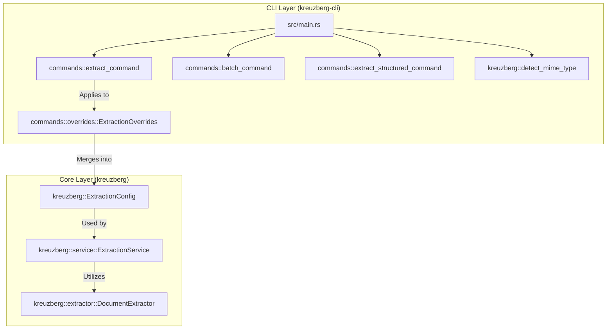

<!-- source: DeepWiki mcp.deepwiki.com · repo kreuzberg-dev/kreuzberg · page 7.1 Command-Line Interface · fetched 2026-10-26 -->

# Command-Line Interface

<details>
<summary>Relevant source files</summary>

The following files were used as context for generating this wiki page:

- [crates/kreuzberg-cli/Cargo.toml](crates/kreuzberg-cli/Cargo.toml)
- [crates/kreuzberg-cli/README.md](crates/kreuzberg-cli/README.md)
- [crates/kreuzberg-cli/src/commands/extract.rs](crates/kreuzberg-cli/src/commands/extract.rs)
- [crates/kreuzberg-cli/src/commands/mod.rs](crates/kreuzberg-cli/src/commands/mod.rs)
- [crates/kreuzberg-cli/src/commands/overrides.rs](crates/kreuzberg-cli/src/commands/overrides.rs)
- [crates/kreuzberg-cli/src/main.rs](crates/kreuzberg-cli/src/main.rs)
- [crates/kreuzberg-cli/tests/commands_test.rs](crates/kreuzberg-cli/tests/commands_test.rs)
- [crates/kreuzberg-cli/tests/config_discovery_test.rs](crates/kreuzberg-cli/tests/config_discovery_test.rs)
- [crates/kreuzberg-cli/tests/server_test.rs](crates/kreuzberg-cli/tests/server_test.rs)
- [crates/kreuzberg/src/mcp/mod.rs](crates/kreuzberg/src/mcp/mod.rs)
- [crates/kreuzberg/src/mcp/server.rs](crates/kreuzberg/src/mcp/server.rs)
- [docs/cli/usage.md](docs/cli/usage.md)
- [docs/getting-started/quickstart.md](docs/getting-started/quickstart.md)
- [docs/guides/advanced.md](docs/guides/advanced.md)
- [docs/guides/api-server.md](docs/guides/api-server.md)
- [docs/guides/configuration.md](docs/guides/configuration.md)
- [docs/guides/extraction.md](docs/guides/extraction.md)
- [docs/guides/layout-detection.md](docs/guides/layout-detection.md)
- [docs/guides/ocr.md](docs/guides/ocr.md)
- [docs/guides/plugins.md](docs/guides/plugins.md)
- [docs/reference/environment-variables.md](docs/reference/environment-variables.md)
- [docs/reference/formats.md](docs/reference/formats.md)
- [docs/snippets/cli/batch_basic.md](docs/snippets/cli/batch_basic.md)
- [docs/snippets/cli/extract_basic.md](docs/snippets/cli/extract_basic.md)
- [docs/snippets/cli/ocr_basic.md](docs/snippets/cli/ocr_basic.md)

</details>


The Kreuzberg CLI provides a high-performance command-line interface for document extraction, MIME type detection, structured data extraction, and batch processing. It wraps the Rust core library into a standalone binary available for all major platforms.

For HTTP API-based extraction, see [HTTP REST API Server](#7.2). For AI agent integration, see [MCP Server for AI Agents](#7.3). For containerized deployments, see [Docker Deployment](#7.4).

---

## Installation

Kreuzberg ships prebuilt binaries for Linux (x86_64/aarch64), macOS (Apple Silicon), and Windows.

### Quick Install (Linux/macOS)
```bash
curl -fsSL https://raw.githubusercontent.com/kreuzberg-dev/kreuzberg/main/scripts/install.sh | bash
```

### Package Managers
=== "Homebrew"
    ```bash
    brew install kreuzberg-dev/tap/kreuzberg
    ```
=== "Cargo"
    ```bash
    cargo install kreuzberg-cli
    ```
=== "Docker"
    ```bash
    docker run -v $(pwd):/data ghcr.io/kreuzberg-dev/kreuzberg-cli:latest extract /data/document.pdf
    ```

**Sources**: [docs/getting-started/quickstart.md:73-75](), [docs/cli/usage.md:5-26]()

---

## CLI Architecture

The CLI is implemented in the `kreuzberg-cli` crate [crates/kreuzberg-cli/Cargo.toml:1-2]() and serves as a thin wrapper around the `kreuzberg` core library. It uses `clap` for command routing and argument parsing [crates/kreuzberg-cli/src/main.rs:8-9]().

### System Data Flow
Title: CLI Execution and Core Integration


**Implementation Details**:
- **Argument Parsing**: The CLI uses `clap`'s `Parser` and `Subcommand` traits to define the interface [crates/kreuzberg-cli/src/main.rs:81-94]().
- **Configuration Layering**: CLI flags captured in `ExtractionOverrides` take precedence over config files and default values [crates/kreuzberg-cli/src/main.rs:24-29](). The `load_config` function [crates/kreuzberg-cli/src/commands/mod.rs:100-100]() handles the merging logic.
- **Output Handling**: Results are formatted into "Wire Formats" (`text`, `json`, or `toon`) before being printed to stdout [crates/kreuzberg-cli/src/main.rs:120-134](). The `output` module [crates/kreuzberg-cli/src/output.rs:1-1]() manages this.

**Sources**: [crates/kreuzberg-cli/src/main.rs:6-30](), [crates/kreuzberg-cli/src/commands/overrides.rs:1-10](), [crates/kreuzberg-cli/src/commands/mod.rs:100-100](), [crates/kreuzberg-cli/src/output.rs:1-1]()

---

## Command Reference

### `extract`
Extracts content from a single file. By default, it outputs plain text to stdout. The command takes a `path` argument and supports various flags for configuration overrides [crates/kreuzberg-cli/src/main.rs:96-129]().

```bash
# Basic usage
kreuzberg extract document.pdf

# Specify output content format
kreuzberg extract document.pdf --content-format markdown

# Enable OCR and specify language
kreuzberg extract scanned.jpg --ocr true --ocr-language deu
```
**Sources**: [crates/kreuzberg-cli/src/main.rs:96-129](), [docs/cli/usage.md:71-79]()

### `extract-structured` <span class="version-badge">v4.8.0</span>
Uses an LLM to extract typed JSON data based on a provided schema. This command requires a model identifier (e.g., `openai/gpt-4o`) and a JSON schema file [docs/cli/usage.md:94-118](). The `ExtractStructuredArgs` struct defines its arguments [crates/kreuzberg-cli/src/main.rs:132-167]().

```bash
kreuzberg extract-structured invoice.pdf \
  --schema invoice_schema.json \
  --model openai/gpt-4o \
  --strict
```
**Sources**: [crates/kreuzberg-cli/src/main.rs:132-167](), [docs/cli/usage.md:94-118]()

### `batch`
Processes multiple files in parallel. It is significantly faster than single extractions for large datasets due to internal concurrency management [docs/guides/extraction.md:188-190](). The command accepts multiple `paths` and supports per-file configuration overrides via `--file-configs` [crates/kreuzberg-cli/src/main.rs:170-205]().

```bash
# Process all PDFs in a directory
kreuzberg batch documents/*.pdf --format json

# Limit concurrency
kreuzberg batch docs/ --max-concurrent 4
```
**Sources**: [crates/kreuzberg-cli/src/main.rs:170-205](), [docs/cli/usage.md:81-92]()

### `detect`
Identifies the MIME type of a file without performing full extraction [crates/kreuzberg-cli/src/main.rs:207-211](). This command directly calls the `kreuzberg::detect_mime_type` function.

```bash
kreuzberg detect unknown_file.bin
```
**Sources**: [crates/kreuzberg-cli/src/main.rs:207-211](), [docs/cli/usage.md:186-187]()

### `cache`
Manages the local cache for models and other resources.
- `cache warm`: Pre-downloads models [docs/cli/usage.md:290-291]().
- `cache clear`: Clears the cache [docs/cli/usage.md:293-294]().
- `cache stats`: Displays cache statistics [docs/cli/usage.md:296-297]().
- `cache manifest`: Shows the model manifest with checksums [docs/cli/usage.md:299-300]().

```bash
# Warm up all models
kreuzberg cache warm --all

# Clear the cache
kreuzberg cache clear

# Show cache statistics
kreuzberg cache stats
```
**Sources**: [crates/kreuzberg-cli/src/main.rs:214-240](), [docs/cli/usage.md:288-300]()

### `serve`
Starts the HTTP REST API server. This command is enabled by the `api` feature flag [crates/kreuzberg-cli/Cargo.toml:37]().

```bash
kreuzberg serve --port 8000
```
**Sources**: [crates/kreuzberg-cli/src/main.rs:243-246](), [docs/guides/api-server.md:9-11]()

### `mcp`
Starts the Model Context Protocol (MCP) server for AI agent integration. This command is enabled by the `mcp` feature flag [crates/kreuzberg-cli/Cargo.toml:38](). The `KreuzbergMcp` struct [crates/kreuzberg/src/mcp/server.rs:26-36]() handles the server logic.

```bash
kreuzberg mcp
```
**Sources**: [crates/kreuzberg-cli/src/main.rs:249-252](), [crates/kreuzberg/src/mcp/server.rs:26-36]()

### `version`
Displays the current version of the Kreuzberg CLI.

```bash
kreuzberg version
```
**Sources**: [crates/kreuzberg-cli/src/main.rs:255-258]()

---

## Configuration Management

Kreuzberg supports a hierarchical configuration system. The CLI looks for a `kreuzberg.toml` (or `.yaml`/`.json`) file in the current and parent directories automatically [crates/kreuzberg-cli/src/main.rs:18-22](). The `ExtractionConfig::discover()` method [crates/kreuzberg/src/mcp/server.rs:63-63]() is used for this auto-discovery.

### Configuration Precedence
1. **CLI Flags**: Individual flags like `--ocr` or `--ocr-language` [crates/kreuzberg-cli/src/commands/overrides.rs:77-100](). These are parsed into an `ExtractionOverrides` struct [crates/kreuzberg-cli/src/commands/overrides.rs:76-76]().
2. **Inline JSON**: Provided via `--config-json` or `--config-json-base64` [crates/kreuzberg-cli/src/main.rs:104-114]().
3. **Config File**: Explicitly passed via `--config` or auto-discovered [docs/guides/configuration.md:86-89]().
4. **Defaults**: Hardcoded system defaults.

### Content vs. Wire Formats
It is important to distinguish between how content is rendered and how the CLI prints the result:
- **Content Format** (`--content-format`): Controls the internal rendering of the document (e.g., `plain`, `markdown`, `html`) [docs/cli/usage.md:137-158](). This is handled by the `ContentOutputFormatArg` enum [crates/kreuzberg-cli/src/commands/overrides.rs:151-152]().
- **Wire Format** (`--format`): Controls the CLI's output wrapper (e.g., `text` for raw content, `json` for a structured object including metadata) [crates/kreuzberg-cli/src/main.rs:120-125](). This is handled by the `WireFormat` enum [crates/kreuzberg-cli/src/main.rs:261-261]().

**Sources**: [crates/kreuzberg-cli/src/main.rs:16-29](), [docs/guides/configuration.md:39-84](), [crates/kreuzberg-cli/src/commands/overrides.rs:76-76](), [crates/kreuzberg-cli/src/commands/overrides.rs:151-152](), [crates/kreuzberg-cli/src/main.rs:261-261](), [crates/kreuzberg/src/mcp/server.rs:63-63]()

---

## Hardware Acceleration

The CLI supports hardware acceleration for ONNX-dependent features (PaddleOCR, layout detection) via the `--acceleration` flag [crates/kreuzberg-cli/src/commands/overrides.rs:191-193](). The `AccelerationArg` enum [crates/kreuzberg-cli/src/commands/overrides.rs:14-29]() defines the available providers.

| Provider | Flag Value | Platform Support |
|----------|------------|------------------|
| CPU | `cpu` | All (Fallback) |
| CoreML | `coreml` | macOS / iOS |
| CUDA | `cuda` | Linux / Windows (NVIDIA) |
| TensorRT | `tensorrt` | Linux / Windows (NVIDIA) |

**Sources**: [crates/kreuzberg-cli/src/commands/overrides.rs:14-41](), [docs/guides/layout-detection.md:116-124]()

---

## Global Flags & Scripting

### Logging
Control verbosity with `--log-level` (overrides `RUST_LOG`). Valid levels: `trace`, `debug`, `info`, `warn`, `error` [docs/cli/usage.md:41-59](). This is handled by the `log_level` argument in the `Cli` struct [crates/kreuzberg-cli/src/main.rs:86-88]().

### Integration Example (Bash)
```bash
# Process all files and extract only the detected language using jq
kreuzberg batch ./docs --format json | jq '.[].detected_languages'
```

### Exit Codes
- `0`: Success.
- `Non-zero`: Error (details printed to stderr) [crates/kreuzberg-cli/src/main.rs:30-33]().

**Sources**: [docs/cli/usage.md:41-68](), [crates/kreuzberg-cli/src/main.rs:30-33](), [crates/kreuzberg-cli/src/main.rs:86-88]()

---

