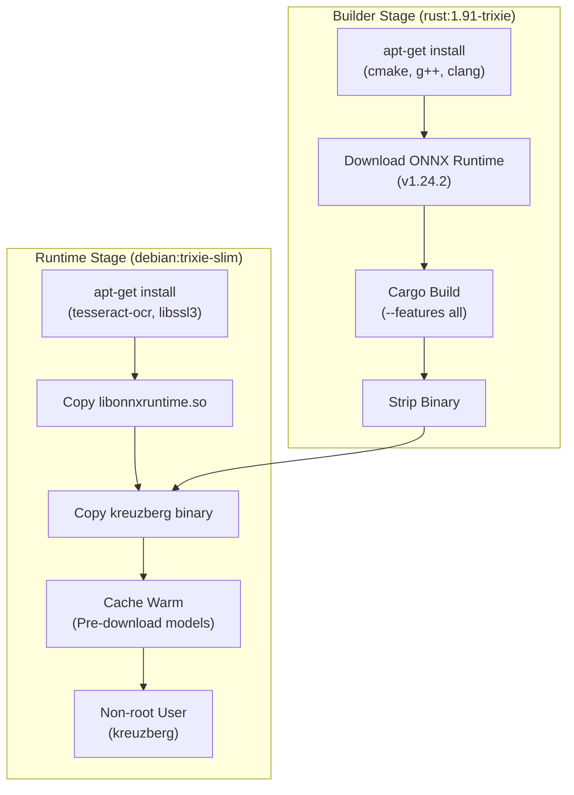
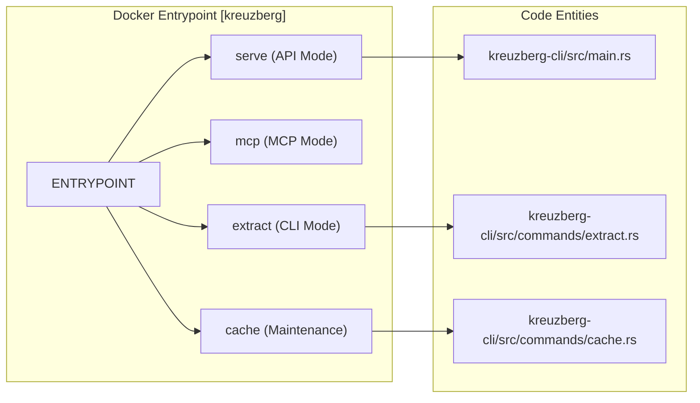
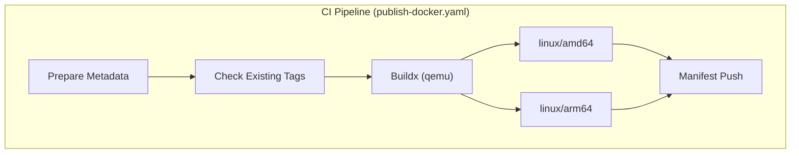

<!-- source: DeepWiki mcp.deepwiki.com · repo kreuzberg-dev/kreuzberg · page 7.4 Docker Deployment · fetched 2026-10-26 -->

# Docker Deployment

<details>
<summary>Relevant source files</summary>

The following files were used as context for generating this wiki page:

- [.dockerignore](.dockerignore)
- [.github/actions/setup-paddle-ocr-models/README.md](.github/actions/setup-paddle-ocr-models/README.md)
- [.github/actions/setup-paddle-ocr-models/action.yml](.github/actions/setup-paddle-ocr-models/action.yml)
- [.github/workflows/publish-docker.yaml](.github/workflows/publish-docker.yaml)
- [.github/workflows/publish-helm.yaml](.github/workflows/publish-helm.yaml)
- [.lychee.toml](.lychee.toml)
- [.task/config/vars.yml](.task/config/vars.yml)
- [.task/languages/rust.yml](.task/languages/rust.yml)
- [.task/tools/demo.yml](.task/tools/demo.yml)
- [.task/tools/docs.yml](.task/tools/docs.yml)
- [.typos.toml](.typos.toml)
- [crates/kreuzberg/build.rs](crates/kreuzberg/build.rs)
- [crates/kreuzberg/tests/paddle_ocr_integration.rs](crates/kreuzberg/tests/paddle_ocr_integration.rs)
- [docker/Dockerfile.core](docker/Dockerfile.core)
- [docker/Dockerfile.full](docker/Dockerfile.full)
- [scripts/ci/docs/build.sh](scripts/ci/docs/build.sh)
- [scripts/stage_csharp_native_local.sh](scripts/stage_csharp_native_local.sh)

</details>


This page documents the containerization and deployment architecture for Kreuzberg. It covers the available Docker image variants, multi-architecture support, execution modes (API/CLI/MCP), and size optimization strategies.

Kreuzberg provides official Docker images published to GitHub Container Registry (GHCR) optimized for document intelligence workloads. All images include the Rust core, native dependencies (PDFium, Tesseract), and pre-warmed model caches.

## Image Variants

Kreuzberg maintains three distinct Docker image variants to balance feature completeness against image size.

| Variant | Tag Suffix | Base Image | Key Features | Use Case |
| :--- | :--- | :--- | :--- | :--- |
| **Core** | `:latest-core` | `debian:trixie-slim` | Tesseract, PDFium, ONNX | Standard production, API servers |
| **Full** | `:latest` | `debian:trixie-slim` | Core + PaddleOCR + Layout Detection | High-accuracy OCR, complex layouts |
| **CLI** | `cli:latest` | `debian:trixie-slim` | Core (optimized for CLI) | One-shot CI/CD, batch processing |

**Sources:** [docker/Dockerfile.full:62-67](), [docker/Dockerfile.core:62-67](), [.github/workflows/publish-docker.yaml:164-180]()

## Build Architecture

The Docker builds utilize a multi-stage process to minimize the final runtime image size while ensuring all native dependencies are correctly linked.

### Multi-Stage Build Pipeline



**Sources:** [docker/Dockerfile.full:4-58](), [docker/Dockerfile.full:62-122](), [docker/Dockerfile.core:4-58]()

### Build Configuration Logic
The build process dynamically adjusts based on the target architecture (`amd64` vs `arm64`) to fetch the correct ONNX Runtime binaries [docker/Dockerfile.full:31-39](). It also prunes the Cargo workspace to exclude language-specific bindings (Python, Ruby, Node.js) that are not needed for the standalone Docker image [docker/Dockerfile.full:49-50]().

**Sources:** [docker/Dockerfile.full:31-39](), [docker/Dockerfile.full:49-50]()

## Execution Modes

The Docker container uses the `kreuzberg` binary as its entrypoint, allowing it to function in multiple modes via command-line arguments.



### 1. API Server Mode (Default)
The default command starts the HTTP REST API server on port 8000.
```bash
docker run -p 8000:8000 ghcr.io/kreuzberg-dev/kreuzberg:latest
```
**Sources:** [docker/Dockerfile.full:161-162]()

### 2. CLI Extraction Mode
Used for one-shot processing of local files via volume mounts.
```bash
docker run --rm -v $(pwd):/data ghcr.io/kreuzberg-dev/kreuzberg:latest \
    extract --file /data/input.pdf --output-dir /data/out
```

### 3. MCP Server Mode
Integrates with AI agents using the Model Context Protocol over stdio.
```bash
docker run -i ghcr.io/kreuzberg-dev/kreuzberg:latest mcp
```

## Model Caching and Optimization

To prevent high latency during the first request, the Docker images perform "cache warming" during the build process.

### Pre-downloaded Models
The `full` image variant executes `kreuzberg cache warm` during the build [docker/Dockerfile.full:119-122](). This populates `/app/.kreuzberg` with:
- PaddleOCR detection, classification, and recognition models.
- Layout detection models.
- Tesseract language data for common languages (English, Spanish, French, German, etc.) [docker/Dockerfile.full:76-89]().

### Cache Directory Mapping
| Component | Path in Container | Environment Variable |
| :--- | :--- | :--- |
| **Main Cache** | `/app/.kreuzberg` | `KREUZBERG_CACHE_DIR` |
| **HuggingFace** | `/app/.kreuzberg/huggingface` | `HF_HOME` |
| **Tessdata** | `/usr/share/tesseract-ocr/tessdata` | N/A (System Path) |

**Sources:** [docker/Dockerfile.full:146-149](), [docker/Dockerfile.full:129-137]()

## Deployment Configuration

### Environment Variables
- `RUST_LOG`: Controls logging verbosity. Default is `info` [docker/Dockerfile.full:148]().
- `LD_LIBRARY_PATH`: Ensures the container finds the bundled `libonnxruntime.so` in `/usr/local/lib` [docker/Dockerfile.full:149]().

**Sources:** [docker/Dockerfile.full:148-149]()

### Security and Permissions
The image runs as a non-root `kreuzberg` user (UID/GID 1000 equivalent) [docker/Dockerfile.full:105-108](). The build process explicitly sets read/execute permissions on Tesseract data directories to ensure the non-root user can access language models [docker/Dockerfile.full:127-137]().

**Sources:** [docker/Dockerfile.full:105-108](), [docker/Dockerfile.full:127-137]()

## Specialized MUSL Builds

For environments requiring fully static or highly portable binaries (e.g., Scratch images, Alpine Linux), Kreuzberg provides MUSL-based Dockerfiles.

- **`Dockerfile.musl-build`**: Produces a portable CLI binary with bundled runtime libraries (`libstdc++`, `libgcc`) using `patchelf` to set `RPATH` to `$ORIGIN/lib` [docker/Dockerfile.musl-build:61-70]().
- **`Dockerfile.musl-ffi`**: Builds a MUSL-linked `libkreuzberg_ffi.so` for C-interop on Alpine-based systems [docker/Dockerfile.musl-ffi:52-54]().
- **`Dockerfile.musl-rustler`**: Specifically for Elixir deployments, building the Rustler NIF shared library against MUSL [docker/Dockerfile.musl-rustler:53-56]().

**Sources:** [docker/Dockerfile.musl-build:1-95](), [docker/Dockerfile.musl-ffi:1-66](), [docker/Dockerfile.musl-rustler:1-68]()

## Multi-Architecture Support

The CI pipeline uses Docker Buildx to build and push multi-platform manifests.



**Sources:** [.github/workflows/publish-docker.yaml:152-202]()

---

