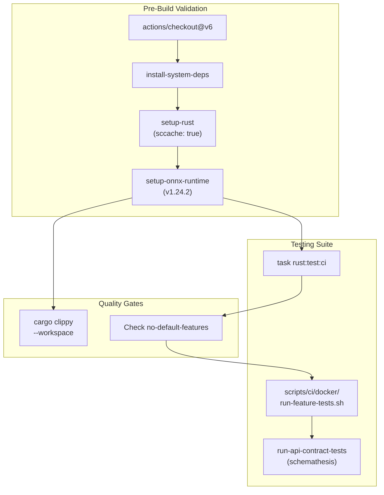
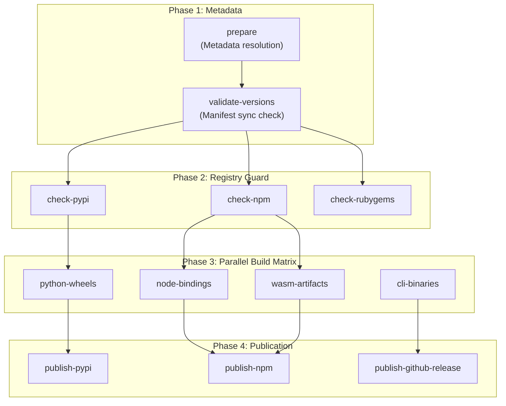

<!-- source: DeepWiki mcp.deepwiki.com · repo kreuzberg-dev/kreuzberg · page 8 CI/CD and Release Process · fetched 2026-10-26 -->

# CI/CD and Release Process

Relevant source files

The following files were used as context for generating this wiki page:

- [.github/actionlint.yaml](.github/actionlint.yaml)
- [.github/documentation/runners.md](.github/documentation/runners.md)
- [.github/workflows/benchmarks.yaml](.github/workflows/benchmarks.yaml)
- [.github/workflows/ci-docker.yaml](.github/workflows/ci-docker.yaml)
- [.github/workflows/ci-docs.yaml](.github/workflows/ci-docs.yaml)
- [.github/workflows/ci-e2e.yaml](.github/workflows/ci-e2e.yaml)
- [.github/workflows/ci-gpu.yaml](.github/workflows/ci-gpu.yaml)
- [.github/workflows/ci-lint.yaml](.github/workflows/ci-lint.yaml)
- [.github/workflows/ci-mobile.yaml](.github/workflows/ci-mobile.yaml)
- [.github/workflows/ci-rust.yaml](.github/workflows/ci-rust.yaml)
- [.github/workflows/profiling.yaml](.github/workflows/profiling.yaml)
- [.github/workflows/publish.yaml](.github/workflows/publish.yaml)
- [.github/workflows/validate-issues.yml](.github/workflows/validate-issues.yml)
- [.github/workflows/validate-pr.yml](.github/workflows/validate-pr.yml)
- [crates/kreuzberg/src/extraction/image_ocr.rs](crates/kreuzberg/src/extraction/image_ocr.rs)
- [crates/kreuzberg/tests/docx_ocr_integration_test.rs](crates/kreuzberg/tests/docx_ocr_integration_test.rs)
- [crates/kreuzberg/tests/gpu_acceleration.rs](crates/kreuzberg/tests/gpu_acceleration.rs)
- [e2e/java/pom.xml](e2e/java/pom.xml)
- [packages/csharp/Kreuzberg/Kreuzberg.csproj](packages/csharp/Kreuzberg/Kreuzberg.csproj)
- [packages/java/pom.xml](packages/java/pom.xml)
- [packages/python/pyproject.toml](packages/python/pyproject.toml)

This document describes the automated testing, building, and publishing infrastructure that validates code changes and distributes Kreuzberg across 16 programming languages and platforms. For information about the build system and dependency management, see [Development Guide](#6). For details on multi-platform builds and cross-compilation, see [Platform-Specific Considerations](#9).

## Overview

Kreuzberg's CI/CD system serves two primary functions:

1.  **Continuous Integration**: Language-specific validation workflows (e.g., `ci-rust.yaml`, `ci-docker.yaml`) that run on every push and pull request, ensuring code quality, security compliance, and API parity across all bindings.
2.  **Release Orchestration**: The `publish.yaml` workflow that coordinates 16 target language releases (crates, Python, Node, WASM, Ruby, PHP, CLI, Homebrew, Go, C-FFI, Java, C#, Elixir, Dart, Swift, Zig, and Kotlin).

The system manages a complex matrix of artifacts including Python wheels, Node.js native modules, Ruby gems, Java JARs (FFM-based), NuGet packages, and multi-architecture Docker images.

**Sources**: [.github/workflows/publish.yaml:1-13](), [CHANGELOG.md:1-7]()

## CI Pipeline Architecture

### Workflow Organization

The CI system consists of specialized workflows for the core engine and its various distribution formats:

| Workflow | Trigger Paths | Primary Jobs | Matrix Size |
| :--- | :--- | :--- | :--- |
| `ci-rust.yaml` | `crates/**`, `Cargo.*` | `clippy`, `rust-tests`, `no-default-features` | 2 platforms (ARM/Intel) |
| `ci-docker.yaml` | `docker/**` | `feature-tests`, `config-tests`, `api-contract` | 3 variants (core/full/cli) |
| `benchmarks.yaml` | Manual dispatch | `bench-rust`, `bench-docling`, `bench-tika` | 12+ frameworks |
| `profiling.yaml` | Manual dispatch | `bench-native`, `bench-python-sync` | Flamegraph generation |
| `publish.yaml` | Release/Dispatch | `prepare`, `validate-versions`, `check-*` | 16 targets |

**Sources**: [.github/workflows/ci-rust.yaml:1-20](), [.github/workflows/ci-docker.yaml:1-26](), [.github/workflows/publish.yaml:15-50]()

### CI Workflow Structure

The Rust CI pipeline ensures that the core engine remains stable before any language-specific bindings are exercised.

**Sources**: [.github/workflows/ci-rust.yaml:53-104](), [.github/workflows/ci-docker.yaml:62-76]()

### Caching and Environment

To maintain high performance across hundreds of jobs, the pipeline uses a shared action infrastructure:
*   **Rust**: Uses `setup-rust@v1` with `sccache` enabled and `CARGO_INCREMENTAL: 0` to optimize for CI environments [.github/workflows/ci-rust.yaml:28-68]().
*   **ONNX**: Standardized on version `1.24.2` across all workflows [.github/workflows/ci-rust.yaml:32-79]().
*   **Disk Management**: Linux runners utilize `free-disk-space-linux@v1` to accommodate large ONNX models and build artifacts [.github/workflows/benchmarks.yaml:59-61]().

## Release Workflow

### Trigger and Preparation

The `publish.yaml` workflow orchestrates the entire release process. It can be triggered by a published GitHub Release or manual `workflow_dispatch`.

The `prepare` job [.github/workflows/publish.yaml:60-94]() resolves release metadata, including:
*   `tag`: The git tag (e.g., `v5.0.0`).
*   `is_prerelease`: Boolean based on semver.
*   `release_targets`: Determines which of the 16 targets should be built based on inputs.

**Sources**: [.github/workflows/publish.yaml:15-94]()

### Release Orchestration Flow

**Sources**: [.github/workflows/publish.yaml:60-187]()

## Idempotency and Validation

### Version Consistency
The `validate-versions` job [.github/workflows/publish.yaml:122-138]() ensures that the version string in `Cargo.toml` matches the provided release tag and is consistent across all language-specific manifests (e.g., `package.json`, `pyproject.toml`). For example, the Python package version is defined in `packages/python/pyproject.toml:7` and the Java package version in `packages/java/pom.xml:9`.

### Registry Existence Checks
To prevent failing builds due to existing versions, the pipeline queries registries before starting expensive build jobs:
*   **PyPI**: Uses `check-registry@v1` to verify `kreuzberg` version presence [.github/workflows/publish.yaml:141-155]().
*   **npm**: Checks both `@kreuzberg/node` and `@kreuzberg/wasm` [.github/workflows/publish.yaml:156-173]().
*   **RubyGems**: Checks for the `kreuzberg` gem [.github/workflows/publish.yaml:174-187]().

**Sources**: [.github/workflows/publish.yaml:122-187](), [packages/python/pyproject.toml:7](), [packages/java/pom.xml:9]()

## Benchmarking and Performance Tracking

The system includes a robust benchmarking harness used to compare Kreuzberg against industry standards like Apache Tika and Docling.

### Benchmark Execution
The `bench-rust` job [.github/workflows/benchmarks.yaml:124-189]() runs a matrix across:
*   **Pipelines**: `baseline`, `layout`, `paddle-ocr`.
*   **Formats**: `markdown`, `plaintext`.
*   **Modes**: `single-file`, `batch`.

### Performance Profiling
For deep-dive analysis, the `profiling.yaml` workflow generates Flamegraphs by building the workspace with debug symbols (`RUSTFLAGS: "-g"`) and running the `benchmark-harness` with profiling enabled [.github/workflows/profiling.yaml:13-76]().

**Sources**: [.github/workflows/benchmarks.yaml:131-136](), [.github/workflows/profiling.yaml:7-13]()

## Package Distribution Channels

Kreuzberg is distributed through a wide array of channels, each with specific requirements:

*   **Python**: Multi-platform wheels built via `maturin`.
*   **Node.js**: Native modules using NAPI-RS.
*   **Docker**: Three variants (`core`, `full`, `cli`) published to GHCR. `core` is optimized for size, while `full` includes layout and OCR models [.github/workflows/ci-docker.yaml:26-43]().
*   **CLI**: Standalone binaries for Linux (ARM/x64), macOS, and Windows.
*   **R**: Excluded from `publish.yaml` as it is automatically distributed via R-Universe from the repository HEAD [.github/workflows/publish.yaml:8]().
*   **Java**: Distributed as a JAR, with its version defined in `packages/java/pom.xml:9`.
*   **C#**: Packaged as a NuGet package, with its version defined in `packages/csharp/Kreuzberg/Kreuzberg.csproj:6`.

For detailed information on specific targets, see the following child pages:
- [CI Pipeline Overview](#8.1) — Workflow structure and validation gates.
- [Multi-Platform Build Matrix](#8.2) — OS/architecture combinations and cross-compilation.
- [Release Orchestration](#8.3) — Idempotency checks and parallel execution.
- [Package Distribution Channels](#8.4) — Details for PyPI, npm, RubyGems, and more.

**Sources**: [.github/workflows/publish.yaml:5-13](), [.github/workflows/ci-docker.yaml:26-43](), [packages/java/pom.xml:9](), [packages/csharp/Kreuzberg/Kreuzberg.csproj:6]()

---

