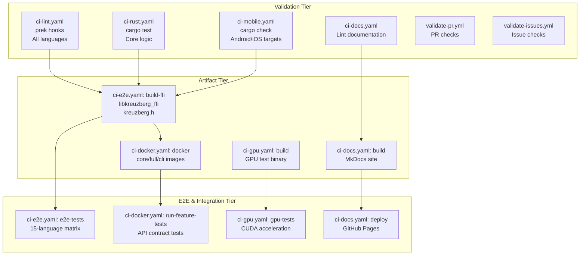
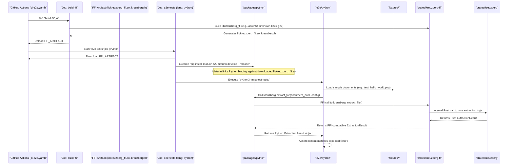

<!-- source: DeepWiki mcp.deepwiki.com · repo kreuzberg-dev/kreuzberg · page 8.1 CI Pipeline Overview · fetched 2026-10-26 -->

# CI Pipeline Overview

Relevant source files

The following files were used as context for generating this wiki page:

- [.github/actionlint.yaml](.github/actionlint.yaml)
- [.github/documentation/runners.md](.github/documentation/runners.md)
- [.github/workflows/ci-docs.yaml](.github/workflows/ci-docs.yaml)
- [.github/workflows/ci-e2e.yaml](.github/workflows/ci-e2e.yaml)
- [.github/workflows/ci-gpu.yaml](.github/workflows/ci-gpu.yaml)
- [.github/workflows/ci-lint.yaml](.github/workflows/ci-lint.yaml)
- [.github/workflows/ci-mobile.yaml](.github/workflows/ci-mobile.yaml)
- [.github/workflows/validate-issues.yml](.github/workflows/validate-issues.yml)
- [.github/workflows/validate-pr.yml](.github/workflows/validate-pr.yml)
- [crates/kreuzberg/src/extraction/image_ocr.rs](crates/kreuzberg/src/extraction/image_ocr.rs)
- [crates/kreuzberg/tests/docx_ocr_integration_test.rs](crates/kreuzberg/tests/docx_ocr_integration_test.rs)
- [crates/kreuzberg/tests/gpu_acceleration.rs](crates/kreuzberg/tests/gpu_acceleration.rs)
- [scripts/ci/rust/run-unit-tests.sh](scripts/ci/rust/run-unit-tests.sh)

## Purpose and Scope

This document describes the architecture of Kreuzberg's GitHub Actions CI/CD pipeline, including workflow organization, path-based triggering, job dependency patterns, validation gates, and end-to-end (E2E) testing across the polyglot codebase. The pipeline orchestrates the validation of the Rust core, its 15+ language bindings, and various deployment artifacts (Docker, CLI, MCP).

## Workflow Inventory

The CI pipeline consists of specialized workflow files organized by responsibility and technology stack:

| Workflow File | Purpose | Primary Jobs | Trigger |
|--------------|---------|--------------|---------|
| `ci-rust.yaml` | Core Rust library & CLI validation | `rust` (matrix: linux-arm, macos) | push, PR |
| `ci-e2e.yaml` | Cross-language E2E validation | `build-ffi`, `e2e-tests` (matrix: 15 langs) | push, PR |
| `ci-docker.yaml` | Container image validation | `docker` (matrix: core, full, cli) | manual |
| `ci-gpu.yaml` | GPU acceleration testing | `build`, `gpu-tests` (CUDA L4 runner) | manual |
| `ci-lint.yaml` | Unified code quality & linting | `lint` (prek hooks for all langs) | push, PR |
| `ci-docs.yaml` | Documentation build & validation | `build`, `lint-links`, `validate-snippets` | manual |
| `ci-mobile.yaml` | Mobile platform compatibility checks | `android-check`, `ios-check` | push, PR |
| `validate-issues.yml` | Validates newly opened or edited issues | `validate` | issues: opened, edited |
| `validate-pr.yml` | Validates pull requests | `validate` | pull_request: opened, edited, synchronize |

Sources: [.github/workflows/ci-rust.yaml:1-41](), [.github/workflows/ci-e2e.yaml:1-48](), [.github/workflows/ci-docker.yaml:1-17](), [.github/workflows/ci-gpu.yaml:1-21](), [.github/workflows/ci-lint.yaml:1-18](), [.github/workflows/ci-docs.yaml:1-16](), [.github/workflows/ci-mobile.yaml:1-20](), [.github/workflows/validate-issues.yml:1-6](), [.github/workflows/validate-pr.yml:1-6]()

## High-Level Pipeline Architecture

The pipeline follows a tiered validation strategy: first linting and unit testing, followed by FFI artifact generation, and finally cross-language E2E testing.

Sources: [.github/workflows/ci-rust.yaml:89-102](), [.github/workflows/ci-e2e.yaml:49-110](), [.github/workflows/ci-docker.yaml:18-80](), [.github/workflows/ci-gpu.yaml:22-113](), [.github/workflows/ci-mobile.yaml:40-79](), [.github/workflows/ci-docs.yaml:61-82]()

## Path-Based Trigger System

To optimize CI resource usage, workflows use granular path filters. This ensures that a change in the Ruby binding doesn't trigger a full Docker build unless necessary.

### Filter Logic Examples

*   **Rust CI (`ci-rust.yaml`)**: Triggers on changes to `crates/**`, `Cargo.toml`, and `rust-toolchain.toml` [[.github/workflows/ci-rust.yaml:6-10]]().
*   **E2E CI (`ci-e2e.yaml`)**: Triggers on core crates, `packages/**` (bindings), and `e2e/**` test suites [[.github/workflows/ci-e2e.yaml:6-14]]().
*   **Lint CI (`ci-lint.yaml`)**: Triggers on all pushes to main and pull requests to ensure consistent style across the repo [[.github/workflows/ci-lint.yaml:4-7]]().
*   **Mobile CI (`ci-mobile.yaml`)**: Triggers on changes to `crates/**`, `packages/dart/**`, `packages/swift/**`, `packages/kotlin-android/**` [[.github/workflows/ci-mobile.yaml:6-12]]().

## Language-Specific CI Jobs

### Rust Core Validation (`ci-rust.yaml`)
This job focuses on the foundational Rust crates. It executes on `ubuntu-24.04-arm` and `macos-latest` to ensure cross-platform compatibility for the core engine [[.github/workflows/ci-rust.yaml:50-51]]().

1.  **Environment Setup**: Installs system dependencies (PDFium, ONNX Runtime, Tesseract) [[.github/workflows/ci-rust.yaml:70-85]]().
2.  **Clippy**: Runs workspace-wide linting, excluding binding crates which are handled by their own language-specific linters [[.github/workflows/ci-rust.yaml:89-91]]().
3.  **Tests**: Executes `task rust:test:ci` [[.github/workflows/ci-rust.yaml:93-95]](). The `run-unit-tests.sh` script sets up `TESSDATA_PREFIX` and `LD_LIBRARY_PATH` for PDFium, then runs `cargo test` for `kreuzberg` with `full` features and other workspace crates with `--all-features` [[scripts/ci/rust/run-unit-tests.sh:17-85]]().
4.  **Feature Validation**: Verifies the library compiles with `--no-default-features` [[.github/workflows/ci-rust.yaml:101-102]]().

### E2E Matrix (`ci-e2e.yaml`)
The E2E workflow is the most complex validation gate, testing the interaction between the Rust FFI layer and the various language bindings.

1.  **Build FFI**: Compiles `libkreuzberg_ffi` and generates the C header `kreuzberg.h` for multiple targets (Linux x86/ARM, macOS, Windows) [[.github/workflows/ci-e2e.yaml:49-109]](). This step includes computing a hash of FFI source files to leverage caching [[.github/workflows/ci-e2e.yaml:74-91]]().
2.  **Test Matrix**: A massive matrix job runs tests for 15 languages/environments [[.github/workflows/ci-e2e.yaml:116-164]]().

| Language | Version | Key Command |
|----------|---------|-------------|
| Python | 3.13 | `maturin develop && pytest` |
| Node.js | 24 | `npm run build && vitest run` |
| Go | 1.26 | `go test ./...` |
| Ruby | 3.4 | `bundle install && bundle exec rake compile && bundle exec rspec` |
| Java | 25 | `mvn package && mvn test` |
| C# | 10.0.x | `dotnet test` |
| PHP | 8.4 | `cargo build && phpunit` |
| Elixir | 1.19 | `mix deps.get && mix test` |
| Wasm | Node 24 | `wasm-pack build && npm test` |
| Rust | N/A | `cargo test` |
| R | 4.3 | `Rscript run_tes...` |

Sources: [.github/workflows/ci-e2e.yaml:116-164](), [.github/workflows/ci-e2e.yaml:74-91](), [scripts/ci/rust/run-unit-tests.sh:17-85]()

### Mobile Compatibility Checks (`ci-mobile.yaml`)
This workflow ensures that the Rust core and its mobile-specific bindings (`kreuzberg-dart`, `kreuzberg-swift`) remain compatible with Android and iOS build environments.

1.  **Android Cargo Check**: Runs `cargo ndk check` for `arm64-v8a` and `x86_64` ABIs on Ubuntu, targeting Android API level 21 [[.github/workflows/ci-mobile.yaml:41-59]]().
2.  **iOS Cargo Check**: Runs `cargo check` for `aarch64-apple-ios` and `aarch64-apple-ios-sim` targets on macOS [[.github/workflows/ci-mobile.yaml:61-79]]().
3.  **RUSTFLAGS**: Custom `RUSTFLAGS` are used to suppress specific warnings (`dead_code`, `unpredictable-function-pointer-comparisons`, `mismatched-lifetime-syntaxes`) that arise due to feature subsets in mobile builds [[.github/workflows/ci-mobile.yaml:35-36]]().

Sources: [.github/workflows/ci-mobile.yaml:41-79](), [.github/workflows/ci-mobile.yaml:35-36]()

## Specialized Testing Gates

### Docker Validation (`ci-docker.yaml`)
Validates the containerized versions of Kreuzberg.
- **Image Variants**: Builds `core`, `full`, and `cli` variants [[.github/workflows/ci-docker.yaml:26]]().
- **Validation Scripts**: Runs `run-feature-tests.sh` and `run-config-tests.sh` inside the containers [[.github/workflows/ci-docker.yaml:62-68]]().
- **API Contract**: Uses `schemathesis` via `run-api-contract-tests` action to verify OpenAPI compliance of the server [[.github/workflows/ci-docker.yaml:70-75]]().

### GPU Acceleration (`ci-gpu.yaml`)
Ensures that ORT-backed subsystems (PaddleOCR, Layout Detection, Embeddings) correctly utilize hardware acceleration.
- **Environment**: Runs on `runner-gpu-l4` self-hosted runners with NVIDIA GPUs [[.github/workflows/ci-gpu.yaml:70](), [.github/actionlint.yaml:10]]().
- **Test Target**: Focuses on `gpu_acceleration` integration tests which verify that CUDA EPs are actually activated and not silently falling back to CPU [[crates/kreuzberg/tests/gpu_acceleration.rs:1-8]]().
- **Log Verification**: The tests use a `LogCapture` to verify that "CUDA execution provider available" appears in the tracing logs [[crates/kreuzberg/tests/gpu_acceleration.rs:52-109]]().
- **PaddleOCR Integration**: Tests specifically check PaddleOCR's `process_image` function with `AccelerationConfig` set to `Cuda` [[crates/kreuzberg/tests/gpu_acceleration.rs:115-149]](). The `process_images_with_ocr` function in the core library also handles `AccelerationConfig` for image OCR tasks [[crates/kreuzberg/src/extraction/image_ocr.rs:52-53](), [crates/kreuzberg/src/extraction/image_ocr.rs:71-72]]().

Sources: [.github/workflows/ci-gpu.yaml:70](), [.github/actionlint.yaml:10](), [crates/kreuzberg/tests/gpu_acceleration.rs:1-8](), [crates/kreuzberg/tests/gpu_acceleration.rs:52-109](), [crates/kreuzberg/tests/gpu_acceleration.rs:115-149](), [crates/kreuzberg/src/extraction/image_ocr.rs:52-53](), [crates/kreuzberg/src/extraction/image_ocr.rs:71-72]()

### Documentation Snippets (`ci-docs.yaml`)
Prevents documentation rot by validating that code snippets in `docs/` actually compile.
- **Snippet Runner**: Uses a custom `snippet-runner` crate to validate syntax and execution of snippets [[.github/workflows/ci-docs.yaml:93-94]]().

### Issue and PR Validation (`validate-issues.yml`, `validate-pr.yml`)
These workflows use reusable GitHub Actions to enforce standards for issues and pull requests.
- **Issue Validation**: Triggers on `opened` or `edited` issue events [[.github/workflows/validate-issues.yml:4-5]]().
- **PR Validation**: Triggers on `opened`, `edited`, or `synchronize` PR events [[.github/workflows/validate-pr.yml:4-5]]().

Sources: [.github/workflows/validate-issues.yml:4-5](), [.github/workflows/validate-pr.yml:4-5]()

## Implementation Detail: E2E Test Flow

The following diagram bridges the high-level CI workflow to the specific scripts and entities used during the E2E validation of a language binding (e.g., Python).

Sources: [.github/workflows/ci-e2e.yaml:49-164](), [crates/kreuzberg/src/extraction/image_ocr.rs:21-23]()

## CI Configuration and Environment

All CI jobs share a common environment configuration to ensure consistency across the matrix:

| Variable | Value | Purpose |
|----------|-------|---------|
| `ORT_VERSION` | `1.24.2` | ONNX Runtime version for OCR and embeddings [[.github/workflows/ci-rust.yaml:32](), [.github/workflows/ci-e2e.yaml:40](), [.github/workflows/ci-gpu.yaml:16]](). |
| `MACOSX_DEPLOYMENT_TARGET` | `14.0` | Minimum macOS version supported [[.github/workflows/ci-rust.yaml:33](), [.github/workflows/ci-e2e.yaml:41]](). |
| `RUST_MIN_STACK` | `16777216` | Large stack size (16MB) to prevent overflows during deep PDF parsing [[.github/workflows/ci-rust.yaml:31](), [.github/workflows/ci-e2e.yaml:39](), [.github/workflows/ci-gpu.yaml:15]](). |
| `CARGO_INCREMENTAL` | `0` | Disabled to improve cache reliability in CI [[.github/workflows/ci-rust.yaml:28](), [.github/workflows/ci-e2e.yaml:36](), [.github/workflows/ci-gpu.yaml:12](), [.github/workflows/ci-mobile.yaml:28]](). |
| `CARGO_PROFILE_DEV_DEBUG` | `0` | Disables debug info for dev profiles to speed up builds [[.github/workflows/ci-rust.yaml:29](), [.github/workflows/ci-e2e.yaml:37](), [.github/workflows/ci-gpu.yaml:13](), [.github/workflows/ci-mobile.yaml:29]](). |
| `RUST_BACKTRACE` | `short` | Configures Rust backtrace verbosity [[.github/workflows/ci-rust.yaml:30](), [.github/workflows/ci-e2e.yaml:38](), [.github/workflows/ci-gpu.yaml:14](), [.github/workflows/ci-mobile.yaml:30]](). |
| `FORCE_JAVASCRIPT_ACTIONS_TO_NODE24` | `true` | Ensures JavaScript actions use Node.js 24 [[.github/workflows/ci-e2e.yaml:43](), [.github/workflows/ci-lint.yaml:25]](). |

Sources: [.github/workflows/ci-rust.yaml:26-36](), [.github/workflows/ci-e2e.yaml:34-44](), [.github/workflows/ci-gpu.yaml:10-17](), [.github/workflows/ci-mobile.yaml:26-36](), [.github/workflows/ci-lint.yaml:23-25]()

---

