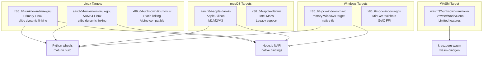
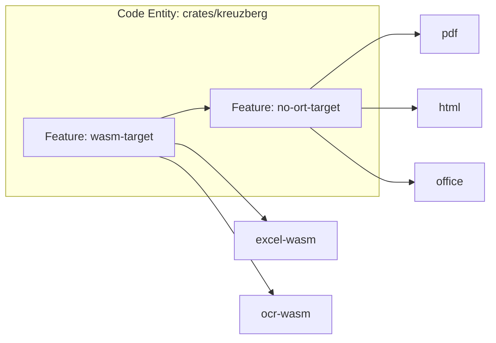

<!-- source: DeepWiki mcp.deepwiki.com · repo kreuzberg-dev/kreuzberg · page 9 Platform-Specific Considerations · fetched 2026-10-26 -->

# Platform-Specific Considerations

<details>
<summary>Relevant source files</summary>

The following files were used as context for generating this wiki page:

- [.dockerignore](.dockerignore)
- [.github/actions/setup-paddle-ocr-models/README.md](.github/actions/setup-paddle-ocr-models/README.md)
- [.github/actions/setup-paddle-ocr-models/action.yml](.github/actions/setup-paddle-ocr-models/action.yml)
- [.github/workflows/benchmarks.yaml](.github/workflows/benchmarks.yaml)
- [.github/workflows/ci-docker.yaml](.github/workflows/ci-docker.yaml)
- [.github/workflows/ci-rust.yaml](.github/workflows/ci-rust.yaml)
- [.github/workflows/profiling.yaml](.github/workflows/profiling.yaml)
- [.github/workflows/publish.yaml](.github/workflows/publish.yaml)
- [.task/config/vars.yml](.task/config/vars.yml)
- [.task/languages/rust.yml](.task/languages/rust.yml)
- [crates/kreuzberg/build.rs](crates/kreuzberg/build.rs)
- [crates/kreuzberg/tests/paddle_ocr_integration.rs](crates/kreuzberg/tests/paddle_ocr_integration.rs)
- [docker/Dockerfile.core](docker/Dockerfile.core)
- [docker/Dockerfile.full](docker/Dockerfile.full)
- [e2e/java/pom.xml](e2e/java/pom.xml)
- [packages/csharp/Kreuzberg/Kreuzberg.csproj](packages/csharp/Kreuzberg/Kreuzberg.csproj)
- [packages/java/pom.xml](packages/java/pom.xml)
- [packages/python/pyproject.toml](packages/python/pyproject.toml)
- [scripts/stage_csharp_native_local.sh](scripts/stage_csharp_native_local.sh)

</details>


This page documents platform quirks, build requirements, and compatibility notes for deploying Kreuzberg across different operating systems, architectures, and runtime environments. It covers target triples, conditional dependencies, and platform-specific workarounds required for successful compilation and execution.

For information about the overall build system and dependency management, see [Building from Source](#6.3). For CI/CD platform matrices, see [Multi-Platform Build Matrix](#8.2).

---

## Overview of Platform Support

Kreuzberg supports the following platforms:

| Platform | Architecture | Target Triple | Status |
|----------|-------------|---------------|--------|
| **Linux (glibc)** | x86_64 | `x86_64-unknown-linux-gnu` | ✅ Full support |
| **Linux (glibc)** | aarch64 | `aarch64-unknown-linux-gnu` | ✅ Full support |
| **Linux (musl)** | x86_64 | `x86_64-unknown-linux-musl` | ✅ Static linking |
| **Linux (musl)** | aarch64 | `aarch64-unknown-linux-musl` | ✅ Static linking |
| **macOS** | ARM64 | `aarch64-apple-darwin` | ✅ Full support |
| **macOS** | x86_64 | `x86_64-apple-darwin` | ⚠️ Cross-compile only |
| **Windows** | x86_64 | `x86_64-pc-windows-msvc` | ✅ Full support |
| **Windows** | x86_64 | `x86_64-pc-windows-gnu` | ⚠️ Go/C FFI only |
| **WASM** | wasm32 | `wasm32-unknown-unknown` | ⚠️ Limited features |

Platform-specific configurations are managed through Cargo's target-specific dependencies and conditional compilation.

**Sources:** [packages/python/pyproject.toml:14-21](), [packages/java/pom.xml:9](), [.github/workflows/publish.yaml:10-11]()

---

## Cross-Platform Build Configuration

Kreuzberg's build system is designed for cross-platform compatibility, leveraging Rust's robust ecosystem. This section provides a high-level overview of how target triples, conditional dependencies, and feature flags are used to manage platform-specific requirements.

### Target Triple Selection

Kreuzberg uses Rust's target triple system to configure platform-specific behavior. The primary targets are defined in the workspace and individual package configurations.


**Sources:** [packages/python/pyproject.toml:14-21](), [.github/workflows/publish.yaml:10-11]()

### Conditional Dependency Configuration

Platform-specific dependencies are declared using Cargo's `[target.'cfg(...)'.dependencies]` sections. This is critical for selecting the correct TLS backend and managing ONNX Runtime (ORT) availability.

1.  **TLS Backend Selection**: `rustls` is preferred for Linux/macOS, while `native-tls` is used for Windows to avoid complex CMake-based build dependencies.
2.  **ONNX Runtime (ORT)**: Bundled via `ort-bundled` for native platforms, but excluded from WASM targets. The `build.rs` script includes a warning if both `ort-bundled` and `ort-dynamic` features are enabled [crates/kreuzberg/build.rs:4-10]().
3.  **`fastembed` Variants**: Different `fastembed` variants might be used depending on the target platform and available features.

For details, see [Cross-Platform Build Configuration](#9.1).

**Sources:** [crates/kreuzberg/build.rs:1-11]()

---

## Windows Considerations

Building Kreuzberg on Windows involves specific considerations, particularly regarding TLS implementations and build environments.

### MinGW Support

While the primary Windows target uses MSVC, support for MinGW (Minimalist GNU for Windows) is maintained, especially for Go and C FFI bindings. This allows for broader compatibility with different toolchains.

### `native-tls` for Avoiding CMake Issues

On Windows, `native-tls` is preferred over `rustls` to circumvent potential issues with `aws-lc-sys` which often requires a functional CMake environment. CMake can be inconsistent in MinGW setups, making `native-tls` a more reliable choice.

### Platform-Specific Test Skips

Certain tests might be skipped on Windows due to platform-specific behaviors or limitations, ensuring the test suite remains robust and relevant.

For details, see [Windows Considerations](#9.2).

**Sources:** [packages/csharp/Kreuzberg/Kreuzberg.csproj:1-24]()

---

## macOS Apple Silicon Builds

Building for macOS Apple Silicon (ARM64) requires careful configuration to ensure optimal performance and compatibility.

### ARM64 Compilation

The primary macOS target is `aarch64-apple-darwin`. To prevent miscompilation issues observed at higher optimization levels, certain crates like `sevenz-rust2` and `zip` have their optimization levels reduced to `opt-level = 2` for ARM64 builds.

### Universal Binaries

Kreuzberg aims to support universal binaries where applicable, allowing a single binary to run natively on both ARM64 and x86_64 macOS systems.

### PDFium Architecture Selection

PDFium, a critical dependency for PDF processing, is architecture-specific. The build system dynamically selects the correct ARM64 or x86_64 variant of PDFium during the linking stage to match the target architecture.

For details, see [macOS Apple Silicon Builds](#9.3).

**Sources:** [.github/workflows/ci-rust.yaml:33]()

---

## Linux manylinux Compatibility

Ensuring broad compatibility across various Linux distributions is crucial for Kreuzberg, especially for Python wheels.

### manylinux2014 Containers

Python wheels are built within `manylinux2014` containers. This standard ensures that the compiled binaries are compatible with a wide range of Linux distributions by linking against an older `glibc` version (2.17).

### MUSL Static Linking

For environments like Alpine Linux, which use MUSL libc instead of glibc, Kreuzberg supports static linking. This allows for the creation of self-contained binaries that do not depend on the host system's `glibc`, enhancing portability.

### glibc Compatibility

The use of `manylinux2014` and MUSL static linking directly addresses `glibc` compatibility concerns, providing options for both dynamic and static linking environments.

For details, see [Linux manylinux Compatibility](#9.4).

**Sources:** [docker/Dockerfile.full:62-62](), [docker/Dockerfile.core:77-77]()

---

## WASM Platform Constraints

The `wasm32-unknown-unknown` target operates under significant constraints:
-   **No ONNX Runtime**: Features like `embeddings` and `paddle-ocr` are disabled as they depend on the C++ ONNX Runtime.
-   **Synchronous Overrides**: Certain extractors (like Excel) use `excel-wasm` which provides synchronous alternatives to the standard `tokio`-based async extractors.
-   **Feature Gating**: The `wasm-target` feature group in `crates/kreuzberg` explicitly defines the subset of supported features.


**Sources:** [docker/Dockerfile.full:49](), [docker/Dockerfile.core:49]()

---

## System Dependency Association

This diagram bridges the high-level platform requirements to the specific code entities and build artifacts.

```mermaid
graph TD
    subgraph "Natural Language Space"
        WinReq["Windows Build Requirements"]
        MacReq["macOS ARM64 Stability"]
        LinuxReq["Linux Portability"]
        DockerBuild["Docker Image Build"]
    end

    subgraph "Code Entity Space"
        NativeTLS["native-tls (Cargo Feature)"]
        OptLevel["profile.release.package (Cargo.toml)"]
        ManyLinux["manylinux (CI/CD Config)"]
        DockerfileFull["docker/Dockerfile.full"]
        DockerfileCore["docker/Dockerfile.core"]
        ONNXRUNTIME_VERSION["ONNXRUNTIME_VERSION (ARG)"]
    end

    WinReq --> NativeTLS
    MacReq --> OptLevel
    LinuxReq --> ManyLinux
    DockerBuild --> DockerfileFull
    DockerBuild --> DockerfileCore
    DockerfileFull --> ONNXRUNTIME_VERSION
    DockerfileCore --> ONNXRUNTIME_VERSION

    NativeTLS -.-> "crates/kreuzberg/Cargo.toml"
    OptLevel -.-> "Cargo.toml"
    ManyLinux -.-> "packages/python/pyproject.toml"
    ONNXRUNTIME_VERSION -.-> "docker/Dockerfile.full:25"
    ONNXRUNTIME_VERSION -.-> "docker/Dockerfile.core:25"
```
**Sources:** [packages/python/pyproject.toml:1-3](), [docker/Dockerfile.full:25](), [docker/Dockerfile.core:25]()

---

