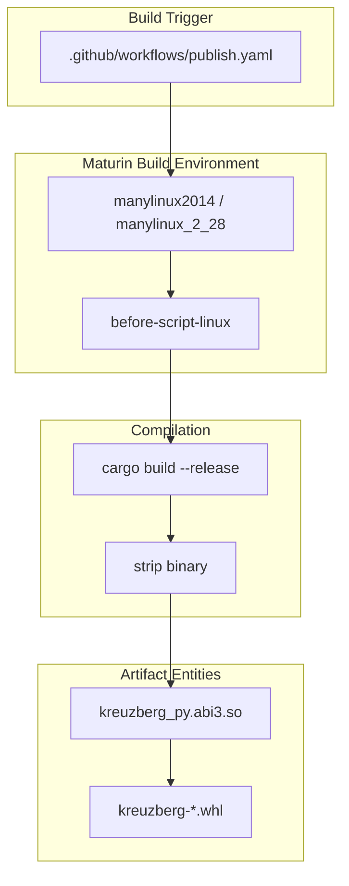
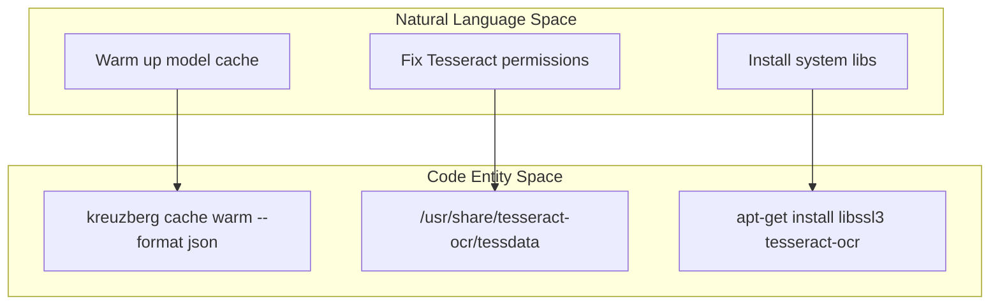
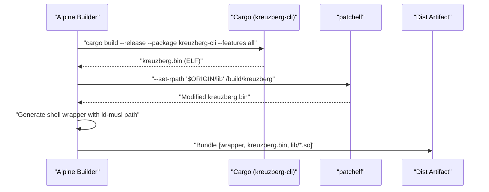

<!-- source: DeepWiki mcp.deepwiki.com · repo kreuzberg-dev/kreuzberg · page 9.4 Linux manylinux Compatibility · fetched 2026-10-26 -->

# Linux manylinux Compatibility

Relevant source files

The following files were used as context for generating this wiki page:

- [.dockerignore](.dockerignore)
- [.github/actions/setup-paddle-ocr-models/README.md](.github/actions/setup-paddle-ocr-models/README.md)
- [.github/actions/setup-paddle-ocr-models/action.yml](.github/actions/setup-paddle-ocr-models/action.yml)
- [.task/config/vars.yml](.task/config/vars.yml)
- [.task/languages/rust.yml](.task/languages/rust.yml)
- [crates/kreuzberg-cli/src/commands/cache.rs](crates/kreuzberg-cli/src/commands/cache.rs)
- [crates/kreuzberg/build.rs](crates/kreuzberg/build.rs)
- [crates/kreuzberg/src/core/config/extraction/file_config.rs](crates/kreuzberg/src/core/config/extraction/file_config.rs)
- [crates/kreuzberg/src/core/config/extraction/loaders.rs](crates/kreuzberg/src/core/config/extraction/loaders.rs)
- [crates/kreuzberg/src/core/io.rs](crates/kreuzberg/src/core/io.rs)
- [crates/kreuzberg/src/error.rs](crates/kreuzberg/src/error.rs)
- [crates/kreuzberg/src/extractors/code.rs](crates/kreuzberg/src/extractors/code.rs)
- [crates/kreuzberg/src/keywords/config.rs](crates/kreuzberg/src/keywords/config.rs)
- [crates/kreuzberg/src/ocr/tessdata_manager.rs](crates/kreuzberg/src/ocr/tessdata_manager.rs)
- [crates/kreuzberg/tests/paddle_ocr_integration.rs](crates/kreuzberg/tests/paddle_ocr_integration.rs)
- [docker/Dockerfile.cli](docker/Dockerfile.cli)
- [docker/Dockerfile.core](docker/Dockerfile.core)
- [docker/Dockerfile.full](docker/Dockerfile.full)
- [docker/Dockerfile.musl-build](docker/Dockerfile.musl-build)
- [docker/Dockerfile.musl-ffi](docker/Dockerfile.musl-ffi)
- [docker/Dockerfile.musl-rustler](docker/Dockerfile.musl-rustler)
- [scripts/ci/r/vendor-kreuzberg-core.py](scripts/ci/r/vendor-kreuzberg-core.py)
- [scripts/ci/ruby/vendor-kreuzberg-core.py](scripts/ci/ruby/vendor-kreuzberg-core.py)
- [scripts/install.sh](scripts/install.sh)
- [scripts/stage_csharp_native_local.sh](scripts/stage_csharp_native_local.sh)

## Purpose and Scope

This page documents Kreuzberg's Linux binary compatibility strategy, focusing on **manylinux** standards for Python wheel distribution, **MUSL** static linking for standalone binaries and NIFs, and general glibc compatibility. Kreuzberg ensures broad Linux support by targeting stable glibc baselines and providing minimal-dependency MUSL variants for containerized environments.

For general cross-platform build configuration, see [9.1 Cross-Platform Build Configuration](). For Windows-specific notes, see [9.2 Windows Considerations]().

---

## manylinux Standards and Architectures

Kreuzberg utilizes specific manylinux policies to balance broad compatibility with modern hardware support.

| Architecture | Policy / Standard | glibc Version | Container Base | Primary Use Case |
| :--- | :--- | :--- | :--- | :--- |
| `x86_64` | `manylinux2014` | 2.17+ | CentOS 7 | Standard Python wheels (PyPI) |
| `aarch64` | `manylinux_2_28` | 2.28+ | AlmaLinux 8 | ARM64 Python wheels |
| `x86_64` | `musl` | N/A | Alpine 3.21 | Standalone CLI, Docker Core |
| `aarch64` | `musl` | N/A | Alpine 3.21 | ARM64 Docker images, Elixir NIFs |

**Sources**: [docker/Dockerfile.full:4-62](), [docker/Dockerfile.musl-build:14-16]()

---

## Python Wheel Build Pipeline

The manylinux build process compiles the Rust core inside standardized Docker containers to ensure the resulting shared objects link against the oldest possible version of system libraries.

**Sources**: [docker/Dockerfile.full:51-57](), [docker/Dockerfile.musl-build:56-58]()

---

## MUSL Static Linking Strategy

For standalone binaries and specific language bindings (like Elixir Rustler NIFs), Kreuzberg uses Alpine-based builders to produce MUSL-linked artifacts. This avoids glibc versioning conflicts entirely.

### Standalone CLI Binary
The CLI build in `docker/Dockerfile.musl-build` produces a portable binary by bundling essential runtime libraries.

1.  **Environment**: Uses `alpine:3.21` with `onnxruntime-dev` from edge repositories [docker/Dockerfile.musl-build:14-29]().
2.  **Linking**: Disables `crt-static` via `RUSTFLAGS="-C target-feature=-crt-static"` to allow `dlopen()` for shared libraries like ONNX Runtime at runtime [docker/Dockerfile.musl-build:38-39]().
3.  **RPATH Injection**: Uses `patchelf` to set `$ORIGIN/lib` so the binary finds bundled libraries relative to its own path [docker/Dockerfile.musl-build:60-61]().
4.  **Wrapper Script**: Generates a shell script that invokes the binary via the bundled musl interpreter (e.g., `ld-musl-x86_64.so.1`), ensuring it runs on glibc-based systems (Ubuntu/Debian) without modification [docker/Dockerfile.musl-build:123-127]().

### Elixir Rustler NIFs
The Elixir NIF is built similarly to ensure compatibility with Alpine-based Phoenix deployments.
- **File**: `docker/Dockerfile.musl-rustler`
- **Output**: `libkreuzberg_nif.so` [docker/Dockerfile.musl-rustler:53-56]().
- **Verification**: Uses `readelf -d` to confirm dynamic dependencies (expecting minimal `NEEDED` entries) and `file` to verify ELF headers [docker/Dockerfile.musl-rustler:58-61]().

**Sources**: [docker/Dockerfile.musl-build:1-143](), [docker/Dockerfile.musl-rustler:1-68]()

---

## Docker Runtime Environments

Kreuzberg provides two primary Linux runtime variants via Docker: `core` and `full`.

### Comparison of Runtime Variants

| Feature | `Dockerfile.core` | `Dockerfile.full` |
| :--- | :--- | :--- |
| **Base Image** | `debian:trixie-slim` | `debian:trixie-slim` |
| **ONNX Runtime** | Included (Dynamic) | Included (Dynamic) |
| **Tesseract** | Standard Langs | Extended Langs (ARA, CHI, etc.) |
| **Model Caching** | On-demand (Paddle) | Pre-warmed (Paddle + Layout) |
| **User** | `kreuzberg` (non-root) | `kreuzberg` (non-root) |

### Model Pre-warming and Permissions
In the `full` variant, the image is "warmed" during the build stage using the `cache warm` command [docker/Dockerfile.full:118-122](). This downloads PaddleOCR and Layout detection models into `/app/.kreuzberg`. 

A critical step in Linux compatibility is ensuring `tessdata` permissions. The Dockerfile iterates through potential Tesseract data directories (e.g., `/usr/share/tesseract-ocr/tessdata`) to ensure the non-root `kreuzberg` user can read trained data files [docker/Dockerfile.full:127-137]().

**Sources**: [docker/Dockerfile.full:71-122](), [docker/Dockerfile.core:74-123](), [crates/kreuzberg-cli/src/commands/cache.rs:136-155]()

---

## Native Dependency Management

### ONNX Runtime (ORT)
On Linux, ORT is handled differently depending on the build target:
- **manylinux/Debian**: Downloads prebuilt binaries from Microsoft releases (v1.24.2) [docker/Dockerfile.full:25-39]().
- **MUSL/Alpine**: Uses system-provided `onnxruntime-dev` from Alpine edge repositories [docker/Dockerfile.musl-build:27-29](). The build environment points `ort-sys` to `/usr/lib` via `ORT_LIB_LOCATION` and sets `ORT_PREFER_DYNAMIC_LINK=1` [docker/Dockerfile.musl-build:43-44]().

### OpenSSL and TLS
To maintain compatibility across various Linux distributions without requiring specific OpenSSL versions, Kreuzberg often defaults to `rustls` where possible. However, the Docker builds install `libssl-dev` (builder) and `libssl3` (runtime) to support features that require native-tls or system-linked OpenSSL [docker/Dockerfile.full:14-91]().

**Sources**: [docker/Dockerfile.full:25-98](), [docker/Dockerfile.musl-build:27-45](), [docker/Dockerfile.core:14-100]()

---

## glibc and Runtime Verification

To ensure manylinux compliance and library portability, the build scripts perform verification using standard Linux utilities.

| Utility | Purpose in Kreuzberg Build | Code Reference |
| :--- | :--- | :--- |
| `ldconfig` | Configures dynamic linker bindings for ORT | [docker/Dockerfile.full:98]() |
| `patchelf` | Sets `RPATH` for portable binaries | [docker/Dockerfile.musl-build:61]() |
| `readelf` | Verifies `NEEDED` shared library dependencies | [docker/Dockerfile.musl-ffi:59]() |
| `strip` | Reduces binary size for distribution | [docker/Dockerfile.full:57]() |

**Sources**: [docker/Dockerfile.full:57-98](), [docker/Dockerfile.musl-build:58-61](), [docker/Dockerfile.musl-ffi:54-59]()

---

## Summary of Linux Build Flows

The following diagram illustrates how the `Dockerfile.musl-build` logic transitions from source code to a portable, self-contained distribution artifact.

**Sources**: [docker/Dockerfile.musl-build:56-127](), [docker/Dockerfile.musl-ffi:52-54]()

---

