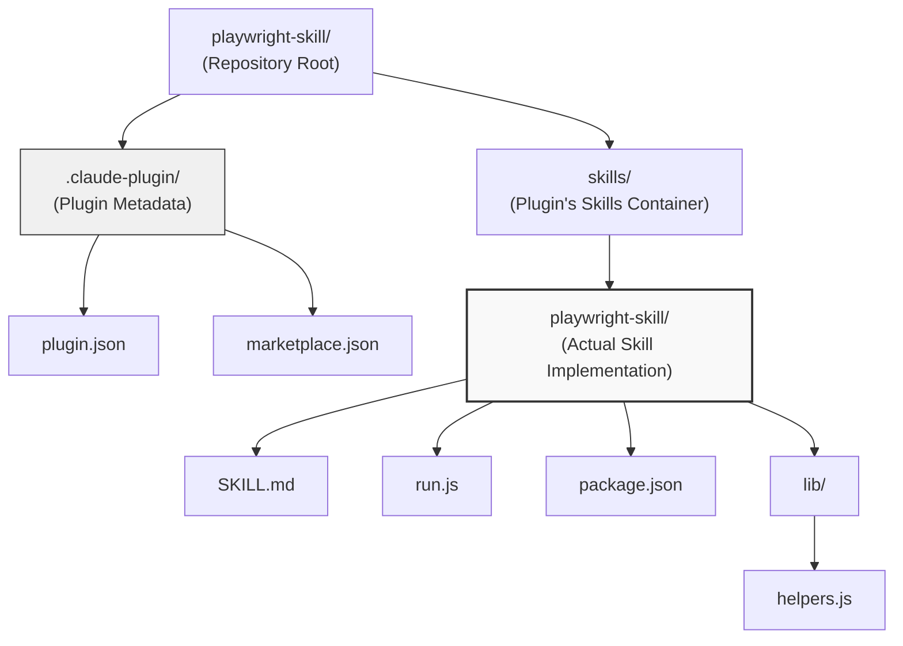
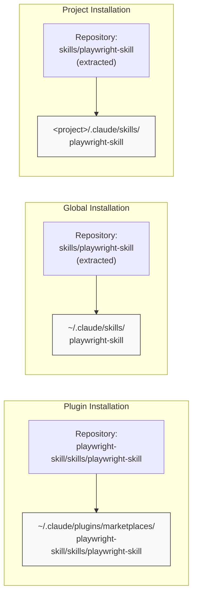
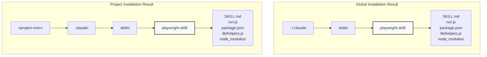
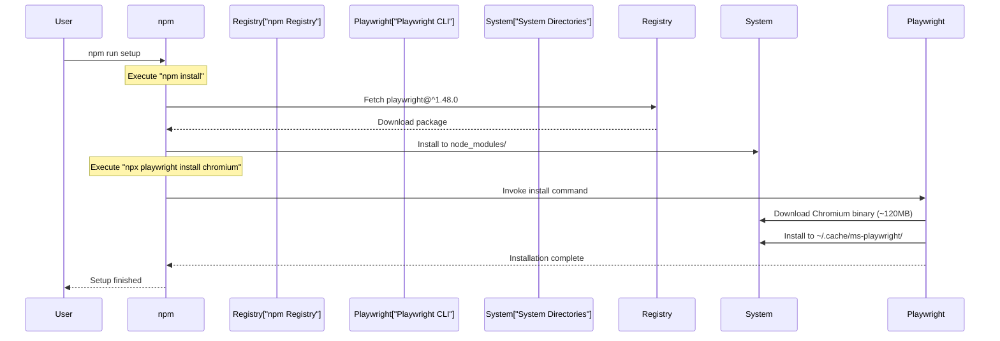
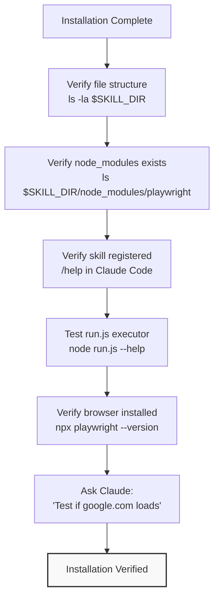

<!-- source: DeepWiki mcp.deepwiki.com · repo lackeyjb/playwright-skill · page 2.1 Installation · fetched 2026-10-26 -->

# Installation

<details>
<summary>Relevant source files</summary>

The following files were used as context for generating this wiki page:

- [.claude-plugin/marketplace.json](.claude-plugin/marketplace.json)
- [README.md](README.md)
- [skills/playwright-skill/package.json](skills/playwright-skill/package.json)

</details>


This document provides detailed instructions for installing the playwright-skill into your Claude Code environment. It covers the three installation methods (plugin system, manual global, and project-specific), explains the nested repository structure that requires special handling, and documents the post-installation setup process.

For information about configuring the skill after installation, see [Configuration and Setup](#2.3). For getting started with your first automation task, see [Quick Start](#2.2).

---

## Prerequisites

Before installing playwright-skill, ensure your system meets these requirements:

| Requirement | Version | Purpose |
|------------|---------|---------|
| Node.js | >= 14.0.0 | Runtime environment for executing JavaScript |
| npm | (bundled with Node.js) | Package manager for installing dependencies |
| Claude Code | Latest version | Platform for skill execution |
| Disk Space | ~500MB | Playwright library and Chromium browser |

**Sources:** [skills/playwright-skill/package.json:22-24]()

---

## Understanding the Repository Structure

The playwright-skill repository uses the Claude Code Plugin format, which creates a nested directory structure. This structure differs from a simple skill repository and requires special handling during installation.

### Repository Layout



**Key Insight:** The plugin format requires the `skills/` directory to organize multiple skills within a single plugin. However, Claude Code expects skills to be directly under `~/.claude/skills/` or `.claude/skills/`. This mismatch means **standalone installations must extract only the inner `skills/playwright-skill/` folder**.

**Sources:** [README.md:22-34]()

### Why This Structure Exists

The nested structure serves distinct purposes:

| Directory Level | Purpose | Required For |
|----------------|---------|--------------|
| `playwright-skill/` (root) | Plugin container with marketplace metadata | Plugin installation only |
| `.claude-plugin/` | Plugin metadata files (`plugin.json`, `marketplace.json`) | Plugin system registration |
| `skills/` | Container for one or more skills within the plugin | Plugin format compliance |
| `skills/playwright-skill/` | The actual skill implementation | All installation methods |

**Sources:** [README.md:95-96](), [.claude-plugin/marketplace.json:1-38]()

---

## Installation Methods

### Installation Path Mapping

Different installation methods place the skill in different locations, which affects the `$SKILL_DIR` variable used at runtime:



**Sources:** [README.md:37-93]()

---

### Option 1: Plugin Installation (Recommended)

Plugin installation uses Claude Code's built-in plugin system for automatic updates and centralized management. This method preserves the entire repository structure including plugin metadata.

#### Installation Commands

```bash
# Add the GitHub repository as a marketplace
/plugin marketplace add lackeyjb/playwright-skill

# Install the plugin from the marketplace
/plugin install playwright-skill@playwright-skill

# Navigate to the skill directory (note the nested path)
cd ~/.claude/plugins/marketplaces/playwright-skill/skills/playwright-skill

# Run the setup script to install dependencies
npm run setup
```

#### What Happens During Plugin Installation

```mermaid
sequenceDiagram
    participant User
    participant Claude["Claude Code<br/>Plugin System"]
    participant GitHub
    participant FileSystem["~/.claude/plugins/"]
    participant npm
    
    User->>Claude: /plugin marketplace add lackeyjb/playwright-skill
    Claude->>GitHub: Fetch marketplace.json
    GitHub-->>Claude: Repository metadata
    Claude->>FileSystem: Register marketplace
    
    User->>Claude: /plugin install playwright-skill@playwright-skill
    Claude->>GitHub: Clone repository
    GitHub-->>FileSystem: Write entire structure<br/>marketplaces/playwright-skill/
    Claude->>FileSystem: Symlink to skills registry
    
    User->>FileSystem: cd ~/.claude/plugins/.../skills/playwright-skill
    User->>npm: npm run setup
    npm->>npm: npm install (Playwright ^1.48.0)
    npm->>npm: npx playwright install chromium
    npm-->>User: Setup complete
```

#### Verification

After installation, verify the skill is registered:

```bash
# Check that the skill directory exists
ls -la ~/.claude/plugins/marketplaces/playwright-skill/skills/playwright-skill

# Verify dependencies are installed
ls -la ~/.claude/plugins/marketplaces/playwright-skill/skills/playwright-skill/node_modules/playwright

# In Claude Code, run:
/help
# The playwright-skill should appear in the skills list
```

**Sources:** [README.md:37-54](), [.claude-plugin/marketplace.json:1-38]()

---

### Option 2: Standalone Skill Installation

Standalone installation extracts only the skill folder from the repository, bypassing the plugin system. This is useful for development, testing, or when plugin system access is unavailable.

#### Global Installation

Global installation makes the skill available to all Claude Code sessions on the system.

```bash
# Clone repository to temporary location
git clone https://github.com/lackeyjb/playwright-skill.git /tmp/playwright-skill-temp

# Create global skills directory if it doesn't exist
mkdir -p ~/.claude/skills

# Extract and copy ONLY the inner skill folder
cp -r /tmp/playwright-skill-temp/skills/playwright-skill ~/.claude/skills/

# Navigate to the skill directory
cd ~/.claude/skills/playwright-skill

# Run setup script
npm run setup

# Clean up temporary clone
rm -rf /tmp/playwright-skill-temp
```

**Critical:** The command copies `skills/playwright-skill` (the inner folder), not the repository root. This avoids the nested structure:

```
❌ WRONG: ~/.claude/skills/playwright-skill/skills/playwright-skill
✅ CORRECT: ~/.claude/skills/playwright-skill
```

#### Project-Specific Installation

Project-specific installation limits the skill to a single project, useful for project-specific customizations or testing.

```bash
# Clone repository to temporary location
git clone https://github.com/lackeyjb/playwright-skill.git /tmp/playwright-skill-temp

# Create project skills directory
mkdir -p .claude/skills

# Extract and copy ONLY the inner skill folder
cp -r /tmp/playwright-skill-temp/skills/playwright-skill .claude/skills/

# Navigate to the skill directory
cd .claude/skills/playwright-skill

# Run setup script
npm run setup

# Clean up temporary clone
rm -rf /tmp/playwright-skill-temp
```

#### File Structure After Standalone Installation



**Sources:** [README.md:58-93]()

---

### Option 3: Release Download

For air-gapped systems or specific version requirements, download a pre-packaged release.

```bash
# Download the latest release archive
# Visit: https://github.com/lackeyjb/playwright-skill/releases
# Download: playwright-skill-vX.Y.Z.tar.gz

# Extract the archive
tar -xzf playwright-skill-vX.Y.Z.tar.gz

# Copy ONLY the skills/playwright-skill folder
# For global installation:
cp -r playwright-skill-vX.Y.Z/skills/playwright-skill ~/.claude/skills/

# For project-specific installation:
cp -r playwright-skill-vX.Y.Z/skills/playwright-skill .claude/skills/

# Navigate and setup
cd ~/.claude/skills/playwright-skill  # or .claude/skills/playwright-skill
npm run setup
```

**Sources:** [README.md:99-109]()

---

## Post-Installation Setup

After placing the skill files, the `npm run setup` command must be executed to install dependencies and configure browsers.

### The Setup Script

The setup script is defined in [skills/playwright-skill/package.json:8]():

```json
"scripts": {
  "setup": "npm install && npx playwright install chromium"
}
```

### Setup Process Flow



### What Gets Installed

| Component | Version | Size | Location | Purpose |
|-----------|---------|------|----------|---------|
| `playwright` (npm package) | ^1.48.0 | ~20MB | `node_modules/playwright/` | JavaScript API library |
| Chromium browser | Latest compatible | ~120MB | `~/.cache/ms-playwright/chromium-*/` | Browser automation target |

**Sources:** [skills/playwright-skill/package.json:8](), [skills/playwright-skill/package.json:19-21]()

### Installing Additional Browsers

The default setup only installs Chromium. To install Firefox and WebKit:

```bash
cd $SKILL_DIR  # Navigate to skill directory
npm run install-all-browsers
```

This executes: `npx playwright install chromium firefox webkit` [skills/playwright-skill/package.json:9]()

---

## Verification

After installation and setup, verify the skill is functional.

### Verification Checklist



### Verification Commands

**1. Verify file structure:**
```bash
# For plugin installation:
ls -la ~/.claude/plugins/marketplaces/playwright-skill/skills/playwright-skill

# For global installation:
ls -la ~/.claude/skills/playwright-skill

# Expected files:
# SKILL.md, run.js, package.json, lib/, node_modules/
```

**2. Verify Playwright installation:**
```bash
cd $SKILL_DIR
npx playwright --version
# Expected: Version 1.48.0 (or higher)
```

**3. Verify skill registration:**
```bash
# In Claude Code, execute:
/help

# Output should include:
# playwright-skill - Browser automation with Playwright
```

**4. Test execution:**
```bash
cd $SKILL_DIR
node run.js --help
# Should display usage information without errors
```

**5. Run a simple automation:**

In Claude Code, ask: `"Test if google.com loads"`

Claude should:
1. Recognize the browser automation request
2. Generate Playwright code
3. Execute via `run.js`
4. Open a browser window
5. Navigate to google.com
6. Return results with screenshots

**Sources:** [README.md:113-116](), [README.md:197-206]()

---

## Troubleshooting

### Common Installation Issues

| Issue | Cause | Solution |
|-------|-------|----------|
| **"Cannot find module 'playwright'"** | Dependencies not installed | Run `npm run setup` in skill directory |
| **"Executable doesn't exist at /path/to/chromium"** | Browser not installed | Run `npx playwright install chromium` |
| **Nested directory structure** | Copied entire repository instead of skill folder | Extract only `skills/playwright-skill/` folder |
| **"Skill not found"** | Skill not in correct location | Verify path: `~/.claude/skills/playwright-skill` or `.claude/skills/playwright-skill` |
| **npm install fails** | Node.js version incompatible | Ensure Node.js >= 14.0.0 |
| **Permission denied** | Insufficient file permissions | Run with appropriate permissions or use `sudo` (not recommended for npm) |

### Directory Structure Validation

If uncertain about the installation, validate the directory structure:

```bash
# Check that these files exist in the skill directory:
ls $SKILL_DIR/SKILL.md
ls $SKILL_DIR/run.js
ls $SKILL_DIR/package.json
ls $SKILL_DIR/lib/helpers.js

# Check that dependencies are installed:
ls $SKILL_DIR/node_modules/playwright

# If any file is missing, repeat installation from the correct source path
```

### Module Resolution Test

Test that module resolution works correctly:

```bash
cd $SKILL_DIR
node -e "const playwright = require('playwright'); console.log('Playwright loaded:', playwright.chromium);"

# Expected: Should print Playwright chromium object
# If error: Dependencies not installed or wrong directory
```

**Sources:** [README.md:197-206]()

---

## Installation Path Summary

This table summarizes where files are located for each installation method:

| Installation Method | Skill Directory Path | Command Prefix |
|---------------------|----------------------|----------------|
| Plugin (via marketplace) | `~/.claude/plugins/marketplaces/playwright-skill/skills/playwright-skill` | `cd ~/.claude/plugins/marketplaces/playwright-skill/skills/playwright-skill &&` |
| Global (manual) | `~/.claude/skills/playwright-skill` | `cd ~/.claude/skills/playwright-skill &&` |
| Project-specific (manual) | `<project>/.claude/skills/playwright-skill` | `cd .claude/skills/playwright-skill &&` |

The `$SKILL_DIR` variable is dynamically resolved at runtime based on which installation method was used. All skill commands must be prefixed with `cd $SKILL_DIR` to ensure proper module resolution. See [Path Resolution and $SKILL_DIR](#4.6) for details.

**Sources:** [README.md:18-116]()

---

## Next Steps

After successful installation and verification:

1. **Quick Start:** Follow [Quick Start](#2.2) to run your first automation
2. **Configuration:** Review [Configuration and Setup](#2.3) for customization options
3. **Documentation:** Familiarize yourself with the skill's capabilities by reviewing `SKILL.md` in the skill directory
4. **Helper Functions:** Explore `lib/helpers.js` for utility functions like `detectDevServers`, `safeClick`, and `takeScreenshot`

**Sources:** [README.md:117-119]()

---

