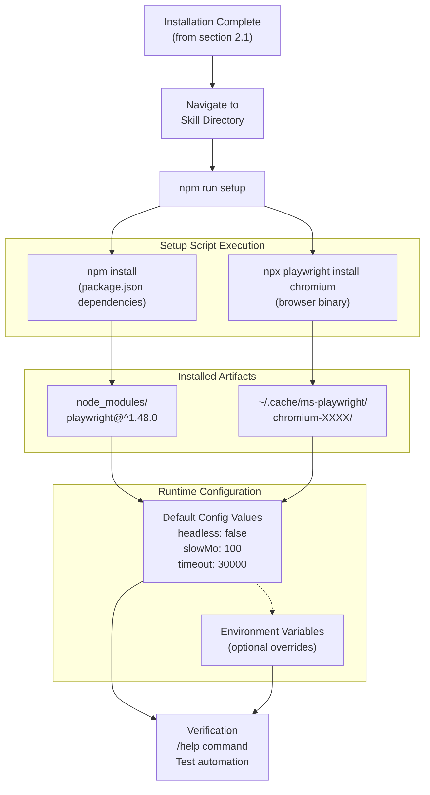
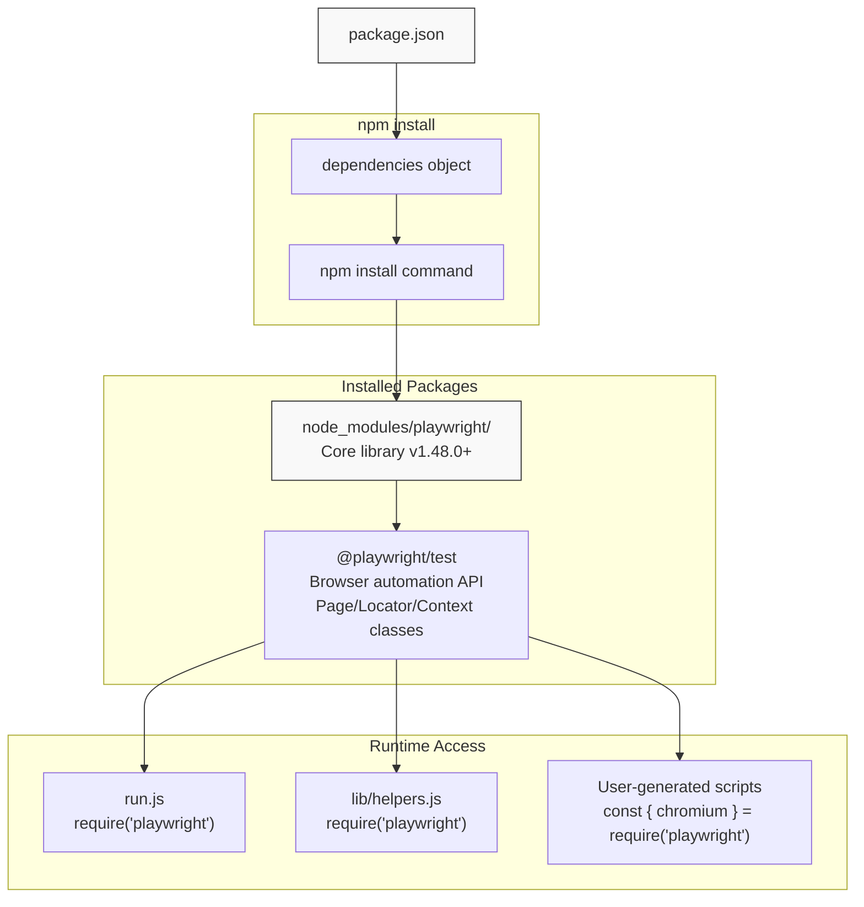
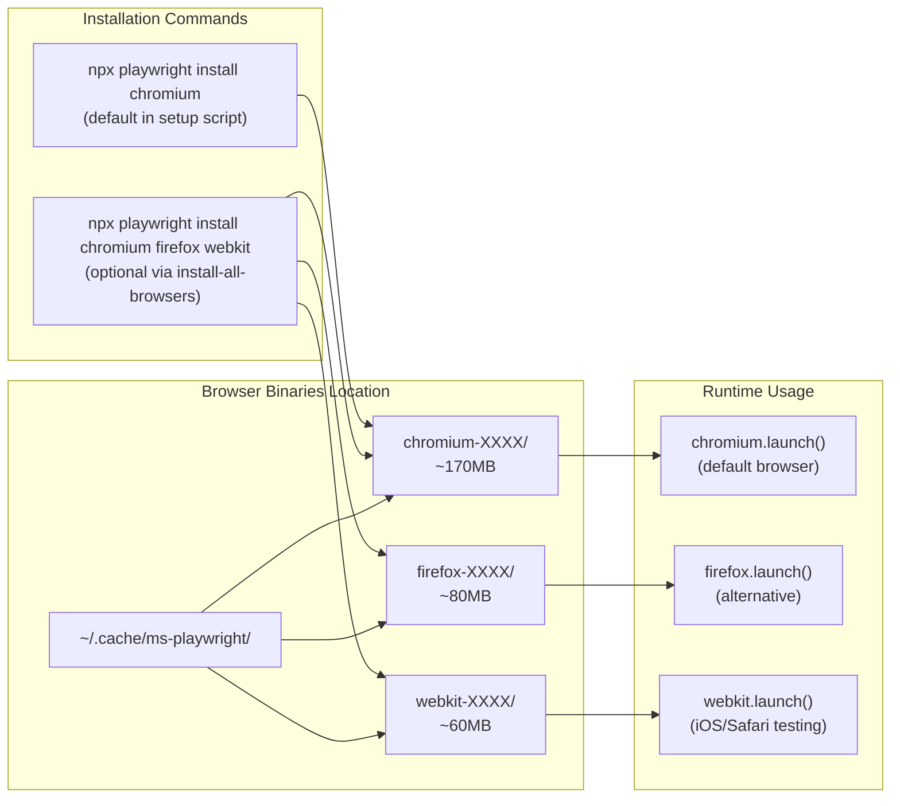
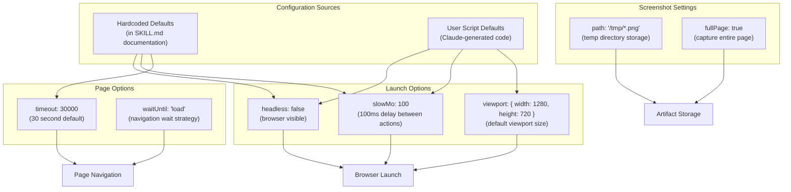
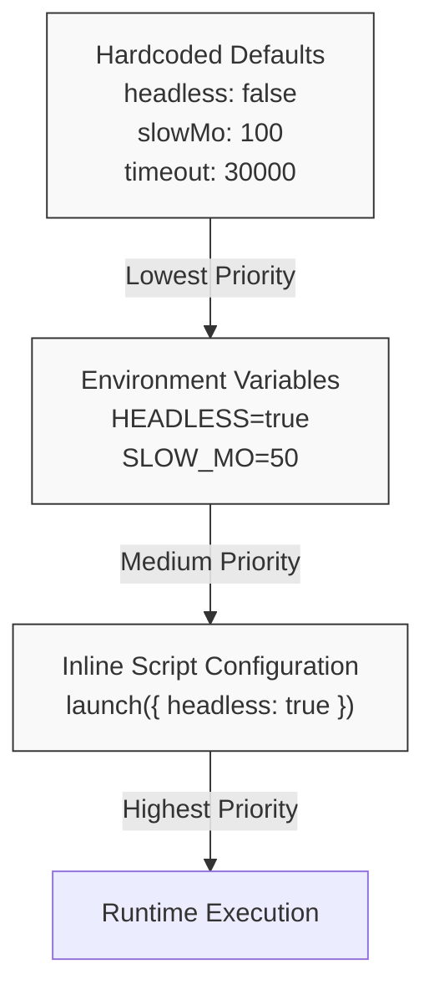
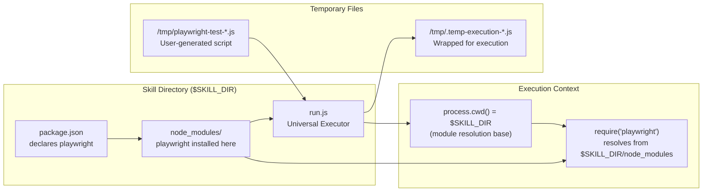

<!-- source: DeepWiki mcp.deepwiki.com · repo lackeyjb/playwright-skill · page 2.3 Configuration and Setup · fetched 2026-10-26 -->

# Configuration and Setup

<details>
<summary>Relevant source files</summary>

The following files were used as context for generating this wiki page:

- [README.md](README.md)
- [skills/playwright-skill/SKILL.md](skills/playwright-skill/SKILL.md)
- [skills/playwright-skill/package.json](skills/playwright-skill/package.json)

</details>


This page explains the initial configuration and setup process for the playwright-skill after installation. It covers running the `npm run setup` command, understanding what gets installed, configuring default browser behavior, and verifying the installation is working correctly.

For installation instructions (extracting the nested skill folder, choosing between plugin/global/project installation), see [Installation](#2.1). For guidance on running your first automation task, see [Quick Start](#2.2).

---

## Purpose and Scope

The setup process prepares the playwright-skill runtime environment by:
1. Installing npm dependencies (Playwright library)
2. Installing browser binaries (Chromium by default)
3. Establishing default configuration values
4. Verifying proper module resolution

This is a one-time process required before the skill can execute browser automation tasks.

---

## Setup Process Overview



**Setup Process Flow**: After installation, users navigate to the skill directory and execute `npm run setup`, which triggers two sequential operations: npm dependency installation and Chromium browser download. These artifacts enable runtime execution with default configuration values that can be overridden via environment variables.

Sources: [README.md:46-53](), [skills/playwright-skill/package.json:7-9](), [skills/playwright-skill/SKILL.md:46-53]()

---

## Running the Setup Command

The setup command must be executed from the skill directory, which varies based on installation method:

### Determining Skill Directory Location

| Installation Method | Skill Directory Path |
|-------------------|---------------------|
| Plugin System | `~/.claude/plugins/marketplaces/playwright-skill/skills/playwright-skill` |
| Manual Global | `~/.claude/skills/playwright-skill` |
| Project-Specific | `<project>/.claude/skills/playwright-skill` |

### Executing Setup

```bash
# Navigate to skill directory (example: global installation)
cd ~/.claude/skills/playwright-skill

# Run setup script
npm run setup
```

The `setup` script is defined in [skills/playwright-skill/package.json:8]() as:

```
"setup": "npm install && npx playwright install chromium"
```

This executes two operations sequentially:
1. `npm install` - Installs dependencies declared in `package.json`
2. `npx playwright install chromium` - Downloads Chromium browser binary

Sources: [README.md:46-53](), [skills/playwright-skill/package.json:7-9](), [skills/playwright-skill/SKILL.md:46-53]()

---

## Dependency Installation



**Dependency Resolution**: The `package.json` declares Playwright ^1.48.0 as the sole runtime dependency. When `npm install` executes, it installs the Playwright library into `node_modules/`, making it available via `require('playwright')` statements in `run.js`, `lib/helpers.js`, and user-generated automation scripts.

### Package Dependencies

The [skills/playwright-skill/package.json:19-21]() declares:

```json
"dependencies": {
  "playwright": "^1.48.0"
}
```

The caret (`^`) allows minor and patch version updates while preventing breaking changes from major version upgrades.

### Engine Requirements

The [skills/playwright-skill/package.json:22-24]() specifies:

```json
"engines": {
  "node": ">=14.0.0"
}
```

Node.js 14.0.0 or higher is required for Playwright compatibility.

Sources: [skills/playwright-skill/package.json:19-24]()

---

## Browser Installation



**Browser Binary Management**: Playwright downloads browser binaries to `~/.cache/ms-playwright/` (Linux/macOS) or `%USERPROFILE%\AppData\Local\ms-playwright` (Windows). The default setup installs only Chromium to minimize download time and disk usage. Alternative browsers can be installed via the `install-all-browsers` script.

### Default Browser (Chromium)

The `setup` script installs Chromium only:

```bash
npx playwright install chromium
```

Chromium is the default browser for several reasons:
- Fastest download (~170MB vs ~310MB for all three)
- Most common browser for web automation
- Supports all Playwright features
- Consistent across platforms

### Installing All Browsers

To install Firefox and WebKit in addition to Chromium, run:

```bash
cd $SKILL_DIR
npm run install-all-browsers
```

This executes the script defined in [skills/playwright-skill/package.json:9]():

```
"install-all-browsers": "npx playwright install chromium firefox webkit"
```

### Browser Binary Storage

Browser binaries are stored in Playwright's cache directory:
- **Linux/macOS**: `~/.cache/ms-playwright/`
- **Windows**: `%USERPROFILE%\AppData\Local\ms-playwright`

Each browser version is stored in a separate directory (e.g., `chromium-1097`, `firefox-1437`).

Sources: [README.md:206-208](), [skills/playwright-skill/package.json:8-9](), [skills/playwright-skill/SKILL.md:354-356]()

---

## Default Configuration



**Default Configuration Values**: The skill uses sensible defaults optimized for visibility and debuggability. Browsers launch visibly (`headless: false`) with 100ms slow motion between actions, making automation easy to observe and debug. Screenshots save to `/tmp/` for automatic OS cleanup.

### Browser Launch Defaults

| Option | Default Value | Purpose |
|--------|--------------|---------|
| `headless` | `false` | Browser window visible for debugging |
| `slowMo` | `100` | 100ms delay between actions for visibility |
| `timeout` | `30000` | 30 second default timeout for operations |

These defaults are documented in [README.md:160-164]() and [skills/playwright-skill/SKILL.md:344-346]().

### Viewport Configuration

Default viewport size is typically `1280x720` for desktop testing. This can be customized per-script using:

```javascript
await page.setViewportSize({ width: 1920, height: 1080 });
```

Examples of viewport customization appear in [skills/playwright-skill/SKILL.md:94-118]().

### Screenshot Storage

All screenshots are saved to `/tmp/` directory by default:

```javascript
await page.screenshot({ path: '/tmp/screenshot.png', fullPage: true });
```

This prevents cluttering the user's project with test artifacts and relies on OS automatic cleanup of temporary files.

Sources: [README.md:158-165](), [skills/playwright-skill/SKILL.md:33,79,346]()

---

## Environment Variable Overrides

Configuration defaults can be overridden using environment variables:

| Environment Variable | Purpose | Example |
|---------------------|---------|---------|
| `TARGET_URL` | Override auto-detected URL | `TARGET_URL=http://localhost:8080` |
| `HEADLESS` | Force headless mode | `HEADLESS=true` |
| `SLOW_MO` | Adjust slow motion delay | `SLOW_MO=50` |

### Configuration Precedence



**Configuration Precedence Hierarchy**: Configuration values follow a three-tier precedence system. Hardcoded defaults provide baseline values, environment variables override defaults for session-wide configuration, and inline script settings override both for per-execution customization.

### Target URL Parameterization

The skill emphasizes URL parameterization to avoid hardcoded values. [skills/playwright-skill/SKILL.md:69-70]() shows the pattern:

```javascript
// Parameterized URL (detected or user-provided)
const TARGET_URL = 'http://localhost:3001'; // <-- Auto-detected or from user
```

This constant appears at the top of every generated script, making the URL explicit and easily modifiable.

Sources: [skills/playwright-skill/SKILL.md:34,69-70,344]()

---

## Verification and Testing

After setup completes, verify the installation is working correctly:

### Verify Skill Registration

Run the `/help` command in Claude Code to confirm the skill appears in the registered skills list.

### Test Basic Automation

Request a simple automation task from Claude:

```
"Test if google.com loads"
```

Claude should:
1. Load the skill instructions from `SKILL.md`
2. Generate a Playwright script
3. Execute it via `run.js`
4. Return results with console output

### Expected Output

Successful execution produces:
- Browser window opens visibly (unless headless requested)
- Console output showing progress
- Screenshot saved to `/tmp/`
- Browser closes automatically

Example output pattern from [skills/playwright-skill/SKILL.md:72-83]():

```
Page loaded: Google
📸 Screenshot saved to /tmp/screenshot.png
```

Sources: [README.md:113-119](), [skills/playwright-skill/SKILL.md:369-380]()

---

## Module Resolution Verification



**Module Resolution Strategy**: The `run.js` executor ensures proper module resolution by maintaining `process.cwd()` at the skill directory location. When user scripts contain `require('playwright')`, Node.js resolves the dependency from `$SKILL_DIR/node_modules/`, preventing "module not found" errors regardless of where the temporary script file is stored.

### Critical Path Resolution

The skill directory path (`$SKILL_DIR`) must be correctly resolved for module access. [skills/playwright-skill/SKILL.md:9-15]() documents:

```
Common installation paths:
- Plugin system: ~/.claude/plugins/marketplaces/playwright-skill/skills/playwright-skill
- Manual global: ~/.claude/skills/playwright-skill
- Project-specific: <project>/.claude/skills/playwright-skill
```

All commands require the `cd $SKILL_DIR &&` prefix to ensure proper module resolution context.

### Verifying Module Access

To verify Playwright is accessible, run:

```bash
cd $SKILL_DIR
node -e "console.log(require('playwright').chromium)"
```

This should output the chromium browser object definition without errors.

Sources: [skills/playwright-skill/SKILL.md:9-15,42,89]()

---

## Troubleshooting Setup Issues

### Playwright Not Installed

**Symptom**: Error message `Cannot find module 'playwright'`

**Solution**: Run setup from the skill directory:

```bash
cd $SKILL_DIR
npm run setup
```

Reference: [README.md:198-199](), [skills/playwright-skill/SKILL.md:353-356]()

### Browser Installation Failed

**Symptom**: Error message `Executable doesn't exist at /path/to/chromium`

**Solution**: Manually install browser binaries:

```bash
cd $SKILL_DIR
npx playwright install chromium
```

### Module Resolution Errors

**Symptom**: Error message `Error: Cannot find module 'playwright'` during script execution

**Solution**: Ensure commands run from skill directory:

```bash
cd $SKILL_DIR && node run.js /tmp/playwright-test-*.js
```

The `cd $SKILL_DIR` prefix is critical for proper module resolution. See [Path Resolution and $SKILL_DIR](#4.6) for details.

### Permission Errors

**Symptom**: `EACCES: permission denied` during npm install

**Solution**: Check directory permissions or use npm's `--prefix` flag:

```bash
npm install --prefix $SKILL_DIR
```

Sources: [README.md:196-208](), [skills/playwright-skill/SKILL.md:353-365]()

---

## Next Steps

After completing setup:
- Proceed to [Quick Start](#2.2) for your first automation task
- Review [SKILL.md Instructions](#4.4) to understand how Claude generates automation code
- Explore [Common Automation Patterns](#5.2) for typical use cases
- Consult [Configuration Options](#9.1) for advanced customization

Sources: [README.md:117-156]()

---

