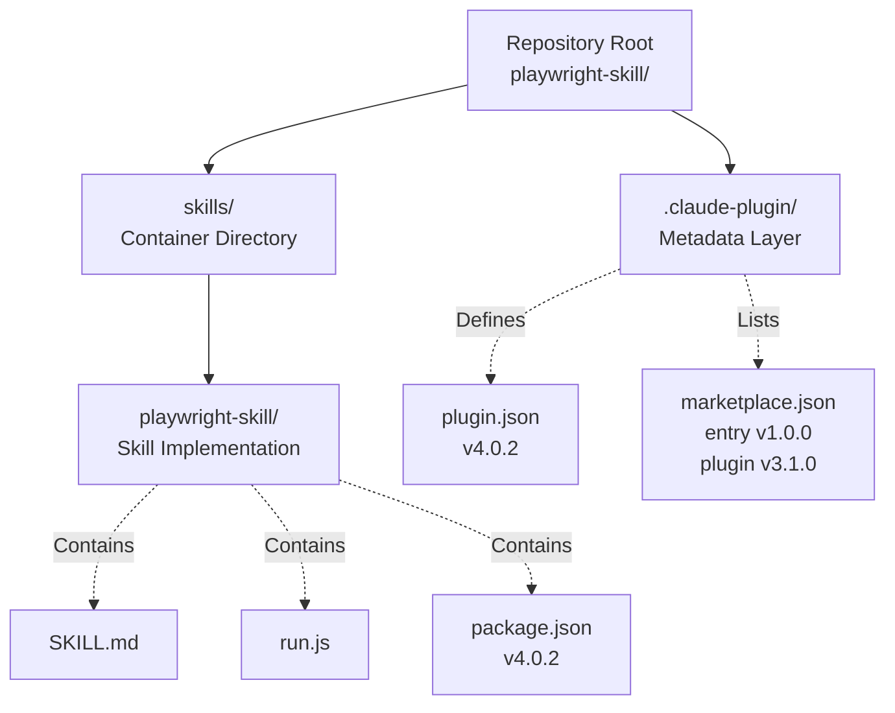
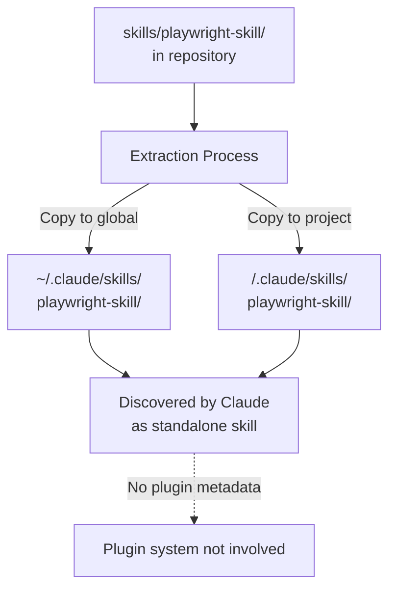
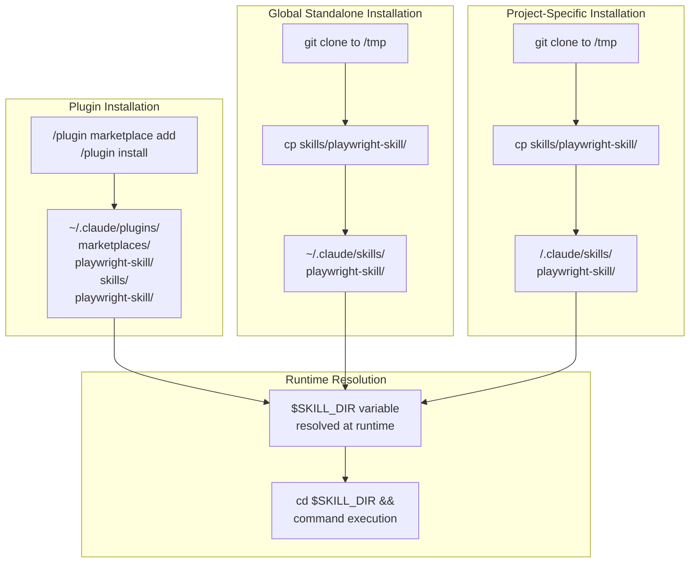
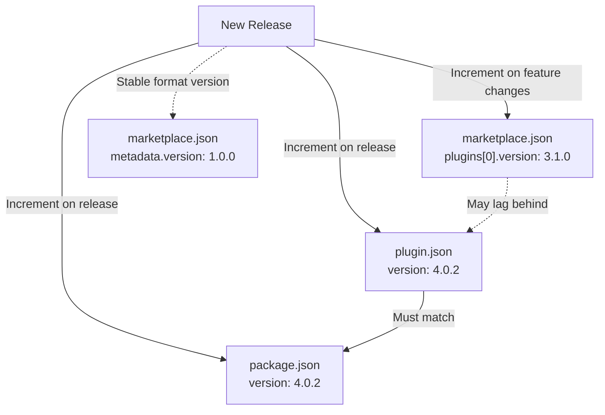
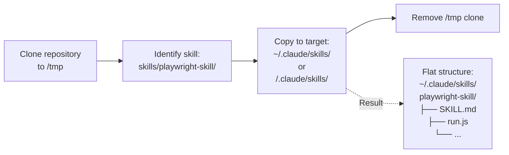
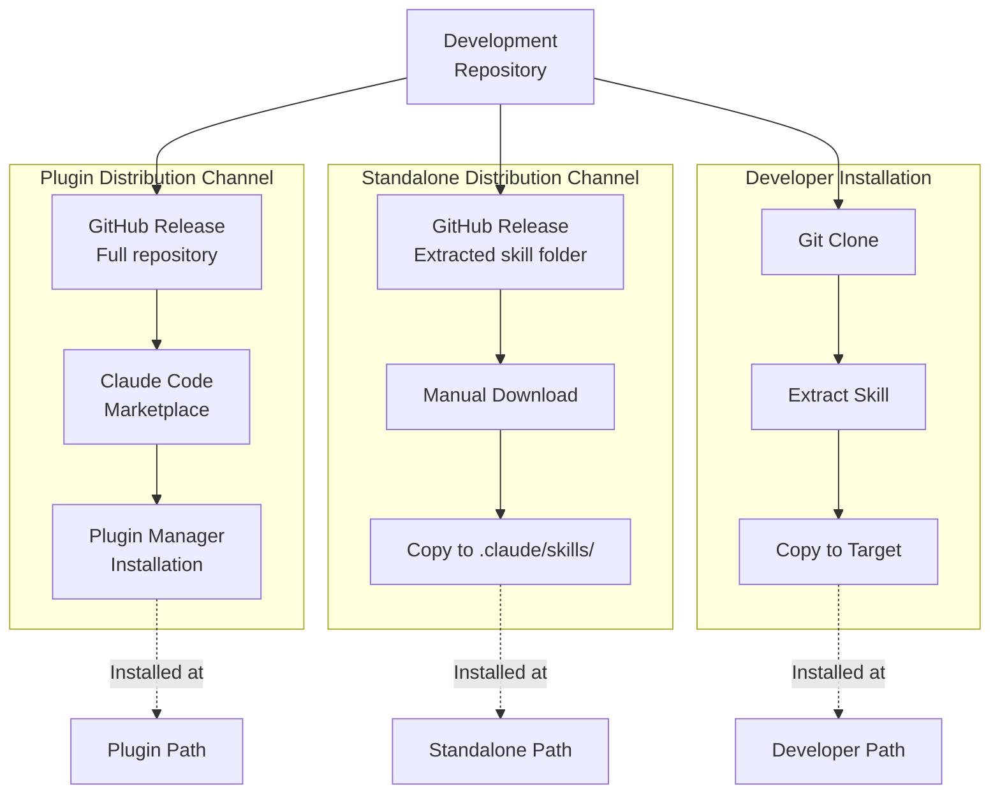

<!-- source: DeepWiki mcp.deepwiki.com · repo lackeyjb/playwright-skill · page 3.2 Distribution Model · fetched 2026-10-26 -->

# Distribution Model

<details>
<summary>Relevant source files</summary>

The following files were used as context for generating this wiki page:

- [.claude-plugin/marketplace.json](.claude-plugin/marketplace.json)
- [.claude-plugin/plugin.json](.claude-plugin/plugin.json)
- [README.md](README.md)

</details>


## Purpose and Scope

This document explains the dual distribution strategy of playwright-skill as both a Claude Code Plugin and standalone skill. It covers the nested directory structure, the rationale for this architecture, installation path resolution, and the metadata files that enable distribution through different channels. For step-by-step installation instructions, see [Installation](#2.1). For technical details on how `$SKILL_DIR` is resolved at runtime, see [Path Resolution and $SKILL_DIR](#4.6).

---

## Nested Directory Structure

The playwright-skill repository uses a nested structure designed to accommodate both plugin-based and standalone distribution:

```
playwright-skill/                    # Repository root (plugin format)
├── .claude-plugin/                 # Plugin metadata layer
│   ├── plugin.json                 # Plugin definition (v4.0.2)
│   └── marketplace.json            # Marketplace listing
├── skills/                         # Skills container (plugin requirement)
│   └── playwright-skill/           # Actual skill implementation
│       ├── SKILL.md                # Instructions for Claude
│       ├── run.js                  # Universal executor
│       ├── package.json            # Dependencies (v4.0.2)
│       └── lib/
│           └── helpers.js          # Utility functions
├── API_REFERENCE.md                # Full API documentation
├── README.md                       # User documentation
└── CONTRIBUTING.md                 # Developer guidelines
```

The nested `skills/` directory exists because the [Claude Code Plugin format](https://docs.claude.com/en/docs/claude-code/plugins) requires a container for organizing multiple skills within a single plugin. This separation creates two distinct layers:

1. **Plugin Layer** (`.claude-plugin/` + root structure): Metadata, marketplace configuration, and documentation
2. **Skill Layer** (`skills/playwright-skill/`): The functional implementation that Claude discovers and executes

**Sources:** [README.md:22-34](), [README.md:166-184]()

---

## Dual Distribution Formats

### Plugin Distribution Format

The complete repository structure is distributed as a Claude Code Plugin, maintaining all nested directories:



**Distribution Path for Plugins:**
- Installed to: `~/.claude/plugins/marketplaces/playwright-skill/skills/playwright-skill/`
- Complete nested structure preserved
- Managed by Claude Code's plugin system
- Supports automatic updates

**Sources:** [README.md:20-34](), [README.md:37-53](), [.claude-plugin/plugin.json:1-21]()

---

### Standalone Skill Format

For standalone installation, only the inner `skills/playwright-skill/` directory is extracted and distributed:



**Extraction Requirement:** Claude Code expects skills to be directly under `.claude/skills/`, not nested within additional directories. The `skills/` container directory is a plugin-specific requirement and must be removed for standalone installations.

**Sources:** [README.md:33-34](), [README.md:57-96]()

---

## Installation Paths and Discovery

### Three Installation Methods

The skill can be installed in three different locations, each with its own discovery path and use case:

| Installation Method | Target Path | Discovery Path | Use Case |
|---------------------|-------------|----------------|----------|
| **Plugin System** | `~/.claude/plugins/marketplaces/playwright-skill/skills/playwright-skill/` | Plugin manager | Centralized management, automatic updates, team distribution |
| **Global Standalone** | `~/.claude/skills/playwright-skill/` | Global skill registry | Available to all projects, manual updates |
| **Project-Specific** | `<project>/.claude/skills/playwright-skill/` | Project-local | Project isolation, version control |

**Sources:** [README.md:37-110]()

---

### Installation Path Resolution Diagram



**Sources:** [README.md:41-110]()

---

## Metadata Files and Versioning

### Plugin Metadata: plugin.json

Location: [.claude-plugin/plugin.json:1-21]()

```json
{
  "name": "playwright-skill",
  "version": "4.0.2",
  "description": "Claude Code Skill for general-purpose browser automation...",
  "author": { "name": "lackeyjb" },
  "license": "MIT",
  "repository": "https://github.com/lackeyjb/playwright-skill",
  "keywords": [
    "claude-skill", "claude-code", "playwright",
    "browser-automation", "testing", "e2e",
    "web-testing", "automation", "model-invoked"
  ]
}
```

**Purpose:** Defines the plugin for Claude Code's plugin system. This file is read by the plugin manager during installation and registration.

**Key Fields:**
- `name`: Plugin identifier used in installation commands
- `version`: Plugin version (v4.0.2)
- `repository`: Source repository for distribution
- `keywords`: Search and discovery metadata

**Sources:** [.claude-plugin/plugin.json:1-21]()

---

### Marketplace Metadata: marketplace.json

Location: [.claude-plugin/marketplace.json:1-38]()

```json
{
  "name": "playwright-skill",
  "owner": { "name": "lackeyjb", "email": "github@lackeyjb" },
  "metadata": {
    "description": "Playwright browser automation skill for Claude Code",
    "version": "1.0.0"
  },
  "plugins": [
    {
      "name": "playwright-skill",
      "source": "./",
      "version": "3.1.0",
      "category": "testing",
      "tags": ["browser", "automation", "playwright", "testing", "e2e"]
    }
  ]
}
```

**Dual Versioning:**
- **Marketplace entry version:** `1.0.0` ([.claude-plugin/marketplace.json:9]()) - Version of the marketplace listing format
- **Plugin version:** `3.1.0` ([.claude-plugin/marketplace.json:16]()) - Version of the plugin listed in the marketplace
- **Package version:** `4.0.2` ([.claude-plugin/plugin.json:3]()) - Current plugin version

The marketplace entry version remains stable while plugin versions increment with releases.

**Purpose:** Configures the plugin for distribution through Claude Code's marketplace system. Enables discovery, categorization, and listing of the plugin.

**Sources:** [.claude-plugin/marketplace.json:1-38]()

---

### Skill Package Metadata: package.json

Location: `skills/playwright-skill/package.json`

The skill implementation has its own `package.json` that defines:
- npm dependencies (Playwright ^1.48.0)
- Setup scripts (`npm run setup`, `npm run install-all-browsers`)
- Version alignment with plugin (v4.0.2)

This file is used by `run.js` for dependency resolution and by the setup process for installing Playwright and browser engines.

**Sources:** [README.md:193-194]()

---

## Version Synchronization Strategy



**Versioning Rules:**
1. `plugin.json` version and `package.json` version must remain synchronized
2. `marketplace.json` plugin version increments on significant feature additions
3. `marketplace.json` metadata version remains stable (format version, not release version)

**Sources:** [.claude-plugin/plugin.json:3](), [.claude-plugin/marketplace.json:9](), [.claude-plugin/marketplace.json:16]()

---

## Extraction Process for Standalone Distribution

### Manual Extraction Steps

For standalone installation, the inner skill directory must be extracted from the nested structure:



**Commands:**
```bash
# Clone to temporary location
git clone https://github.com/lackeyjb/playwright-skill.git /tmp/playwright-skill-temp

# Extract only the skill folder
cp -r /tmp/playwright-skill-temp/skills/playwright-skill ~/.claude/skills/

# Clean up
rm -rf /tmp/playwright-skill-temp
```

**Why Extraction is Required:** The `skills/` container directory is a plugin-specific structure. Claude Code's skill discovery expects skills to be directly under `.claude/skills/`, not nested within additional directories.

**Sources:** [README.md:59-76]()

---

## File System Layout Comparison

### Plugin Installation Layout

```
~/.claude/plugins/marketplaces/playwright-skill/
├── .claude-plugin/
│   ├── plugin.json                    # Plugin metadata
│   └── marketplace.json               # Marketplace config
├── skills/
│   └── playwright-skill/              # ← $SKILL_DIR points here
│       ├── SKILL.md
│       ├── run.js
│       ├── package.json
│       ├── node_modules/              # Installed dependencies
│       └── lib/
│           └── helpers.js
├── API_REFERENCE.md
├── README.md
└── CONTRIBUTING.md
```

**Discovery:** Plugin manager registers the nested skill path.

---

### Standalone Installation Layout

```
~/.claude/skills/playwright-skill/     # ← $SKILL_DIR points here
├── SKILL.md
├── run.js
├── package.json
├── node_modules/                      # Installed dependencies
└── lib/
    └── helpers.js
```

**Discovery:** Claude Code scans `.claude/skills/` for skill directories.

**Note:** Plugin metadata (`.claude-plugin/`) is not present in standalone installations. The skill operates independently without plugin system integration.

**Sources:** [README.md:22-34](), [README.md:166-184]()

---

## Path Resolution and Command Execution

All commands in the skill's `SKILL.md` instructions are prefixed with `cd $SKILL_DIR &&` to ensure proper module resolution regardless of installation method:

```bash
# Example command structure
cd $SKILL_DIR && node run.js /tmp/playwright-test-*.js
```

The `$SKILL_DIR` variable is dynamically resolved by Claude Code based on where the skill is installed:

| Installation Method | `$SKILL_DIR` Resolution |
|---------------------|-------------------------|
| Plugin | `~/.claude/plugins/marketplaces/playwright-skill/skills/playwright-skill` |
| Global Standalone | `~/.claude/skills/playwright-skill` |
| Project-Specific | `<project>/.claude/skills/playwright-skill` |

This abstraction allows the same skill instructions to work across all installation methods without hardcoding paths. For detailed information on path resolution mechanics, see [Path Resolution and $SKILL_DIR](#4.6).

**Sources:** [README.md:41-110]()

---

## Distribution Workflow



**Sources:** [README.md:18-110]()

---

## Design Rationale

### Why Nested Structure?

The nested structure serves multiple purposes:

1. **Plugin Format Compliance:** Claude Code's plugin system requires a `skills/` directory for organizing skills within plugins
2. **Clear Separation:** Plugin-level concerns (distribution, marketplace) vs. skill-level concerns (functionality)
3. **Multiple Skill Support:** The structure allows a single plugin to contain multiple skills (future extensibility)
4. **Metadata Organization:** Plugin metadata (`.claude-plugin/`) is separate from skill implementation

### Why Extraction for Standalone?

Standalone installations require extraction because:

1. **Flat Discovery:** Claude Code's skill discovery scans directly under `.claude/skills/` without traversing nested structures
2. **Simplicity:** Standalone skills don't need plugin metadata or container directories
3. **Consistency:** Matches the expected structure for skills created without the plugin system

**Sources:** [README.md:20-34](), [README.md:95-96]()

---

## Distribution Checklist

When preparing a new release, ensure consistency across metadata files:

- [ ] Update version in [.claude-plugin/plugin.json:3]()
- [ ] Update version in `skills/playwright-skill/package.json`
- [ ] Consider updating plugin version in [.claude-plugin/marketplace.json:16]() if adding significant features
- [ ] Tag release in git with version number
- [ ] Create GitHub release with full repository archive
- [ ] Optionally create standalone distribution by packaging only `skills/playwright-skill/` directory

**Sources:** [.claude-plugin/plugin.json:1-21](), [.claude-plugin/marketplace.json:1-38]()

---

