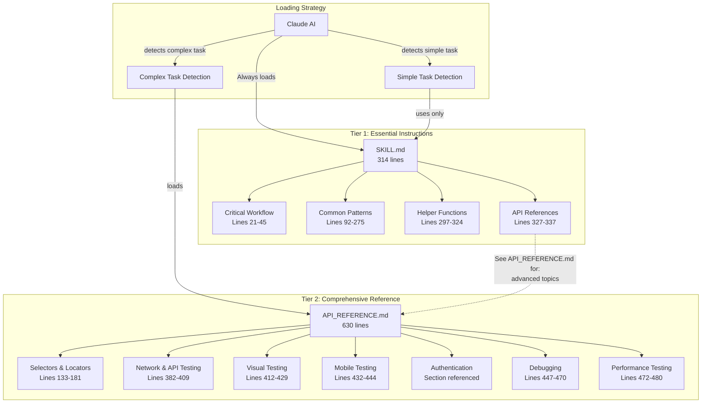
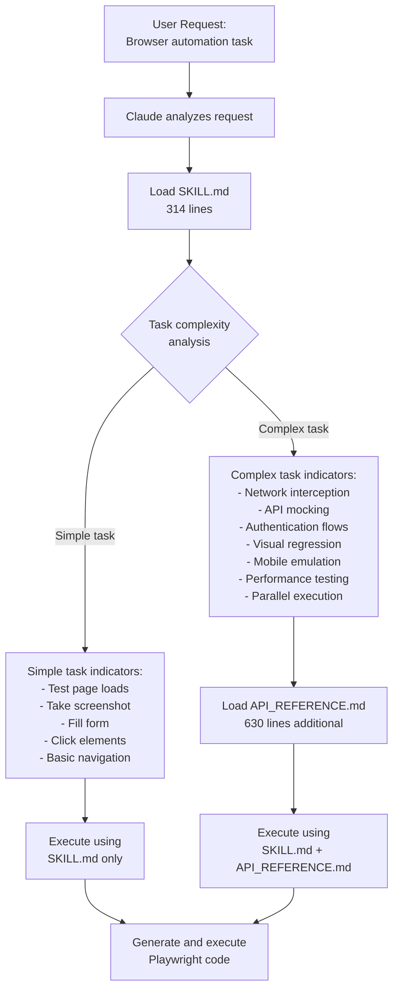
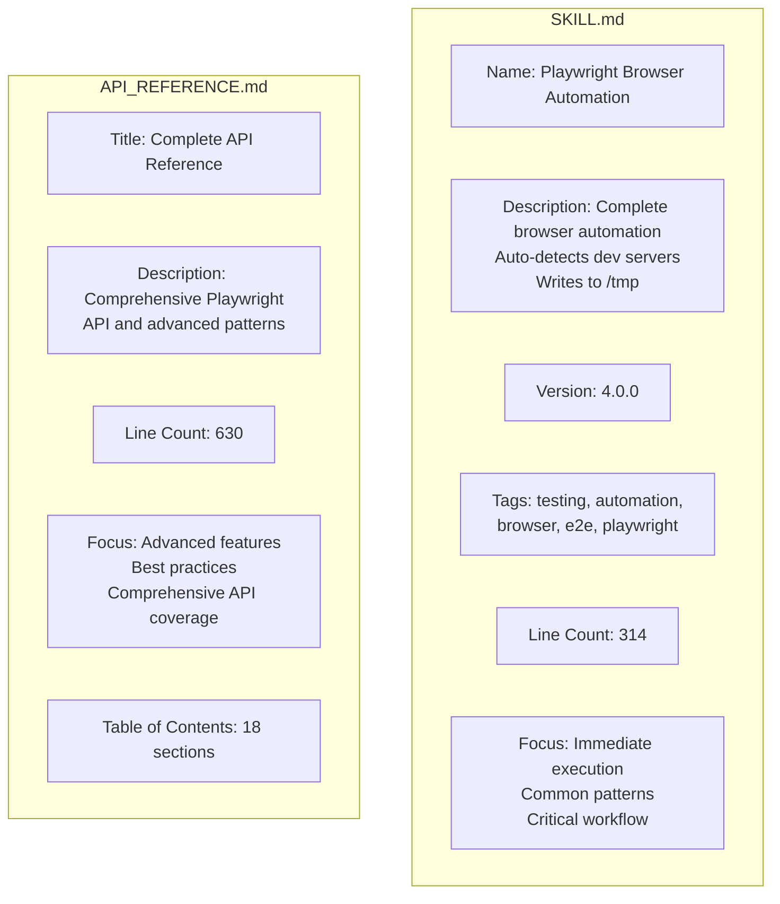
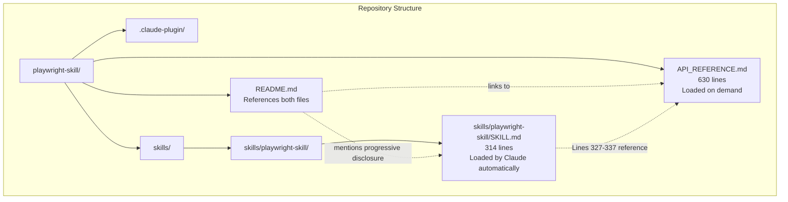
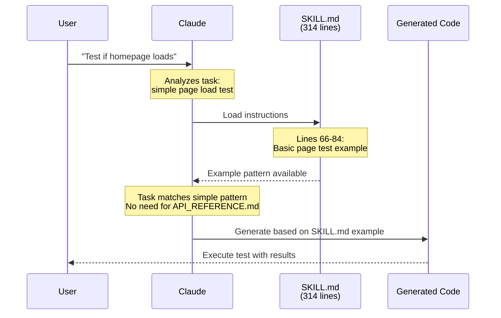
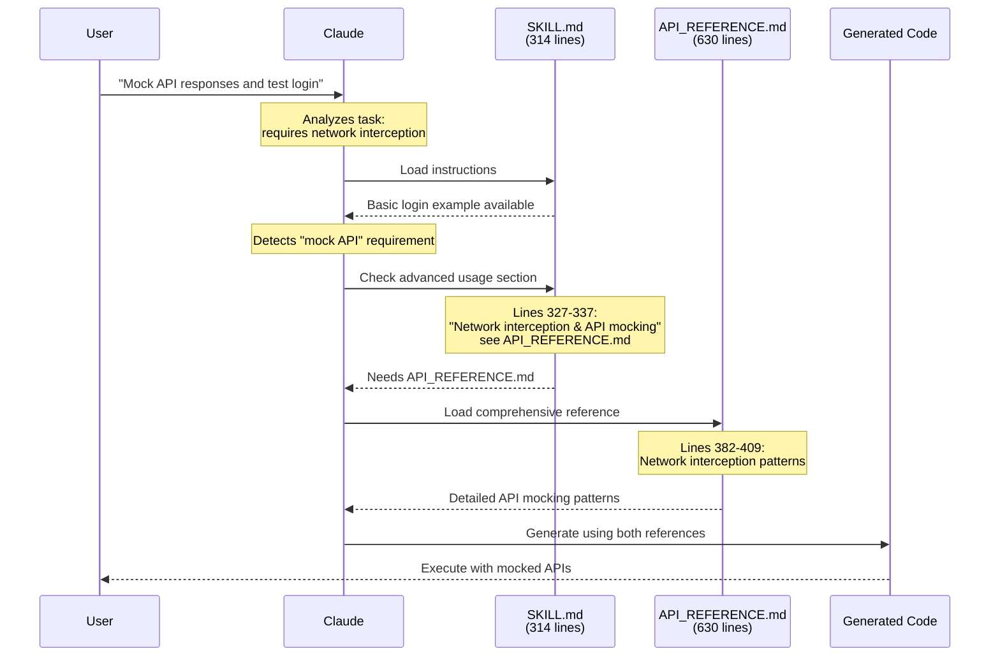

<!-- source: DeepWiki mcp.deepwiki.com · repo lackeyjb/playwright-skill · page 3.4 Progressive Disclosure Documentation · fetched 2026-10-26 -->

# Progressive Disclosure Documentation

<details>
<summary>Relevant source files</summary>

The following files were used as context for generating this wiki page:

- [API_REFERENCE.md](API_REFERENCE.md)
- [README.md](README.md)
- [skills/playwright-skill/SKILL.md](skills/playwright-skill/SKILL.md)

</details>


## Purpose and Scope

This document explains the two-tier documentation strategy used in playwright-skill, where `SKILL.md` provides concise instructions that Claude reads automatically, while `API_REFERENCE.md` contains comprehensive API documentation loaded only when needed for complex scenarios. This pattern optimizes token usage and reduces cognitive load while maintaining access to detailed information.

For information about how Claude autonomously invokes this skill, see [Model-Invoked Pattern](#3.1). For details on the actual execution workflow, see [run.js: The Universal Executor](#4.2).

---

## Overview

Progressive disclosure is a design pattern that presents essential information first, revealing detailed complexity only when required. In playwright-skill, this manifests as:

- **SKILL.md** (314 lines): Concise instructions covering critical workflows and common patterns
- **API_REFERENCE.md** (630 lines): Comprehensive Playwright API reference with advanced topics

Claude loads `SKILL.md` automatically when browser automation is detected. The comprehensive `API_REFERENCE.md` is loaded only when the task requires advanced features like network interception, authentication flows, or visual regression testing.

Sources: [README.md:14](), [skills/playwright-skill/SKILL.md:327-337](), [API_REFERENCE.md:1-3]()

---

## Two-Tier Documentation Architecture

### Documentation Structure Diagram



**Sources**: [skills/playwright-skill/SKILL.md:1-407](), [API_REFERENCE.md:1-631]()

---

## SKILL.md: Concise Instructions

### Purpose and Design

`SKILL.md` serves as the primary instruction set for Claude, designed to enable immediate task execution without requiring comprehensive API knowledge. The file is intentionally compact (314 lines) to minimize token consumption while providing sufficient information for 80% of browser automation tasks.

**Sources**: [skills/playwright-skill/SKILL.md:1-19]()

### Content Organization

The file follows a strict organizational structure optimized for quick reference:

| Section | Line Range | Purpose | Token Efficiency |
|---------|------------|---------|------------------|
| Metadata | 1-7 | YAML frontmatter with skill identification | Required overhead |
| Path Resolution | 9-15 | Dynamic `$SKILL_DIR` resolution instructions | Critical for all execution |
| Critical Workflow | 21-45 | 3-step process: detect servers → write to /tmp → execute | Highest priority |
| Execution Pattern | 56-90 | Concrete examples of the 3-step workflow | Enables immediate action |
| Common Patterns | 92-275 | 7 complete, runnable examples | Covers most use cases |
| Inline Execution | 277-296 | Alternative mode for simple tasks | Reduces file I/O |
| Helper Functions | 297-324 | Optional utilities reference | Awareness without detail |
| Advanced Usage | 327-337 | Explicit pointer to API_REFERENCE.md | Progressive disclosure trigger |

**Sources**: [skills/playwright-skill/SKILL.md:1-407]()

### Critical Workflow Section

The most important content appears immediately after setup instructions [skills/playwright-skill/SKILL.md:21-45]():

```markdown
**CRITICAL WORKFLOW - Follow these steps in order:**

1. Auto-detect dev servers
2. Write scripts to /tmp
3. Use visible browser by default
4. Parameterize URLs
```

This section ensures Claude follows the correct execution pattern regardless of the specific automation task.

**Sources**: [skills/playwright-skill/SKILL.md:21-45]()

### Example Patterns

Seven complete, executable examples demonstrate common automation scenarios [skills/playwright-skill/SKILL.md:92-275]():

1. **Test a Page (Multiple Viewports)** [93-118]() - Responsive design testing
2. **Test Login Flow** [120-144]() - Authentication and redirect validation
3. **Fill and Submit Form** [146-171]() - Form interaction and submission
4. **Check for Broken Links** [173-206]() - Link validation automation
5. **Take Screenshot with Error Handling** [208-235]() - Basic visual testing
6. **Test Responsive Design** [237-275]() - Multi-viewport iteration

Each example is complete, runnable code with:
- Proper `TARGET_URL` parameterization
- `headless: false` default
- Console logging for visibility
- Error handling where appropriate

**Sources**: [skills/playwright-skill/SKILL.md:92-275]()

### Reference Mechanism to API_REFERENCE.md

The "Advanced Usage" section [skills/playwright-skill/SKILL.md:327-337]() explicitly lists topics covered in `API_REFERENCE.md`:

```markdown
## Advanced Usage

For comprehensive Playwright API documentation, see [API_REFERENCE.md](API_REFERENCE.md):

- Selectors & Locators best practices
- Network interception & API mocking
- Authentication & session management
- Visual regression testing
- Mobile device emulation
- Performance testing
- Debugging techniques
- CI/CD integration
```

This explicit enumeration helps Claude identify when it needs the comprehensive reference.

**Sources**: [skills/playwright-skill/SKILL.md:327-337]()

### What's Intentionally Omitted

`SKILL.md` deliberately excludes:

- **Detailed Playwright API**: No comprehensive method signatures or parameters
- **Advanced Selector Strategies**: Only basic locator patterns shown in examples
- **Network Interception**: Not covered; requires API_REFERENCE.md
- **Authentication Patterns**: Only basic form login example provided
- **Configuration Options**: Only critical defaults (headless, slowMo) mentioned
- **CI/CD Integration**: Not relevant for immediate execution
- **Troubleshooting Details**: Only most common issues

This omission is intentional - these topics are covered comprehensively in `API_REFERENCE.md`.

**Sources**: [skills/playwright-skill/SKILL.md:1-407]()

---

## API_REFERENCE.md: Comprehensive Reference

### Purpose and Design

`API_REFERENCE.md` is a 630-line comprehensive reference designed to be loaded only when tasks require advanced Playwright features. It provides exhaustive API documentation, configuration options, and patterns that would be excessive for routine automation tasks.

**Sources**: [API_REFERENCE.md:1-631]()

### Content Architecture

```mermaid
graph LR
    subgraph "API_REFERENCE.md Structure"
        TOC[Table of Contents<br/>Lines 5-26]
        SETUP[Installation & Setup<br/>Lines 28-75]
        CORE[Core Patterns<br/>Lines 77-131]
        SELECT[Selectors & Locators<br/>Lines 133-181]
        ACTIONS[Common Actions<br/>Lines 183-256]
        WAIT[Waiting Strategies<br/>Lines 258-299]
        ASSERT[Assertions<br/>Lines 301-340]
        POM[Page Object Model<br/>Lines 342-379]
        NETWORK[Network & API<br/>Lines 381-409]
        VISUAL[Visual Testing<br/>Lines 411-429]
        MOBILE[Mobile Testing<br/>Lines 431-444]
        DEBUG[Debugging<br/>Lines 446-470]
        PERF[Performance<br/>Lines 472-480]
        PARALLEL[Parallel Execution<br/>Lines 482-495]
        DATA[Data-Driven<br/>Lines 497-515]
        A11Y[Accessibility<br/>Lines 517-527]
        CI[CI/CD<br/>Lines 529-550]
        BEST[Best Practices<br/>Lines 552-558]
        PATTERNS[Common Patterns<br/>Lines 560-596]
        TROUBLE[Troubleshooting<br/>Lines 598-606]
    end
    
    TOC --> SETUP
    TOC --> CORE
    TOC --> SELECT
    TOC --> ACTIONS
    TOC --> WAIT
    TOC --> ASSERT
    TOC --> POM
    TOC --> NETWORK
    TOC --> VISUAL
    TOC --> MOBILE
    TOC --> DEBUG
    TOC --> PERF
    TOC --> PARALLEL
    TOC --> DATA
    TOC --> A11Y
    TOC --> CI
    TOC --> BEST
    TOC --> PATTERNS
    TOC --> TROUBLE
```



**Sources**: [API_REFERENCE.md:5-631]()

### Advanced Topics Coverage

#### Selectors & Locators Best Practices

Comprehensive selector strategy guide [API_REFERENCE.md:133-181]() including:

- **Preferred**: Data attributes (`data-testid`, `data-cy`)
- **Good**: Role-based selectors (`getByRole`, `getByText`)
- **OK**: Semantic HTML (`input[name="email"]`)
- **Avoid**: Classes and IDs (fragile)
- **Last Resort**: Complex CSS/XPath

**Sources**: [API_REFERENCE.md:133-181]()

#### Network & API Testing

Request interception and mocking patterns [API_REFERENCE.md:382-409]():

```javascript
// Mock API responses
await page.route('**/api/users', route => {
  route.fulfill({
    status: 200,
    contentType: 'application/json',
    body: JSON.stringify([...])
  });
});
```

**Sources**: [API_REFERENCE.md:382-409]()

#### Visual Testing

Screenshot capture and comparison [API_REFERENCE.md:411-429]():

- Full page screenshots
- Element-specific screenshots
- Visual regression with `toHaveScreenshot()`

**Sources**: [API_REFERENCE.md:411-429]()

#### Mobile Testing

Device emulation with Playwright's device descriptors [API_REFERENCE.md:431-444]():

```javascript
const { devices } = require('playwright');
const iPhone = devices['iPhone 12'];
const context = await browser.newContext({
  ...iPhone,
  locale: 'en-US',
  permissions: ['geolocation']
});
```

**Sources**: [API_REFERENCE.md:431-444]()

#### Authentication & Session Management

Referenced in [skills/playwright-skill/SKILL.md:332]() but fully detailed in the comprehensive reference (referenced but not shown in provided excerpts).

#### Performance Testing

Page load measurement and timing [API_REFERENCE.md:472-480]():

```javascript
const startTime = Date.now();
await page.goto('https://example.com');
const loadTime = Date.now() - startTime;
```

**Sources**: [API_REFERENCE.md:472-480]()

---

## Loading Strategy and Decision Flow

### When Each Document is Loaded



**Sources**: [skills/playwright-skill/SKILL.md:327-337](), [README.md:188]()

### Token Optimization Strategy

| Scenario | SKILL.md Loaded | API_REFERENCE.md Loaded | Total Lines | Token Estimate |
|----------|----------------|-------------------------|-------------|----------------|
| Simple page test | ✓ | ✗ | 314 | ~1,200 tokens |
| Form submission | ✓ | ✗ | 314 | ~1,200 tokens |
| Responsive testing | ✓ | ✗ | 314 | ~1,200 tokens |
| Network interception | ✓ | ✓ | 944 | ~3,600 tokens |
| Visual regression | ✓ | ✓ | 944 | ~3,600 tokens |
| Mobile device emulation | ✓ | ✓ | 944 | ~3,600 tokens |

The progressive disclosure pattern results in ~66% token savings for routine automation tasks.

**Sources**: [skills/playwright-skill/SKILL.md:1-407](), [API_REFERENCE.md:1-631]()

---

## Content Comparison: SKILL.md vs API_REFERENCE.md

### Topic Coverage Matrix

| Topic | SKILL.md Coverage | API_REFERENCE.md Coverage | Rationale |
|-------|-------------------|---------------------------|-----------|
| **Dev Server Detection** | Complete [23-29]() | Not mentioned | SKILL.md focus |
| **Path Resolution** | Complete [9-15]() | Brief [39]() | Critical for execution |
| **Execution Pattern** | Complete [56-90]() | Basic [79-106]() | SKILL.md priority |
| **Common Patterns** | 7 examples [92-275]() | Not duplicated | Avoid redundancy |
| **Selector Strategies** | Basic examples only | Comprehensive [133-181]() | Progressive disclosure |
| **Form Interactions** | Inline examples | Detailed API [183-216]() | API reference depth |
| **Waiting Strategies** | Inline in examples | Comprehensive [258-299]() | Advanced patterns in API |
| **Assertions** | None | Complete [301-340]() | Not needed for basic tasks |
| **Page Object Model** | Not covered | Complete [342-379]() | Advanced pattern |
| **Network Interception** | Not covered | Complete [382-409]() | Complex feature |
| **Visual Testing** | Screenshot examples | Comprehensive [411-429]() | API provides comparison |
| **Mobile Emulation** | Viewport examples | Device descriptors [431-444]() | API provides presets |
| **Authentication** | Basic login example | Comprehensive patterns | Advanced flows in API |
| **Debugging** | Basic hints [341-365]() | Complete [446-470]() | API provides tools |
| **CI/CD Integration** | Not covered | Complete [529-550]() | Not relevant to execution |

**Sources**: [skills/playwright-skill/SKILL.md:1-407](), [API_REFERENCE.md:1-631]()

### File Metadata Comparison



**Sources**: [skills/playwright-skill/SKILL.md:1-7](), [API_REFERENCE.md:1-26]()

---

## Benefits and Trade-offs

### Benefits

1. **Token Efficiency**: 66% reduction in token consumption for simple tasks
2. **Cognitive Load**: Claude processes only essential information initially
3. **Faster Task Completion**: Direct access to common patterns without API search
4. **Scalability**: API_REFERENCE.md can grow without bloating SKILL.md
5. **Maintainability**: Clear separation between instructions and reference material
6. **Discoverability**: Explicit references in SKILL.md guide to advanced features

### Trade-offs

1. **Duplication Risk**: Must ensure examples in SKILL.md don't become stale
2. **Reference Maintenance**: Changes to Playwright API require updates in both files
3. **Loading Decision**: Claude must correctly identify when to load comprehensive reference
4. **File Location Coordination**: Both files must remain accessible in repository structure

**Sources**: [README.md:14](), [skills/playwright-skill/SKILL.md:327-337]()

---

## Implementation Details

### File Locations in Repository



**Key Observations**:

- `SKILL.md` is inside the skill directory at [skills/playwright-skill/SKILL.md]()
- `API_REFERENCE.md` is at repository root [API_REFERENCE.md]()
- `SKILL.md` references `API_REFERENCE.md` using relative path `../../API_REFERENCE.md` implicitly

**Sources**: [README.md:168-184](), [skills/playwright-skill/SKILL.md:328](), [API_REFERENCE.md:1]()

### Reference Link Mechanism

The reference in SKILL.md [skills/playwright-skill/SKILL.md:328]() uses a standard markdown link:

```markdown
For comprehensive Playwright API documentation, see [API_REFERENCE.md](API_REFERENCE.md):
```

Since Claude resolves paths relative to the current file location, this resolves to `../../API_REFERENCE.md` from the skill directory.

**Sources**: [skills/playwright-skill/SKILL.md:328]()

### Version Alignment

Both documentation files must remain synchronized with:

- **plugin.json** version: 4.0.2 [.claude-plugin/plugin.json]()
- **SKILL.md** version: 4.0.0 [skills/playwright-skill/SKILL.md:4]()
- **package.json** version: 4.0.2 [skills/playwright-skill/package.json]()

Minor version discrepancies exist but do not affect functionality.

**Sources**: [skills/playwright-skill/SKILL.md:4]()

### Maintenance Guidelines

When updating documentation:

1. **SKILL.md changes**: Update if common patterns change or new helpers added
2. **API_REFERENCE.md changes**: Update when Playwright API evolves or advanced patterns emerge
3. **Cross-references**: Verify SKILL.md references remain accurate when API_REFERENCE.md sections change
4. **Example synchronization**: Ensure SKILL.md examples follow best practices documented in API_REFERENCE.md

**Sources**: [skills/playwright-skill/SKILL.md:1-407](), [API_REFERENCE.md:1-631]()

---

## Progressive Disclosure in Action

### Example: Simple Task Flow



**Sources**: [skills/playwright-skill/SKILL.md:66-84]()

### Example: Complex Task Flow



**Sources**: [skills/playwright-skill/SKILL.md:327-337](), [API_REFERENCE.md:382-409]()

---

## Summary

The progressive disclosure pattern in playwright-skill achieves optimal balance between immediacy and comprehensiveness:

- **SKILL.md**: 314 lines of actionable instructions for 80% of tasks
- **API_REFERENCE.md**: 630 lines of detailed reference for advanced scenarios
- **Token savings**: ~66% reduction for routine automation
- **Explicit references**: Clear signaling when to load comprehensive documentation
- **Maintenance**: Separated concerns for independent evolution

This architecture enables Claude to execute simple browser automation immediately while maintaining access to advanced Playwright features when needed.

**Sources**: [skills/playwright-skill/SKILL.md:1-407](), [API_REFERENCE.md:1-631](), [README.md:14]()

---

