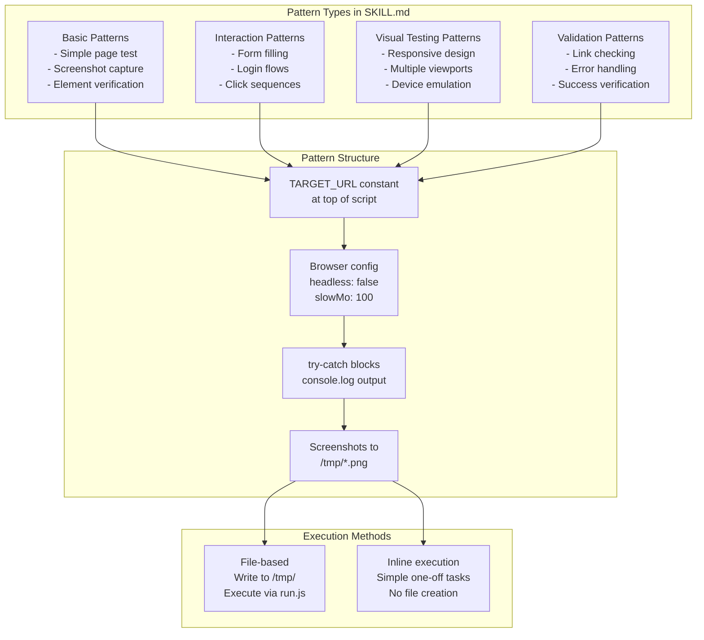
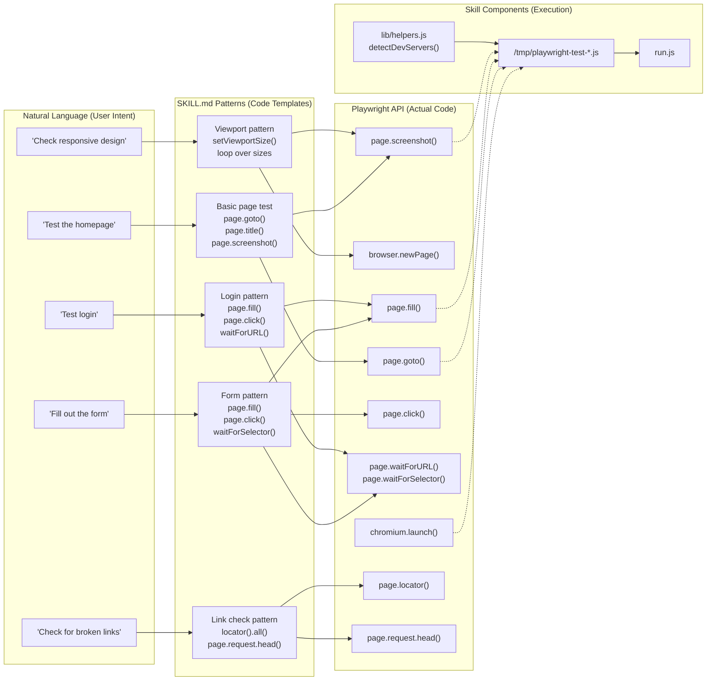
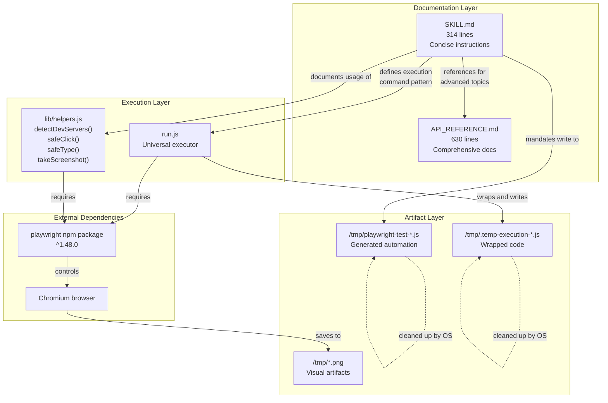

<!-- source: DeepWiki mcp.deepwiki.com · repo lackeyjb/playwright-skill · page 4.4 SKILL.md: Instructions for Claude · fetched 2026-10-26 -->

# SKILL.md: Instructions for Claude

<details>
<summary>Relevant source files</summary>

The following files were used as context for generating this wiki page:

- [.claude-plugin/plugin.json](.claude-plugin/plugin.json)
- [README.md](README.md)
- [skills/playwright-skill/SKILL.md](skills/playwright-skill/SKILL.md)

</details>


## Purpose and Scope

This document explains the `SKILL.md` file, which serves as the primary instruction document that Claude reads when determining how to use the playwright-skill. `SKILL.md` is a 314-line concise reference that defines the critical workflow, provides code patterns, and establishes best practices for browser automation tasks. 

For information about the comprehensive API documentation that Claude loads on-demand for complex scenarios, see [API_REFERENCE.md](#3.4). For details on the universal executor that executes the generated scripts, see [run.js: The Universal Executor](#4.2). For the utility functions referenced in examples, see [Helper Functions Library](#4.3).

**Sources:** [skills/playwright-skill/SKILL.md:1-407]()

## Overview

`SKILL.md` is Claude's operational manual for the playwright-skill. When Claude identifies a browser automation task in a user request, it loads this file to understand how to proceed. The document implements a progressive disclosure strategy - providing immediately actionable information while explicitly referencing `API_REFERENCE.md` for advanced topics.

### Key Characteristics

| Characteristic | Value | Purpose |
|---------------|-------|---------|
| **Line Count** | 314 lines | Concise enough to load quickly |
| **Section Count** | 11 major sections | Organized for rapid navigation |
| **Code Examples** | 10+ working patterns | Immediately usable templates |
| **Path Resolution** | Dynamic `$SKILL_DIR` | Works across installation methods |
| **Workflow Enforcement** | 3-step critical process | Ensures consistent execution |
| **Default Behavior** | Visible browser (`headless: false`) | Prioritizes debuggability |

The file balances brevity with completeness - every line serves an operational purpose, with no conceptual explanations that can be deferred to comprehensive documentation.

**Sources:** [skills/playwright-skill/SKILL.md:1-17](), [README.md:14]()

---

## File Structure and Metadata

### Frontmatter Metadata

The file begins with YAML frontmatter that Claude's skill discovery system uses to index and categorize the skill:

```yaml
---
name: Playwright Browser Automation
description: Complete browser automation with Playwright...
version: 4.0.0
author: Claude Assistant
tags: [testing, automation, browser, e2e, playwright, web-testing]
---
```

This metadata serves two purposes:
1. **Skill Discovery**: Claude's skill registry uses `name`, `description`, and `tags` to determine when to load this skill
2. **Task Matching**: Keywords like "testing", "browser", "automation" trigger skill invocation

**Sources:** [skills/playwright-skill/SKILL.md:1-7]()

### Path Resolution Section

Immediately following the frontmatter, `SKILL.md` addresses the critical path resolution challenge caused by multiple installation methods:

```
Common installation paths:
- Plugin system: ~/.claude/plugins/marketplaces/playwright-skill/skills/playwright-skill
- Manual global: ~/.claude/skills/playwright-skill
- Project-specific: <project>/.claude/skills/playwright-skill
```

This section defines the `$SKILL_DIR` variable that all subsequent commands use, enabling the same instructions to work across different installation contexts. Claude must determine the actual path where `SKILL.md` is located and substitute it for `$SKILL_DIR` in all commands.

**Sources:** [skills/playwright-skill/SKILL.md:9-16]()

---

## The Critical Workflow

`SKILL.md` defines a mandatory 3-step workflow that Claude must follow for every browser automation task. This workflow is prominently labeled **"CRITICAL WORKFLOW - Follow these steps in order:"** to ensure compliance.

### Workflow Sequence Diagram

```mermaid
sequenceDiagram
    participant User
    participant Claude
    participant SKILL_MD["SKILL.md<br/>(instructions)"]
    participant detectDevServers["lib/helpers.js<br/>detectDevServers()"]
    participant tmp["/tmp/<br/>(filesystem)"]
    participant run_js["run.js<br/>(executor)"]
    
    User->>Claude: "Test the homepage"
    Claude->>SKILL_MD: Load instructions
    
    Note over Claude,SKILL_MD: Step 1: Auto-detect servers
    
    Claude->>detectDevServers: cd $SKILL_DIR && node -e "require('./lib/helpers').detectDevServers()..."
    
    alt 1 server found
        detectDevServers-->>Claude: JSON: [{url: "http://localhost:3001", ...}]
        Claude->>Claude: Auto-select URL
    else Multiple servers
        detectDevServers-->>Claude: JSON: [{url: "..."}, {url: "..."}]
        Claude->>User: "Found 2 servers. Which one?"
        User->>Claude: "Use 3001"
    else No servers
        detectDevServers-->>Claude: JSON: []
        Claude->>User: "No servers found. Provide URL?"
    end
    
    Note over Claude,tmp: Step 2: Write script to /tmp
    
    Claude->>tmp: Write /tmp/playwright-test-<task>.js<br/>with TARGET_URL constant
    
    Note over Claude,run_js: Step 3: Execute via run.js
    
    Claude->>run_js: cd $SKILL_DIR && node run.js /tmp/playwright-test-<task>.js
    run_js-->>Claude: Execution results + screenshots
    Claude-->>User: Display results
```

**Sources:** [skills/playwright-skill/SKILL.md:21-45]()

### Step 1: Auto-Detect Dev Servers

The first mandatory step prevents hardcoded URLs and ensures scripts work across different development environments. Claude must execute:

```bash
cd $SKILL_DIR && node -e "require('./lib/helpers').detectDevServers().then(servers => console.log(JSON.stringify(servers)))"
```

This command scans common development server ports (3000, 5173, 8080, 4200, 5000, etc.) and returns a JSON array of detected servers. The workflow branches based on the result:

| Result | Action |
|--------|--------|
| **1 server found** | Auto-select URL, inform user |
| **Multiple servers found** | Ask user which server to test |
| **No servers found** | Request URL or offer to help start dev server |

**Sources:** [skills/playwright-skill/SKILL.md:23-29](), [skills/playwright-skill/SKILL.md:57-61]()

### Step 2: Write Scripts to /tmp

The second requirement ensures the skill never clutters the user's project or the skill directory with generated test files. All automation scripts must be written to `/tmp/playwright-test-*.js` with a descriptive filename suffix.

**Critical constraints enforced:**
- **Never** write to `$SKILL_DIR` (the skill directory)
- **Never** write to the user's project directory
- **Always** use the `/tmp/` prefix
- **Always** include a descriptive suffix: `/tmp/playwright-test-<task-description>.js`

Example filenames:
- `/tmp/playwright-test-login.js`
- `/tmp/playwright-test-responsive.js`
- `/tmp/playwright-test-form.js`

**Sources:** [skills/playwright-skill/SKILL.md:31](), [skills/playwright-skill/SKILL.md:64-84]()

### Step 3: Execute via run.js

The final step requires all automation to execute through the universal executor, which handles module resolution, code wrapping, and dependency management:

```bash
cd $SKILL_DIR && node run.js /tmp/playwright-test-<task>.js
```

The `cd $SKILL_DIR` prefix is mandatory to ensure proper module resolution from the skill's `node_modules` directory. Direct execution of generated scripts would fail with "Cannot find module 'playwright'" errors.

**Sources:** [skills/playwright-skill/SKILL.md:42](), [skills/playwright-skill/SKILL.md:86-90]()

---

## Code Pattern Library

`SKILL.md` provides 10+ working code patterns that Claude can adapt for specific user requests. These patterns serve as templates, not rigid scripts - Claude modifies them based on the actual task requirements.

### Pattern Categories



**Sources:** [skills/playwright-skill/SKILL.md:92-276]()

### Pattern: Test a Page (Multiple Viewports)

This pattern demonstrates responsive design testing across desktop, tablet, and mobile viewports:

```javascript
const TARGET_URL = 'http://localhost:3001'; // Auto-detected

const viewports = [
  { name: 'Desktop', width: 1920, height: 1080 },
  { name: 'Tablet', width: 768, height: 1024 },
  { name: 'Mobile', width: 375, height: 667 }
];

for (const viewport of viewports) {
  await page.setViewportSize({ width: viewport.width, height: viewport.height });
  await page.goto(TARGET_URL);
  await page.screenshot({ path: `/tmp/${viewport.name.toLowerCase()}.png`, fullPage: true });
}
```

**Key elements:**
- `TARGET_URL` constant for URL parameterization
- Loop over predefined viewports
- Descriptive screenshot filenames
- Full-page screenshots for comprehensive capture

**Sources:** [skills/playwright-skill/SKILL.md:238-275]()

### Pattern: Test Login Flow

This pattern handles authentication flows with redirect verification:

```javascript
await page.goto(`${TARGET_URL}/login`);

await page.fill('input[name="email"]', 'test@example.com');
await page.fill('input[name="password"]', 'password123');
await page.click('button[type="submit"]');

// Wait for redirect
await page.waitForURL('**/dashboard');
console.log('✅ Login successful, redirected to dashboard');
```

**Key elements:**
- URL concatenation with `TARGET_URL` base
- Form interaction using `fill()` and `click()`
- Smart waiting with `waitForURL()` instead of fixed timeout
- User-friendly console output with emoji indicators

**Sources:** [skills/playwright-skill/SKILL.md:120-144]()

### Pattern: Check for Broken Links

This pattern demonstrates network request validation:

```javascript
const links = await page.locator('a[href^="http"]').all();
const results = { working: 0, broken: [] };

for (const link of links) {
  const href = await link.getAttribute('href');
  try {
    const response = await page.request.head(href);
    if (response.ok()) {
      results.working++;
    } else {
      results.broken.push({ url: href, status: response.status() });
    }
  } catch (e) {
    results.broken.push({ url: href, error: e.message });
  }
}

console.log(`✅ Working links: ${results.working}`);
console.log(`❌ Broken links:`, results.broken);
```

**Key elements:**
- Locator pattern for external links: `a[href^="http"]`
- HTTP HEAD requests for efficiency
- Structured results object
- Error handling for network failures
- Comprehensive result reporting

**Sources:** [skills/playwright-skill/SKILL.md:173-206]()

---

## Code Entity Mapping

`SKILL.md` bridges natural language descriptions to specific Playwright API calls and skill components:



**Sources:** [skills/playwright-skill/SKILL.md:92-275](), [skills/playwright-skill/SKILL.md:369-397]()

### Mapping Table

| User Request | SKILL.md Pattern | Key Playwright APIs | Helper Functions |
|-------------|------------------|---------------------|------------------|
| "Test homepage" | Basic page test ([SKILL.md:64-84]()) | `page.goto()`, `page.title()`, `page.screenshot()` | `detectDevServers()` |
| "Fill form" | Form submission ([SKILL.md:146-171]()) | `page.fill()`, `page.click()`, `page.waitForSelector()` | `safeType()`, `safeClick()` |
| "Test login" | Login flow ([SKILL.md:120-144]()) | `page.fill()`, `page.click()`, `page.waitForURL()` | `authenticate()` |
| "Responsive test" | Multiple viewports ([SKILL.md:238-275]()) | `page.setViewportSize()`, `page.screenshot()` | - |
| "Check links" | Link validation ([SKILL.md:173-206]()) | `page.locator()`, `page.request.head()` | - |
| "Take screenshot" | Screenshot capture ([SKILL.md:208-235]()) | `page.screenshot()`, `page.goto()` | `takeScreenshot()` |

**Sources:** [skills/playwright-skill/SKILL.md:92-275]()

---

## Inline Execution Mode

In addition to file-based execution, `SKILL.md` documents an inline execution mode for simple one-off tasks:

```bash
cd $SKILL_DIR && node run.js "
const browser = await chromium.launch({ headless: false });
const page = await browser.newPage();
await page.goto('http://localhost:3001');
await page.screenshot({ path: '/tmp/quick-screenshot.png', fullPage: true });
console.log('Screenshot saved');
await browser.close();
"
```

### Decision Matrix for Execution Mode

| Criteria | Use Inline | Use File-Based |
|----------|------------|----------------|
| **Task Complexity** | Simple, single action | Multi-step workflows |
| **Code Length** | < 10 lines | > 10 lines |
| **Reusability** | One-off task | User might want to re-run |
| **Examples** | Quick screenshot, check element exists, get page title | Responsive testing, form flows, link checking |

The inline mode skips file creation and cleanup, making it faster for trivial tasks. However, `run.js` still handles code wrapping, module resolution, and dependency management.

**Sources:** [skills/playwright-skill/SKILL.md:277-296]()

---

## Helper Functions Documentation

`SKILL.md` documents the available utility functions in `lib/helpers.js`, providing both API signatures and usage examples:

```javascript
const helpers = require('./lib/helpers');

// Detect running dev servers (CRITICAL - use this first!)
const servers = await helpers.detectDevServers();

// Safe click with retry
await helpers.safeClick(page, 'button.submit', { retries: 3 });

// Safe type with clear
await helpers.safeType(page, '#username', 'testuser');

// Take timestamped screenshot
await helpers.takeScreenshot(page, 'test-result');

// Handle cookie banners
await helpers.handleCookieBanner(page);

// Extract table data
const data = await helpers.extractTableData(page, 'table.results');
```

These helpers are **optional** - Claude can use them for convenience but can also write custom code when helpers don't fit the specific use case.

**Sources:** [skills/playwright-skill/SKILL.md:297-325]()

---

## Progressive Disclosure Reference

`SKILL.md` explicitly directs Claude to `API_REFERENCE.md` for advanced topics that don't fit in the concise instruction format:

```
## Advanced Usage

For comprehensive Playwright API documentation, see [API_REFERENCE.md](API_REFERENCE.md):

- Selectors & Locators best practices
- Network interception & API mocking
- Authentication & session management
- Visual regression testing
- Mobile device emulation
- Performance testing
- Debugging techniques
- CI/CD integration
```

This creates a two-tier documentation system:
1. **SKILL.md (314 lines)**: Immediate operational guidance, critical workflow, common patterns
2. **API_REFERENCE.md (630 lines)**: Comprehensive API reference, advanced patterns, detailed explanations

Claude loads `SKILL.md` for every automation task but only loads `API_REFERENCE.md` when the task requires advanced features not covered in basic patterns.

**Sources:** [skills/playwright-skill/SKILL.md:326-338]()

---

## Best Practices and Conventions

`SKILL.md` establishes mandatory conventions through its "Tips" section:

### Mandatory Practices

| Practice | Enforcement | Rationale |
|----------|-------------|-----------|
| **Detect servers FIRST** | CRITICAL label | Prevents hardcoded URLs |
| **Use /tmp for test files** | Explicit instruction | Keeps projects clean |
| **Parameterize URLs** | `TARGET_URL` constant in all patterns | Environment independence |
| **Visible browser by default** | `headless: false` in all examples | Debuggability over speed |
| **Slow down actions** | `slowMo: 100` recommended | Makes automation observable |

**Sources:** [skills/playwright-skill/SKILL.md:339-350]()

### Conditional Practices

| Practice | When to Use | Example |
|----------|-------------|---------|
| **Headless mode** | User explicitly requests "headless" or "background" | `headless: true` |
| **Smart waiting** | Always prefer over fixed timeouts | `waitForURL()`, `waitForSelector()` |
| **Error handling** | All complex automations | `try-catch-finally` blocks |
| **Console output** | All automations | Progress tracking with emoji indicators |

**Sources:** [skills/playwright-skill/SKILL.md:339-350]()

---

## Troubleshooting Guide

`SKILL.md` provides quick resolution steps for common issues:

### Issue Resolution Table

| Issue | Cause | Solution |
|-------|-------|----------|
| **"Playwright not installed"** | First-time setup not run | `cd $SKILL_DIR && npm run setup` |
| **"Module not found"** | Direct script execution without `run.js` | Ensure execution via `run.js` wrapper |
| **"Browser doesn't open"** | Headless mode or no display | Check `headless: false` and display availability |
| **"Element not found"** | Race condition or slow loading | Add explicit wait: `await page.waitForSelector('.element', { timeout: 10000 })` |

These troubleshooting steps are designed to be actionable single-command fixes that Claude can execute immediately when encountering errors.

**Sources:** [skills/playwright-skill/SKILL.md:351-366]()

---

## Example Conversations

`SKILL.md` concludes with two example conversation flows that demonstrate the complete workflow in action:

### Example 1: Single Server Detected

```
User: "Test if the marketing page looks good"

Claude: I'll test the marketing page across multiple viewports. 
        Let me first detect running servers...
[Runs: detectDevServers()]
[Output: Found server on port 3001]

I found your dev server running on http://localhost:3001

[Writes custom automation script to /tmp/playwright-test-marketing.js]
[Runs: cd $SKILL_DIR && node run.js /tmp/playwright-test-marketing.js]
[Shows results with screenshots from /tmp/]
```

### Example 2: Multiple Servers Detected

```
User: "Check if login redirects correctly"

Claude: I'll test the login flow. First, let me check for running servers...
[Runs: detectDevServers()]
[Output: Found servers on ports 3000 and 3001]

I found 2 dev servers. Which one should I test?
- http://localhost:3000
- http://localhost:3001

User: "Use 3001"

[Writes login automation to /tmp/playwright-test-login.js]
[Runs: cd $SKILL_DIR && node run.js /tmp/playwright-test-login.js]
[Reports: ✅ Login successful, redirected to /dashboard]
```

These examples reinforce the critical workflow and demonstrate proper handling of server detection edge cases.

**Sources:** [skills/playwright-skill/SKILL.md:367-397]()

---

## Concluding Notes Section

The final section summarizes the skill's capabilities and constraints:

```
## Notes

- Each automation is custom-written for your specific request
- Not limited to pre-built scripts - any browser task possible
- Auto-detects running dev servers to eliminate hardcoded URLs
- Test scripts written to `/tmp` for automatic cleanup (no clutter)
- Code executes reliably with proper module resolution via `run.js`
- Progressive disclosure - API_REFERENCE.md loaded only when advanced features needed
```

This serves as a final reminder to Claude of the skill's flexible, custom-code-generation approach rather than template-based automation.

**Sources:** [skills/playwright-skill/SKILL.md:399-407]()

---

## SKILL.md Integration Points



**Sources:** [skills/playwright-skill/SKILL.md:1-407](), [README.md:166-184]()

---

