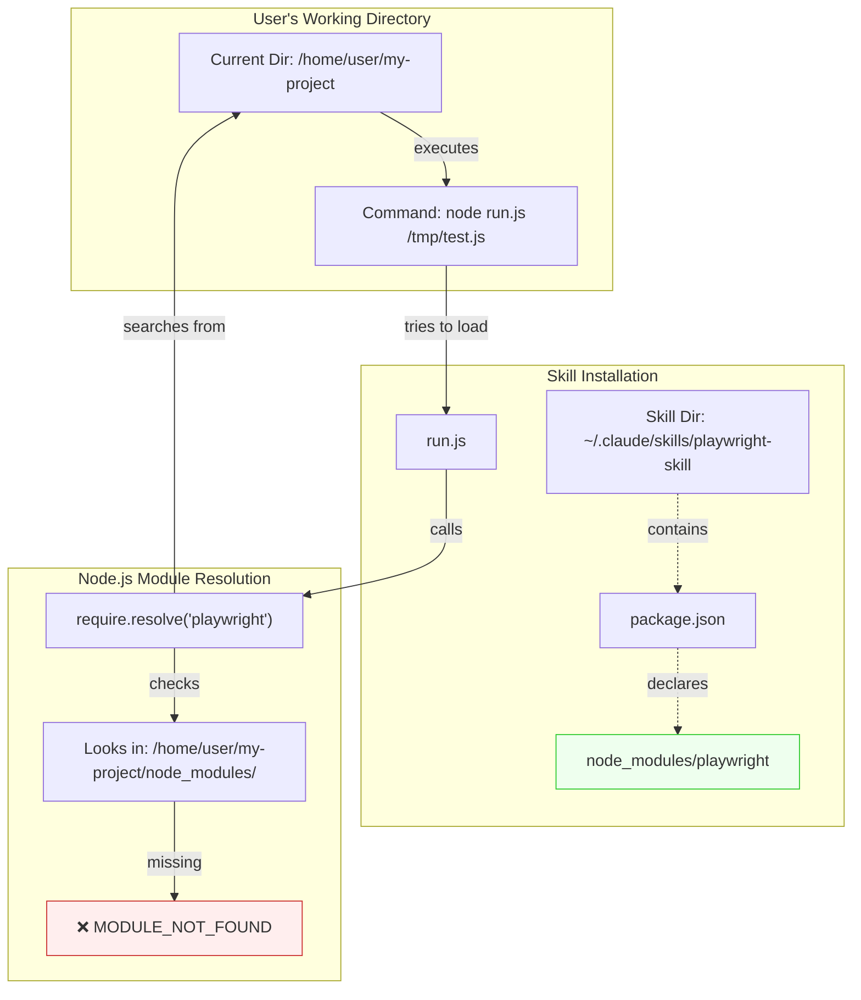
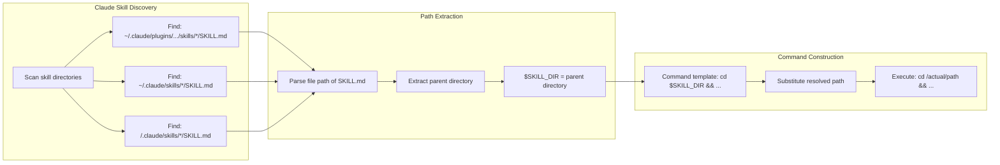
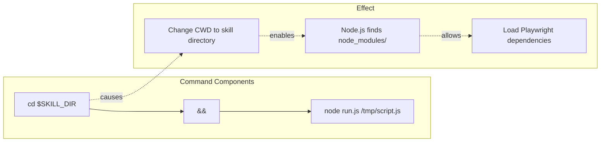
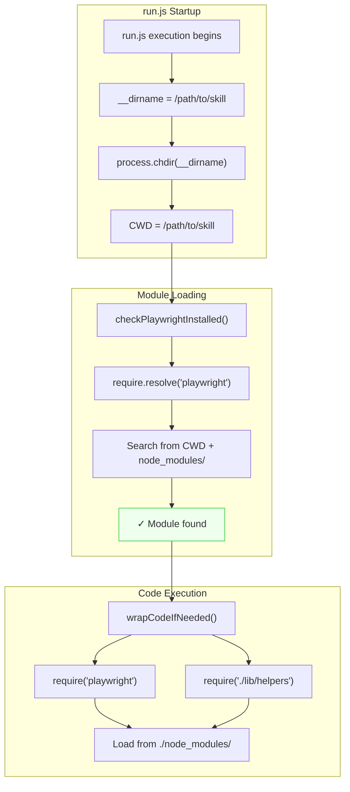
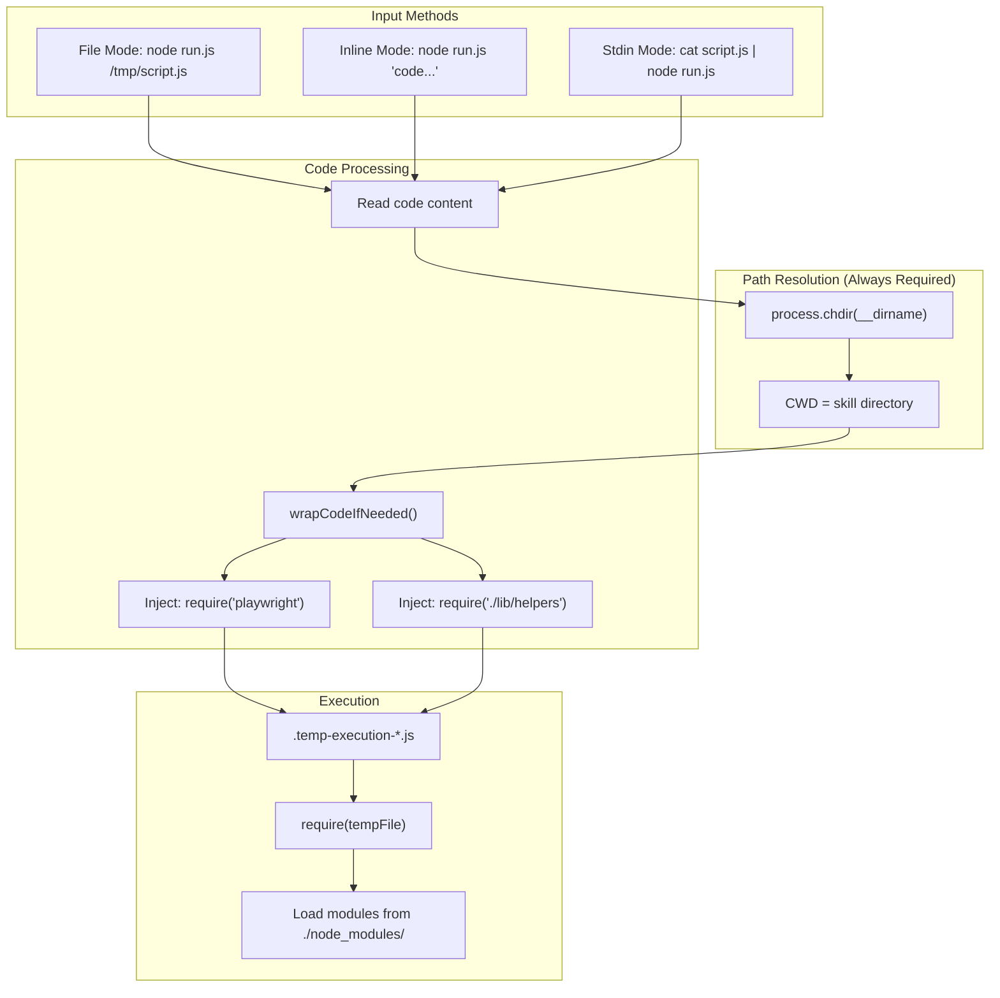
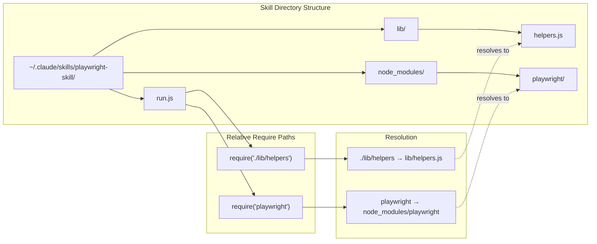

<!-- source: DeepWiki mcp.deepwiki.com · repo lackeyjb/playwright-skill · page 4.6 Path Resolution and $SKILL_DIR · fetched 2026-10-26 -->

# Path Resolution and $SKILL_DIR

<details>
<summary>Relevant source files</summary>

The following files were used as context for generating this wiki page:

- [README.md](README.md)
- [skills/playwright-skill/SKILL.md](skills/playwright-skill/SKILL.md)
- [skills/playwright-skill/run.js](skills/playwright-skill/run.js)

</details>


## Purpose and Scope

This document explains the path resolution mechanism in playwright-skill, focusing on how the `$SKILL_DIR` variable is dynamically resolved based on installation method and why all command executions require the `cd $SKILL_DIR &&` prefix. This page covers the technical implementation of module resolution in Node.js and how `run.js` ensures proper dependency loading regardless of where the skill is installed.

For information about the different installation methods themselves, see [Installation](#2.1). For details about the universal executor's code wrapping functionality, see [run.js: The Universal Executor](#4.2).

## Installation Path Variations

The playwright-skill can be installed in three different locations, each requiring a different absolute path. The `$SKILL_DIR` variable is a placeholder representing whichever path is active for a given installation.

### Common Installation Paths

| Installation Method | Path | Notes |
|-------------------|------|-------|
| Plugin System | `~/.claude/plugins/marketplaces/playwright-skill/skills/playwright-skill` | Preserves nested structure for plugin metadata |
| Manual Global | `~/.claude/skills/playwright-skill` | Extracted inner folder, no nesting |
| Project-Specific | `<project>/.claude/skills/playwright-skill` | Per-project isolation, extracted inner folder |

**Sources:** [skills/playwright-skill/SKILL.md:9-15](), [README.md:22-96]()

## Why Path Resolution Matters

Node.js module resolution uses relative paths from the current working directory. When Claude executes commands that require Node.js dependencies (like Playwright), those dependencies must be resolvable from the execution context. The playwright-skill has dependencies declared in `package.json` and installed in its `node_modules/` directory, which exists relative to the skill directory, not the user's current working directory.

### The Module Resolution Problem



**Diagram: Module Resolution Failure Without Path Prefix**

Without changing to the skill directory, Node.js searches for modules relative to the user's current working directory, where Playwright is not installed.

**Sources:** [skills/playwright-skill/run.js:18](), [skills/playwright-skill/SKILL.md:9-10]()

## Dynamic $SKILL_DIR Resolution

Claude determines the `$SKILL_DIR` path by examining where it loaded the `SKILL.md` file from. Since Claude discovers skills by scanning known skill directories, the file path of `SKILL.md` reveals the installation location.



**Diagram: Dynamic $SKILL_DIR Resolution Process**

**Sources:** [skills/playwright-skill/SKILL.md:9-15]()

## The cd $SKILL_DIR Requirement

Every command in `SKILL.md` that executes Node.js code includes the `cd $SKILL_DIR &&` prefix. This pattern is critical because it changes the current working directory before executing the command, ensuring Node.js module resolution searches from the correct location.

### Command Pattern Structure



**Diagram: Command Prefix Structure and Effect**

### Examples from SKILL.md

All executable commands follow this pattern:

```bash
# Dev server detection
cd $SKILL_DIR && node -e "require('./lib/helpers').detectDevServers().then(s => console.log(JSON.stringify(s)))"

# Execute test script
cd $SKILL_DIR && node run.js /tmp/playwright-test-page.js

# Inline execution
cd $SKILL_DIR && node run.js "await page.goto('http://localhost:3001')"

# Setup command
cd $SKILL_DIR && npm run setup
```

**Sources:** [skills/playwright-skill/SKILL.md:24-26](), [skills/playwright-skill/SKILL.md:42](), [skills/playwright-skill/SKILL.md:89](), [skills/playwright-skill/SKILL.md:283-290]()

## Module Resolution in run.js

The `run.js` universal executor reinforces path resolution by explicitly changing to the skill directory using `process.chdir(__dirname)` at startup. This ensures that even if the `cd $SKILL_DIR &&` prefix is somehow omitted, module resolution will still work correctly.

### process.chdir(__dirname) Implementation



**Diagram: run.js Module Resolution Flow**

### Key Code Constructs

| Code Entity | Location | Purpose |
|------------|----------|---------|
| `process.chdir(__dirname)` | [skills/playwright-skill/run.js:18]() | Changes CWD to skill directory for module resolution |
| `__dirname` | [skills/playwright-skill/run.js:18]() | Node.js variable containing run.js's directory path |
| `require.resolve('playwright')` | [skills/playwright-skill/run.js:25]() | Checks if Playwright module is resolvable from CWD |
| `require('./lib/helpers')` | [skills/playwright-skill/run.js:123]() | Loads helper functions using relative path from skill dir |

**Sources:** [skills/playwright-skill/run.js:17-19](), [skills/playwright-skill/run.js:23-30](), [skills/playwright-skill/run.js:122-124]()

## Execution Modes and Path Resolution

The `run.js` executor supports three input modes, all requiring proper path resolution:



**Diagram: Execution Modes with Path Resolution**

All three modes converge on the same path resolution mechanism: `process.chdir(__dirname)` ensures the current working directory is set to the skill directory before any module loading occurs.

**Sources:** [skills/playwright-skill/run.js:51-81](), [skills/playwright-skill/run.js:109-157](), [skills/playwright-skill/run.js:162-201]()

## Relative Path Loading

Once the working directory is set to the skill directory, relative paths work consistently:



**Diagram: Relative Path Resolution from Skill Directory**

| Path Type | Example | Resolution Base |
|-----------|---------|----------------|
| Relative (`./ or ../`) | `require('./lib/helpers')` | Current working directory (skill dir) |
| Module name | `require('playwright')` | node_modules/ in CWD or parent directories |
| Absolute | `require('/tmp/script.js')` | Filesystem root |

**Sources:** [skills/playwright-skill/run.js:123](), [skills/playwright-skill/SKILL.md:302]()

## Temporary File Placement

The executor writes wrapped code to temporary files within the skill directory (not `/tmp`) to maintain module resolution context:

```javascript
// From run.js:181
const tempFile = path.join(__dirname, `.temp-execution-${Date.now()}.js`);
```

These `.temp-execution-*.js` files are created in the skill directory because:

1. **Module Resolution Context**: The temp file must be in the same directory as `node_modules/` for relative requires to work
2. **Helper Access**: The wrapped code includes `require('./lib/helpers')` which resolves relative to the temp file's location
3. **Cleanup Safety**: Old temp files are cleaned up at the start of the next run (not during execution) to avoid race conditions with async operations

**Sources:** [skills/playground-skill/run.js:181](), [skills/playwright-skill/run.js:86-104]()

## Path-Aware Command Construction

When Claude generates commands based on `SKILL.md` instructions, it follows this pattern:

### Command Template

```bash
cd $SKILL_DIR && <command>
```

### Substitution Examples

| Command Template | Resolved Command (Plugin Install) | Resolved Command (Global Install) |
|-----------------|----------------------------------|----------------------------------|
| `cd $SKILL_DIR && node run.js /tmp/test.js` | `cd ~/.claude/plugins/marketplaces/playwright-skill/skills/playwright-skill && node run.js /tmp/test.js` | `cd ~/.claude/skills/playwright-skill && node run.js /tmp/test.js` |
| `cd $SKILL_DIR && npm run setup` | `cd ~/.claude/plugins/marketplaces/playwright-skill/skills/playwright-skill && npm run setup` | `cd ~/.claude/skills/playwright-skill && npm run setup` |
| `cd $SKILL_DIR && node -e "..."` | `cd ~/.claude/plugins/marketplaces/playwright-skill/skills/playwright-skill && node -e "..."` | `cd ~/.claude/skills/playwright-skill && node -e "..."` |

**Sources:** [skills/playwright-skill/SKILL.md:9-15](), [skills/playwright-skill/SKILL.md:24-26](), [skills/playwright-skill/SKILL.md:42]()

## Critical Path Resolution Rules

### Rules Enforced in SKILL.md

The following rules are documented at the top of `SKILL.md` and must be followed:

1. **Determine Installation Path First**: Before executing any commands, Claude must determine where `SKILL.md` was loaded from
2. **Replace $SKILL_DIR in All Commands**: Every command template using `$SKILL_DIR` must be substituted with the actual path
3. **Never Execute from User's CWD**: Commands must never run from the user's current working directory without the `cd` prefix
4. **Verify Path Before Execution**: Claude should verify the skill directory exists before attempting command execution

**Sources:** [skills/playwright-skill/SKILL.md:9-15]()

### Failure Scenarios Without Proper Path Resolution

```mermaid
graph TB
    subgraph "Scenario 1: Missing cd Prefix"
        S1_CMD["node run.js /tmp/test.js"]
        S1_CWD["CWD: /home/user/project"]
        S1_ERR["❌ MODULE_NOT_FOUND: playwright"]
    end
    
    subgraph "Scenario 2: Wrong Path Substitution"
        S2_CMD["cd /wrong/path && node run.js"]
        S2_ERR["❌ bash: cd: /wrong/path: No such file or directory"]
    end
    
    subgraph "Scenario 3: Partial Path Resolution"
        S3_CMD["cd $SKILL_DIR && npm run setup"]
        S3_NOSUBST["$SKILL_DIR not substituted"]
        S3_ERR["❌ bash: cd: $SKILL_DIR: No such file or directory"]
    end
    
    S1_CMD --> S1_CWD
    S1_CWD --> S1_ERR
    
    S2_CMD --> S2_ERR
    
    S3_CMD --> S3_NOSUBST
    S3_NOSUBST --> S3_ERR
    
    style S1_ERR fill:#fee,stroke:#c33
    style S2_ERR fill:#fee,stroke:#c33
    style S3_ERR fill:#fee,stroke:#c33
```



**Diagram: Common Path Resolution Failures**

**Sources:** [skills/playwright-skill/SKILL.md:9-10](), [skills/playwright-skill/SKILL.md:352-365]()

## Summary

Path resolution in playwright-skill operates through a two-layer mechanism:

1. **Shell Layer**: The `cd $SKILL_DIR &&` prefix changes the working directory before executing Node.js commands
2. **Node.js Layer**: The `process.chdir(__dirname)` call in `run.js` reinforces the correct working directory

This dual approach ensures module resolution works correctly regardless of installation method, protecting against both user error (omitting the prefix) and execution context issues. All commands must use the `cd $SKILL_DIR &&` pattern, and Claude must dynamically determine the skill directory path by examining where `SKILL.md` was loaded from.

**Sources:** [skills/playwright-skill/run.js:18](), [skills/playwright-skill/SKILL.md:9-15](), [skills/playwright-skill/SKILL.md:42]()

---

