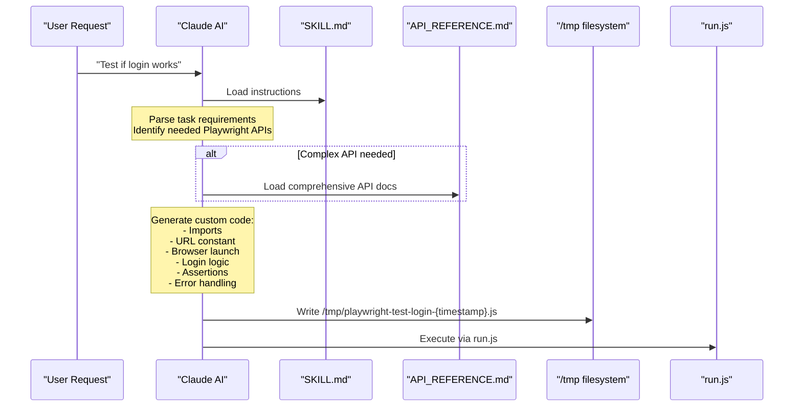
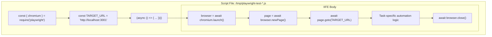
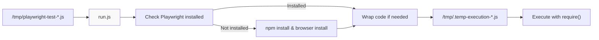

<!-- source: DeepWiki mcp.deepwiki.com · repo lackeyjb/playwright-skill · page 5.1 Writing Automation Scripts · fetched 2026-10-26 -->

# Writing Automation Scripts

<details>
<summary>Relevant source files</summary>

The following files were used as context for generating this wiki page:

- [API_REFERENCE.md](API_REFERENCE.md)
- [README.md](README.md)
- [skills/playwright-skill/SKILL.md](skills/playwright-skill/SKILL.md)

</details>


## Purpose and Scope

This document provides a technical guide to writing Playwright automation scripts within the playwright-skill system. It covers the fundamental patterns for script structure, locator strategies, actions, assertions, and error handling. This page focuses on the code-writing aspects of automation scripts.

For information about common automation workflows and end-to-end testing patterns, see [Common Automation Patterns](#5.2). For debugging techniques and troubleshooting, see [Debugging and Troubleshooting](#5.4). For comprehensive API details, see [Playwright Core API](#6.1).

## Custom Code Generation vs Templates

The playwright-skill system operates on a **custom code generation** model rather than template-based automation. Claude analyzes each user request and writes purpose-specific Playwright code tailored to the task.

**Key Characteristics:**
- Each automation script is written from scratch for the specific request
- No predefined test templates or boilerplate
- Scripts are parameterized with detected or user-provided URLs
- Code includes task-specific logic, selectors, and assertions
- Generated code is written to `/tmp/playwright-test-*.js` to avoid project clutter



**Sources:** [skills/playwright-skill/SKILL.md:1-45](), [README.md:10-16](), [skills/playwright-skill/SKILL.md:399-407]()

## Script Structure and Anatomy

### Basic Structure

Every generated script follows a consistent anatomical structure with five core components:

| Component | Purpose | Required |
|-----------|---------|----------|
| Imports | Load Playwright library | Yes |
| URL Constant | Parameterize target URL | Yes for localhost |
| IIFE Wrapper | Async execution context | Yes |
| Automation Logic | Task-specific actions | Yes |
| Browser Cleanup | Close browser resources | Yes |



**Sources:** [skills/playwright-skill/SKILL.md:64-90](), [skills/playwright-skill/SKILL.md:96-118]()

### Required Imports

Scripts always begin with Playwright library imports:

```javascript
const { chromium } = require('playwright');
```

For scripts using helper functions:

```javascript
const { chromium } = require('playwright');
const helpers = require('./lib/helpers');
```

**Sources:** [skills/playwright-skill/SKILL.md:67](), [skills/playwright-skill/SKILL.md:302]()

### URL Parameterization Pattern

URLs are **always** parameterized as a constant at the top of the script, populated from dev server detection or user input:

```javascript
// From auto-detection
const TARGET_URL = 'http://localhost:3001';

// From user input
const TARGET_URL = 'https://example.com';

// Used in navigation
await page.goto(TARGET_URL);
await page.goto(`${TARGET_URL}/login`);
```

This pattern prevents hardcoded URLs and enables easy URL substitution.

**Sources:** [skills/playwright-skill/SKILL.md:69-70](), [skills/playwright-skill/SKILL.md:31-36](), [skills/playwright-skill/SKILL.md:341-343]()

### Async IIFE Wrapper

Scripts use an Immediately Invoked Function Expression (IIFE) with async/await:

```javascript
(async () => {
  // Automation code here
})();
```

This pattern provides top-level await support without requiring module type configuration.

**Sources:** [skills/playwright-skill/SKILL.md:72-83](), [API_REFERENCE.md:84-106]()

### Browser Launch Configuration

Default launch configuration prioritizes visibility and debuggability:

```javascript
const browser = await chromium.launch({
  headless: false,  // Visible browser (default)
  slowMo: 100      // Slow down by 100ms for visibility
});
```

Headless mode is only used when explicitly requested:

```javascript
const browser = await chromium.launch({
  headless: true  // Only when user requests headless
});
```

**Sources:** [skills/playwright-skill/SKILL.md:33](), [skills/playwright-skill/SKILL.md:344-345](), [README.md:161-163]()

## Locator Strategies

### Strategy Hierarchy

The skill follows a strict hierarchy of locator strategies, from most to least preferred:

```mermaid
graph TD
    NL["Natural Language Request"]
    
    NL --> DT["1. data-testid attributes"]
    NL --> ROLE["2. getByRole() selectors"]
    NL --> TEXT["3. getByText() selectors"]
    NL --> SEM["4. Semantic HTML attributes"]
    NL --> CSS["5. CSS selectors (avoid)"]
    
    DT --> CODE1["page.locator('[data-testid=\"submit-button\"]')"]
    ROLE --> CODE2["page.getByRole('button', { name: 'Submit' })"]
    TEXT --> CODE3["page.getByText('Sign in')"]
    SEM --> CODE4["page.locator('button[type=\"submit\"]')"]
    CSS --> CODE5["page.locator('.btn-primary') // Fragile"]
    
    style DT fill:#f9f9f9
    style ROLE fill:#f9f9f9
```

**Sources:** [API_REFERENCE.md:136-161]()

### Data Attributes (Preferred)

Data attributes provide the most stable selectors:

```javascript
// data-testid (most common)
await page.locator('[data-testid="submit-button"]').click();
await page.locator('[data-testid="user-input"]').fill('text');

// data-cy (Cypress convention)
await page.locator('[data-cy="login-form"]');
```

These selectors are immune to styling changes and maintainable across refactors.

**Sources:** [API_REFERENCE.md:138-140]()

### Role-Based Selectors

Playwright's `getByRole()` provides accessible, semantic selectors:

```javascript
// Buttons
await page.getByRole('button', { name: 'Submit' }).click();
await page.getByRole('button', { name: /sign in/i }).click();

// Form controls
await page.getByRole('textbox', { name: 'Email' }).fill('user@example.com');
await page.getByRole('checkbox', { name: 'I agree' }).check();

// Headings
await page.getByRole('heading', { level: 1 });
await page.getByRole('heading', { name: 'Welcome' });

// Links
await page.getByRole('link', { name: 'Documentation' }).click();
```

**Sources:** [API_REFERENCE.md:142-145](), [skills/playwright-skill/SKILL.md:136]()

### Text Content Selectors

Text-based selectors work well for unique content:

```javascript
// Exact text
await page.getByText('Sign in').click();

// Regex matching (case-insensitive)
await page.getByText(/welcome back/i).click();

// Partial text
await page.getByText('Submit', { exact: false });
```

**Sources:** [API_REFERENCE.md:147-149]()

### Semantic HTML Selectors

Use HTML attributes when data-testid and roles are unavailable:

```javascript
// Form field names
await page.locator('input[name="email"]').fill('test@test.com');
await page.locator('input[name="password"]').fill('secret');

// Button types
await page.locator('button[type="submit"]').click();

// Input types
await page.locator('input[type="checkbox"]').check();
```

**Sources:** [API_REFERENCE.md:151-153](), [skills/playwright-skill/SKILL.md:134-136]()

### Locators to Avoid

Avoid class-based and ID-based selectors as they are fragile:

```javascript
// AVOID: CSS classes (change frequently)
await page.locator('.btn-primary').click();
await page.locator('.form-control').fill('text');

// AVOID: IDs (may not be unique or stable)
await page.locator('#submit').click();

// AVOID: Complex CSS selectors (brittle)
await page.locator('div.container > form > button').click();
```

**Sources:** [API_REFERENCE.md:155-160]()

### Advanced Locator Patterns

Complex scenarios use chaining and filtering:

```javascript
// Filter by text content
const row = page.locator('tr').filter({ hasText: 'John Doe' });
await row.locator('button').click();

// Nth element
await page.locator('button').nth(2).click();
await page.locator('li').first().click();
await page.locator('li').last().click();

// Parent navigation
const cell = page.locator('td').filter({ hasText: 'Active' });
const row = cell.locator('..');
await row.locator('button.edit').click();
```

**Sources:** [API_REFERENCE.md:165-180]()

## Common Actions

### Form Interactions

#### Text Input

```javascript
// Basic fill
await page.getByLabel('Email').fill('user@example.com');
await page.locator('input[name="username"]').fill('testuser');

// Clear and type with delay
await page.locator('#username').clear();
await page.locator('#username').type('newuser', { delay: 100 });

// Using helper function
await helpers.safeType(page, '#username', 'testuser');
```

**Sources:** [API_REFERENCE.md:187-193](), [skills/playwright-skill/SKILL.md:312](), [skills/playwright-skill/SKILL.md:160-162]()

#### Checkboxes and Radio Buttons

```javascript
// Check/uncheck
await page.getByLabel('I agree').check();
await page.getByLabel('Subscribe').uncheck();

// Radio button selection
await page.getByLabel('Option 2').check();

// Verify state
const isChecked = await page.locator('input[type="checkbox"]').isChecked();
```

**Sources:** [API_REFERENCE.md:195-200]()

#### Dropdowns

```javascript
// By value
await page.selectOption('select#country', 'usa');

// By label
await page.selectOption('select#country', { label: 'United States' });

// By index
await page.selectOption('select#country', { index: 2 });

// Multi-select
await page.selectOption('select#colors', ['red', 'blue', 'green']);
```

**Sources:** [API_REFERENCE.md:202-208]()

#### File Uploads

```javascript
// Single file
await page.setInputFiles('input[type="file"]', 'path/to/file.pdf');

// Multiple files
await page.setInputFiles('input[type="file"]', [
  'file1.pdf',
  'file2.pdf'
]);
```

**Sources:** [API_REFERENCE.md:210-215]()

### Mouse Actions

```javascript
// Standard clicks
await page.click('button');
await page.dblclick('button');
await page.click('button', { button: 'right' });

// Click at specific position
await page.click('button', { position: { x: 10, y: 10 } });

// Hover
await page.hover('.menu-item');

// Drag and drop
await page.dragAndDrop('#source', '#target');

// Safe click with retry
await helpers.safeClick(page, 'button.submit', { retries: 3 });
```

**Sources:** [API_REFERENCE.md:218-237](), [skills/playwright-skill/SKILL.md:309]()

### Keyboard Actions

```javascript
// Type with delay
await page.keyboard.type('Hello World', { delay: 100 });

// Key combinations
await page.keyboard.press('Control+A');
await page.keyboard.press('Control+C');
await page.keyboard.press('Control+V');

// Special keys
await page.keyboard.press('Enter');
await page.keyboard.press('Tab');
await page.keyboard.press('Escape');
await page.keyboard.press('ArrowDown');
```

**Sources:** [API_REFERENCE.md:241-256]()

### Navigation

```javascript
// Basic navigation
await page.goto(TARGET_URL);

// With wait strategy
await page.goto(TARGET_URL, {
  waitUntil: 'networkidle',
  timeout: 10000
});

// Relative paths
await page.goto(`${TARGET_URL}/login`);
await page.goto(`${TARGET_URL}/dashboard`);
```

**Sources:** [skills/playwright-skill/SKILL.md:76](), [API_REFERENCE.md:98-101]()

## Waiting Strategies

### Smart Waiting for Elements

Playwright auto-waits, but explicit waits provide better control:

```javascript
// Wait for element state
await page.locator('button').waitFor({ state: 'visible' });
await page.locator('.spinner').waitFor({ state: 'hidden' });
await page.locator('button').waitFor({ state: 'attached' });

// Wait for selector with timeout
await page.waitForSelector('.element', { timeout: 10000 });
```

**Sources:** [API_REFERENCE.md:263-267](), [skills/playwright-skill/SKILL.md:365]()

### Waiting for Navigation

```javascript
// Wait for URL change
await page.waitForURL('**/dashboard');
await page.waitForURL(url => url.pathname === '/success');

// Wait for load state
await page.waitForLoadState('networkidle');
await page.waitForLoadState('domcontentloaded');
```

**Sources:** [API_REFERENCE.md:270-275](), [skills/playwright-skill/SKILL.md:139-140]()

### Waiting for Network Activity

```javascript
// Wait for specific response
const responsePromise = page.waitForResponse('**/api/users');
await page.click('button#load-users');
const response = await responsePromise;

// Wait for request
await page.waitForRequest(request =>
  request.url().includes('/api/') && request.method() === 'POST'
);
```

**Sources:** [API_REFERENCE.md:284-292]()

### Custom Wait Conditions

```javascript
// Wait for function
await page.waitForFunction(() => document.querySelector('.loaded'));
await page.waitForFunction(
  text => document.body.innerText.includes(text),
  'Content loaded'
);
```

**Sources:** [API_REFERENCE.md:277-282]()

## Assertions and Verification

### Console Output

Scripts use `console.log()` for progress tracking and results:

```javascript
console.log('Page loaded:', await page.title());
console.log('✅ Login successful');
console.log('❌ Error:', error.message);
console.log('📸 Screenshot saved to /tmp/screenshot.png');
```

Emoji markers help identify status:
- `✅` - Success
- `❌` - Error
- `📸` - Screenshot saved

**Sources:** [skills/playwright-skill/SKILL.md:77](), [skills/playwright-skill/SKILL.md:140](), [skills/playwright-skill/SKILL.md:349]()

### Screenshots

Screenshots provide visual verification and are saved to `/tmp`:

```javascript
// Full page screenshot
await page.screenshot({
  path: '/tmp/screenshot.png',
  fullPage: true
});

// Element screenshot
await page.locator('.chart').screenshot({
  path: '/tmp/chart.png'
});

// Using helper function
await helpers.takeScreenshot(page, 'test-result');
// Saves to /tmp/test-result-{timestamp}.png
```

**Sources:** [skills/playwright-skill/SKILL.md:79-80](), [skills/playwright-skill/SKILL.md:315](), [API_REFERENCE.md:416-425]()

### Playwright Assertions

For test scripts, use Playwright's expect assertions:

```javascript
// URL verification
await expect(page).toHaveURL('/dashboard');

// Element visibility
await expect(page.locator('.message')).toBeVisible();
await expect(page.locator('.spinner')).toBeHidden();

// Text content
await expect(page.locator('h1')).toHaveText('Welcome');
await expect(page.locator('.message')).toContainText('success');

// Input values
await expect(page.locator('input')).toHaveValue('test@example.com');

// Element state
await expect(page.locator('button')).toBeEnabled();
await expect(page.locator('input')).toBeDisabled();
```

**Sources:** [API_REFERENCE.md:305-340]()

## Error Handling Patterns

### Try-Catch Blocks

All scripts include error handling to gracefully handle failures:

```javascript
const { chromium } = require('playwright');

(async () => {
  const browser = await chromium.launch({ headless: false });
  const page = await browser.newPage();

  try {
    await page.goto(TARGET_URL, {
      waitUntil: 'networkidle',
      timeout: 10000
    });

    // Automation logic here

    console.log('✅ Test completed successfully');
  } catch (error) {
    console.error('❌ Error:', error.message);
    await page.screenshot({ path: '/tmp/error-screenshot.png' });
  } finally {
    await browser.close();
  }
})();
```

The `finally` block ensures browser cleanup even on failure.

**Sources:** [skills/playwright-skill/SKILL.md:217-234](), [skills/playwright-skill/SKILL.md:348]()

### Timeout Configuration

Timeouts prevent indefinite hangs:

```javascript
// Page-level timeout
await page.goto(url, { timeout: 10000 });

// Action-level timeout
await page.locator('button').click({ timeout: 5000 });

// Custom wait timeout
await page.locator('.slow-element').waitFor({
  state: 'visible',
  timeout: 10000
});
```

**Sources:** [API_REFERENCE.md:294-298](), [skills/playwright-skill/SKILL.md:219-220]()

## Integration with run.js

### Execution Flow



**Sources:** [skills/playwright-skill/SKILL.md:42](), [skills/playwright-skill/SKILL.md:86-89]()

### Execution Command Pattern

Scripts are always executed with the `cd $SKILL_DIR &&` prefix:

```bash
cd $SKILL_DIR && node run.js /tmp/playwright-test-page.js
```

This ensures:
- Proper module resolution for `require('playwright')`
- Access to `lib/helpers.js` functions
- Correct working directory for dependencies

**Sources:** [skills/playwright-skill/SKILL.md:9-10](), [skills/playwright-skill/SKILL.md:42]()

### Module Resolution

The `run.js` executor handles module resolution automatically. Scripts can use:

```javascript
// Playwright (installed in skill directory)
const { chromium } = require('playwright');

// Helpers (relative to skill directory)
const helpers = require('./lib/helpers');
```

Without `run.js`, these imports would fail due to module path resolution issues.

**Sources:** [skills/playwright-skill/SKILL.md:357-359](), [README.md:200-202]()

### Temporary File Lifecycle

1. **Generation**: Claude writes script to `/tmp/playwright-test-*.js`
2. **Wrapping**: `run.js` creates `/tmp/.temp-execution-*.js` with necessary wrapper code
3. **Execution**: Wrapped script executes with proper module resolution
4. **Cleanup**: Temp files remain in `/tmp` for OS-level cleanup (not deleted during execution to avoid race conditions)

**Sources:** [skills/playwright-skill/SKILL.md:31](), [skills/playwright-skill/SKILL.md:41-44]()

## Script Examples by Category

### Basic Page Test

```javascript
// /tmp/playwright-test-page.js
const { chromium } = require('playwright');

const TARGET_URL = 'http://localhost:3001';

(async () => {
  const browser = await chromium.launch({ headless: false });
  const page = await browser.newPage();

  await page.goto(TARGET_URL);
  console.log('Page loaded:', await page.title());

  await page.screenshot({ path: '/tmp/screenshot.png', fullPage: true });
  console.log('📸 Screenshot saved');

  await browser.close();
})();
```

**Sources:** [skills/playwright-skill/SKILL.md:64-84]()

### Form Submission

```javascript
// /tmp/playwright-test-form.js
const { chromium } = require('playwright');

const TARGET_URL = 'http://localhost:3001';

(async () => {
  const browser = await chromium.launch({ headless: false, slowMo: 50 });
  const page = await browser.newPage();

  await page.goto(`${TARGET_URL}/contact`);

  await page.fill('input[name="name"]', 'John Doe');
  await page.fill('input[name="email"]', 'john@example.com');
  await page.fill('textarea[name="message"]', 'Test message');
  await page.click('button[type="submit"]');

  await page.waitForSelector('.success-message');
  console.log('✅ Form submitted successfully');

  await browser.close();
})();
```

**Sources:** [skills/playwright-skill/SKILL.md:147-171]()

### Responsive Design Testing

```javascript
// /tmp/playwright-test-responsive.js
const { chromium } = require('playwright');

const TARGET_URL = 'http://localhost:3001';

(async () => {
  const browser = await chromium.launch({ headless: false });
  const page = await browser.newPage();

  const viewports = [
    { name: 'Desktop', width: 1920, height: 1080 },
    { name: 'Tablet', width: 768, height: 1024 },
    { name: 'Mobile', width: 375, height: 667 }
  ];

  for (const viewport of viewports) {
    console.log(`Testing ${viewport.name}`);

    await page.setViewportSize({
      width: viewport.width,
      height: viewport.height
    });

    await page.goto(TARGET_URL);
    await page.waitForTimeout(1000);

    await page.screenshot({
      path: `/tmp/${viewport.name.toLowerCase()}.png`,
      fullPage: true
    });
  }

  console.log('✅ All viewports tested');
  await browser.close();
})();
```

**Sources:** [skills/playwright-skill/SKILL.md:238-275]()

### Link Validation

```javascript
// /tmp/playwright-test-links.js
const { chromium } = require('playwright');

const TARGET_URL = 'http://localhost:3000';

(async () => {
  const browser = await chromium.launch({ headless: false });
  const page = await browser.newPage();

  await page.goto(TARGET_URL);

  const links = await page.locator('a[href^="http"]').all();
  const results = { working: 0, broken: [] };

  for (const link of links) {
    const href = await link.getAttribute('href');
    try {
      const response = await page.request.head(href);
      if (response.ok()) {
        results.working++;
      } else {
        results.broken.push({ url: href, status: response.status() });
      }
    } catch (e) {
      results.broken.push({ url: href, error: e.message });
    }
  }

  console.log(`✅ Working links: ${results.working}`);
  console.log(`❌ Broken links:`, results.broken);

  await browser.close();
})();
```

**Sources:** [skills/playwright-skill/SKILL.md:173-206]()

---

