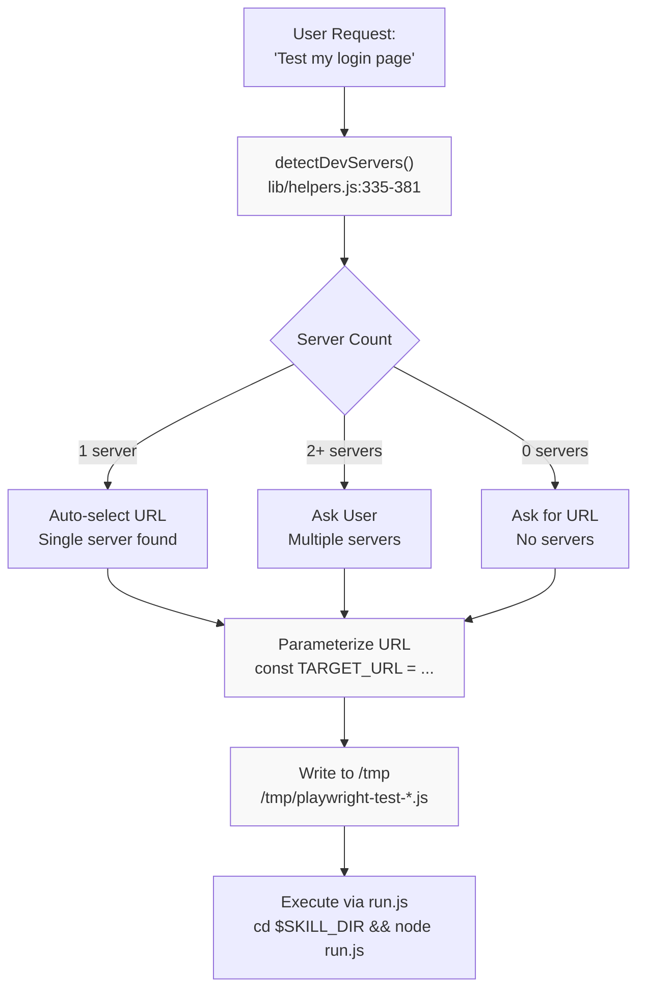
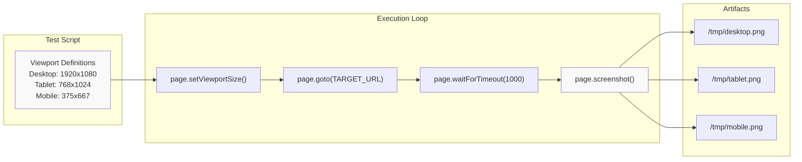
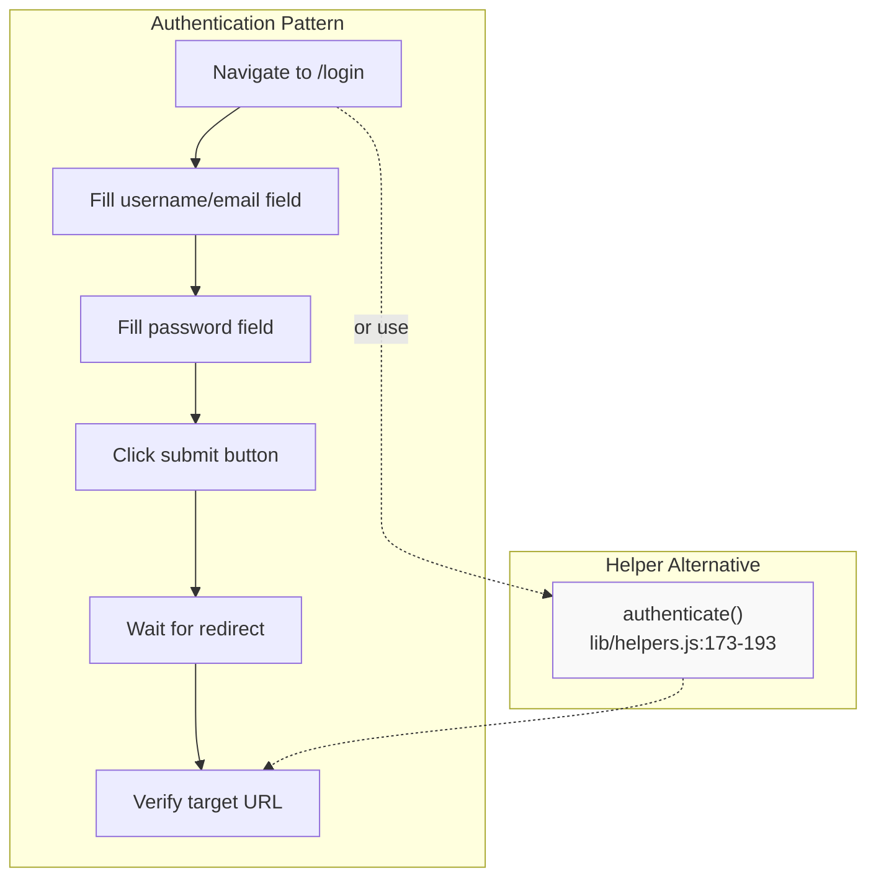
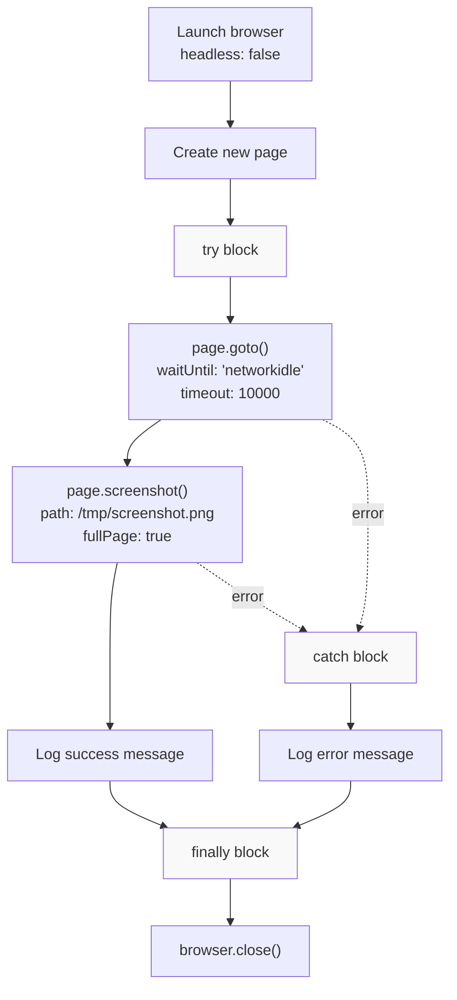
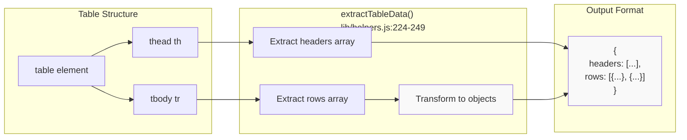
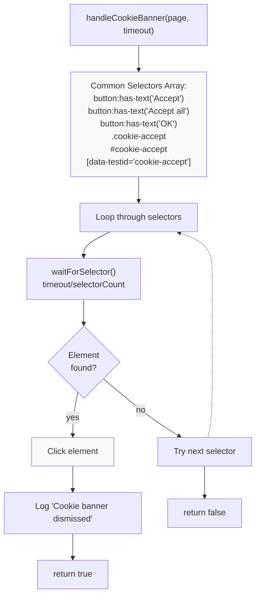
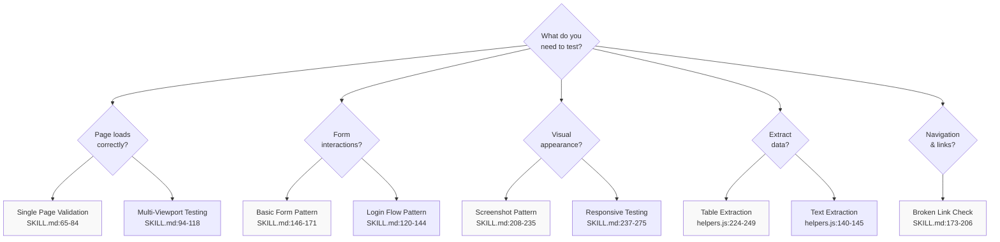
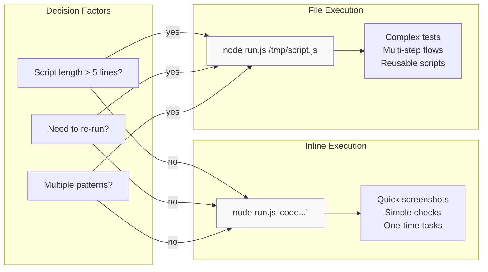

<!-- source: DeepWiki mcp.deepwiki.com · repo lackeyjb/playwright-skill · page 5.2 Common Automation Patterns · fetched 2026-10-26 -->

# Common Automation Patterns

<details>
<summary>Relevant source files</summary>

The following files were used as context for generating this wiki page:

- [API_REFERENCE.md](API_REFERENCE.md)
- [skills/playwright-skill/SKILL.md](skills/playwright-skill/SKILL.md)
- [skills/playwright-skill/lib/helpers.js](skills/playwright-skill/lib/helpers.js)

</details>


This page documents the typical automation scenarios and patterns supported by playwright-skill. Each pattern represents a common use case with concrete code examples and execution strategies.

For low-level API details and locator strategies, see [Writing Automation Scripts](#5.1). For organizing patterns into E2E test workflows, see [Testing Workflows](#5.3). For specific helper function APIs, see [Helper Functions API](#6.2).

## Scope and Purpose

This document covers:
- Pre-built automation patterns for common scenarios
- URL parameterization and dev server detection workflow
- Form interaction and authentication patterns  
- Visual testing and screenshot capture
- Data extraction from tables and elements
- Safe interaction patterns with retry logic

Each pattern references actual code implementations in [skills/playwright-skill/SKILL.md]() and [skills/playwright-skill/lib/helpers.js]().

---

## Pattern Execution Workflow

All automation patterns follow the same critical workflow to ensure clean, maintainable automation.



**Sources:** [skills/playwright-skill/SKILL.md:21-44](), [skills/playwright-skill/lib/helpers.js:335-381]()

This workflow is mandatory for all localhost testing patterns. The `detectDevServers()` function scans common ports (3000, 5173, 8080, 4200, 5000, 9000, 1234) and returns an array of detected URLs. Scripts are always written to `/tmp` to keep projects clean, and URL is always parameterized as `TARGET_URL` constant.

---

## URL Parameterization Pattern

Every automation script must parameterize the target URL rather than hardcoding it. This pattern is enforced by the workflow described in [skills/playwright-skill/SKILL.md:21-36]().

### Structure

```javascript
// CORRECT: Parameterized URL
const TARGET_URL = 'http://localhost:3001'; // From detectDevServers() or user input

(async () => {
  const browser = await chromium.launch({ headless: false });
  const page = await browser.newPage();
  
  await page.goto(TARGET_URL);
  await page.goto(`${TARGET_URL}/login`);  // Relative paths work
  
  await browser.close();
})();
```

### Detection and Selection

| Server Count | Action | Implementation |
|-------------|--------|----------------|
| 0 servers | Ask user for URL | Prompt for external URL or help start dev server |
| 1 server | Auto-select | Use detected URL automatically, inform user |
| 2+ servers | Ask user to choose | Present list, user selects which port to test |

**Sources:** [skills/playwright-skill/SKILL.md:23-29](), [skills/playwright-skill/SKILL.md:69-70](), [skills/playwright-skill/lib/helpers.js:335-381]()

---

## Page Testing Patterns

### Single Page Validation

Basic pattern for testing page load, title, and capturing screenshots.

```javascript
// /tmp/playwright-test-page.js
const { chromium } = require('playwright');
const TARGET_URL = 'http://localhost:3001';

(async () => {
  const browser = await chromium.launch({ headless: false });
  const page = await browser.newPage();
  
  await page.goto(TARGET_URL);
  console.log('Page loaded:', await page.title());
  
  await page.screenshot({ path: '/tmp/screenshot.png', fullPage: true });
  console.log('📸 Screenshot saved to /tmp/screenshot.png');
  
  await browser.close();
})();
```

**Sources:** [skills/playwright-skill/SKILL.md:65-84]()

### Multi-Viewport Testing

Tests the same page across desktop, tablet, and mobile viewports to validate responsive design.



**Sources:** [skills/playwright-skill/SKILL.md:94-118](), [skills/playwright-skill/SKILL.md:237-275]()

Implementation at [skills/playwright-skill/SKILL.md:245-275]() shows the full loop:
- Defines array of viewports with name, width, height
- Iterates through each viewport
- Resizes page with `setViewportSize()`
- Navigates to target URL
- Waits for content to settle
- Captures timestamped screenshot to `/tmp`

---

## Form Interaction Patterns

### Basic Form Filling

Standard pattern for filling and submitting forms with validation.

```javascript
// /tmp/playwright-test-form.js
const { chromium } = require('playwright');
const TARGET_URL = 'http://localhost:3001';

(async () => {
  const browser = await chromium.launch({ headless: false, slowMo: 50 });
  const page = await browser.newPage();
  
  await page.goto(`${TARGET_URL}/contact`);
  
  await page.fill('input[name="name"]', 'John Doe');
  await page.fill('input[name="email"]', 'john@example.com');
  await page.fill('textarea[name="message"]', 'Test message');
  await page.click('button[type="submit"]');
  
  await page.waitForSelector('.success-message');
  console.log('✅ Form submitted successfully');
  
  await browser.close();
})();
```

**Sources:** [skills/playwright-skill/SKILL.md:146-171]()

Key features:
- Uses `slowMo: 50` to make actions visible (line 155)
- Uses semantic selectors (`input[name="..."]`)
- Waits for success indicator before concluding (line 166)
- Relative URL paths work with `TARGET_URL` (line 158)

### Login Flow Pattern

Authenticates user and validates successful redirect.



**Sources:** [skills/playwright-skill/SKILL.md:120-144](), [skills/playwright-skill/lib/helpers.js:173-193]()

Manual implementation at [skills/playwright-skill/SKILL.md:128-141]():
```javascript
await page.goto(`${TARGET_URL}/login`);
await page.fill('input[name="email"]', 'test@example.com');
await page.fill('input[name="password"]', 'password123');
await page.click('button[type="submit"]');
await page.waitForURL('**/dashboard');
console.log('✅ Login successful, redirected to dashboard');
```

Helper implementation at [skills/playwright-skill/lib/helpers.js:173-193]() provides:
- Flexible selector matching (tries multiple common patterns)
- Automatic credential filling
- Race condition handling between navigation and success indicators
- Configurable selectors for custom forms

---

## Navigation and Link Testing

### Broken Link Detection

Checks all external links on a page and reports which are broken.

```javascript
const { chromium } = require('playwright');

(async () => {
  const browser = await chromium.launch({ headless: false });
  const page = await browser.newPage();
  
  await page.goto('http://localhost:3000');
  
  const links = await page.locator('a[href^="http"]').all();
  const results = { working: 0, broken: [] };
  
  for (const link of links) {
    const href = await link.getAttribute('href');
    try {
      const response = await page.request.head(href);
      if (response.ok()) {
        results.working++;
      } else {
        results.broken.push({ url: href, status: response.status() });
      }
    } catch (e) {
      results.broken.push({ url: href, error: e.message });
    }
  }
  
  console.log(`✅ Working links: ${results.working}`);
  console.log(`❌ Broken links:`, results.broken);
  
  await browser.close();
})();
```

**Sources:** [skills/playwright-skill/SKILL.md:173-206]()

Pattern details:
- Uses `locator('a[href^="http"]')` to find external links only (line 184)
- Uses `page.request.head()` for efficient checking without downloading full page (line 190)
- Tracks both HTTP errors (status codes) and network errors (exceptions)
- Reports results in structured format

---

## Visual Testing Patterns

### Screenshot Capture with Error Handling

Production-ready pattern with proper error handling and configuration.



**Sources:** [skills/playwright-skill/SKILL.md:208-235]()

Implementation at [skills/playwright-skill/SKILL.md:217-234]() shows:
- `waitUntil: 'networkidle'` ensures dynamic content loads (line 219)
- Explicit timeout configuration (10 seconds)
- `fullPage: true` captures entire scrollable area (line 225)
- Try-catch-finally ensures browser cleanup even on error
- Screenshots saved to `/tmp` for automatic OS cleanup

### Helper Function Alternative

The `takeScreenshot()` helper at [skills/playwright-skill/lib/helpers.js:153-165]() provides:
- Automatic timestamp generation in ISO format
- Configurable full-page capture (default: true)
- Console logging of saved filename
- Returns filename for further processing

---

## Data Extraction Patterns

### Table Data Extraction

Extracts structured data from HTML tables into JavaScript objects.



**Sources:** [skills/playwright-skill/lib/helpers.js:224-249](), [skills/playwright-skill/SKILL.md:320-322]()

Implementation at [skills/playwright-skill/lib/helpers.js:227-248]() uses `page.evaluate()` to run extraction in browser context:
- Extracts header text from `thead th` elements
- Iterates `tbody tr` rows
- Maps cell text to header names creating objects
- Falls back to array format if no headers present
- Returns structured `{ headers, rows }` object

Usage pattern:
```javascript
const helpers = require('./lib/helpers');
const data = await helpers.extractTableData(page, 'table.results');
console.log('Headers:', data.headers);
console.log('Rows:', data.rows);
```

---

## Safe Interaction Patterns

Many patterns benefit from retry logic and defensive coding. The helpers library provides utilities for robust interactions.

### Pattern Comparison Table

| Pattern | Manual Implementation | Helper Function | Key Benefit |
|---------|----------------------|-----------------|-------------|
| Click with retry | Custom retry loop + error handling | `safeClick(page, selector, {retries: 3})` | Handles timing issues automatically |
| Type with clear | `fill('')` then `fill(text)` | `safeType(page, selector, text)` | Clears field first, optional slow typing |
| Screenshot | Manual path + timestamp logic | `takeScreenshot(page, 'name')` | Auto-timestamped filenames |
| Authentication | Manual field finding + filling | `authenticate(page, credentials)` | Flexible selector matching |
| Cookie banner | Try multiple selectors manually | `handleCookieBanner(page)` | Tests common patterns automatically |

**Sources:** [skills/playwright-skill/lib/helpers.js:85-133](), [skills/playwright-skill/SKILL.md:297-324]()

### Safe Click Pattern

The `safeClick()` function at [skills/playwright-skill/lib/helpers.js:85-109]() implements:
- Waits for element to be visible with configurable timeout (line 91-94)
- Retries on failure with exponential backoff (line 89)
- Configurable retry count and delay (line 86-87)
- Force click option for special cases (line 96)
- Detailed error logging with retry attempt tracking (line 105)

Usage:
```javascript
const helpers = require('./lib/helpers');

// Basic usage with default 3 retries
await helpers.safeClick(page, 'button.submit');

// With custom options
await helpers.safeClick(page, '.dynamic-button', {
  retries: 5,
  retryDelay: 2000,
  timeout: 10000
});
```

### Safe Type Pattern

The `safeType()` function at [skills/playwright-skill/lib/helpers.js:118-133]() provides:
- Automatic field clearing before typing (line 124-126)
- Optional slow typing with configurable delay (line 128-129)
- Fast filling for most cases (line 131)
- Visibility waiting before interaction (line 119-122)

Usage:
```javascript
// Fast fill (default)
await helpers.safeType(page, '#username', 'testuser');

// Slow typing for visual verification
await helpers.safeType(page, '#username', 'testuser', {
  slow: true,
  delay: 100  // ms per character
});

// Skip clearing existing value
await helpers.safeType(page, '#search', 'query', { clear: false });
```

---

## Cookie Banner Handling

Common pattern for dismissing cookie consent banners that appear on many websites.



**Sources:** [skills/playwright-skill/lib/helpers.js:256-285](), [skills/playwright-skill/SKILL.md:318-319]()

Implementation at [skills/playwright-skill/lib/helpers.js:257-284]() uses a progressive selector strategy:
- Tests multiple common button texts and selectors
- Divides timeout among all selectors to avoid long waits
- Returns `true` if banner dismissed, `false` if none found
- Non-blocking - continues if no banner present

Usage:
```javascript
const helpers = require('./lib/helpers');

// Try to dismiss cookie banner (default 3s timeout)
await helpers.handleCookieBanner(page);

// Continue with test regardless of result
await page.goto(TARGET_URL);
```

---

## Pattern Selection Guide



**Sources:** [skills/playwright-skill/SKILL.md:92-275](), [skills/playwright-skill/lib/helpers.js:1-398]()

### When to Use Each Pattern

| Use Case | Pattern | File Reference |
|----------|---------|----------------|
| Verify page loads and take screenshot | Single Page Validation | [SKILL.md:65-84]() |
| Test across devices | Multi-Viewport Testing | [SKILL.md:94-118]() |
| Test desktop + tablet + mobile | Responsive Testing | [SKILL.md:237-275]() |
| Submit contact/registration form | Basic Form Pattern | [SKILL.md:146-171]() |
| Test authentication | Login Flow Pattern | [SKILL.md:120-144]() |
| Capture page state | Screenshot Pattern | [SKILL.md:208-235]() |
| Validate all links work | Broken Link Check | [SKILL.md:173-206]() |
| Extract table data for validation | Table Extraction | [helpers.js:224-249]() |
| Get text from multiple elements | Text Extraction | [helpers.js:140-145]() |
| Handle dynamic/flaky elements | Safe Click/Type | [helpers.js:85-133]() |
| Test site with cookie banner | Cookie Handling | [helpers.js:256-285]() |

---

## Combining Patterns

Real-world automation often combines multiple patterns. Example workflow:

```javascript
const { chromium } = require('playwright');
const helpers = require('./lib/helpers');

const TARGET_URL = 'http://localhost:3001';

(async () => {
  const browser = await chromium.launch({ headless: false, slowMo: 50 });
  const page = await browser.newPage();
  
  try {
    // Pattern 1: Navigate and handle cookie banner
    await page.goto(TARGET_URL);
    await helpers.handleCookieBanner(page);
    
    // Pattern 2: Login flow
    await helpers.authenticate(page, {
      username: 'test@example.com',
      password: 'password123'
    });
    
    // Pattern 3: Navigate to dashboard
    await page.waitForURL('**/dashboard');
    
    // Pattern 4: Extract table data
    const users = await helpers.extractTableData(page, 'table.users');
    console.log('Found users:', users.rows.length);
    
    // Pattern 5: Screenshot for verification
    await helpers.takeScreenshot(page, 'dashboard-after-login');
    
  } catch (error) {
    console.error('Test failed:', error.message);
    await helpers.takeScreenshot(page, 'error-state');
  } finally {
    await browser.close();
  }
})();
```

**Sources:** [skills/playwright-skill/SKILL.md:297-324](), [skills/playwright-skill/lib/helpers.js:173-285]()

This combined pattern uses:
- Cookie banner handling (line 12)
- Authentication helper (lines 15-18)
- URL waiting for navigation (line 21)
- Data extraction (line 24)
- Screenshot capture (line 28)
- Error handling with screenshot (line 31)

---

## Inline vs File Execution

Quick patterns can be executed inline without creating files, while complex patterns should use files.



**Sources:** [skills/playwright-skill/SKILL.md:277-296]()

Inline example from [skills/playwright-skill/SKILL.md:282-290]():
```bash
cd $SKILL_DIR && node run.js "
const browser = await chromium.launch({ headless: false });
const page = await browser.newPage();
await page.goto('http://localhost:3001');
await page.screenshot({ path: '/tmp/quick-screenshot.png', fullPage: true });
console.log('Screenshot saved');
await browser.close();
"
```

Guidelines from [skills/playwright-skill/SKILL.md:293-295]():
- **Inline**: Quick one-off tasks (screenshot, check element existence, get page title)
- **Files**: Complex tests, responsive checks, anything user might want to re-run

---

